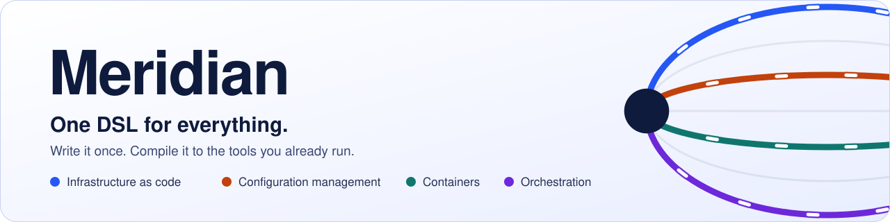

# meridian-core

<picture>
  <source media="(prefers-color-scheme: dark)" srcset="docs/branding/banner/meridian-banner-dark-animated.svg">
  
</picture>

**Documentation:** <https://zanattamichael.github.io/meridian-core/> · the same pages as the
[wiki](https://github.com/ZanattaMichael/meridian-core/wiki) · the source under [`docs/`](docs/index.md)

Meridian is one declarative language for infrastructure and configuration. A document
compiles into the native files of the tool you choose, and Meridian runs that tool to plan
and apply it. If a tool cannot do what a document asks, the compile fails and says why.

## Targets

| Plugin | Category | Compiles to | Runs with |
|---|---|---|---|
| [`ansible`](docs/targets/ansible.md) | configuration management | a playbook and inventory | `ansible-playbook` |
| [`puppet`](docs/targets/puppet.md) | configuration management | a class and node statement | `puppet apply`, or `bolt apply` for another host |
| [`salt`](docs/targets/salt.md) | configuration management | a state file and top file | `salt-call --local`, or `salt-ssh` for another host |
| [`openvox`](docs/targets/openvox.md) | configuration management | a class and node statement | OpenVox's `puppet apply`, or OpenBolt's `bolt apply` for another host |
| [`chef`](docs/targets/chef.md) | configuration management | a cookbook | `chef-client`, or `chef-run` for another host |
| [`dsc`](docs/targets/dsc.md) | configuration management | a DscPipelineRunner configuration | `Invoke-DscRunner` (DSC v2 and v3) |
| [`cloud-init`](docs/targets/cloud-init.md) | configuration management | first-boot user-data and a NoCloud seed | `cloud-init schema` to check it; the machine applies it on first boot |
| [`terraform`](docs/targets/terraform.md) | infrastructure as code | `main.tf.json` | `terraform`, or `tofu` |
| [`opentofu`](docs/targets/opentofu.md) | infrastructure as code | `main.tofu.json`, with state and plan encryption | `tofu` |
| [`cloudformation`](docs/targets/cloudformation.md) | infrastructure as code | a template | `aws cloudformation` change sets |
| [`bicep`](docs/targets/bicep.md) | infrastructure as code | `main.bicep` | `az deployment group` |
| [`arm`](docs/targets/arm.md) | infrastructure as code | an ARM JSON template | `az deployment group`, or `az deployment sub` |
| [`packer`](docs/targets/packer.md) | infrastructure as code (image building) | `build.pkr.json` | `packer` |
| [`pulumi`](docs/targets/pulumi.md) | infrastructure as code | a Pulumi YAML program | `pulumi preview`, `pulumi up` |
| [`docker`](docs/targets/docker.md) | containerization | a Compose file | `docker compose` |
| [`podman`](docs/targets/podman.md) | containerization | Quadlet units | `systemctl` and `podman`, over `ssh` for another host |
| [`kubernetes`](docs/targets/kubernetes.md) | container orchestration | manifests | `kubectl apply` |
| [`helm`](docs/targets/helm.md) | container orchestration | a Helm chart, with an optional Kustomize overlay | `helm upgrade --install`, with `kustomize build` for an overlay |

- [Capability matrix](docs/reference/capability-matrix.md): what each target can express.
- [Quickstart](docs/quickstart/install.md), and an example per target in [`examples/`](examples).
- [Common infrastructure types](docs/reference/dsl/common-infrastructure-types.md): `network`,
  `subnet`, `firewall`, `address`, `vm`, `disk` and `objectStore` compile for Terraform and OpenTofu (AWS, Azure, Google Cloud), Pulumi (AWS, Azure),
  CloudFormation, Bicep and ARM.
- [`meridian import`](docs/operations/importing.md) converts existing Terraform, OpenTofu,
  Ansible, Compose, Kubernetes and DSC configuration.
- [How it fits together](docs/reference/dsl/how-it-fits-together.md) follows one document
  from file to running tool.

<p align="center"></p>

## Commands

```
meridian validate site.yaml                 # check documents without plugins
meridian plugins                            # installed plugins and their capabilities
meridian compile site.yaml --out build      # write each tool's files
meridian plan site.yaml                     # what applying would change
meridian apply site.yaml                    # apply
meridian import ./compose.yaml -o imported  # convert existing configuration
meridian test                               # run the project's tests
meridian fmt . / meridian lint .            # format and lint
meridian lsp / meridian mcp                 # language server, MCP server
```

- Runs are locked, recorded, resumable (`apply --resume`) and can roll back. `adopt` takes an
  existing thing under management ([adopting what exists](docs/reference/dsl/resources.md#adopting-what-exists));
  `meridian retarget` moves a document to another tool ([retargeting](docs/operations/retargeting.md));
  `meridian destroy` removes what was applied, last stage first ([destroying](docs/operations/destroying.md)).
  See [running safely](docs/concepts/run-safety.md) and [policy checks](docs/reference/policy.md).
- `--analyze checkov,trivy` scans the compiled files and shows each finding at its document
  line ([analyzers](docs/reference/analyzers.md)).
- `--report` writes JUnit, JSON, Markdown, HTML or SARIF; `--sink` streams events. See
  [reports](docs/reference/reporting.md).
- In CI, a job runs `meridian apply`; `plan --out` and `apply --plan` apply exactly what was
  reviewed. See [running in a pipeline](docs/operations/running-in-a-pipeline.md) and
  [a saved plan](docs/operations/pull-requests.md).
- Editor support: [tools for writing documents](docs/tooling/index.md), the
  [VS Code extension](docs/tooling/vscode.md), and tool types from `meridian schema sync` or
  signed [schema bundles](docs/tooling/schema-bundles.md).


<p align="center"></p>

## Build and test

```
cargo build --workspace
cargo test --workspace
cargo clippy --workspace --all-targets -- -D warnings
cargo fmt --all --check
python3 tools/check_links.py
```

The core is under `crates/`, plugins under `plugins/`. Plugins are separate processes that
speak the gRPC protocol in [`proto/`](proto/meridian/plugin/v1/plugin.proto). See
[`CONTRIBUTING.md`](CONTRIBUTING.md) for the layout and
[real-tool tests](docs/contributing/real-tool-tests.md) for what runs against real tools.

## Contributing

Read [`CONTRIBUTING.md`](CONTRIBUTING.md), then pick a
[`good first issue`](https://github.com/ZanattaMichael/meridian-core/issues?q=is%3Aissue+is%3Aopen+label%3A%22good+first+issue%22).
To add a tool, run `python3 tools/new_plugin.py <name>` and follow
[Writing a plugin](docs/contributing/writing-a-plugin.md). Follow the
[Code of Conduct](CODE_OF_CONDUCT.md). Report security issues through [`SECURITY.md`](SECURITY.md).
