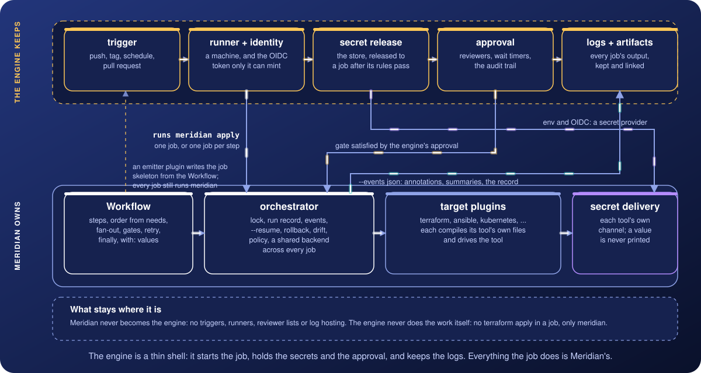
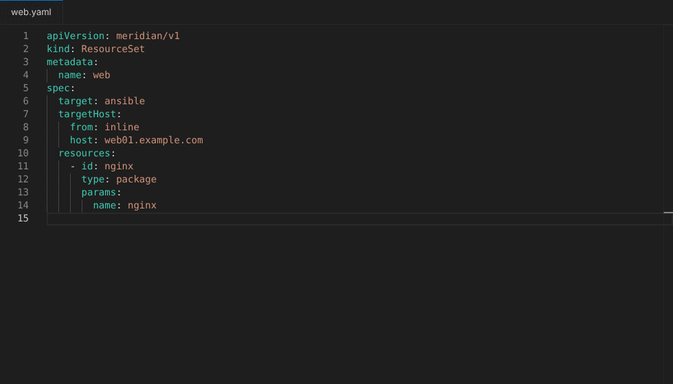

# meridian-core

<picture>
  <source media="(prefers-color-scheme: dark)" srcset="docs/branding/banner/meridian-banner-dark-animated.svg">
  
</picture>

**Documentation:** <https://zanattamichael.github.io/meridian-core/> · the same pages as the
[wiki](https://github.com/ZanattaMichael/meridian-core/wiki) · the source under [`docs/`](docs/index.md)

Meridian is one declarative language for infrastructure and configuration. You write a
document once. Meridian compiles it into the native files of the tool you choose, then runs
that tool to plan and apply it.

Meridian compiles and orchestrates. It does not replace the tools: Ansible still runs the
playbook, Puppet still applies the catalog. If a tool cannot do what a document asks,
the compile fails and says why. Meridian never emits output that quietly does less.

## Status

Early and moving fast. Specifications are in [`docs/`](docs/index.md); start with the
[design plan](docs/plans/design-plan.md), or with
[How it fits together](https://zanattamichael.github.io/meridian-core/reference/dsl/how-it-fits-together.html),
which follows one document from file to running tool.

| Plugin | Category | Compiles to | Runs with |
|---|---|---|---|
| [`ansible`](docs/targets/ansible.md) | configuration management | a playbook and inventory | `ansible-playbook` |
| [`puppet`](docs/targets/puppet.md) | configuration management | a class and node statement | `puppet apply`, or `bolt apply` for another host |
| [`salt`](docs/targets/salt.md) | configuration management | a state file and top file | `salt-call --local`, or `salt-ssh` for another host |
| [`openvox`](docs/targets/openvox.md) | configuration management | a class and node statement | OpenVox's `puppet apply`, or OpenBolt's `bolt apply` for another host |
| [`chef`](docs/targets/chef.md) | configuration management | a cookbook | `chef-client`, or `chef-run` for another host |
| [`dsc`](docs/targets/dsc.md) | configuration management | a DscPipelineRunner configuration | `Invoke-DscRunner` (DSC v2 and v3) |
| [`cloud-init`](docs/targets/cloud-init.md) | configuration management | first-boot user-data and a NoCloud seed | `cloud-init schema` to check it; the machine applies it on first boot |
| [`terraform`](docs/targets/terraform.md) | infrastructure as code | `main.tf.json` | `terraform`, or `tofu` |
| [`opentofu`](docs/targets/opentofu.md) | infrastructure as code | `main.tofu.json`, with state and plan encryption | `tofu` |
| [`cloudformation`](docs/targets/cloudformation.md) | infrastructure as code | a template | `aws cloudformation` change sets |
| [`bicep`](docs/targets/bicep.md) | infrastructure as code | `main.bicep` | `az deployment group` |
| [`arm`](docs/targets/arm.md) | infrastructure as code | an ARM JSON template | `az deployment group`, or `az deployment sub` |
| [`packer`](docs/targets/packer.md) | infrastructure as code (image building) | `build.pkr.json` | `packer` |
| [`pulumi`](docs/targets/pulumi.md) | infrastructure as code | a Pulumi YAML program | `pulumi preview`, `pulumi up` |
| [`docker`](docs/targets/docker.md) | containerization | a Compose file | `docker compose` |
| [`podman`](docs/targets/podman.md) | containerization | Quadlet units | `systemctl` and `podman`, over `ssh` for another host |
| [`kubernetes`](docs/targets/kubernetes.md) | container orchestration | manifests | `kubectl apply` |
| [`helm`](docs/targets/helm.md) | container orchestration | a Helm chart, with an optional Kustomize overlay | `helm upgrade --install`, with `kustomize build` for an overlay |

- **What each plugin can express:** the generated [capability matrix](docs/reference/capability-matrix.md).
- **Getting started:** the [quickstart](docs/quickstart/install.md), and a worked example
  for every plugin under [`examples/`](examples).
- **Existing configuration:** `meridian import` turns Terraform, OpenTofu, Ansible, Compose,
  Kubernetes and DSC configuration into documents and marks what it could not carry over.
  See [importing existing configuration](docs/operations/importing.md).

## The `meridian` command

```
cargo build --workspace
meridian validate site.yaml                 # check documents, load no plugin
meridian plugins                            # what is installed, and what each can do
meridian compile site.yaml --out build      # write each target's own files; change nothing
meridian plan site.yaml                     # ask each tool what applying would change
meridian apply site.yaml                    # make it so
meridian import ./compose.yaml -o imported  # turn a tool's existing configuration into documents
meridian test                               # run the project's own tests: compile and plan, then check
```

Plugins are found beside the `meridian` binary, or in `--plugin-dir` / `MERIDIAN_PLUGIN_DIR`.
Tool working files and Meridian's run-state live under `--state-dir` (default `.meridian`).

### Running safely

- `plan` and `apply` hold a lock on the state, so two runs cannot collide.
- Every run is recorded. `meridian status` shows the last one step by step.
- `meridian apply --resume` continues a failed apply from the stage that failed.
- `--on-failure rollback` and `meridian rollback` undo what an apply changed.
- `meridian drift` reports whether what was applied is still there.
- `--policy` asks an Open Policy Agent (Rego) policy about each change first. A denied apply
  changes nothing. See [policy checks](docs/reference/policy.md).
- `--backend` keeps the record in a shared place.

See [running safely](docs/concepts/run-safety.md).

### Reports

`--report junit=FILE` (or `json`, `markdown`, `html`) writes a report when the run ends.
`meridian report` writes one for any recorded run. `--sink NAME` streams the run's events to
a forwarding program. Reports name steps, resources and outputs, never values. See
[reports and sinks](docs/reference/reporting.md). The optional
[`meridian-report-server`](docs/reference/report-server.md) collects every project's runs
through a sink.

### In a pipeline

Any pipeline engine runs Meridian as one job, with no plugin: the job runs `meridian apply`.
In GitHub Actions and Azure Pipelines a refused document shows on the pull request at its
line, and the report becomes the job summary. On Buildkite the report is an annotation.
[Running Meridian in a pipeline](docs/operations/running-in-a-pipeline.md) has a tested
GitHub Actions workflow, a snippet for each other engine, the split between engine and
Meridian, and how the job's identity is checked before anything runs.

What reviewers approved is what gets applied. `meridian plan --out` saves the plan, two
actions post it on the pull request and apply it after approval, and `meridian apply --plan`
refuses if anything changed since ([a saved plan](docs/operations/pull-requests.md)).

<p align="center"></p>

### Workflows across tools

A workflow runs its Infrastructure documents first, then its ResourceSets. A ResourceSet
whose `targetHost` comes from an Infrastructure output is compiled for, and applied to,
that output's value; until the infrastructure is applied it is reported as deferred.

`spec.imports` hands a document a value from another document: an output, or a file it
compiles to (for example cloud-init user-data for the machine Terraform creates). The value
reaches the tool as the tool's own variable, and the documents run in the order that needs.
Values a tool marks sensitive are masked everywhere Meridian prints.

## Editor support

The editor tools are built from the compiler, so an editor never accepts what
`meridian compile` refuses:

```
meridian fmt .                              # one standard layout; never changes a value
meridian lint --strict .                    # every error in a project, plus probable mistakes
meridian schema -o meridian.schema.json     # a JSON Schema, for editors that only know YAML
meridian schema sync .                      # cache each tool's own types, for completion and checking
meridian lsp                                # the language server, started by your editor
meridian mcp                                # the MCP server, started by an AI client
```



The language server gives completion, hover docs, live errors, go to definition, rename,
formatting and quick fixes. Resource types and params come from the installed plugins. A
tool's own types (`aws_instance`, `apps/v1/Deployment`) are read once by
`meridian schema sync` and cached in the project. There is a
[Visual Studio Code extension](docs/tooling/vscode.md) in [`editors/vscode`](editors/vscode)
and recipes for [other editors](docs/tooling/other-editors.md). Start at
[Tools for writing Meridian documents](docs/tooling/index.md).

## Layout

The core is a Cargo workspace under `crates/`:

- `meridian-ir`: parses and validates documents
- `meridian-yaml`: YAML scalar rules and a deterministic writer, shared by the parser and YAML-emitting plugins
- `meridian-resolve`: hierarchical data resolution
- `meridian-module`: modules: the `meridian.yaml` manifest, path, git and OCI sources, version
  resolution, `meridian.lock` and content hashes
- `meridian-test`: [`meridian test`](docs/reference/testing.md): `Test` documents that compile or plan documents with given data and check the result
- `meridian-rules`: [compile rules](docs/concepts/compile-rules.md): policies over the layers of a hierarchy, checked before compiling (for example "a more specific layer may not change a variable a less specific layer set")
- `meridian-graph`: dependency graph and topological sort
- `meridian-ast`: the target-agnostic resource tree every plugin consumes
- `meridian-value`: the dynamic value type and its canonical JSON form
- `meridian-sdk`: what plugins build against: the `Emitter`, `Runner` and `Importer` traits,
  `serve`, wire conversion, and helpers for running command-line tools
- `meridian-import`: shared importer code: line-preserving YAML and HCL readers, the document
  writer with `TODO` markers, and the semantic diff used by round-trip tests
- `meridian-plugin-host`: launches, discovers and drives plugins
- `meridian-orchestrator`: runs a workflow: compiles each document, drives its tool, passes
  outputs between stages, stops on the first failure
- `meridian-tooling`: shared editor code: formatter, linter, completion, hover, navigation and
  JSON Schema export, all read from the parser's field tables and the plugins' declarations
- `meridian-lsp`: the language server
- `meridian-mcp`: the MCP server: the compiler and catalogue as tools for an AI model
- `meridian-cli`: the `meridian` command
- `meridian-policy-opa`: the Open Policy Agent engine behind `--policy`
- `meridian-target-fake`: a small complete plugin whose tool is a directory; used by tests and
  a worked example of the SDK
- `meridian-plugin-testkit`: shared test code for first-party plugins
- `meridian-plugin-template`: the working plugin that `tools/new_plugin.py` copies

Plugins live under `plugins/`, one crate each, built as `meridian-target-<name>`. A plugin
depends on `meridian-sdk` (and `meridian-yaml` / `meridian-import` where needed), never on
the compiler. Third-party plugins are in the same position.

A plugin is a separate process. The host launches it, reads one handshake line giving its
address (a Unix socket, or a named pipe on Windows), agrees a protocol version, then talks
gRPC. The host can check the binary's [signature](docs/reference/plugin-signatures.md) first;
a released `meridian` starts only the plugins it shipped with unless told to trust another
key. The protocol is in [`proto/`](proto/meridian/plugin/v1/plugin.proto), so plugins can be
written in any language. Do not run a plugin by hand: its stdout carries the protocol, and it
exits when the host closes its stdin.

Every plugin compiles in four stages:

1. **transform**: map each resource to the tool's vocabulary, or refuse it
2. **sort**: apply the tool's ordering rules
3. **validate**: check the tool's own constraints
4. **emit**: serialise

Running the tool is a separate half of the plugin, so compiling has no side effects. An
optional third half imports: it reads existing configuration and returns documents, which
`meridian import` writes out.

## Tests

```
cargo test --workspace
cargo clippy --workspace --all-targets -- -D warnings
cargo fmt --all --check
python3 tools/check_links.py
```

Each plugin compiles the shared documents in `fixtures/` and its own examples, and compares
the output byte for byte with golden files in `plugins/<name>/testdata`. Refusals are golden
files too, since their wording is output. Set `UPDATE_GOLDEN=1` to re-record after a
deliberate change. Runners are tested against stand-ins, so the suite needs only Rust.
Seventeen of the eighteen targets are also tested against the real tool, each in its own
workflow; [real-tool tests](docs/contributing/real-tool-tests.md) lists what each runs and
what it cannot prove.

## Contributing

Contributions are welcome, and a first one can be small.

1. Read [`CONTRIBUTING.md`](CONTRIBUTING.md): setup, layout, and what a pull request needs.
2. Pick an issue labelled
   [`good first issue`](https://github.com/ZanattaMichael/meridian-core/issues?q=is%3Aissue+is%3Aopen+label%3A%22good+first+issue%22)
   or [`help wanted`](https://github.com/ZanattaMichael/meridian-core/issues?q=is%3Aissue+is%3Aopen+label%3A%22help+wanted%22),
   or a tool Meridian does not support yet.
3. To add a tool, run `python3 tools/new_plugin.py <name>` and follow
   [Writing a plugin](docs/contributing/writing-a-plugin.md). The template already builds and
   passes its tests.
4. Open a pull request. A draft is fine.

Follow the [Code of Conduct](CODE_OF_CONDUCT.md). Report security issues through
[`SECURITY.md`](SECURITY.md), not the issue tracker.
