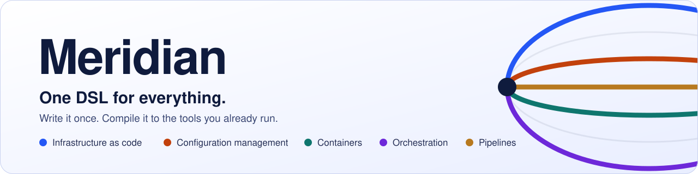

# Meridian branding

The logo family for Meridian core and its plugins. The idea behind every mark is the
project's own: one DSL for everything.

| Module | Logo | Category |
| --- | --- | --- |
| Core |  | Platform |
| Terraform |  | Infrastructure as code |
| OpenTofu |  | Infrastructure as code |
| Bicep |  | Infrastructure as code |
| CloudFormation |  | Infrastructure as code |
| ARM templates |  | Infrastructure as code |
| Packer |  | Infrastructure as code |
| Pulumi |  | Infrastructure as code |
| DSC |  | Configuration management |
| Ansible |  | Configuration management |
| Puppet |  | Configuration management |
| OpenVox |  | Configuration management |
| Chef |  | Configuration management |
| Salt |  | Configuration management |
| cloud-init |  | Configuration management |
| Docker |  | Containers |
| Podman |  | Containers |
| Kubernetes |  | Orchestration |
| Helm with Kustomize |  | Orchestration |

## The system

- **The white point** at the top of the globe is the single DSL. It appears in every mark.
- **The core mark** is a globe drawn from four meridians, one per plugin category, all
  meeting at that point.
- **Plugin marks** keep the same tile, globe and point. Only the glyph changes, drawn in
  its category's colour.
- The glyphs are original. They deliberately do not reuse any vendor's logo, so they can
  ship with the project without trademark concerns.

## Colours

| Use | Colour |
| --- | --- |
| Tile gradient | `#22357A` to `#0A112B` |
| Globe, point | `#FFFFFF` |
| Infrastructure as code | `#6F9BFF` |
| Configuration management | `#FF8A4C` |
| Containers | `#35D0C2` |
| Orchestration | `#B48CFF` |

## Files

Each module has two files in [`logos/`](logos/), drawn on a 64 by 64 grid:

- `meridian-<module>.svg` is the full-colour tile.
- `meridian-<module>-mono.svg` has no tile and uses `currentColor`, for single-colour
  contexts such as dark surfaces, terminals and print.

The core mark also has an animated copy, `meridian-core-animated.svg`:

A point of light leaves the white point and travels down each of the four meridians in
turn. It is the still file with four overlays added by
[`tools/wiki/graphics.py`](../../tools/wiki/graphics.py), which writes it; it is not
edited by hand. The motion is CSS inside the file, so it plays wherever the file is
shown as an image, and it is turned off for a reader whose system asks for less motion
(`prefers-reduced-motion: reduce`), who sees the still mark. The documentation site shows
it in its top bar. Use the still file where a mark should not move: a favicon, print, a
plugin's own page, the plugin map.

## Banner

<picture>
  <source media="(prefers-color-scheme: dark)" srcset="banner/meridian-banner-dark.svg">
  
</picture>

The banner opens the core mark out across a 1280 by 320 canvas: the four category
meridians all leave the single point that stands for the DSL. It sits at the top of the
repository README and the documentation home page.

- [`banner/meridian-banner-dark.svg`](banner/meridian-banner-dark.svg) is for dark
  backgrounds.
- [`banner/meridian-banner-light.svg`](banner/meridian-banner-light.svg) is for light
  backgrounds, and uses the deeper category colours so they keep their contrast.
- `meridian-banner-dark-animated.svg` and `meridian-banner-light-animated.svg` are the
  same two with the travelling light, written by `tools/wiki/graphics.py` from the still
  files in the same way as the core mark. The README and the documentation home page show
  these; the still files are for a place where nothing should move.

Use both through a `<picture>` element with a `prefers-color-scheme` source, as the README
does, so each reader gets the one that matches their theme.

## The explanatory graphics

The pictures under [`docs/graphics/`](../graphics/) that explain the architecture, the
path of a document, the two stages, secrets, runs and modules use the same tile, colours
and type as the marks, and the same motion. They are drawn by `tools/wiki/graphics.py`,
as [how the documentation is published](../contributing/documentation-site.md#the-graphics)
describes.

## Adding a logo for a new plugin

Copy an existing plugin file from the same category, keep the tile, ring, faint meridians
and white point unchanged, and replace only the glyph group. Keep the glyph to simple
3.5 unit round-capped strokes so it stays legible at 16 px, and use the category colour
from the table above.
