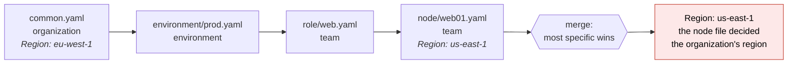
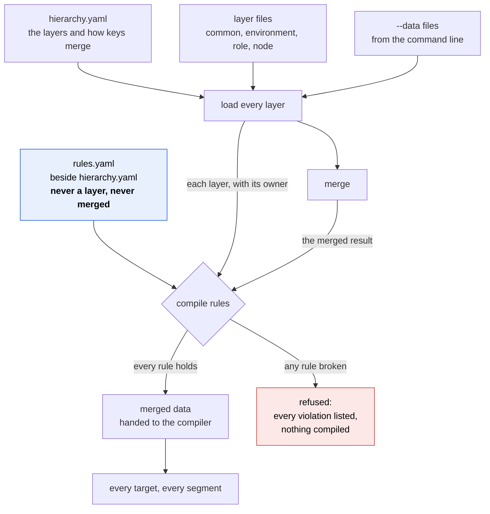
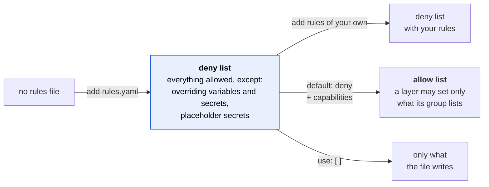
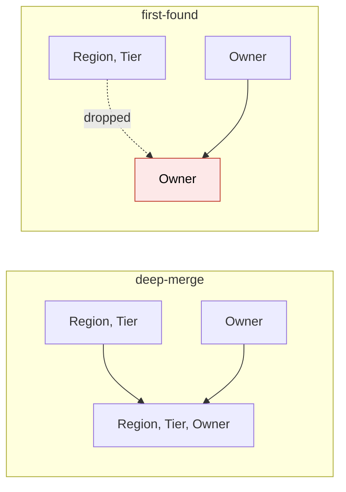

# Compile rules

A hierarchy says **how** layers of configuration merge. Compile rules say what
each layer is **allowed** to do in that merge. They are checked before
compiling and are the same for every target. A configuration that breaks one is
refused with a message naming the rule, the layer and the key.

The founding rule comes from
[DscPipelineRunner](https://github.com/ZanattaMichael/Dsc.PipelineRunner):
**a more specific file cannot overwrite a variable or secret that a less
specific file set.** The organization's baseline stays fixed, whatever a team's
node file says.

This page covers the design: purpose, placement and shape. The
[reference](../reference/compile-rules.md) has every field and message.

## The problem

Layered configuration lets many people contribute to one result: an
organization baseline, environment adjustments, team roles, and per-machine
node files. The risk is that the most specific layer wins by default, so the
least-reviewed file can change anything above it.



A merge strategy cannot fix this. It decides how values combine, not who may
set them. That needs a policy.

## What DscPipelineRunner does, and what Meridian takes from it

DscPipelineRunner compiles a [Datum](https://github.com/gaelcolas/Datum) tree
of YAML files into one file per node, and its capability policy says what each
layer may use. Its ideas about where a policy lives and how layers get owners
carry over directly.

| DscPipelineRunner `Policy.yml` | Meridian `rules.yaml` |
|---|---|
| Sits beside `Datum.yml`. It is a file of its own, outside the hierarchy, so **no layer can add to it or override it** | Sits beside `hierarchy.yaml`. It is never a layer and never merged, and a hierarchy that lists it as a layer is refused |
| `Layers` give files owners by path. A layer is decided by **where a file is**, never by what it says, and the first layer whose paths match owns the file | `layers` (groups) give layers owners by path, first match first |
| Each layer lists its `Capabilities`; `Default: Deny` decides what it does not list | Each group lists its `capabilities`; `default: deny` decides what it does not list |
| A file no layer claims may do nothing, whatever `Default` says | The same |
| Something several layers contributed to is allowed only what every one of them is allowed | Each layer is held to its own group for every key it sets |
| Every violation is listed, nothing runs, and offending values are not logged | Every violation is listed, nothing is compiled, and a refusal never holds a value |
| `-RequirePolicy` fails a run that has no policy, and `-PolicyPath` takes the policy from somewhere contributors cannot write | `--require-rules` and `--rules FILE` |

The capabilities differ because the layers hold different things. A
DscPipelineRunner layer holds resources, so its policy governs what resources
may use: `Targets`, `Engines`, `ExecutionScripts` and
`DatumScriptBlocks`. A Meridian hierarchy layer holds data, so the capability
is `keys`: which keys a layer may set. The
[reference](../reference/compile-rules.md#from-dscpipelinerunner) puts the two
files side by side.

`Policy.yml` says what a layer may *use*. It does not stop a team file from
changing a variable the platform set, because DscPipelineRunner merges
`variables` deeply and the most specific file wins.

So a rules file has two parts:

- **Capabilities**, the `Policy.yml` model: what each group of layers may set.
- **Rules**, Meridian's addition: six kinds of declarative rule over key
  patterns and groups. The file that keeps a team out of `secrets` can also
  stop a node changing the organization's region, require each team layer to
  name an owner, or forbid a floating image tag.

## Where the rules sit



This placement has three consequences.

**The rules see layers, not only the result.** A merged value does not say who
set it, so the rules get every layer as loaded, with its owner. That is how
they can report that `node/web01.yaml` changed something `common.yaml` set.

**The rules run before any target is involved.** They check data, which is the
same whatever the tool. There are no Ansible or Terraform rules; a rule holds
for every target.

**The rules file is outside what it constrains.** If a layer could contribute
to the policy, it could switch it off. So the rules are their own file beside
the hierarchy file, and a hierarchy path that resolves to it (by name, through
`..`, or via a symbolic link) is an error.

## Ownership: groups

Groups give layers owners, and say what each owner may set:

```yaml
default: deny
layers:
  - name: organization
    paths: [common.yaml]
    capabilities:
      keys: ["**"]
  - name: environment
    paths: ["environment/*"]
    capabilities:
      keys: [variables, registry]
  - name: team
    paths: ["role/**", "node/**"]
    capabilities:
      keys: [variables, packages, web]
```

With `default: deny`, a group may set the keys it lists and nothing else, and
a group that lists none may set nothing. A team layer that declares a secret
is refused before any rule is looked at:

```
[meridian/capabilities] layer "node/web01.yaml" (team) sets "secrets.database.path", which team is not allowed to set: it may set only variables, packages, web
```

The first group whose pattern matches a layer's path owns it. Ownership goes by
path because contributors cannot choose the path of someone else's file: your
repository controls (CODEOWNERS, folder branch protection) tie folders to
teams, and groups mirror them. Nothing inside a layer can change its group.

Values from `--data` on the command line merge last and win, so every rule
checks them as the most specific layers, in a group called `(command line)`. A
protected value cannot be changed from the command line either. Capabilities do
not apply to them: the command line belongs to whoever runs the pipeline.

## The rules

| Rule | Says | Typical use |
|---|---|---|
| `no-override` | a more specific layer may not change a value a less specific layer set | the organization's variables and secrets hold |
| `final` | once a layer sets a key, no more specific layer may set it at all, even to the same value | a value decided in exactly one place |
| `restrict` | only the named groups may set a key | only the platform team declares secrets |
| `required` | a key must be set, in every layer of a group or in the merged result | every team layer names an owner |
| `forbidden-value` | a key may not hold certain values | no `:latest` image tags, no plain HTTP |
| `merge-strategy` | a key may only be merged with certain strategies | `variables` must merge deeply |

Rules are checked after capabilities and independently: permission to set
`variables` does not let a team change the organization's.

## A deny list by default

A rules file is a deny list by default: everything is allowed except what it
forbids. Adding one to an existing hierarchy does not require listing
everything every layer already sets.

An empty deny list would protect nothing, so three rule sets apply unless the
file says otherwise:

| Set | Forbids |
|---|---|
| `protect-variables` | changing a variable a less specific layer set |
| `protect-secrets` | changing a secret or a credential a less specific layer set |
| `no-placeholder-secrets` | a secret or a credential that is empty, or a placeholder such as `changeme` |



`use:` picks the shipped sets explicitly; `use: []` turns them off.
`default: deny` with `capabilities` makes the file an allow list, as
`Policy.yml` recommends for DscPipelineRunner. With no rules file nothing is
checked; `--require-rules` makes that an error.

## Rules follow the merge

Whether a layer overrode something depends on how the key merges, so the rules
ask the hierarchy. The same two layers are judged differently under different
strategies:

```yaml
# common.yaml                      # node/web01.yaml
variables:                         variables:
  Region: eu-west-1                  Owner: web-team
  Tier: gold
```

| Strategy for `variables` | What the merge does | `protect-variables` |
|---|---|---|
| `deep-merge` | the node's `Owner` is added beside `Region` and `Tier` | passes: nothing the organization set has changed |
| `first-found` | the node's `variables` **is** the answer; `Region` and `Tier` are gone | refused: the node dropped two organization variables without naming either |



So the engine does not just look for a key *written twice*. Value by value, it
works out what the more specific layer does to the less specific one:
**changed**, **restated**, **dropped**, or untouched. `no-override` refuses
changed and dropped; `final` also refuses restated. This catches the usual ways
to sneak an override through:

- replacing a mapping with `null`, a string or an empty list, which changes
  everything beneath it without naming any of it;
- setting one key of a mapping that merges by replacement, which drops the
  rest;
- replacing a protected list with a longer one;
- changing only a value's type, such as `5432` to `"5432"`;
- writing the same change in a `--data` file instead of a layer.

Each is refused, and each has a test.

The engine reduces every strategy to one of three kinds: the more specific
value **replaces** the whole, mappings merge **deep**, or lists are
**appended**. A rule needs nothing more, so a new strategy only has to say
which kind it is.

## What a refusal looks like

```
error: compile rules: 2 violations; nothing was compiled
  - [meridian/protect-variables] layer "node/web01.yaml" (team) changes "variables.Region", which layer "common.yaml" (organization) set
  - [team-layers-name-an-owner] layer "node/web01.yaml" (team) does not set "variables.Owner", which every layer of team must set
```

Every violation is listed in a fixed order, so one run shows everything to fix
and repeated runs print the same text. A refusal never includes a value: guarded
keys are the ones most likely to hold something that must not reach a pipeline
log.

## How this fits the rest of the language

**Today.** The rules are evaluated over a `hierarchy.yaml` and its layers by
[`meridian rules check`](../reference/cli.md#rules-check), which a pipeline
runs before `compile`, and by the library call `meridian_rules::enforce`. `compile`, `plan` and `apply` do not read a hierarchy yet (they take flat
`--data` files), so they do not run the rules themselves.

**With the language expansion.** The proposal in
`docs/plans/language-expansion.md` (pull request 59) moves layers into a
`Data` document, adds merge strategies, and makes `compile` resolve layered
data itself. That work calls `enforce` when layers load, so a broken rule will
then stop `compile`, `plan` and `apply` directly. The design matches that
proposal:

- its layers stay least specific first, which is the order the rules assume;
- each of its strategies maps onto replace, deep or append;
- its `--data` and `--set` values become the last layers, which the rules
  already check as `(command line)`;
- its `final:` list on a `Data` layer is the language's own way to mark a key
  final, and the `final` rule here is the same check written as policy.

**Declarations.** The proposal also declares variables, secrets and credentials
in documents, where a nearer scope may override a farther one. The engine checks
any ordered stack of layers, not just data files. Scopes form such a stack, with
keys `variables.<name>`, `secrets.<name>` and `credentials.<name>`, so
`protect-variables` and `protect-secrets` will apply to them unchanged.

## Limits

- Capabilities cover keys only. Limiting which targets, tools or scripts a
  layer's documents use (as `Policy.yml` does for DscPipelineRunner) waits until
  documents can be layered.
- The rules are not a sandbox. They check what layers say, not what a tool
  does with the result.
- Whoever can change the rules file decides what every layer may do. Protect
  `rules.yaml` and `hierarchy.yaml` with your most trusted owners, or keep the
  rules where contributors cannot write and pass `--rules`. Use
  `--require-rules` so deleting the file is an error, not a way out.
- `required` for a group checks only layers that exist. A missing file is not a
  layer, so also put `required` on the merged result when the value must exist.
- Keys are compared exactly, including case, as data is read.
  `variables.Region` and `variables.region` are different keys; a rule protects
  the one it names.
