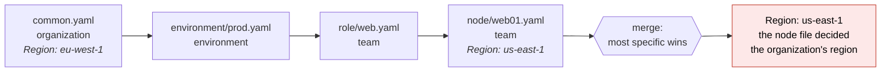
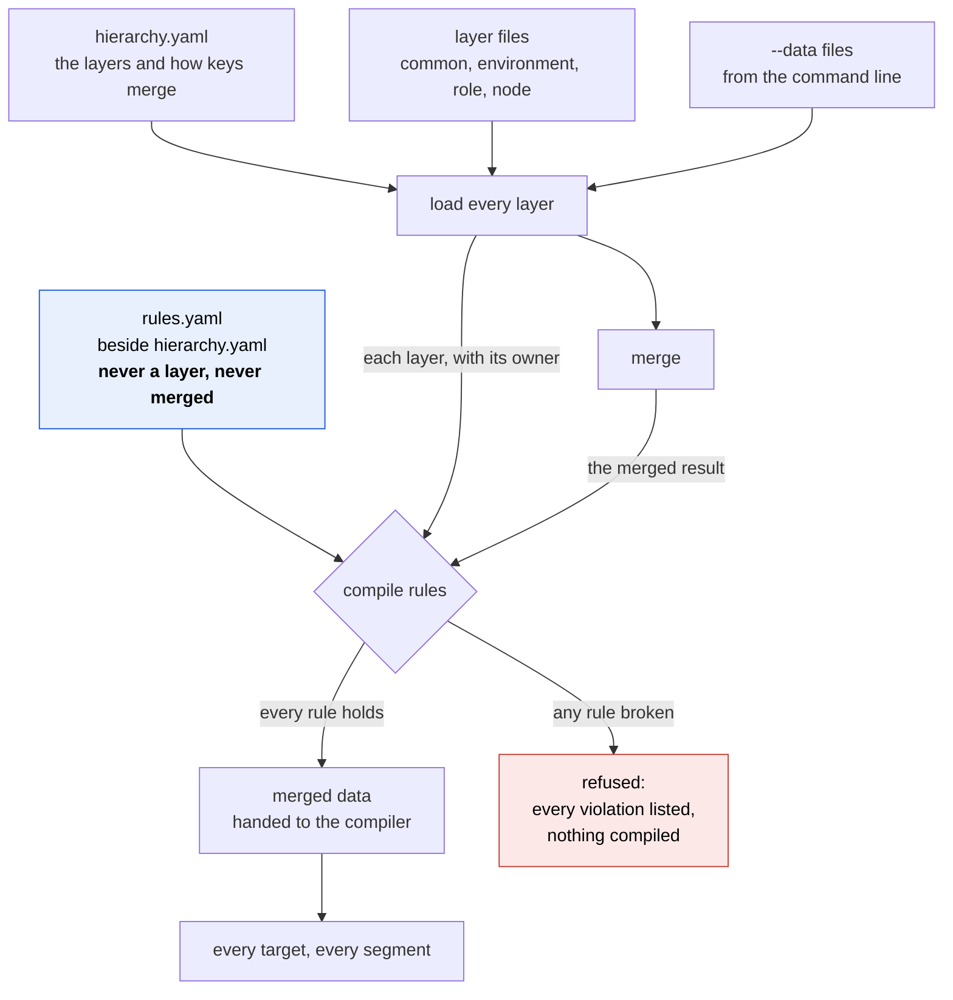
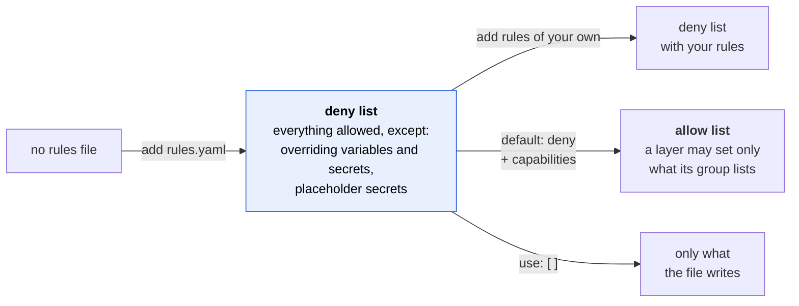
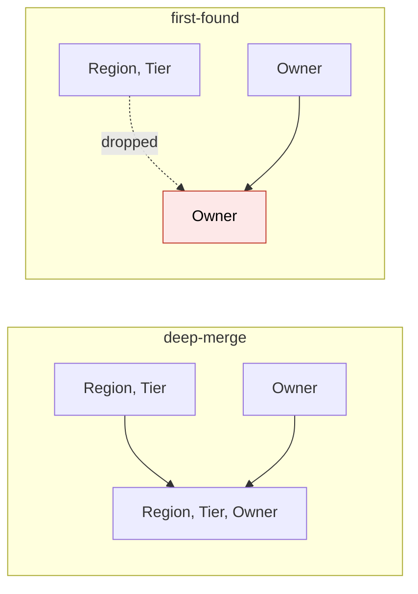

# Compile rules

Compile rules say what each layer of a hierarchy may set. They are checked before
compiling, on every target. A violation is refused with the rule, layer and key.

The default rule, from [DscPipelineRunner](https://github.com/ZanattaMichael/Dsc.PipelineRunner):
**a more specific file cannot overwrite a variable or secret a less specific file set.**

Every field and message is in the [reference](../reference/compile-rules.md).

## The problem

In a layered hierarchy the most specific layer wins, so a node file can change anything
the organization baseline set.




## What DscPipelineRunner does, and what Meridian takes from it

DscPipelineRunner compiles a [Datum](https://github.com/gaelcolas/Datum) tree into one file
per node, with a capability policy per layer. What carries over:

| DscPipelineRunner `Policy.yml` | Meridian `rules.yaml` |
|---|---|
| Sits beside `Datum.yml`. It is a file of its own, outside the hierarchy, so **no layer can add to it or override it** | Sits beside `hierarchy.yaml`. It is never a layer and never merged, and a hierarchy that lists it as a layer is refused |
| `Layers` give files owners by path. A layer is decided by **where a file is**, never by what it says, and the first layer whose paths match owns the file | `layers` (groups) give layers owners by path, first match first |
| Each layer lists its `Capabilities`; `Default: Deny` decides what it does not list | Each group lists its `capabilities`; `default: deny` decides what it does not list |
| A file no layer claims may do nothing, whatever `Default` says | The same |
| Something several layers contributed to is allowed only what every one of them is allowed | Each layer is held to its own group for every key it sets |
| Every violation is listed, nothing runs, and offending values are not logged | Every violation is listed, nothing is compiled, and a refusal never holds a value |
| `-RequirePolicy` fails a run that has no policy, and `-PolicyPath` takes the policy from somewhere contributors cannot write | `--require-rules` and `--rules FILE` |

A DscPipelineRunner capability governs resources (`Targets`, `Engines`,
`ExecutionScripts`, `DatumScriptBlocks`). A Meridian capability is `keys`: which keys a
layer may set ([side by side](../reference/compile-rules.md#from-dscpipelinerunner)).

A rules file has two parts:

- **Capabilities**: what each group of layers may set.
- **Rules**: six kinds of rule over key patterns and groups, such as protecting a region,
  requiring an owner key, or forbidding a floating image tag.

## Where the rules sit



- Rules see every layer with its owner, not only the merged result.
- Rules run before any target; there are no target-specific rules.
- The rules file sits beside the hierarchy file. A hierarchy path that resolves to it (by
  name, `..` or a symbolic link) is an error.

## Ownership: groups

Groups give layers owners, and say what each owner may set:

```yaml
default: deny
layers:
  - name: organization
    paths: [common.yaml]
    capabilities:
      keys: ["**"]
  - name: environment
    paths: ["environment/*"]
    capabilities:
      keys: [variables, registry]
  - name: team
    paths: ["role/**", "node/**"]
    capabilities:
      keys: [variables, packages, web]
```

With `default: deny`, a group may set the keys it lists and nothing else, and
a group that lists none may set nothing. A team layer that declares a secret
is refused before any rule is looked at:

```
[meridian/capabilities] layer "node/web01.yaml" (team) sets "secrets.database.path", which team is not allowed to set: it may set only variables, packages, web
```

The first group whose pattern matches a layer's path owns it. Nothing inside a layer can
change its group.

`--data` values merge last, as the most specific layers, in a group called
`(command line)`. Rules apply to them; capabilities do not.

## The rules

| Rule | Says | Typical use |
|---|---|---|
| `no-override` | a more specific layer may not change a value a less specific layer set | the organization's variables and secrets hold |
| `final` | once a layer sets a key, no more specific layer may set it at all, even to the same value | a value decided in exactly one place |
| `restrict` | only the named groups may set a key | only the platform team declares secrets |
| `required` | a key must be set, in every layer of a group or in the merged result | every team layer names an owner |
| `forbidden-value` | a key may not hold certain values | no `:latest` image tags, no plain HTTP |
| `merge-strategy` | a key may only be merged with certain strategies | `variables` must merge deeply |

Rules are checked after capabilities, independently.

## A deny list by default

A rules file allows everything it does not forbid. Three rule sets apply unless the file
says otherwise:

| Set | Forbids |
|---|---|
| `protect-variables` | changing a variable a less specific layer set |
| `protect-secrets` | changing a secret or a credential a less specific layer set |
| `no-placeholder-secrets` | a secret or a credential that is empty, or a placeholder such as `changeme` |



`use:` picks shipped sets; `use: []` turns them off. `default: deny` with `capabilities`
makes the file an allow list. With no rules file nothing is checked; `--require-rules`
makes that an error.

## Rules follow the merge

Whether a layer overrode a key depends on the key's merge strategy:

```yaml
# common.yaml                      # node/web01.yaml
variables:                         variables:
  Region: eu-west-1                  Owner: web-team
  Tier: gold
```

| Strategy for `variables` | What the merge does | `protect-variables` |
|---|---|---|
| `deep-merge` | the node's `Owner` is added beside `Region` and `Tier` | passes: nothing the organization set has changed |
| `first-found` | the node's `variables` **is** the answer; `Region` and `Tier` are gone | refused: the node dropped two organization variables without naming either |



For each value the engine decides whether the more specific layer **changed**,
**restated** or **dropped** it, or left it alone. `no-override` refuses changed and
dropped; `final` also refuses restated. Each of these is refused and tested:

- replacing a mapping with `null`, a string or an empty list, which changes
  everything beneath it without naming any of it;
- setting one key of a mapping that merges by replacement, which drops the
  rest;
- replacing a protected list with a longer one;
- changing only a value's type, such as `5432` to `"5432"`;
- writing the same change in a `--data` file instead of a layer.

Every strategy is one of three kinds: **replace**, **deep** merge, or **append**.

## What a refusal looks like

```
error: compile rules: 2 violations; nothing was compiled
  - [meridian/protect-variables] layer "node/web01.yaml" (team) changes "variables.Region", which layer "common.yaml" (organization) set
  - [team-layers-name-an-owner] layer "node/web01.yaml" (team) does not set "variables.Owner", which every layer of team must set
```

Every violation is listed, in a fixed order. A refusal never includes a value.

## How this fits the rest of the language

Rules run in [`meridian rules check`](../reference/cli.md#rules-check), before `compile`,
and through `meridian_rules::enforce`. `compile`, `plan` and `apply` read flat `--data`
files, not a hierarchy, so they do not run the rules. When the
[language expansion](../plans/language-expansion.md) adds layered `Data` documents,
`compile` will call `enforce` as layers load.

## Limits

- Capabilities cover keys only, not targets, tools or scripts.
- Rules check what layers say, not what a tool does.
- Protect `rules.yaml` and `hierarchy.yaml`, or pass `--rules` from a place contributors
  cannot write. Use `--require-rules`.
- `required` for a group checks only layers that exist; also put `required` on the merged
  result.
- Keys are case-sensitive.
