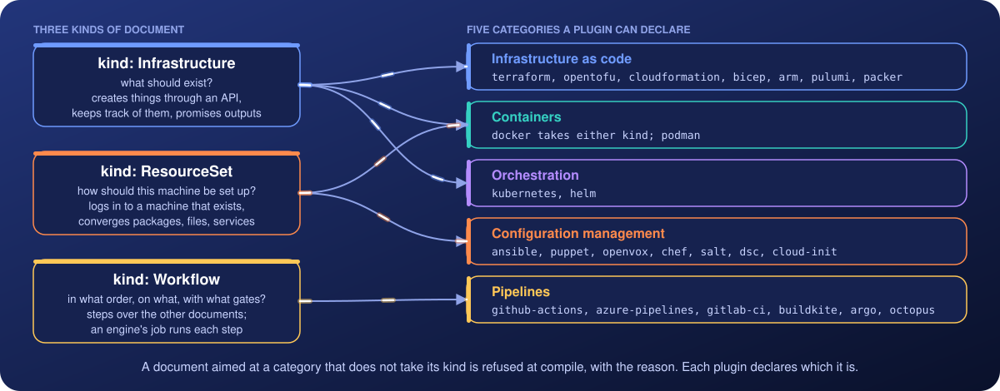

# Documents, resources and targets

A **document** is one YAML or JSON object with a kind, a name and a spec.

```yaml
apiVersion: meridian/v1
kind: ResourceSet        # or Infrastructure
metadata:
  name: web
spec:
  target: ansible        # which tool does the work
  resources: [...]
```

## Two kinds

| Kind | Describes | Extra fields |
|---|---|---|
| `Infrastructure` | things to create: machines, networks, containers, cluster objects | `outputs`: values later stages can read |
| `ResourceSet` | how a machine that already exists is configured | `targetHost`: the machine |

See [the two-stage architecture](two-stage-architecture.md). A plugin's category decides
which kind it takes:

<p align="center"></p>

Every field is in [the language reference](../reference/dsl/index.md).

## Resources

```yaml
- id: nginx_conf            # unique in the document; how everything refers to it
  type: file                # what kind of thing
  state: present            # optional; what "true" means for this type
  params:                   # the type's settings
    path: /etc/nginx/nginx.conf
    content: "worker_processes 4;\n"
  dependsOn:                # optional; see Dependencies
    - resource: nginx_pkg
  notifies:
    - resource: nginx_svc
      action: restart
  runtimeWhen: "..."        # optional; only on targets that can check at apply time
  adopt: "..."              # optional; the tool's identifier of a thing that exists
```

## Two families of types

What `type` and `params` mean depends on the target's category.

**Configuration management targets** (`ansible`, `puppet`, `openvox`, `chef`, `salt`,
`cloud-init`) share six types: `package`, `file`, `service`, `user`, `group` and `exec`.
The same resource compiles for any of them. `cloud-init` applies them once, on first boot
([its page](../targets/cloud-init.md)). These targets also take the tool's own types
(`ansible.builtin.lineinfile`), which compile for that target only
([native types](../reference/dsl/configuration-management.md#native-types-beside-the-six)).

**Every other target is native passthrough.** `type` is the tool's own type and
`params` are its arguments, as the tool documents them:

| Target | `type` is | Example |
|---|---|---|
| `terraform` | the Terraform type | `aws_instance` |
| `opentofu` | the OpenTofu type | `aws_instance` |
| `cloudformation` | the CloudFormation type | `AWS::EC2::Instance` |
| `bicep` | the Azure type and API version | `Microsoft.Network/publicIPAddresses@2023-09-01` |
| `arm` | the Azure type; the API version is the `apiVersion` param | `Microsoft.Network/publicIPAddresses` |
| `packer` | the part of a build, then Packer's own type | `source.amazon-ebs`, `provisioner.shell` |
| `pulumi` | the Pulumi type token | `aws:ec2:Instance` |
| `kubernetes` | API version and kind | `apps/v1/Deployment` |
| `helm` | API version and kind, the same as `kubernetes` | `apps/v1/Deployment` |
| `docker` | an element of a Compose file | `service` |
| `podman` | a kind of Quadlet unit | `container` |
| `dsc` | module and resource | `PSDscResources/Service` |

The five [common infrastructure types](../reference/dsl/common-infrastructure-types.md)
(`network`, `subnet`, `firewall`, `address`, `vm`) sit beside native types on `terraform`,
`opentofu`, `pulumi` (AWS, Azure), `cloudformation`, `bicep` and `arm`.

Most passthrough targets also take a **settings resource** with a fixed type name
(`stack`, `deployment`, `cluster`, `project`) that says where to deploy. Exceptions:

- `dsc` uses `spec.settings` instead.
- `helm` has four: `values`, `chart`, `release` and `kustomization`.
- `arm` also has `parameter`, a template parameter.
- `packer` has none.
- `terraform` and `opentofu` have none; their `provider` and `backend` resources, and
  `opentofu`'s `encryption`, `variable` and `local`, become configuration blocks.

## References

`${id}` or `${id.path}` in a param refers to another resource in the same document.
Meridian checks it exists, and the target rewrites it into the tool's form: a Terraform
address, a CloudFormation `Ref`, a Packer variable, a Kubernetes object name, a Helm
`{{ .Values }}` expression. Write `$${` for a literal `${`.

On configuration management targets, `${id.param}` becomes that param's value at compile
time, and anything else in `${...}` is refused
([the rules](../reference/resource-types.md#references)).

## What is not here yet

Facts gathered from the node are not available. A compile-time
[`when`](../reference/dsl/index.md#when-and-runtimewhen) reads `--data` files only, and
`facts.*` is refused. `runtimeWhen` works on targets that support it.
