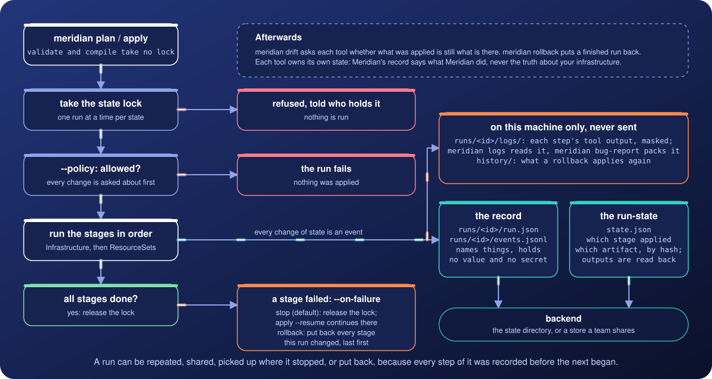
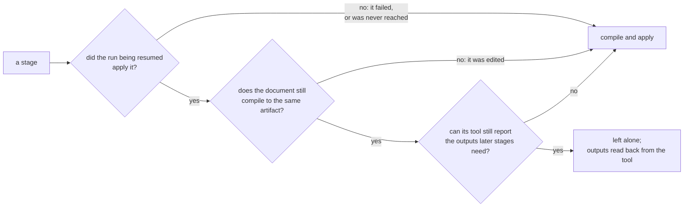
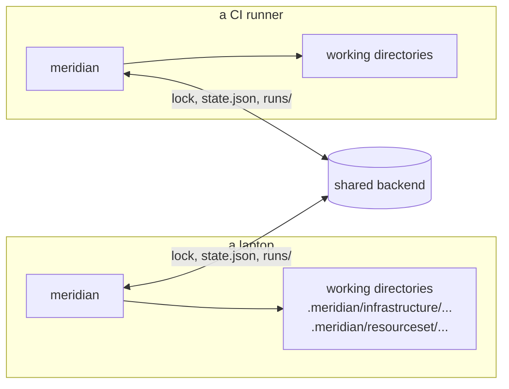
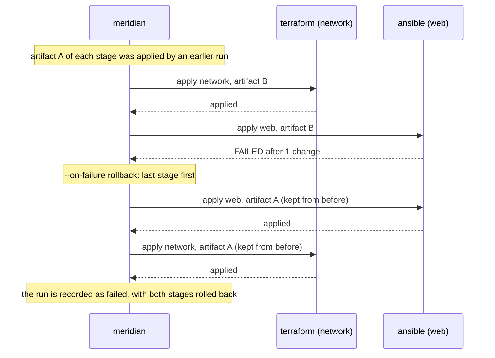
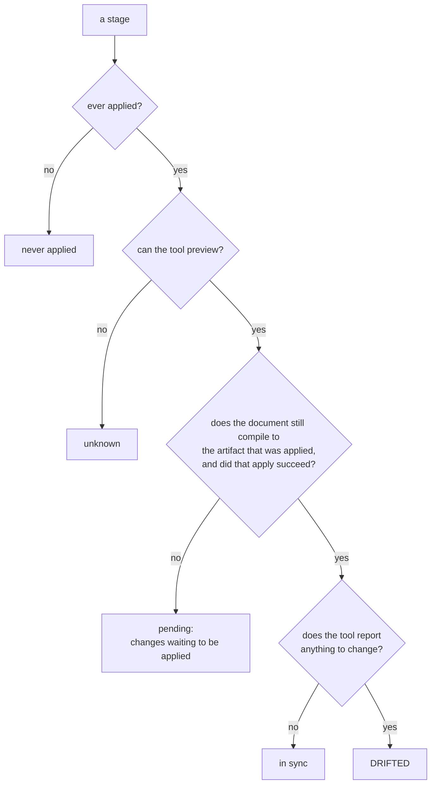
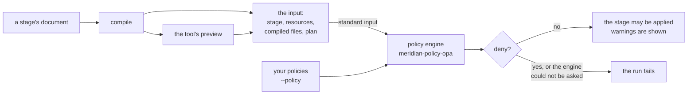

# Running safely

Locks, run records, resuming, stopping, sharing, rollback, drift and policy checks.

<p align="center"></p>

- Each tool owns its state. Meridian records what it did; outputs are read back from the
  tool, never stored.
- The record holds steps, resource ids, output names and artifact hashes, never a param,
  output value or tool output.
- `compile` and `validate` take no lock and leave no record.

## One run at a time

`plan`, `apply`, `drift` and `rollback` take the state's lock first.

```
$ meridian apply site.yaml
error: the state is locked by another run: lock 2026-11-17T09-14-03Z-0cc7, taken by `meridian apply site.yaml` (mike@build-07, process 4242) at 2026-11-17T09:14:03.204Z
Wait for it to finish, or wait here with --lock-timeout. If that run is gone and will never release it, remove the lock with `meridian unlock 2026-11-17T09-14-03Z-0cc7`
```

- `--lock-timeout 5m` waits for the other run instead of failing at once.
- The lock is released when the run ends, success or failure.
- Meridian never breaks a lock. If a killed run left one, check it with
  `meridian status` and remove it with `meridian unlock <id>`.

The lock covers one `--state-dir` or one shared [backend](#sharing-the-record).

## The record

Every run that takes the lock is recorded under an id that sorts by start
time, such as `2026-11-17T09-14-03Z-0cc7`.

```
$ meridian status
run 2026-11-17T09-14-03Z-0cc7: apply, failed
  command:  meridian apply site.yaml
  started:  2026-11-17T09:14:03.204Z by mike@build-07
  finished: 2026-11-17T09:15:11.910Z
  network (Infrastructure, target terraform): succeeded, 4 changes
  web (ResourceSet, target ansible on 203.0.113.10): failed (tool-failed), 2 changes
not locked
```

| Command | Shows |
|---|---|
| `meridian status` | the current or last run, step by step, and who holds the lock |
| `meridian runs` | every recorded run, oldest first, with its mode and how it ended |
| `meridian events [run]` | the run's events, one JSON object per line; `--type step.failed` or `--type 'step.*'` narrows them |
| `--events json` on `plan` or `apply` | the same events on standard output while the run is going, for CI |

A killed run never records how it ended. `status` shows it as `interrupted`,
with the last step it started.

A failed step records a fixed reason (`tool-failed`, `plugin-failed`, `compile-refused`,
...), never the tool's message.

The newest 50 runs are kept; change with `--keep-runs N`. Every file and field
is in [the state reference](../reference/state.md).

## Picking up where a run stopped

A run stops at the first failed stage. After a fix:

```
$ meridian apply site.yaml --resume
network (Infrastructure, target terraform)
  already applied by run 2026-11-17T09-14-03Z-0cc7, and unchanged since; left alone
web (ResourceSet, target ansible on 203.0.113.10)
  ~ update nginx_conf
  applied 1 change
```



- `--resume` continues the last apply; `--resume=<run>` names one (the `=`
  keeps a following file from being read as the run id).
- Stages whose compiled artifact (by hash) is unchanged are skipped. An edited
  document is applied again.
- A skipped stage still passes on its outputs, read from its tool as a `plan`
  of existing infrastructure would.
- If the tool cannot report them, the stage is applied again.
- A killed run can be resumed the same way after `meridian unlock`.
- Resuming a successful run is refused.

### Applying a saved plan

`meridian plan --out plan.mplan` writes the plan. `meridian apply --plan plan.mplan`
applies it or nothing:

- it refuses before running if a stage was applied since, or the plan names other stages
- it fails a stage with `plan-differs` if the document no longer compiles to the recorded
  artifact
- a tool that saves its own plan is handed that plan back

 [A saved plan, and applying it from a pull
request](../operations/pull-requests.md) has the details.

## Stopping a run

**Ctrl-C.** The first interrupt asks the run to stop:

1. `meridian` tells the plugin to cancel.
2. The plugin stops its tool (gently, then by force after ten seconds) and
   reports what the tool had done.
3. The stage is recorded as failed with reason `interrupted`, later stages as
   not run, and the run as failed.
4. The lock is released and the command exits `130`, as a shell does for
   Ctrl-C.

A second interrupt ends the process at once. The record is then left as for a
killed run: `running`, with the lock to remove by hand.

```
$ meridian apply site.yaml
network (Infrastructure, target terraform)
  applied 4 changes
web (ResourceSet, target ansible on 203.0.113.10)
^C
stopping: waiting for the tool to stop so the run can be recorded; press Ctrl-C again to exit at once
  ~ update nginx_conf
  FAILED: interrupted: the run was stopped (was running `ansible-playbook ...`)
run 2026-11-17T09-14-03Z-0cc7 was interrupted. `meridian apply --resume site.yaml` continues from the stage that was stopped
```

An interrupted apply is not rolled back, even with `--on-failure rollback`; run
`meridian rollback` if wanted. `SIGTERM` is handled like Ctrl-C.

**A time limit.** `--stage-timeout 30m` stops a stage that runs that long. It is recorded
as failed with reason `timed-out` and handled like any failure. There is no default
limit.

`--resume` applies a stopped stage again. What the tool reported doing before it stopped
is listed and counted in the record's `changes`.

A plugin without cancellation support is abandoned with a warning that its tool may still
be running. Every plugin in this repository supports cancellation.

## Sharing the record

The record is in the state directory by default. `--backend` shares the lock and history:

```
meridian apply site.yaml --backend dir --backend-config path=/mnt/team/meridian
```



`local` is built in. Any other backend is a program named `meridian-backend-<name>` in a
plugin directory. A shared-directory backend ships in
[`examples/backends`](../../examples/backends), and
[the state reference](../reference/state.md#writing-a-backend) has the full
contract.

A backend does not hold tool working directories or tool state. Set a tool's own remote
state (a Terraform `backend` block, a Pulumi backend) in the document.

**Between pipeline jobs**, pass the record as a job artifact, or use a shared backend,
which also holds the lock. Rerun a failed job with `apply --resume`.
[Running Meridian in a pipeline](../operations/running-in-a-pipeline.md#sharing-the-record-between-jobs)
shows both for each engine.

## Putting a run back

A rollback re-applies the artifact of each stage's last successful apply.

```
$ meridian apply site.yaml --on-failure rollback
network (Infrastructure, target terraform)
  ~ update web_sg
  applied 1 change
web (ResourceSet, target ansible on 203.0.113.10)
  ~ update nginx_conf
  FAILED: the play failed (ran `ansible-playbook ...`, exit status 2)
rolling back web (ResourceSet, target ansible on 203.0.113.10)
  ~ update nginx_conf
  rolled back to what was applied before (artifact 77aa0c1d52e9), 1 change
rolling back network (Infrastructure, target terraform)
  ~ update web_sg
  rolled back to what was applied before (artifact 9f2c41b7d003), 1 change
```



- `--on-failure rollback` on `apply` puts back every stage the run handed to a
  tool, the failed one first, then earlier ones in reverse. `--on-failure stop`
  (the default) leaves everything in place for `--resume`.
- `meridian rollback <files>` does the same on demand for the last apply, even
  a successful one; `--run <id>` picks another. Pass the same files the apply
  used: they are not compiled, but they say which machine each document
  configures.
- A rollback is a run: it holds the lock, is recorded, and shows in `status`.

What it cannot do is reported per stage:

| The stage | What happens | Why |
|---|---|---|
| was applied for the first time by that run | `NOT ROLLED BACK`; what was created is left as it is | there is nothing to go back to. Removing what was created would need a `destroy` operation that plugins do not have; use the tool itself |
| was applied from the same artifact as before | nothing to put back | the run did not change what the stage is |
| has no snapshot on this machine | `NOT ROLLED BACK`, with what to do by hand | snapshots are kept on the machine that applied, and not in a shared backend. Check out the previous revision of the document and apply it |
| has been applied again by a later run | `NOT ROLLED BACK` | that later run's work is what is there now, and undoing an older run over it would undo the wrong thing |
| fails to go back | `ROLLBACK FAILED`, and the rollback stops | the stages before it were built on the one that would not go back, so they are left alone and reported as not attempted |

**Snapshots.** After each successful apply, the artifact is kept under
`history/` in the state directory, beside the stage's working directory: the
one just applied and the previous good one. A snapshot that no longer matches
its hash is refused.

**Limits.** A rollback restores what the tool manages, not destroyed data: a replaced
database comes back empty. `plan` marks a replacement with `!`.

## Finding drift

Drift: the document compiles to what was applied, but the tool reports a difference.

```
$ meridian drift site.yaml
network (Infrastructure, target terraform)
  in sync with what was applied
web (ResourceSet, target ansible on 203.0.113.10)
  ~ update sshd_config
  DRIFTED: 1 difference from what was applied
drift: 1 of 2 stages drifted
```

`meridian drift` compiles each document, asks each tool for its preview, and
changes nothing. Each stage gets one of five results:



| Reported | Meaning | Counts as drift |
|---|---|---|
| `in sync` | the tool has nothing to change | no |
| `DRIFTED` | the tool would have to change these to restore what was applied | **yes** |
| `pending` | the document changed since the last apply, or the last apply failed part way. The differences are changes waiting to be applied, and cannot be told from drift | no |
| `unknown` | the tool cannot preview, so it cannot say. Never read as in sync | no |
| `never applied` | there is nothing to compare with | no |

Exit status: `0` no drift, `2` drift, `1` the check failed. `meridian apply` fixes
drift. A tool with no preview reports `unknown`
([capability matrix](../reference/capability-matrix.md)).

## Asking a policy first

`--policy` asks a policy whether each change may be made.

```sh
meridian plan  site.yaml --policy policies/
meridian apply site.yaml --policy policies/
```



An apply checks every stage it can before applying the first. The policy gets the stage,
its resources, its compiled files and the tool's preview, and returns denials and
warnings:

```rego
package meridian

import rego.v1

deny contains msg if {
	input.stage.labels.env == "prod"
	some change in input.plan.changes
	change.action == "replace"
	msg := sprintf("%s would be destroyed and recreated in prod", [change.resource])
}
```

- A missing or crashing engine, or an unreadable answer, is a denial.
- The input is the compiled artifact and the tool's preview, not the document text.
- The input goes to the engine on stdin and is never written. The record keeps the
  verdict, not the messages.
- A stage waiting on an output is checked when its turn comes.
- `meridian plan --policy` shows every denial and exits `1`.

See the [policy reference](../reference/policy.md).

## Values between stages

With [`spec.imports`](../reference/dsl/outputs-and-hand-offs.md#imports):

- A document runs after every document it imports from. A cycle is refused by `validate`.
- A missing value defers the stage.
- The value goes only to the tool, as its own variable, and is not written to compiled
  files or the record. `sensitive` values are masked.
- A rollback uses current imports. A stage whose imports cannot be resolved is reported as
  unavailable.

## What this does not do yet

- Backends have only been tested with the directory backend in
  `examples/backends`, not a cloud object store.
- Only targets whose tool has variables can import: `terraform`, `opentofu`,
  `packer`, `pulumi` and `arm`. Reading another document's output in any value,
  on any target, is part of the
  [language expansion](../plans/language-expansion.md).
