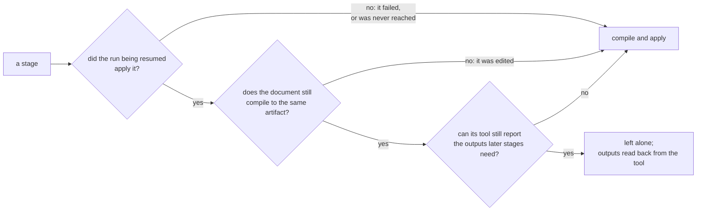
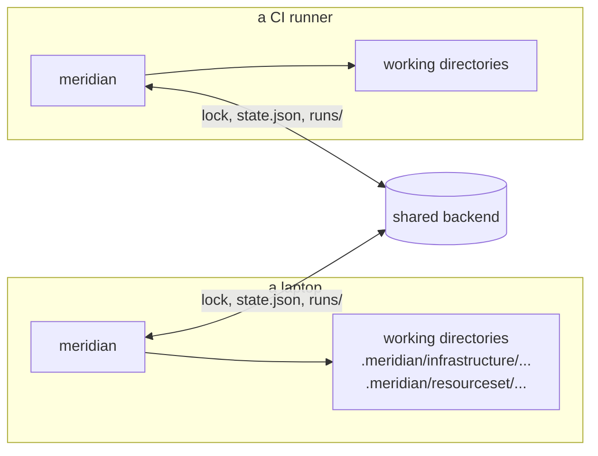
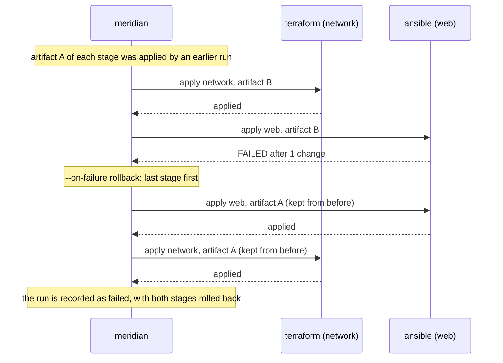
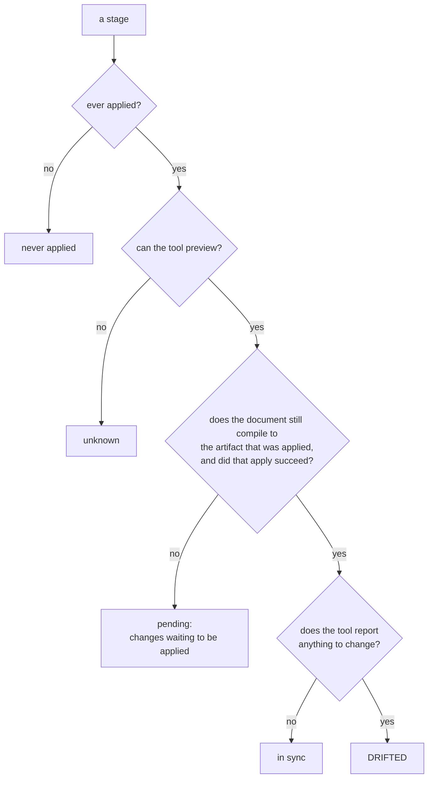
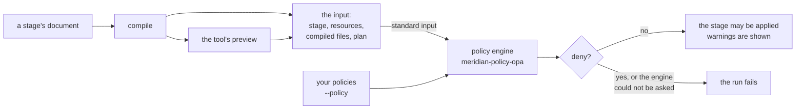

# Running safely

A run that reaches a tool changes real things, takes real time, and can fail
half way. This page says what Meridian does so that a run can be repeated,
shared between people, picked up where it stopped, or put back, how to find
out whether what was applied is still what is there, and how a policy is
asked whether a change may be made before it is.

<p align="center"></p>

Three rules hold throughout:

- **Each tool owns its own state.** Meridian's record says what Meridian did.
  It is never the truth about your infrastructure, and outputs are never
  stored in it: they are read back from the tool that produced them.
- **Nothing kept holds a secret value.** The record names things: a step, a
  resource id, an output, the hash of an artifact. It never holds a param, an
  output's value, or what a tool printed.
- **`compile` and `validate` are outside all of this.** They contact nothing,
  so they take no lock and leave no record.

## One run at a time

Two runs against the same state collide in ways no tool can untangle: two
`terraform apply`s in one directory, a plan read while an apply is half done.
So everything that runs a tool (`plan`, `apply`, `drift` and `rollback`) first
takes the state's lock.

```
$ meridian apply site.yaml
error: the state is locked by another run: lock 2026-11-17T09-14-03Z-0cc7, taken by `meridian apply site.yaml` (mike@build-07, process 4242) at 2026-11-17T09:14:03.204Z
Wait for it to finish, or wait here with --lock-timeout. If that run is gone and will never release it, remove the lock with `meridian unlock 2026-11-17T09-14-03Z-0cc7`
```

- `--lock-timeout 5m` waits for the other run instead of giving up at once.
- The lock is released when the run ends, whether it succeeded or failed.
- **Meridian never breaks a lock by itself.** A process on another machine
  cannot be seen to be dead, and guessing wrong is exactly the collision the
  lock exists to prevent. If a run was killed and left its lock, look at who
  holds it with `meridian status`, make sure that run is really gone, and
  remove it with `meridian unlock <id>`. The id has to be given, so the lock
  removed is the one you looked at.

The lock covers one state: one `--state-dir`, or one shared
[backend](#sharing-the-record). Workflows that should not block each other
belong in different states.

## The record

Every run that takes the lock is recorded, under an id that sorts by when it
started, such as `2026-11-17T09-14-03Z-0cc7`.

```
$ meridian status
run 2026-11-17T09-14-03Z-0cc7: apply, failed
  command:  meridian apply site.yaml
  started:  2026-11-17T09:14:03.204Z by mike@build-07
  finished: 2026-11-17T09:15:11.910Z
  network (Infrastructure, target terraform): succeeded, 4 changes
  web (ResourceSet, target ansible on 203.0.113.10): failed (tool-failed), 2 changes
not locked
```

| Command | Shows |
|---|---|
| `meridian status` | the current or last run, step by step, and who holds the lock |
| `meridian runs` | every recorded run, oldest first, with its mode and how it ended |
| `meridian events [run]` | the run's events, one JSON object per line; `--type step.failed` or `--type 'step.*'` narrows them |
| `--events json` on `plan` or `apply` | the same events on standard output while the run is going, for CI |

A run that was killed never says how it ended. `status` shows it as
`interrupted`, with the last step it had started.

A failed step is recorded with a fixed word for the kind of failure
(`tool-failed`, `plugin-failed`, `compile-refused` and so on), never with what
the tool said. A tool can quote a value in an error message, and the record
is not the place to find that out. What the tool said is on the terminal of
the run that failed.

The newest 50 runs are kept; `--keep-runs N` changes that. Every file and
field is in [the state reference](../reference/state.md).

## Picking up where a run stopped

A run stops at the first stage that fails, and the stages after it are not
attempted. Once the cause is fixed, there is no need to start from the top:

```
$ meridian apply site.yaml --resume
network (Infrastructure, target terraform)
  already applied by run 2026-11-17T09-14-03Z-0cc7, and unchanged since; left alone
web (ResourceSet, target ansible on 203.0.113.10)
  ~ update nginx_conf
  applied 1 change
```



- `--resume` continues the last apply; `--resume=<run>` names one, with the
  `=`, so that a file after the flag is read as a file.
- "The same" means the same compiled artifact, by its hash. A document you
  edited is applied again. One you did not touch is not.
- A stage that is left alone still hands on its outputs. They are read from
  its tool, exactly as a `plan` of existing infrastructure reads them.
- If the tool cannot report them, the stage is applied again. An apply is
  safe to repeat; a guessed address is not.
- A run that was killed can be resumed in the same way, after its lock has
  been removed with `meridian unlock`.
- Resuming a run that succeeded is refused: there is nothing to continue.

Resuming is a saving, not a different result. A plain `meridian apply` of
the same documents reaches the same end, by asking every tool again.

### Applying a saved plan

The same comparison, an artifact by its hash, ties a plan to the apply that
follows it. `meridian plan --out plan.mplan` writes what was planned, and
`meridian apply --plan plan.mplan` applies that plan or nothing: it refuses
before it runs anything if a stage has been applied since the plan was
taken, by any run, or if the plan names other stages; and it fails a stage
with `plan-differs` if its document no longer compiles to the artifact the
plan recorded. Where the tool saves a plan of its own, it is handed that
plan back. [A saved plan, and applying it from a pull
request](../operations/pull-requests.md) has the file, the checks and the
pull request automation built on it.

## Stopping a run

A run that reaches a tool can be stopped before the tool finishes, and the
record says so.

**Ctrl-C.** The first interrupt asks the run to stop: `meridian` tells the
plugin to cancel, the plugin stops its tool (politely, then by force after
ten seconds) and reports what the tool had done, the stage is recorded as
failed with the reason `interrupted`, the stages after it as not run, the run
as failed, and the lock is released. The command exits `130`, as a shell
reports a command ended by Ctrl-C. A second interrupt ends the process at
once, and the record is left as a killed run leaves it: `running`, with the
lock to remove by hand.

```
$ meridian apply site.yaml
network (Infrastructure, target terraform)
  applied 4 changes
web (ResourceSet, target ansible on 203.0.113.10)
^C
stopping: waiting for the tool to stop so the run can be recorded; press Ctrl-C again to exit at once
  ~ update nginx_conf
  FAILED: interrupted: the run was stopped (was running `ansible-playbook ...`)
run 2026-11-17T09-14-03Z-0cc7 was interrupted. `meridian apply --resume site.yaml` continues from the stage that was stopped
```

An interrupted apply is not rolled back, even with `--on-failure rollback`:
the operator asked for nothing more to happen, and a rollback runs more
tools. `meridian rollback` puts it back when that is what is wanted. A
`SIGTERM` from a supervisor is handled the same way as Ctrl-C.

**A time limit.** `--stage-timeout 30m` stops a stage whose tool has run that
long: a tool waiting on a prompt, a dead connection or a stuck cloud operation
no longer holds the run, and the lock, forever. The stage is recorded as
failed with the reason `timed-out`, and the run goes on as after any failure:
later stages are not run, `--on-failure rollback` rolls back. There is no
limit unless one is asked for, so a long apply is as long as it always was.

Either way, `--resume` continues from the stopped stage, exactly as from a
failed one: a stage that was stopped is applied again, and an apply is safe to
repeat. What the tool had done before it was stopped is listed above the
failure, as far as the tool reported it, and counted in the record's
`changes`.

A plugin built against an SDK that does not know how to be asked to stop
cannot be stopped this way. `meridian` then gives up on the run and says that
the tool may still be running; the lock is still released. The plugins in
this repository all know.

## Sharing the record

By default the record is in the state directory, which suits one person or
one CI job. A team wants one lock and one history, wherever a run happens:

```
meridian apply site.yaml --backend dir --backend-config path=/mnt/team/meridian
```



`local` is built in. Any other backend is a small program named
`meridian-backend-<name>` in a plugin directory, and can be a shell script
around a cloud CLI. One that keeps the record in a shared directory ships in
[`examples/backends`](../../examples/backends), and
[the state reference](../reference/state.md#writing-a-backend) has the whole
contract.

**What a backend does not hold.** Each tool's working directory stays on the
machine that runs Meridian. A tool's own state belongs in that tool's own
remote backend (a Terraform `backend` block, a Pulumi backend), set in the
document. A shared Meridian backend gives a team one lock, one history, and
one answer to "what was applied last, and did it work".

**Between the jobs of a pipeline.** A job's runner is gone when the job
ends, so a pipeline that plans in one job and applies in the next must put
the record where the second job can reach it: carried as an artifact between
the jobs, which is enough while one pipeline owns the documents and runs one
job at a time, or in a shared backend, which also holds the lock against a
second pipeline or a laptop. A failed apply is then continued by running the
job again with `apply --resume`, which finds the failed run in the record
and goes on from the step that failed.
[Running Meridian in a pipeline](../operations/running-in-a-pipeline.md#sharing-the-record-between-jobs)
shows both for each engine.

## Putting a run back

Sometimes the right move after a failure is not to fix forward but to go back
to what worked. Meridian knows no tool, so it has one honest way to undo a
stage: apply again the artifact of that stage's last successful apply.

```
$ meridian apply site.yaml --on-failure rollback
network (Infrastructure, target terraform)
  ~ update web_sg
  applied 1 change
web (ResourceSet, target ansible on 203.0.113.10)
  ~ update nginx_conf
  FAILED: the play failed (ran `ansible-playbook ...`, exit status 2)
rolling back web (ResourceSet, target ansible on 203.0.113.10)
  ~ update nginx_conf
  rolled back to what was applied before (artifact 77aa0c1d52e9), 1 change
rolling back network (Infrastructure, target terraform)
  ~ update web_sg
  rolled back to what was applied before (artifact 9f2c41b7d003), 1 change
```



- `--on-failure rollback` on `apply` puts back every stage the run handed to
  a tool: the one that failed first, then the ones before it, in reverse.
  `--on-failure stop`, the default, leaves what was applied in place for
  `--resume`.
- `meridian rollback <files>` does the same on request for the last apply,
  including one that succeeded; `--run <id>` names another. Give it the files
  the apply was given: it does not compile them, but it reads which machine
  each document configures from them.
- A rollback is a run: it holds the lock, is recorded, and shows in `status`.

What it cannot do is said, stage by stage, and never skipped in silence:

| The stage | What happens | Why |
|---|---|---|
| was applied for the first time by that run | `NOT ROLLED BACK`; what was created is left as it is | there is nothing to go back to. Removing what was created would need a `destroy` operation that plugins do not have; use the tool itself |
| was applied from the same artifact as before | nothing to put back | the run did not change what the stage is |
| has no snapshot on this machine | `NOT ROLLED BACK`, with what to do by hand | snapshots are kept on the machine that applied, and not in a shared backend. Check out the previous revision of the document and apply it |
| has been applied again by a later run | `NOT ROLLED BACK` | that later run's work is what is there now, and undoing an older run over it would undo the wrong thing |
| fails to go back | `ROLLBACK FAILED`, and the rollback stops | the stages before it were built on the one that would not go back, so they are left alone and reported as not attempted |

**Snapshots.** After every successful apply the artifact is kept under
`history/` in the state directory, beside the stage's working directory: the
one just applied, and the last good one before it. A snapshot whose content no
longer matches its hash is refused, not applied.

**What a rollback cannot promise.** Applying an old artifact restores what
the tool manages. It does not bring back data a tool destroyed on the way: a
database that was replaced comes back empty. `plan` marks a replacement with
`!` for that reason. Read the plan before the apply.

## Finding drift

Drift is a difference nobody asked for: the document still compiles to
exactly what was applied, and the tool says the world is no longer that.

```
$ meridian drift site.yaml
network (Infrastructure, target terraform)
  in sync with what was applied
web (ResourceSet, target ansible on 203.0.113.10)
  ~ update sshd_config
  DRIFTED: 1 difference from what was applied
drift: 1 of 2 stages drifted
```

`meridian drift` compiles each document, asks each tool for its preview, and
changes nothing. It then says which of five things each stage is:



| Reported | Meaning | Counts as drift |
|---|---|---|
| `in sync` | the tool has nothing to change | no |
| `DRIFTED` | the tool would have to change these to restore what was applied | **yes** |
| `pending` | the document changed since the last apply, or the last apply failed part way. The differences are changes waiting to be applied, and cannot be told from drift | no |
| `unknown` | the tool cannot preview, so it cannot say. Never read as in sync | no |
| `never applied` | there is nothing to compare with | no |

The command exits `0` when nothing drifted, `2` when something did, and `1`
when the check itself failed, so a scheduled job can tell the three apart.
Run it from whatever already schedules things: CI, cron. To put drift right,
`meridian apply`.

The tools still differ, and Meridian does not pretend otherwise. Terraform
compares against real infrastructure when it plans. Ansible's check mode is a
dry run of the play. A tool with no real preview reports `unknown`. The
[capability matrix](../reference/capability-matrix.md) says which targets can
plan.

## Asking a policy first

Everything above is about a change that has been made. A policy is asked
before: may this change be made at all?

```sh
meridian plan  site.yaml --policy policies/
meridian apply site.yaml --policy policies/
```



An apply asks about every stage it can before it applies the first one, so a
change that is not allowed stops the run while there is still nothing to
undo. A policy is given the stage, its resources, the files it compiled to
and the tool's own preview of what would change, and answers with reasons to
deny and things to warn about:

```rego
package meridian

import rego.v1

deny contains msg if {
	input.stage.labels.env == "prod"
	some change in input.plan.changes
	change.action == "replace"
	msg := sprintf("%s would be destroyed and recreated in prod", [change.resource])
}
```

Three things make it safe to rely on:

- **It fails closed.** A policy engine that is missing, crashes, or answers
  with something unreadable is a denial. A policy that could not be asked has
  not said yes.
- **It is asked about what will run.** The input is the compiled artifact and
  the tool's preview, not the document's text, so a rule about what Terraform
  would destroy is a rule about what Terraform says it would destroy.
- **It leaves no secret behind.** The input goes to the engine on standard
  input and is never written down. The record keeps that a policy was asked
  and how it answered, and never the messages, which can quote the input.

A stage that waits on an output of a stage this run has yet to apply cannot
be asked about up front; it is asked about at its turn. `meridian plan
--policy` shows every denial and exits `1`, which is how a pipeline refuses a
merge. The [policy reference](../reference/policy.md) has the input field by
field, the Rego conventions, and how to write an engine for another policy
language.

## Values between stages

A stage often needs something another stage has: the machine needs the
user-data a bootstrap document compiles to, an application needs the network
another document created. A document asks for it with
[`spec.imports`](../reference/dsl/outputs-and-hand-offs.md#imports), and three
things follow that bear on running safely:

- **The order is worked out, not written.** A document runs after every
  document it needs. Documents that wait on each other are refused by
  `validate`, before anything runs.
- **A value that does not exist yet defers the stage.** A plan made before the
  network exists reports the application as deferred. It is never planned
  against a guess.
- **The value goes to the tool and nowhere else.** It is handed to the tool as
  the tool's own variable, is not written into the compiled files, and is not
  recorded. Marked `sensitive`, it is masked wherever Meridian prints.

A rollback puts a stage back with the imports it would be given now, and a
stage whose imports can no longer be worked out is reported as unavailable,
not guessed at.

## What this does not do yet

- A backend has met only the directory backend shipped in `examples/backends`,
  not a cloud object store.
- Only targets whose tool has variables can import: `terraform`, `opentofu`,
  `packer`, `pulumi` and `arm`. Reading another document's output inside any
  value, for any target, is part of the
  [language expansion](../plans/language-expansion.md).
