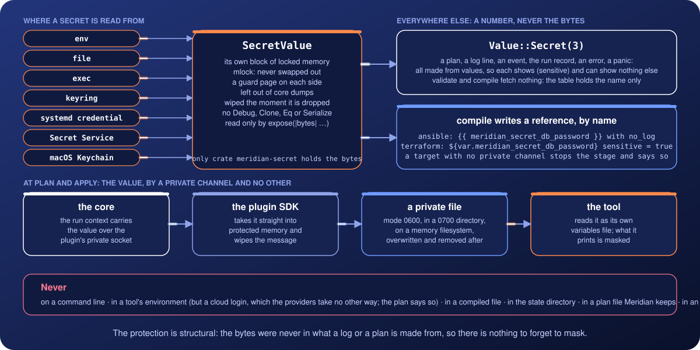

# How a secret is held in memory

How Meridian protects a secret it holds for a tool. All of it is in the crate
`meridian-secret`; no other crate holds a secret's bytes. The design is in
[the language plan](../plans/language-expansion.md#115-holding-a-secret-in-memory).

> **Status.** Built today (see [the secrets reference](../reference/dsl/secrets.md)):
> declaring and reading secrets; secrets in `when`; `meridian secret check`;
> credentials resolved outside a run; a secret with several possible places;
> OS secret stores, written with `meridian secret set`; and handing a secret in
> params, or a [credential's](../reference/dsl/credentials.md) secret fields, to
> the tool by a private file on targets that
> [take one](../reference/dsl/secrets.md#handing-a-secret-to-a-tool).

## The promise, and its limit

A secret is kept out of logs, plan output, events, the run record, panic and error
messages, swap, core dumps, and the environment and arguments of programs Meridian starts.
It is wiped when no longer needed.

It is not protected from `root`, a debugger run by `root`, a compromised kernel, or the
tool it is handed to.

## One home for each secret

A secret is a `SecretValue`, in a memory block mapped for it alone at its final size, so
it is never moved or left in freed memory.

| Property | Linux | macOS and other Unix | Windows |
|---|---|---|---|
| Wiped when dropped (`zeroize`, a write the compiler cannot remove) | yes | yes | yes |
| Locked out of swap (`mlock`) | yes | yes | not yet |
| Guard page on each side, so an overrun faults | yes | yes | not yet |
| Left out of core dumps (`MADV_DONTDUMP`) | yes | no | no |
| Zeroes in a forked child (`MADV_WIPEONFORK`) | yes | no | no |

`SecretValue::protection()` reports which of these held. If locking fails (a small
`RLIMIT_MEMLOCK`), the run [warns once](../reference/cli.md#secrets), or stops the stage
with `--strict-secrets`.

A `SecretValue` cannot be printed, copied or compared by accident:

- `Debug` and `Display` give `(sensitive)`.
- It does not implement `Clone`, `PartialEq`, `Hash`, `Serialize` or `Deref`.
  Copy with `duplicate()`, which makes a second locked block. Compare with
  `same()`, which runs in constant time.
- The bytes are reachable only through `expose(|bytes| ...)`, which lends them
  to a closure. A secret built from another (an encoding, or with text around
  it) uses `derive()`, which writes straight into a new locked block.

## Few places expose a secret

`crates/meridian-secret/tests/expose_is_rare.rs` fails if `expose` is called in a file not
on its list, or `unsafe` appears outside `sys.rs`.

## The process

`harden_process()` runs before any secret is read. It sets `setrlimit(RLIMIT_CORE, 0)` and,
on Linux, `prctl(PR_SET_DUMPABLE, 0)`, which also stops the same user attaching a debugger
or reading `/proc/<pid>/mem`. `hardening()` reports what held.

As a result, inspecting a running `meridian` (`/proc/<pid>/environ`, `strace`, `gdb`)
needs `root`. Programs it starts are unaffected.

## Everywhere else: a reference, not the value

The rest of Meridian never holds a secret's bytes. A `Value::Secret` holds only
a number identifying the run's secret. The bytes are in the run's
`SecretTable`, in this crate.

- The reference prints, compares and encodes as `(sensitive)`, so plans, logs, errors and
  run state never contain the bytes.
- An expression that joins a secret to text or encodes it asks the table to do
  it, on protected memory; the result is another reference.
- An unfetched secret (`validate` and `compile` never fetch) is in the table as
  its name. Anything built from it is a description, such as
  `password=(secret db_password)`.
- A stage's table is wiped when the stage ends. A reference that outlives it
  names nothing.

## Fetching

Seven providers are built. Each reads straight into locked memory, and none
puts a value in an error.

| Provider | What it does | What it refuses |
|---|---|---|
| `from_env(key)` | reads the variable, **removes it from the environment** so a program started later does not inherit it, wipes the copy it read, and keeps one copy in locked memory so a later read of the same variable in the same process still answers | an unset variable is `Missing`; an empty one is an empty secret, not a missing one |
| `from_file(path, options)` | reads the file, without its last line ending unless `keep_trailing_newline` | a file that anyone but its owner can read or write, unless `allow_wide_mode`; a file longer than 256 KiB; a directory |
| `from_exec(command)` | runs the command **without a shell**, reads what it prints, discards its standard error | a command that fails, is not found, is stopped by a signal, or prints nothing. The error names the program and never its arguments or output |
| `from_keyring(description)` | finds the key with `keyctl(KEYCTL_SEARCH)` in the session and then the user keyring, and reads it with `KEYCTL_READ` **straight into the locked region**, sized by the key's own length; no library buffer is between the kernel and the home | a key larger than 256 KiB; a description with a NUL. The keyring being shut off (a container's sandbox) is `Unavailable` |
| `from_systemd_credential(name, keep)` | opens `$CREDENTIALS_DIRECTORY/<name>` and reads it as a file | a name that is a path; no `CREDENTIALS_DIRECTORY` is `Unavailable` |
| `from_secret_service(attributes)` | runs `secret-tool lookup` and reads its standard output as `exec` does | no session bus, or no `secret-tool`, is `Unavailable`; the tool failing or printing nothing is `Missing` |
| `from_keychain(service, account)` | runs `/usr/bin/security find-generic-password -w` and reads its standard output | exit status 44 is `Missing`; any other failure is refused without what the tool printed; not macOS is `Unavailable` |

`Source::store(label, value)` writes the two stores Meridian can write: the
kernel keyring via `add_key(2)` from the locked region, and the Secret Service
via `secret-tool store` on stdin. Nothing goes through an argument.

A third answer, `FetchError::Unavailable`, lets a secret name several places:
`fetch_first` skips a place that is `Missing` or `Unavailable` and stops at one
that `Failed`. `probe_first` and `store_first` do the same without reading, or
while writing. A value typed for `secret set` is read by `read_from_stdin` with
`read(2)` on the terminal, one byte at a time with echo off, into the locked
region, with no `BufReader` copy.

A secret's origin is a `Source`: the provider and what it needs. Document
declarations and project credentials are both built from them, so both use the
same checks (`Source::problems()`) and fetching (`Source::fetch()`).
`Source::probe()` says whether the place would answer, without reading it; that
is what `meridian secret check` prints.

## A credential outside a run

`resolve_credential(declared, name)` resolves a credential outside a run, such as for a
private module registry.

- A `CredentialDeclaration` is a name, a type and fields. A plain field holds
  text. A secret field holds a `Source`, never a value: a literal secret is
  refused, and the refusal does not repeat it.
- Three types can be resolved today: `registry` (`server`, `user`,
  `password`), `usernamePassword` (`user`, `domain`, `password`) and `token`
  (`token`, `scheme`). The rest of [the plan's list](../plans/language-expansion.md#12-credentials)
  arrive with credentials in documents.
- Resolving fetches only that credential's secret fields, into locked memory.
  The returned `Credential` prints as its name and type, lends secret fields as
  `SecretValue`s, and wipes them when dropped.
- An error names the field and provider, and nothing a provider read.

The module system uses it: see [registry logins](../reference/modules.md#registry-logins).

## A credential in a run

A document declares credentials under `spec.credentials`, with every type the
language has, and names one for its host with `targetHost.credential`
([Credentials](../reference/dsl/credentials.md)). Its secret fields are secrets of the
document:

- A secret field must be exactly `${{ secret.<name> }}`, so once resolved it
  *is* a `Value::Secret` slot in the run's table, like any secret. A plain
  field (user, region) is text, checked as shown text, so a secret cannot go
  there.
- The plugin receives a `HeldCredential`: the declared shape plus one
  `SecretValue` per secret field, duplicated from the table into its own
  holder and wiped with the stage. It prints as its name, type and field
  names.
- It crosses to the plugin like the run context: values at plan and apply
  only, over the private socket, taken straight into protected memory on the
  other side (`SecretValue::take_from`). `outputs` gets none. At compile the
  plugin sees the shape and secret field names, no values.
- The host prints and records only a summary, such as `deploy (ssh, user
  deploy)`, in the plan line, run record and events.
- A rollback fetches the credential again at the stage's turn, as it does
  document secrets.

A credential's secret fields count among the stage's secrets for masking tool
output, since they are the same slots.

An SSH private key for a host is delivered through an agent (the plan's rank 1,
`meridian-sdk/src/agent.rs`):

- The plugin starts `ssh-agent -D -a <socket>`, with the socket in a directory
  only the user can enter.
- It runs `ssh-add -` with the key on stdin (`Tool::stdin_secret`), so the key
  goes from protected memory into the agent and never touches disk.
- A passphrase goes in a `SecretFile` beside the socket, answered by an askpass
  program that only prints that file.
- The tool (`ssh`, `salt-ssh`, `bolt`, `chef-run`) gets the socket in
  `SSH_AUTH_SOCK` and nothing else of the credential in its environment or
  command line.
- Dropping the agent kills it and removes the directory, so the key lives for one
  stage.

A cloud credential (`spec.endpoint`, an `aws`, `azure` or `gcp` type) takes
the plan's rank 4 (`meridian-sdk/src/cloud.rs`): the providers of
`terraform`, `opentofu`, `pulumi`, `packer` and the AWS command line read a
login from the environment, from files under the user's home directory, or
from the machine's metadata service, and Meridian writes nothing under a
home directory. `CloudHandover` keeps one copy of each secret field in
protected memory for the stage and tells every call of the tool through
`Tool::env_secret`, which hands the bytes to the child's environment block
inside the spawn and makes no `String` of them; what Meridian copies is the
kernel's copy for the new process. A `gcp` service account key and an
`azure` certificate go to a `SecretFile` the environment names instead. The
exposure this adds is the one the table names: the same user can read the
process's environment, and what the tool starts inherits it. That is what
exporting the variables in a shell exposes too, and no more; the plan line
says which stage goes this way.

## Handing a secret to a tool

In order of preference: stdin or a file descriptor; a file only the user can read; the
tool's environment, only where nothing else works. Never an argument.

`SecretFile::create(name, parts)` is the file:

- It lives in its own `0700` directory, `meridian-secrets-<pid>-<random>`. The
  file is `0600` and must not already exist.
- The directory is on a memory filesystem where available (`XDG_RUNTIME_DIR`,
  `/run/user/<uid>`, `/dev/shm`), so the secret never reaches disk.
  `in_memory()` reports whether it did.
- The file is built from parts (literal text and secrets, in order), so a
  secret goes from locked memory to the file without becoming a `String`.
- `beside(name, text)` writes a second, equally protected file in the same
  directory, for tools that reach the secret file through another: a
  `hiera.yaml` naming its data directory, a pillar top file, a `client.rb`. The
  text holds no secret.
- Dropping it overwrites and removes the file and directory, including anything
  a tool left there.
- A killed run cannot clean up. `sweep_stale()` removes directories of
  processes that no longer exist and keeps those of live ones.

## Masking what a tool prints

`Masker` replaces each secret with `(sensitive)` in tool output before it is shown or
recorded. It finds:

- the secret itself;
- its base64 forms (standard and URL-safe, with and without padding), its
  hexadecimal form and its URL-encoded form;
- each line of a multi-line secret, since a tool echoing a key prints it line
  by line.

Secrets or lines shorter than four bytes are not masked; `add()` returns `false` for
them.

## Across the plugin boundary

A plugin is a separate process. What crosses, and when:

- **At compile, a name.** Params reach the plugin with `Value::Secret` where a
  secret stands, and the graph names each (`ResourceGraph::secrets`). The plugin
  writes a reference by that name into its artifact (`secrets_written_as`); it
  has no value to write. The message carries `(sensitive)` plus the path and
  slot, so the other side restores a `Value::Secret`.
- **At plan and apply, the value.** The run context carries each referenced
  secret's value over the plugin's private socket, only to targets that declare
  they take secrets. The plugin SDK takes each value straight into protected
  memory and wipes the message bytes (`SecretValue::take_from`). On the host,
  the message is the only copy outside protected memory, dropped once sent.
  `outputs` gets none.
- **For the length of the call.** `RunContext::secrets` holds the values as
  `SecretValue`s (no `Debug` or `Display`), wiped when the context drops.
- **To the tool by a private channel.** `Secrets::json_file` writes every value
  into one `SecretFile` under the artifact's names, for tools that read
  variables from a file. Plugins whose tool reads another format (Hiera YAML, a
  Salt pillar) build the `SecretFile` from parts. `Tool::stdin_secret` pipes one
  to stdin. The SDK offers neither command line nor environment, so a tool with
  only a command line (`chef-run`) is refused the secret.
- **Rollback fetches again.** Nothing of a stage's secrets is kept after it
  ends; a rollback, immediate or later, fetches them again at the stage's turn.

A plugin given a secret can do anything with it. It gets only the secrets of the resources
it compiles; trust it as any code you run (see [plugin
signatures](../reference/plugin-signatures.md)).

## What is tested

In `crates/meridian-secret/tests`:

| File | What it proves |
|---|---|
| `value.rs` | a value prints as `(sensitive)` everywhere, is locked and guarded, is compared and copied only by name |
| `wiped.rs` | after a secret is dropped its bytes are nowhere in the process: the test searches every writable mapping of its own memory |
| `process.rs` | hardening is what the system reports; a secret read from the environment is not inherited by the next program; five kinds of panic do not print a held secret |
| `provider.rs` | each provider's refusals, and that no error holds a value or an argument; a probe reads nothing and runs nothing |
| `deliver.rs` | the file's modes, content, removal, and the sweep after a killed run |
| `mask.rs` | every form is masked, in text and in bytes |
| `credential.rs` | a credential resolves with its secret fields in protected memory; only the one asked for is fetched; a secret written out is refused; no error or debug form holds a value |
| `stores.rs` | the kernel keyring gives back every byte stored in it, or says it is shut off; a unit credential is one name and never a path; the Secret Service is reached through its tool with the value on standard input and never in an argument, and is unavailable without a bus or the tool; the keychain is unavailable off macOS and read from a keychain made for the test on it; with several places the first that has the secret answers, an unavailable store is passed over, a refusal stops the search, and every reason is given when none answers |
| `expose_is_rare.rs` | `expose` and `unsafe` appear only where expected; the SDK's wire conversion and standard-input channel are the two places added for handing a secret to a plugin and its tool |

Across the other crates:

| File | What it proves |
|---|---|
| `meridian-secret/tests/table.rs` | secrets are joined, encoded and compared without leaving protected memory; one that is not fetched is described and never guessed; a wiped one is gone |
| `meridian-ir/tests/credentials.rs` | a credential's secret fields are one declared secret each, a literal is refused without being repeated, a plain field takes no secret, and a resolved credential holds slots and never values |
| `meridian-cli/tests/credentials.rs` | a credential's key reaches the test target in a private file of mode `0600`, and is in nothing `plan` and `apply` print or write: not the plan, not the state directory, not the run record; a target that takes none is refused before anything runs |
| `plugins/ansible/tests/run.rs` | a key reaches a stand-in `ansible-playbook` as `--private-key` naming a `0600` file, a password in the extra-vars file, and neither is in an argument, the environment or the log; the files are gone after the run |
| `meridian-expr/tests/secrets.rs` | an expression holds a reference; joins and placements stay secret; a comparison is a plain answer; every other function and operator refuses; no error holds a value |
| `meridian-ir/tests/secrets.rs` | every rule of a declaration; every place a secret is refused; a resolved document, its debug form and its encoding hold only `(sensitive)`; the secrets are wiped when their holder is dropped |
| `meridian-cli/tests/secret_stores.rs` | through the real command: `secret set` stores a value from standard input and a run reads it back from the keyring and the Secret Service; the value reaches the store's tool on its standard input and never as an argument; a store this machine does not have is passed over for the next place and every reason is given when none has it; the value is in nothing printed or written |
| `meridian-cli/tests/secrets.rs` | through the real command: the value is in nothing `plan` and `apply` print and in no file of the state directory or of `compile --out`; a failed fetch repeats neither the value, a command's output nor its arguments; a secret read from the environment is not inherited by a program started afterwards; a secret that cannot be locked is warned about once, or refused with `--strict-secrets`; `secret check` reads no value and runs no command; a secret in a param is compiled as a reference and handed to the tool in a file only the user can read, which the tool reads back whole, and is in nothing else the run prints, applies or keeps; a target that takes none stops the stage and names the ones that do |
| `meridian-sdk/src/wire.rs`, `src/secrets.rs`, `src/tool.rs` | a secret in a param crosses the wire as a place and a slot and never a value, and a place that does not hold the mask is refused; a run context carries its values into protected memory and `outputs` carries none; `Secrets` prints only names; a JSON variables file holds every value escaped under its key and refuses a secret that is not text; a secret on standard input reaches the tool and is not on its command line |
| `plugins/podman/tests/run.rs`, `plugins/salt/tests/run.rs`, `plugins/puppet/tests/run.rs`, `plugins/chef/tests/run.rs` | against stand-ins for the tool, `ssh-agent` and `ssh-add`: a credential's key reaches `ssh-add` on standard input and its passphrase through the askpass program, the tool is told the socket and the user and nothing else, a password is in a `0600` roster or inventory and in nothing else, the agent's directory is gone when the stage ends, and a credential for this machine is refused before the tool starts |
| `plugins/salt/tests/real_salt.rs` | against the real `salt-ssh` in CI: a machine is configured over SSH as a credential whose key is read into a secret and reaches `salt-ssh` only through the agent Meridian starts |
| `meridian-sdk/src/cloud.rs`, `src/tool.rs` | a cloud credential becomes the providers' variables and nothing else, a key or certificate a private file that is gone when the handover is dropped, a credential of another kind or with a role is refused with the reason, and no debug form holds a value; a secret in the environment reaches `sh` and is not on its command line, and one that is not text is refused before the tool starts |
| `plugins/terraform/tests/run.rs`, `plugins/opentofu/tests/run.rs`, `plugins/pulumi/tests/run.rs`, `plugins/cloudformation/tests/run.rs`, `plugins/packer/tests/run.rs` | against a stand-in for the tool: every call of the stage sees the credential in its environment under the providers' names and nowhere else, not in an argument, the log or the work directory; a Google key is read from the file the environment names and the file is gone after the run; a credential the tool cannot take stops the run before the tool starts |
| `meridian-cli/tests/credentials.rs`, `meridian-cli/tests/secret_conformance.rs` | through the real command: an Infrastructure document names its cloud's credential, the plan line names it and says it goes in the tool's environment, the value is in nothing printed or kept; on every target, a cloud credential is taken only where the target declares it and the artifact holds nothing of it |
| `meridian-plugin-host/tests/runner.rs` | through the real plugin process: a secret in a param reaches the plugin by name at compile and by value when it runs, and the tool is handed it in a private file; a plugin that takes no secrets says so |
| `plugins/ansible/tests/run.rs`, `plugins/terraform/tests/run.rs`, `plugins/opentofu/tests/run.rs` | against a stand-in for the tool: the value reaches it in a file of mode `0600`, under the variable's name; the command line names the file and nothing more; the environment holds nothing; the file is gone when the run is over; Terraform's saved plan, which holds every variable, is scrubbed |
| `plugins/ansible/tests/real.rs`, `plugins/terraform/tests/real.rs`, `plugins/opentofu/tests/real.rs` | against the real tools in CI: the value reaches the play and the configuration and is in nothing the tool prints, in check mode with diff included, and in no file the plugin wrote |
| `plugins/packer/tests/run.rs`, `plugins/cloudformation/tests/run.rs`, `plugins/bicep/tests/run.rs`, `plugins/arm/tests/run.rs`, `plugins/pulumi/tests/run.rs` | against a stand-in for the tool: the value reaches it in a variables or parameters file of mode `0600`, or on standard input for Pulumi; the command line names the file or the key and nothing more; the environment holds nothing; the file is gone when the stage is over; Pulumi is told to forget the configuration value even when the preview fails |
| `plugins/packer/tests/packer.rs`, `plugins/cloudformation/tests/real.rs`, `plugins/bicep/tests/real.rs`, `plugins/arm/tests/real.rs`, `plugins/pulumi/tests/real.rs` | against the real tools in CI: a Packer step and a CloudFormation stack in LocalStack receive the value and show it nowhere; the Bicep compiler makes a `securestring` of the parameter and the ARM reader reads it back as `@secure()`; Pulumi keeps the value as a secret input and output and leaves nothing in the open |
| `plugins/kubernetes/tests/run.rs`, `plugins/helm/tests/run.rs`, `plugins/docker/tests/run.rs`, `plugins/podman/tests/run.rs` | against a stand-in for the tool: the manifests or values reach `kubectl` and `helm` on standard input with the value filled in, and no file holds it; Compose is given a `0600` environment file that quotes the value for its reader and is gone after the stage; Podman is given the value on the apply script's standard input and asked to create a secret from it, and a plan creates none; in every case the command line names no value and the environment holds none |
| `plugins/kubernetes/tests/real.rs`, `plugins/helm/tests/real.rs`, `plugins/docker/tests/real.rs`, `plugins/podman/tests/real.rs` | against the real tools in CI: the value is in the Secret a kind cluster holds and in the Secret Helm renders, reaches a Compose service's environment and its `/run/secrets` file, and reaches a container Podman started from a unit that names the secret; it is in no file the plugin wrote and in nothing printed |
| `crates/meridian-cli/tests/secret_conformance.rs` | every target, on its own example: a target that takes a secret compiles the reference it says it does, and one that takes none stops `plan` naming the ones that do; the value reaches no file either way |
