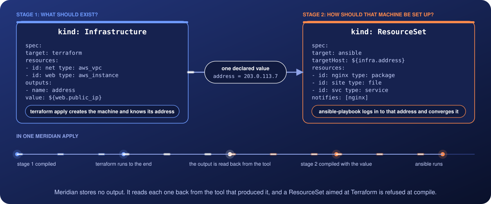

# The two-stage architecture

Meridian has two kinds of document, `Infrastructure` and `ResourceSet`, and runs
them as two stages. This page says why they are not one.

<p align="center"></p>

## They answer different questions

An Infrastructure document answers "what should exist?" Its tools (Terraform,
CloudFormation, Bicep, ARM templates, Pulumi, Docker, Kubernetes, Helm) create things through an API, keep
track of what they created, and can tell you facts about the result: an address,
an id, a URL.

A ResourceSet answers "how should this machine be set up?" Its tools (Ansible,
Puppet, OpenVox, Chef, DSC) log in to a machine, or run on it, and converge packages,
files and services. They need the machine to exist first, and they need to know
where it is.

Meridian holds a document to its question. Each plugin declares its category,
and a ResourceSet aimed at Terraform, or an Infrastructure document aimed at
Ansible, is refused when it is compiled. Docker is the one tool that answers
both: a container project either stands on its own, or runs on the daemon of a
machine the document names, so the `docker` target takes either kind.
[The table](../reference/dsl/index.md#the-document) is in the language
reference.

A single graph over both would have to pretend that "create a VM" and "install
nginx" are the same sort of step. They are not: one of them does not have a
place to run until the other has finished.

## The hand-off is one declared value

An Infrastructure document promises **outputs**:

```yaml
outputs:
  - name: address
    value: ${web.public_ip}
```

A ResourceSet names the output it needs as its host:

```yaml
targetHost:
  from: infrastructure
  ref: machine          # the Infrastructure document's name
  output: address
```

That is the whole interface between the stages. `meridian validate` checks that
the document and the output exist. The value itself is only known after the
first stage has been applied, and Meridian is strict about that:

- Until then, the ResourceSet is **deferred**. It is not compiled against a
  guess.
- When the first stage is applied, its tool reports the outputs, and the
  ResourceSet is compiled for the real value and applied. The outputs stay
  with the tool: a later run asks it again.
- If the first stage fails, later stages do not run.

A ResourceSet for a machine that is already there says so directly, and needs no
first stage:

```yaml
targetHost:
  from: inline
  host: web01.example.com
```

## Order within a workflow

Every Infrastructure document in a workflow runs before any ResourceSet,
whatever order the files are given in, unless a document
[imports](../reference/dsl/outputs-and-hand-offs.md#imports) a value from
another: a document always runs after the ones it needs, so a cloud-init
ResourceSet runs before the Infrastructure document that creates the machine
with its user-data. A workflow is simply the documents passed
to one `meridian` command, in one file separated by `---` or in several files.

## What this does not do

By default Meridian does not roll back a first stage because a second failed.
A run stops at the stage that failed, and
[`apply --resume`](run-safety.md#picking-up-where-a-run-stopped) continues
from there once the cause is fixed. Asked to with `--on-failure rollback`, it
[puts back](run-safety.md#putting-a-run-back) what the run changed by applying
what was applied before; it cannot remove what a first apply created.

Each tool keeps its own state and its own idea of drift: Terraform notices
drift when it plans, Ansible and Chef only when they run, Puppet and DSC
agents on their own schedule. [`meridian drift`](run-safety.md#finding-drift)
asks every tool the same question and reports what each says, without
papering over the difference: a tool that cannot preview is reported as
unknown, never as in sync.

What Meridian does across stages, so that a run is safe to repeat and to
share, is on [running safely](run-safety.md): one run at a time, a record of
every run, resuming a run that failed, putting one back, and finding drift.

A worked example: [a two-stage workflow](../quickstart/first-two-stage.md).
