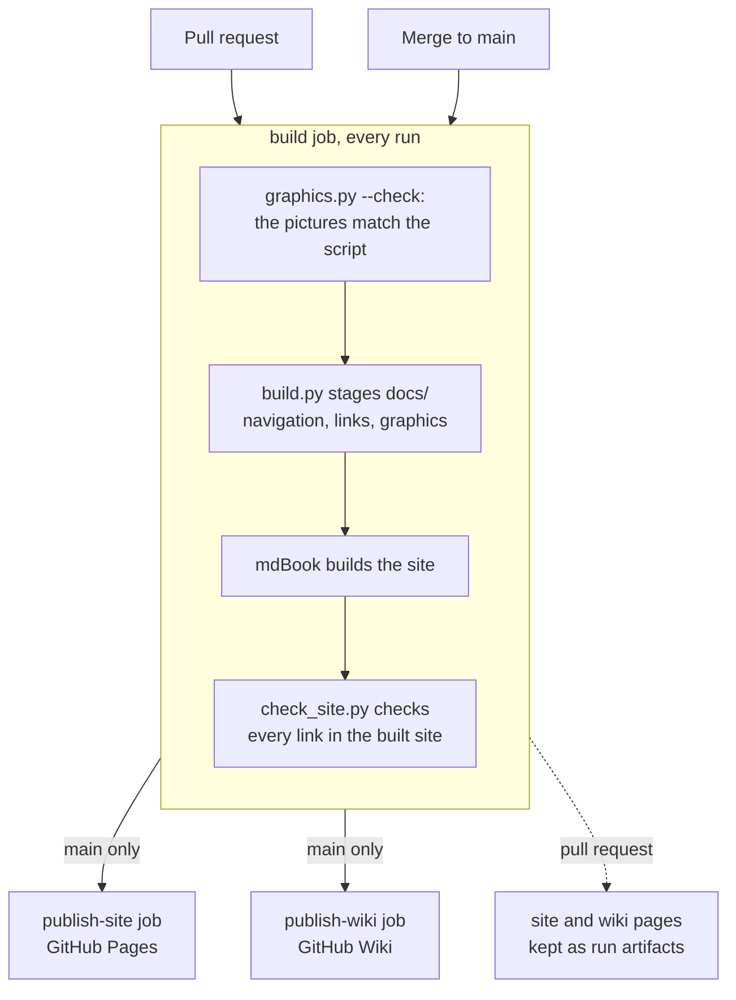

# How the documentation is published

Everything under `docs/` is published twice by one pipeline, and nothing is published
by hand:

| Where | Address | What it is |
|---|---|---|
| The documentation site | <https://zanattamichael.github.io/meridian-core/> | An [mdBook](https://rust-lang.github.io/mdBook/) site on GitHub Pages: sidebar navigation, full-text search, light and dark themes, rendered diagrams |
| The GitHub Wiki | <https://github.com/ZanattaMichael/meridian-core/wiki> | The same pages in the repository's Wiki tab, with a generated sidebar |

`docs/` is the only source. To change a page, change its file under `docs/` in a pull
request. The published copies are rebuilt from `main` every time a pull request merges,
so they cannot fall behind it. An edit made in the Wiki tab is overwritten by the next
run.

## What you have to do when you add documentation

Add the Markdown file under `docs/`. That is all.

- **Navigation.** There is no table of contents to edit. The pipeline reads the
  directory tree, and each page's first `#` heading becomes its name in the sidebar.
- **Targets.** `docs/targets/<name>.md` is listed under its plugin's category, read
  from the generated [capability matrix](../reference/capability-matrix.md).
- **Logos.** If `docs/branding/logos/meridian-<name>.svg` exists, it appears at the top
  of the target's published page and in the home page's plugin map. See
  [Meridian branding](../branding/README.md).
- **Links.** Use ordinary relative links, as on GitHub. Links to files outside
  `docs/`, such as `examples/`, are published as links to the file on GitHub.
- **Diagrams.** Use a fenced `mermaid` block; GitHub, the Wiki and the site all render
  it (the diagram below is one). For a picture explaining a whole subject, draw it in
  [`tools/wiki/graphics.py`](#the-graphics) instead, to match the others' look and
  motion.

## The pipeline

The workflow is [`.github/workflows/wiki.yml`](../../.github/workflows/wiki.yml).



| Job | Runs on | What it does |
|---|---|---|
| `build` | every pull request, every push to `main`, weekly, and on demand | Checks that the graphics match the script that draws them, stages `docs/`, builds the site, checks every internal link, image and heading anchor in the built pages, and keeps the site and the wiki pages as artifacts of the run |
| `publish-site` | `main` | Deploys the built site to GitHub Pages |
| `publish-wiki` | `main` | Replaces the contents of the Wiki with the generated pages |

A pull request never publishes. It proves the site builds with no broken links, and
keeps the built site as an artifact named `github-pages` that you can download to
preview the change.

### Link checks

There are three, and they look at different things:

| Check | Workflow | Looks at | Blocks a pull request |
|---|---|---|---|
| `tools/check_links.py` | `docs` | Relative links and heading anchors in every Markdown file in the repository | Yes |
| `tools/wiki/check_site.py` | `wiki` | Every link, image, stylesheet, script and `#fragment` in the HTML that mdBook wrote | Yes |
| [lychee](https://lychee.cli.rs/) | `wiki`, weekly and on demand | Links to other websites | No |

Links to other websites are fetched once a week rather than on every pull request, so
that somebody else's server being down cannot stop a merge.

## How the pages are generated

[`tools/wiki/build.py`](../../tools/wiki/build.py) writes both forms into `target/wiki/`
(which git ignores) using only the Python standard library.

| It does this | For the site | For the Wiki |
|---|---|---|
| Builds the navigation from the directory tree | `SUMMARY.md`, mdBook's table of contents | `_Sidebar.md` |
| Names each page | Keeps the path; a directory's `README.md` is served as its `index.html` | Flattens the path: `docs/targets/ansible.md` is the page `Targets-Ansible`, `docs/index.md` is `Home` |
| Rewrites links between pages | Relative links, unchanged | Links to the flattened page names |
| Rewrites links that leave `docs/` | Links to the file on GitHub | The same |
| Draws the plugin map | `generated/meridian-plugin-map.svg` | The same file |
| Adds the graphics to pages | The plugin map on the home page, each target's logo on its page | The same |
| Points at the other form | The home page links the Wiki | Every page opens with a link to its copy on the site; the sidebar and the footer link the site |

Sections appear in a fixed reading order (quickstart, concepts, reference, targets, and
so on, with the planning documents and branding last). A new top-level directory is
placed before the planning documents automatically. The order, and the title each
directory is shown under, are the short tables at the top of `build.py`.

### The graphics

There are three kinds, and all of them are drawn by a script rather than kept by hand:

- **The banner and the core mark** are kept in
  [`docs/branding/`](../branding/README.md), one banner for light and one for dark
  colour schemes. `tools/wiki/graphics.py` writes the animated copies
  (`*-animated.svg`) from the still ones: a point of light travels along each of the
  four meridians. `docs/index.md` and the README show the animated banner, so it
  matches on GitHub, the site and the Wiki; the site's top bar shows the animated mark.
- **The plugin map** is drawn by `build.py` on every build, so it is never stale. It
  shows one document going through the core to every plugin, one column per category,
  taken from the capability matrix and `docs/targets/`. Each tile uses the plugin's
  logo; a plugin without one gets a lettered tile.
- **The explanatory pictures** under [`docs/graphics/`](../graphics/) (the
  architecture, the path of a document, kinds and categories, the two stages, a
  secret's path, a run, modules) are drawn by
  [`tools/wiki/graphics.py`](../../tools/wiki/graphics.py) and committed, so GitHub
  shows them too. The workflow runs the script with `--check` and fails if a file
  differs from what the script draws, so change a picture by changing the script:

  ```
  python3 tools/wiki/graphics.py          # draw every file
  python3 tools/wiki/graphics.py --check  # what the workflow runs
  ```

  Each picture is one function in the script, built from a few helpers (a card, a
  chip, a line of text, a connector). To add one, write the function, add it to
  `GRAPHIC_FILES`, run the script, and put an `` for the new file on the page
  that explains the subject. The home page's "In pictures" table lists them.

#### Motion

Every graphic shares one motion: a point of light travelling along connecting lines,
like the banner's meridians leaving the single point that stands for the DSL. It is CSS
inside each SVG (`stroke-dasharray` on a copy of the line with `pathLength="100"`,
moved by `stroke-dashoffset`), so it plays wherever the file is shown as an image,
including a GitHub README, with no page script.

The site itself moves too, and every part of it is in two files:
[`tools/wiki/theme/meridian.css`](../../tools/wiki/theme/meridian.css) and
[`tools/wiki/theme/meridian.js`](../../tools/wiki/theme/meridian.js).

| What | Where | How |
|---|---|---|
| **The sky.** Behind every page, nine meridians drawn between two poles, a faint grid of points, three slow glows in the category colours, and light travelling along four of the lines. The top bar and the sidebar frost it; the page lets it through. It leans a little towards the pointer | `meridian.js` draws it as inline SVG as the page loads; `meridian.css` colours it for each of mdBook's themes (`--meridian-sky-*` on `.light`, `.rust`, `.navy`, `.coal`, `.ayu`) | the lines and dots are a tenth as strong as the text, so nothing behind a paragraph competes with it |
| The mark in the top bar | `meridian.js` puts the animated mark there and makes it a link home | without scripts the still mark is drawn by the stylesheet |
| A line of the four meridians across the top of the window | `meridian.js` fills it as far as the page has been read | |
| Each block of a page rises in as it scrolls into view, and each section heading draws its own short line when it arrives | `meridian.js` adds `meridian-reveal` to the blocks and an observer marks each `is-visible`; the classes are added only when the observer exists, so nothing is ever left hidden | |
| Each page rises in as it opens; the line under its title drifts through the four colours; links underline themselves from the left; sidebar entries slide under the pointer; the graphics and the mark lift when hovered; table rows ease | `meridian.css` | |

Readers who ask for less motion (`prefers-reduced-motion: reduce`) get a still site:
no travelling light, reveals or parallax. The stylesheet keeps motion inside a
`prefers-reduced-motion: no-preference` query, the script checks the same setting
before starting an observer or pointer listener, and each SVG under `docs/graphics/`
hides its light under the matching `reduce` query. Keep this rule for any new motion.

To change the sky, edit `sky()` in `meridian.js`. The short lists at its top set the
two poles, the positions of the nine lines, which four carry light, and where the
glows sit. The page draws the sky, so it is the same on every page and theme.

The site's look is `meridian.css` on top of mdBook's stock themes, and its settings are
[`tools/wiki/book.toml`](../../tools/wiki/book.toml).

## Building it on your own machine

You need Python 3.10 or later, and for the site, mdBook and its diagram plugin at the
versions the workflow pins:

```
cargo install --locked mdbook --version 0.5.4
cargo install --locked mdbook-mermaid --version 0.17.1
```

Then, from the top of the repository:

```
python3 tools/wiki/graphics.py --check         # the pictures match the script
python3 tools/wiki/build.py all                # stage both forms into target/wiki/
mdbook-mermaid install target/wiki/site        # add the diagram scripts
mdbook build target/wiki/site                  # write target/wiki/site/book/
python3 tools/wiki/check_site.py target/wiki/site/book --site-url=/meridian-core/
```

`mdbook serve target/wiki/site --open` shows the site in a browser. The Wiki pages are
plain Markdown in `target/wiki/wiki/`.

## Repository settings the pipeline depends on

Two settings can only be changed by an owner of the repository. Until each is set, its
publish job prints a warning that says what is missing and finishes without failing;
the build and the link checks run regardless.

| For | Setting |
|---|---|
| The site | **Settings → Pages → Build and deployment → Source: GitHub Actions** |
| The Wiki | **Settings → General → Features → Wikis** ticked, and then one page created by hand in the Wiki tab (any content; it is replaced). GitHub does not create a wiki's storage until it has a first page, and a workflow cannot create it |

It is also worth ticking **Restrict editing to collaborators only** under the Wikis
feature, since anything typed into the Wiki is replaced on the next run.

## Changing the address

The site address appears in:

- `tools/wiki/book.toml` (`site-url`, `git-repository-url`, `edit-url-template`);
- the workflow's `--site-url` argument;
- the table at the top of this page;
- `README.md`, `CONTRIBUTING.md` and `docs/index.md`;
- the `WIKI_SITE_URL` setting `build.py` reads for the Wiki's links to the site
  (otherwise derived from the repository name).

The Wiki's own addresses follow the repository name automatically.
