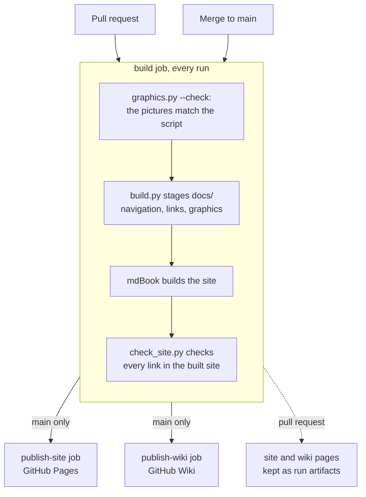

# How the documentation is published

`docs/` is published to two places by one pipeline:

| Where | Address | What it is |
|---|---|---|
| The documentation site | <https://zanattamichael.github.io/meridian-core/> | An [mdBook](https://rust-lang.github.io/mdBook/) site on GitHub Pages: sidebar navigation, full-text search, light and dark themes, rendered diagrams |
| The GitHub Wiki | <https://github.com/ZanattaMichael/meridian-core/wiki> | The same pages in the repository's Wiki tab, with a generated sidebar |

Edit pages under `docs/` in a pull request. Both copies are rebuilt on every merge to
`main`; Wiki-tab edits are overwritten.

## What you have to do when you add documentation

Add the Markdown file under `docs/`.

- **Navigation** comes from the directory tree; the first `#` heading is the sidebar name.
- **Targets** (`docs/targets/<name>.md`) are grouped by the
  [capability matrix](../reference/capability-matrix.md).
- **Logos**: `docs/branding/logos/meridian-<name>.svg` is shown if present
  ([branding](../branding/README.md)).
- **Links**: relative links; files outside `docs/` link to GitHub.
- **Diagrams**: `mermaid` blocks, or [`tools/wiki/graphics.py`](#the-graphics) for subject
  pictures.

## The pipeline

The workflow is [`.github/workflows/wiki.yml`](../../.github/workflows/wiki.yml).



| Job | Runs on | What it does |
|---|---|---|
| `build` | every pull request, every push to `main`, weekly, and on demand | Checks that the graphics match the script that draws them, stages `docs/`, builds the site, checks every internal link, image and heading anchor in the built pages, and keeps the site and the wiki pages as artifacts of the run |
| `publish-site` | `main` | Deploys the built site to GitHub Pages |
| `publish-wiki` | `main` | Replaces the contents of the Wiki with the generated pages |

Pull requests only build and check; the `github-pages` artifact is a preview.

### Link checks

Three checks:

| Check | Workflow | Looks at | Blocks a pull request |
|---|---|---|---|
| `tools/check_links.py` | `docs` | Relative links and heading anchors in every Markdown file in the repository | Yes |
| `tools/wiki/check_site.py` | `wiki` | Every link, image, stylesheet, script and `#fragment` in the HTML that mdBook wrote | Yes |
| [lychee](https://lychee.cli.rs/) | `wiki`, weekly and on demand | Links to other websites | No |

External links are checked weekly, not per pull request.

## How the pages are generated

[`tools/wiki/build.py`](../../tools/wiki/build.py) writes both into `target/wiki/` (standard
library only).

| It does this | For the site | For the Wiki |
|---|---|---|
| Builds the navigation from the directory tree | `SUMMARY.md`, mdBook's table of contents | `_Sidebar.md` |
| Names each page | Keeps the path; a directory's `README.md` is served as its `index.html` | Flattens the path: `docs/targets/ansible.md` is the page `Targets-Ansible`, `docs/index.md` is `Home` |
| Rewrites links between pages | Relative links, unchanged | Links to the flattened page names |
| Rewrites links that leave `docs/` | Links to the file on GitHub | The same |
| Draws the plugin map | `generated/meridian-plugin-map.svg` | The same file |
| Adds the graphics to pages | The plugin map on the home page, each target's logo on its page | The same |
| Points at the other form | The home page links the Wiki | Every page opens with a link to its copy on the site; the sidebar and the footer link the site |

Section order and titles are the tables at the top of `build.py`; new top-level
directories go before the plans.

### The graphics

- **Banner and mark**: still versions in [`docs/branding/`](../branding/README.md);
  `tools/wiki/graphics.py` writes the `*-animated.svg` copies.
- **Plugin map**: drawn by `build.py` each build from the capability matrix.
- **Explanatory pictures** in [`docs/graphics/`](../graphics/): drawn by
  [`tools/wiki/graphics.py`](../../tools/wiki/graphics.py) and committed. CI runs `--check`,
  so edit the script:

  ```
  python3 tools/wiki/graphics.py          # draw every file
  python3 tools/wiki/graphics.py --check  # what the workflow runs
  ```

  To add one, write a function, add it to `GRAPHIC_FILES`, run the script, and link the
  file from its page.

#### Motion

Graphics animate a point of light along lines with CSS inside the SVG
(`stroke-dasharray`, `pathLength="100"`, `stroke-dashoffset`), so no script is needed. Site
motion is in [`meridian.css`](../../tools/wiki/theme/meridian.css) and
[`meridian.js`](../../tools/wiki/theme/meridian.js).

| What | Where | How |
|---|---|---|
| **The sky.** Behind every page, nine meridians drawn between two poles, a faint grid of points, three slow glows in the category colours, and light travelling along four of the lines. The top bar and the sidebar frost it; the page lets it through. It leans a little towards the pointer | `meridian.js` draws it as inline SVG as the page loads; `meridian.css` colours it for each of mdBook's themes (`--meridian-sky-*` on `.light`, `.rust`, `.navy`, `.coal`, `.ayu`) | the lines and dots are a tenth as strong as the text, so nothing behind a paragraph competes with it |
| The mark in the top bar | `meridian.js` puts the animated mark there and makes it a link home | without scripts the still mark is drawn by the stylesheet |
| A line of the four meridians across the top of the window | `meridian.js` fills it as far as the page has been read | |
| Each block of a page rises in as it scrolls into view, and each section heading draws its own short line when it arrives | `meridian.js` adds `meridian-reveal` to the blocks and an observer marks each `is-visible`; the classes are added only when the observer exists, so nothing is ever left hidden | |
| Each page rises in as it opens; the line under its title drifts through the four colours; links underline themselves from the left; sidebar entries slide under the pointer; the graphics and the mark lift when hovered; table rows ease | `meridian.css` | |

All motion must stop under `prefers-reduced-motion: reduce`, in CSS, JS and each SVG.

The sky is `sky()` in `meridian.js`. mdBook settings are in
[`tools/wiki/book.toml`](../../tools/wiki/book.toml).

## Building it on your own machine

Needs Python 3.10+, and mdBook with its mermaid plugin at the pinned versions:

```
cargo install --locked mdbook --version 0.5.4
cargo install --locked mdbook-mermaid --version 0.17.1
```

```
python3 tools/wiki/graphics.py --check         # the pictures match the script
python3 tools/wiki/build.py all                # stage both forms into target/wiki/
mdbook-mermaid install target/wiki/site        # add the diagram scripts
mdbook build target/wiki/site                  # write target/wiki/site/book/
python3 tools/wiki/check_site.py target/wiki/site/book --site-url=/meridian-core/
```

Preview with `mdbook serve target/wiki/site --open`. Wiki pages are in `target/wiki/wiki/`.

## Repository settings the pipeline depends on

Owner-only settings. Until set, the publish job warns and passes:

| For | Setting |
|---|---|
| The site | **Settings → Pages → Build and deployment → Source: GitHub Actions** |
| The Wiki | **Settings → General → Features → Wikis** ticked, and then one page created by hand in the Wiki tab (any content; it is replaced). GitHub does not create a wiki's storage until it has a first page, and a workflow cannot create it |

Also tick **Restrict editing to collaborators only** for the Wiki.

## Changing the address

The site address is in:

- `tools/wiki/book.toml` (`site-url`, `git-repository-url`, `edit-url-template`);
- the workflow's `--site-url` argument;
- the table at the top of this page;
- `README.md`, `CONTRIBUTING.md` and `docs/index.md`;
- the `WIKI_SITE_URL` setting `build.py` reads for the Wiki's links to the site
  (otherwise derived from the repository name).
