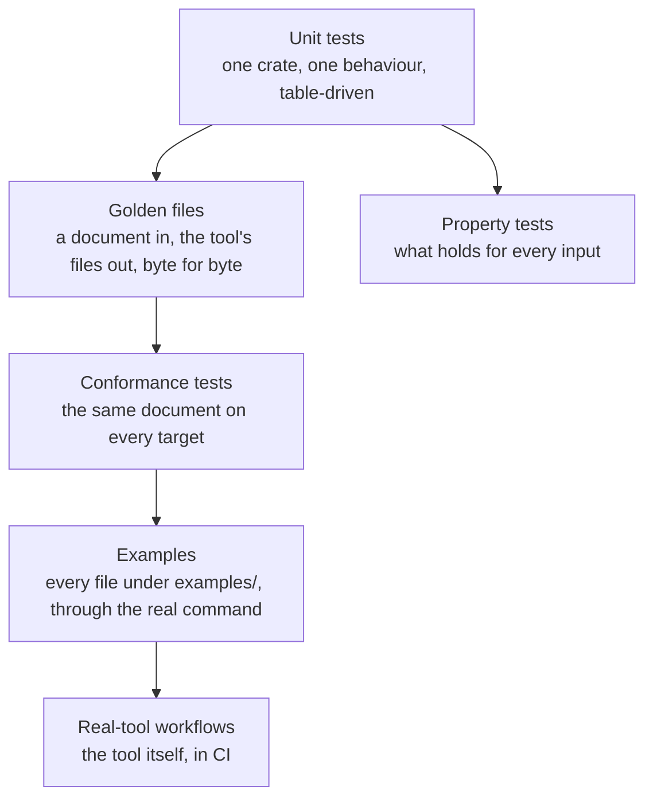

# How Meridian is tested

This page says what tests exist today, what each kind is for, and how to add to
them. The [testing plan](../plans/testing-plan.md) says where testing is
heading; this page is what CI enforces now.



| Kind | Lives in | Run it |
|---|---|---|
| Unit tests | `crates/*/tests/`, `plugins/*/tests/` | `cargo test -p <crate>` |
| Golden files | `plugins/<name>/testdata/` | `cargo test -p meridian-target-<name>`; record with `UPDATE_GOLDEN=1` |
| Property tests | `crates/meridian-cli/tests/properties.rs` | `cargo test -p meridian-cli --test properties` |
| Placement tests | `crates/meridian-cli/tests/placement.rs`, `placement_properties.rs` | `cargo test -p meridian-cli --test placement --test placement_properties` |
| Secret tests | `crates/meridian-cli/tests/secret_places.rs`, `secret_properties.rs`, `secrets.rs` | `cargo test -p meridian-cli --test secret_places --test secret_properties --test secrets` |
| Conformance tests | `crates/meridian-cli/tests/conformance.rs` | `cargo test -p meridian-cli --test conformance` |
| Robustness tests | `crates/meridian-cli/tests/robustness.rs` | `cargo test -p meridian-cli --test robustness` |
| Examples | `crates/meridian-cli/tests/examples.rs` | `cargo test -p meridian-cli --test examples` |
| Real tools | a workflow per tool under `.github/workflows/` | in CI; [Real-tool tests](real-tool-tests.md) lists what each one runs and how to run it yourself |

Everything except the real-tool workflows runs with `cargo test --workspace`,
needs no tool installed, and takes a few minutes.

## Unit tests and golden files

A plugin's `tests/compile.rs` compiles documents in process and checks two
things. What a valid document compiles to is compared with a golden file,
because the exact bytes are the contract with the tool. What an invalid document
is refused with is asserted field by field: the rule, the resource, the message
and the line. A refusal's wording is part of what a user sees, so it is tested
as closely as the output is.

`tests/run.rs` tests the runner against a stand-in: a shell script that takes
the tool's place, sees its real arguments and working directory, and answers as
the tool would. [Writing a plugin](writing-a-plugin.md) has both in detail.

### A table for every validation rule

Some of a plugin's validation rules cannot be reached from a document: the
earlier stages never produce a model that breaks them, and the rule is there
for a tree assembled some other way. A test in `tests/compile.rs` cannot break
those, so each plugin's `src/validate.rs` ends with a test module that builds
the stage's own model and has two tables.

| Test | What it holds |
|---|---|
| `each_rule_refuses_the_one_mistake_it_is_for` | one row for each way to break each rule: the rule's name, the resource the refusal must name, and one change to a model the stage accepts. The refusal must also carry the target and the resource's line |
| `what_looks_alike_but_is_allowed_is_accepted` | models a reader might expect to be refused and are not: one provider twice under two aliases, a user and a group of one name, one object name in two namespaces |

A rule about names has a table of its own, of names accepted and names
refused, with the longest allowed and the first too long. A rule that warns
and does not refuse is tested for the warning and for the cases that stay
quiet. When you add a rule, add its rows; a rule with no row is a rule nothing
holds in place.

## Property tests

An example-based test says "this input gives that output". A property test
says what must hold for every input, and lets the machine look for an input that
breaks it. `properties.rs` runs about twenty-five of them, a few thousand
generated inputs each, in three shapes:

| Shape | Examples |
|---|---|
| **Nothing panics** | arbitrary bytes, punctuation soup, a real document with bytes cut out or doubled, and nesting thousands deep are each answered with a value or an error, never a crash |
| **Round trips** | YAML Meridian writes is read back as the same value; canonical JSON decodes to what was encoded; a document is the same document in YAML and in JSON |
| **A model agrees** | a second, naive implementation written in the test decides the same as the real one: the condition language, the topological sort, `when` pruning, label selectors, and each hierarchy merge strategy |

The model tests are the ones behind the claims the documentation makes. "A
condition means the same on every target" rests on the condition language
having one meaning, and
`a_condition_is_decided_as_the_documented_language_says` holds the evaluator to
the grammar and the rules in [conditions](../reference/dsl/conditions.md) for
three thousand generated expressions a run, with their precedence, their
short-circuiting and their errors. The model covers the core of the language:
literals, paths into the data, `defined()`, `!`, `&&`, `||`, `==` and `!=`.
The other operators and the functions are tested in `crates/meridian-expr`.

An example that decides by `when`, or interpolates a value, needs its data
before it can be compiled, so the conformance and robustness tests, which
build a tree straight from a file, pass over it. `examples.rs` compiles it through the command with its
data files.

When a property fails, the output ends with the smallest input that still
fails:

```
minimal failing input: original = List([Float(8.038549324716471e-175)])
```

proptest also writes that input to
`crates/meridian-cli/tests/properties.proptest-regressions`, and tries it first
on every later run. Commit the file with the fix. To look harder for a failure
locally, raise the number of cases:

```
PROPTEST_CASES=20000 cargo test -p meridian-cli --test properties
```

What these tests have found so far, each fixed with a test of its own:

- A float in a JSON document or crossing the plugin boundary could change in
  its last digit. JSON numbers are now read exactly.
- A document nested a few hundred levels deep could overflow the stack of a
  thread with a small one. The limit is now 64 levels, in YAML and in JSON, and
  holds on a 1 MiB stack.

### Placement: what data supplies is text

[Interpolation](../reference/dsl/interpolation.md) makes one promise that is
easy to break: whatever text data supplies, a tool reads it as text. Only what
the author wrote is ever a reference. Two files hold it in place.

`placement.rs` is a table. Each row is a value an author might write, the data
it reads, and exactly what the plugin must be given, compiled by the real
command:

| Row | Written | Data | The plugin is given |
|---|---|---|---|
| data that looks like a reference | `${{ data.v }}` | `${web.id}` | text that reads `${web.id}`, and no reference |
| two halves that would meet | `${{ data.a }}${{ data.b }}` | `$` and `{web.id}` | text, kept apart from each other |
| a reference beside data | `${web.id}-${{ data.v }}` | `${x}` | the reference to `web`, then text |
| a dollar from data before a reference | `${{ data.v }}${web.id}` | `costs $` | refused: the reference would be lost |

There are twenty-four rows, and a test that the references a plugin reads are
exactly the ones the author wrote. To add a case, add a `Row`.

`placement_properties.rs` asks the same of generated values. It builds a value
from pieces, some the author's text and some from data, out of the characters
that matter (`$`, `{`, `}`, `$$`, `${`, `}}`). The model is a few lines: read
each of the author's pieces the way a plugin reads it, and put the data
between them as plain text. The implementation has to reach the same reading by
escaping, and the test fails wherever the two differ. Its failures are kept in
`placement_properties.proptest-regressions`.

The table found one: a value from data ending in `$`, placed directly before a
reference, turned the reference into literal text, because a `$` before `${` is
how a plugin is told the text is literal. That is now refused, with a message
that says to put a space between the two.

### Secrets: who may read a value, and never the value

[A secret](../reference/dsl/secrets.md) makes two promises. Its value is in
nothing Meridian prints or writes, and marking a value as a secret changes
nothing else about what a document means.

`secret_properties.rs` holds the second. Its model is the expression engine
itself: every generated expression is worked out twice from the same text,
once where `secret.a` and `secret.b` are secrets and once where they are
ordinary text with the same characters. A comparison must give the same yes or
no. A secret must hold exactly the characters the plain reading gave. Anything
readable that comes out must hold no secret. A function that is not on the
short list must refuse a secret, name the functions that take one, and repeat
nothing of the value, and must do its work when the same expression holds no
secret. Nothing made from a secret may outlive the wipe.

`secret_places.rs` holds the first, through the real command. It is a table
of every place a document can ask a question of a secret:

| Place | Written as |
|---|---|
| a resource | `when: secret.password != 'changeme'` |
| the whole document | `spec.when` |
| a named condition, and one that reads another | `conditions:` |
| a variable that holds the answer | `variables:` with `${{ secret.password != 'changeme' }}` |
| an output | `when:` on the output |
| an edge | `when:` on a `dependsOn` or `notifies` entry |
| a file's content | `${{ secret.password == 'changeme' ? 'default' : 'changed' }}` |

Each row is planned with a password that makes the question true and one that
makes it false, and must give both answers. `compile` must stop at that place
and name it. With no password, every row must stop the same way. And after
`plan`, `apply` and `plan` again, the password must be in nothing printed and
in no file the run left behind, the state directory included. To cover a new
place, add a `Place`.

`secrets.rs` covers the providers and what each command does. The two examples
that use secrets are tested in `examples.rs`: one is planned and applied for
six machines that differ only in the secrets they have, the other is compiled
with a password in the environment that must not appear in any file.

### Writing one

Add a property when you add something that parses, orders, merges or decides.
State the rule as the documentation states it, write the slowest, most obvious
implementation of that rule in the test, and assert the two agree:

```rust
proptest! {
    #![proptest_config(cases(1500))]

    #[test]
    fn a_selector_selects_exactly_when_every_requirement_holds(
        requirements in vec(requirement(), 1..5),
        labels in btree_map(key(), value(), 0..4),
    ) {
        let expected = requirements.iter().all(|r| r.holds(&labels));
        let selector = Selector::parse(&text_of(&requirements)).unwrap();
        prop_assert_eq!(selector.matches(&labels), expected);
    }
}
```

Generate inputs that are nearly right as well as inputs that are random: a
valid document with one edit finds more than noise does.

## Conformance tests

`conformance.rs` compiles the same document with every target that should
agree about it.

**The shared dialect.** About ninety small documents, covering every type,
state and param of the [configuration management types](../reference/resource-types.md),
`dependsOn`, `notifies`, references and `runtimeWhen`, are each compiled by
Ansible, Chef, cloud-init, OpenVox, Puppet and Salt. How each compile came out
is written to the [conformance matrix](../reference/conformance-matrix.md), and
the test fails when that page is out of date. Each case is marked as one the
targets must agree on or one where the tools differ; a target that breaks ranks
on a case marked the same fails the test. Further tests hold all six to:

- Puppet and OpenVox compile every case to the same manifest;
- every case compiles to the same bytes twice;
- every refusal names its target, its resource and a line;
- a settled `${...}` leaves no marker in any output, and the value it named is
  there;
- a dependency is written before what depends on it.

**Every target.** Each example under `examples/<target>/` is put through rules
that hold whatever the segment: it compiles deterministically to relative
paths; a `runtimeWhen` on any of its resources is compiled in or refused, never
dropped; a target that declares no notify refuses one between any two
resources; an unknown type is refused under one rule. A document written for
Terraform compiles to the same configuration for OpenTofu.

Literal text is held to the same standard on all eighteen. Every text param of
every example is compiled three ways: with plain text, with text that looks
like a reference but is marked literal, and with the reference itself. Where
the target accepts the text at all, the literal reaches the output as the
characters it is, and never as what the reference compiles to. No target may
read text as a reference because of what it holds.

To add a case, add a `case(...)` to `CASES` and record the page:

```
UPDATE_GOLDEN=1 cargo test -p meridian-cli --test conformance
```

Read the row it adds. If the targets disagree where you expected them to
agree, that is a finding: either a target is wrong, or the case is `Varies` and
the reference should say why.

## Robustness tests

A plugin is a separate program, and must not trust that the tree it is handed
was checked. `robustness.rs` takes every example's tree and damages it in the
ways a careless or hostile host could: about fifty awkward strings (empty,
newlines, quotes, every tool's own interpolation syntax, path traversal,
control characters) and a dozen awkward values in every name, id, type, state
and param; resources missing, doubled or reversed; edges that point nowhere or
in a circle; outputs that read nothing. Tens of thousands of trees per run,
and one rule for every target: the answer is files at relative paths, or a
refusal that names the target and the rule. Never a panic.

The first run found one: a resource id used twice made the Ansible, Puppet and
OpenVox sort stages panic. They now refuse it as `duplicate-resource`.

## Examples

Every `.yaml` file under `examples/` is validated and compiled by the real
`meridian` command with the real plugin binaries. The workflows under
`examples/workflow/` are held to more:

- each document that can be compiled is written to a directory named after it,
  and each ResourceSet that waits for an output is reported as deferred;
- each deferred document is compiled again with a host filled in, so a mistake
  in a document that waits is still caught;
- a workflow with data files is compiled once per data set
  (`site.data.yaml`, then `site.<name>.data.yaml` layered over it), and
  `environments.yaml` is checked resource by resource against what its
  conditions should keep in development and in production;
- a document left out by its own `spec.when` is expected to be reported as
  skipped and to compile nothing, and every document must be kept by at least
  one of the workflow's data sets, so no document goes untested;
- `tenants.yaml` is checked for what each plan decides: which documents run,
  which resources and outputs they hold, the values functions work out, the
  types those values keep, and that text from data reaches a file unchanged;
- an example whose conditions read a secret cannot be compiled, because
  `compile` fetches none. It must be refused for exactly that reason, and is
  planned and applied with its secrets by a test of its own.

An example the documentation shows is always one of these files, so it cannot
rot.

## Coverage

The `coverage` workflow measures line, function and region coverage of the
whole workspace on every pull request, writes the table to the run's summary,
and fails if line coverage falls below its floor. To measure it yourself:

```
cargo install cargo-llvm-cov --locked
rustup component add llvm-tools
cargo llvm-cov --workspace --locked --summary-only
cargo llvm-cov --workspace --locked --html      # target/llvm-cov/html/index.html
```

Each plugin's `main.rs` shows as uncovered. It is three lines that hand the
plugin to the SDK, and it runs in a separate process the measurement does not
follow; the tests that start the plugin's real binary, and the examples test,
are what exercise it.

A number is a way to find code no test reaches, not a goal. A refusal that no
test triggers is the usual finding, and the fix is a test that names the rule
and the message.
