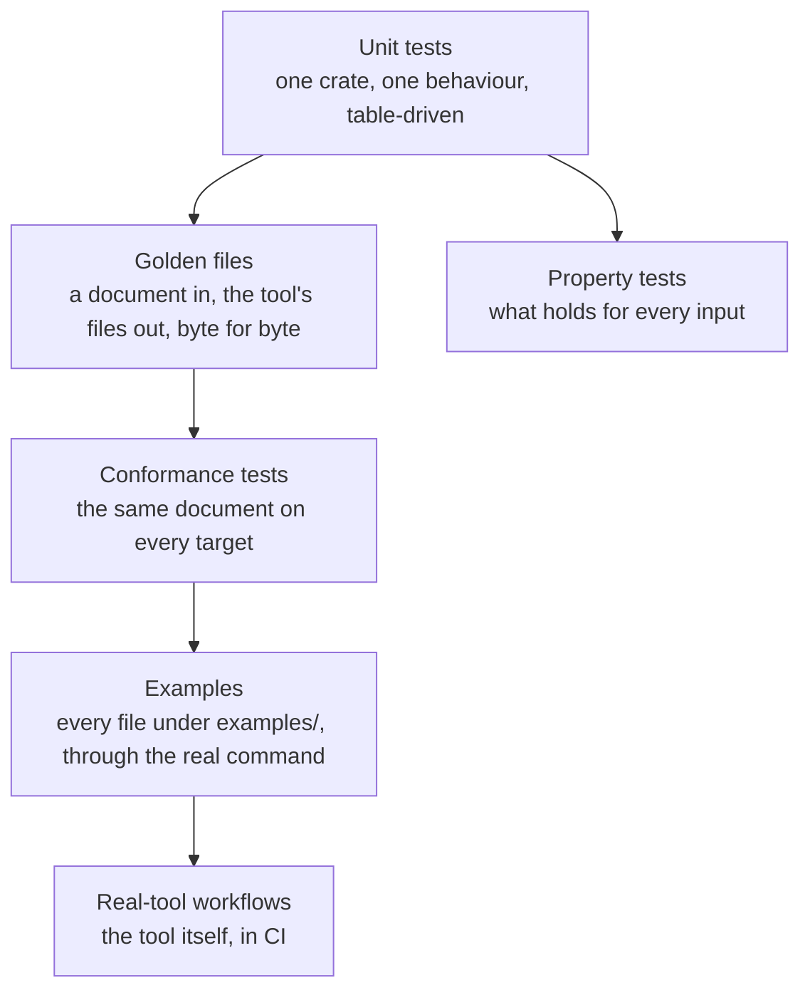

# How Meridian is tested

What CI tests today. Future work: [testing plan](../plans/testing-plan.md).



| Kind | Lives in | Run it |
|---|---|---|
| Unit tests | `crates/*/tests/`, `plugins/*/tests/` | `cargo test -p <crate>` |
| Golden files | `plugins/<name>/testdata/` | `cargo test -p meridian-target-<name>`; record with `UPDATE_GOLDEN=1` |
| Property tests | `crates/meridian-cli/tests/properties.rs` | `cargo test -p meridian-cli --test properties` |
| Placement tests | `crates/meridian-cli/tests/placement.rs`, `placement_properties.rs` | `cargo test -p meridian-cli --test placement --test placement_properties` |
| Secret tests | `crates/meridian-cli/tests/secret_places.rs`, `secret_properties.rs`, `secrets.rs` | `cargo test -p meridian-cli --test secret_places --test secret_properties --test secrets` |
| Conformance tests | `crates/meridian-cli/tests/conformance.rs`, `infra_conformance.rs`, `condition_conformance.rs`, `secret_conformance.rs` | `cargo test -p meridian-cli --test conformance --test infra_conformance --test condition_conformance --test secret_conformance` |
| Robustness tests | `crates/meridian-cli/tests/robustness.rs` | `cargo test -p meridian-cli --test robustness` |
| Examples | `crates/meridian-cli/tests/examples.rs` | `cargo test -p meridian-cli --test examples` |
| Real tools | a workflow per tool under `.github/workflows/` | in CI; [Real-tool tests](real-tool-tests.md) lists what each one runs and how to run it yourself |

All but the real-tool tests run with `cargo test --workspace`, no tools needed.

## Unit tests and golden files

A plugin's `tests/compile.rs` compares valid output with golden files and asserts each
refusal's rule, resource, message and line. `tests/run.rs` tests the runner against a
stand-in script. See [writing a plugin](writing-a-plugin.md).

Both use `crates/meridian-plugin-testkit` (tested in `tests/kit.rs`):

- A golden is `testdata/<case>.<suffix>`, the suffix one word and not a source extension
  (`web.playbook_yml`, not `web.yaml`). `UPDATE_GOLDEN=1` rewrites only that case's goldens.
- Stand-ins are written atomically, so concurrent tests are safe.

### A table for every validation rule

Some rules cannot be reached from a document, so each plugin's `src/validate.rs` tests
the model directly with two tables:

| Test | What it holds |
|---|---|
| `each_rule_refuses_the_one_mistake_it_is_for` | one row for each way to break each rule: the rule's name, the resource the refusal must name, and one change to a model the stage accepts. The refusal must also carry the target and the resource's line |
| `what_looks_alike_but_is_allowed_is_accepted` | models a reader might expect to be refused and are not: one provider twice under two aliases, a user and a group of one name, one object name in two namespaces |

Name rules have accepted and refused tables, including the length boundary. Warnings are
tested both ways. Add rows for every new rule.

## Property tests

`properties.rs` runs about 25 properties, thousands of inputs each:

| Shape | Examples |
|---|---|
| **Nothing panics** | arbitrary bytes, punctuation soup, a real document with bytes cut out or doubled, and nesting thousands deep are each answered with a value or an error, never a crash |
| **Round trips** | YAML Meridian writes is read back as the same value; canonical JSON decodes to what was encoded; a document is the same document in YAML and in JSON |
| **A model agrees** | a second, naive implementation written in the test decides the same as the real one: the condition language, the topological sort, `when` pruning, label selectors, and each hierarchy merge strategy |

`a_condition_is_decided_as_the_documented_language_says` checks the evaluator against
[conditions](../reference/dsl/conditions.md) on 3,000 expressions per run (literals, paths,
`defined()`, `!`, `&&`, `||`, `==`, `!=`); the rest is tested in `crates/meridian-expr`.
Examples needing data are compiled by `examples.rs`.

A failure ends with the smallest failing input:

```
minimal failing input: original = List([Float(8.038549324716471e-175)])
```

It is saved to `crates/meridian-cli/tests/properties.proptest-regressions`; commit it with the
fix. To search harder:

```
PROPTEST_CASES=20000 cargo test -p meridian-cli --test properties
```

### Placement: what data supplies is text

[Interpolated](../reference/dsl/interpolation.md) data is always text to the tool.
`placement.rs` is a table of value, data and exact plugin input:

| Row | Written | Data | The plugin is given |
|---|---|---|---|
| data that looks like a reference | `${{ data.v }}` | `${web.id}` | text that reads `${web.id}`, and no reference |
| two halves that would meet | `${{ data.a }}${{ data.b }}` | `$` and `{web.id}` | text, kept apart from each other |
| a reference beside data | `${web.id}-${{ data.v }}` | `${x}` | the reference to `web`, then text |
| a dollar from data before a reference | `${{ data.v }}${web.id}` | `costs $` | refused: the reference would be lost |

Add a `Row` for a new case. `placement_properties.rs` generates values from `$`, `{`, `}`,
`$$`, `${` and `}}` pieces and compares with a simple model.

### Secrets: who may read a value, and never the value

[Secrets](../reference/dsl/secrets.md) are never printed or written, and otherwise behave as
plain values. `secret_properties.rs` evaluates each expression with secrets and as plain text:

- comparisons must give the same answer;
- a secret must hold exactly the characters of the plain result;
- nothing readable that comes out may hold a secret;
- a function not on the short list must refuse a secret, name the functions
  that accept one, repeat nothing of the value, and still work when the
  expression holds no secret;
- nothing made from a secret may outlive the wipe.

`secret_places.rs` tables every place a document can test a secret:

| Place | Written as |
|---|---|
| a resource | `when: secret.password != 'changeme'` |
| the whole document | `spec.when` |
| a named condition, and one that reads another | `conditions:` |
| a variable that holds the answer | `variables:` with `${{ secret.password != 'changeme' }}` |
| an output | `when:` on the output |
| an edge | `when:` on a `dependsOn` or `notifies` entry |
| a file's content | `${{ secret.password == 'changeme' ? 'default' : 'changed' }}` |

Each row is planned true and false, `compile` must stop and name it, and after `plan`,
`apply`, `plan` the password must appear nowhere. Add a `Place` for a new one. A workflow
test checks three stages sharing one environment secret.

`secrets.rs` covers providers and commands; `examples.rs` tests the two secret examples.

### Writing one

Add one for anything that parses, orders, merges or decides: write the obvious model and
assert agreement:

```rust
proptest! {
    #![proptest_config(cases(1500))]

    #[test]
    fn a_selector_selects_exactly_when_every_requirement_holds(
        requirements in vec(requirement(), 1..5),
        labels in btree_map(key(), value(), 0..4),
    ) {
        let expected = requirements.iter().all(|r| r.holds(&labels));
        let selector = Selector::parse(&text_of(&requirements)).unwrap();
        prop_assert_eq!(selector.matches(&labels), expected);
    }
}
```

Generate near-valid inputs as well as random ones.

## Conformance tests

`conformance.rs` compiles the same document for every target that should agree.

**Shared dialect.** About 90 documents covering the
[configuration management types](../reference/resource-types.md), `dependsOn`, `notifies`,
references and `runtimeWhen` are compiled by Ansible, Chef, cloud-init, OpenVox, Puppet and
Salt into the [conformance matrix](../reference/conformance-matrix.md) (stale page fails).
Also:

- Puppet and OpenVox compile every case to the same manifest;
- output is deterministic;
- every refusal names its target, its resource and a line;
- a settled `${...}` leaves no marker;
- dependencies come first.

**Common infrastructure types.** `infra_conformance.rs` compiles about 40 documents using
`network`, `subnet`, `firewall`, `address`, `vm`, `disk` and `objectStore` for Terraform and OpenTofu (AWS, Azure, Google Cloud), Pulumi (AWS, Azure),
CloudFormation, Bicep and ARM into the
[infra conformance matrix](../reference/infra-conformance-matrix.md). It fails if a target
declares only some of the five or has no column, and checks a secret ssh key is never
written.

**Every target.** Each `examples/<target>/` example must compile deterministically to
relative paths, never drop `runtimeWhen`, refuse undeclared notifies, and refuse unknown
types under one rule. Terraform and OpenTofu output must match.

`condition_conformance.rs` puts the same `when` on every resource of each example, per kind
of condition: true gives the unconditioned files, false reports every removal, undecidable
is refused identically.

Literal text: every text param is compiled as plain, literal-looking-like-a-reference, and
reference; the literal must reach the output unchanged.

`secret_conformance.rs`: targets that take secrets write the tool's own reference; others
write the placeholder and `plan` stops with the same words. Credentials likewise. A target
gaining support moves between the test's lists.

To add a case, add `case(...)` to `CASES` and regenerate the page:

```
UPDATE_GOLDEN=1 cargo test -p meridian-cli --test conformance
```

Unexpected disagreement means a target is wrong, or the case is `Varies`.

## Robustness tests

`robustness.rs` damages every example's tree (about 50 awkward strings in every field;
missing, doubled or reversed resources; dangling or circular edges; empty outputs). Every
target must return relative files or a named refusal, never panic.

## Tests people write for their own documents

Users test their documents with [`meridian test`](../reference/testing.md); `examples/tests/`
is run by the examples test.

## Examples

Every `.yaml` under `examples/` is validated and compiled with the real binaries. Workflows
under `examples/workflow/` also:

- report deferred ResourceSets, then compile them with a host filled in;
- compile once per data set (`site.data.yaml`, then `site.<name>.data.yaml`);
  `environments.yaml` is checked per resource;
- report `spec.when` exclusions as skipped, and every document is kept by some data set;
- check `tenants.yaml` plans in detail;
- refuse examples whose conditions read a secret; those are planned and applied separately.

Documentation examples are always these files.

## Coverage

The `coverage` workflow fails if line coverage drops below its floor. Locally:

```
cargo install cargo-llvm-cov --locked
rustup component add llvm-tools
cargo llvm-cov --workspace --locked --summary-only
cargo llvm-cov --workspace --locked --html      # target/llvm-cov/html/index.html
```

Plugin `main.rs` files show as uncovered because they run in a separate process.

## Superseded CI runs

Every workflow has a `concurrency` group of workflow plus ref. A newer run for the same branch or pull request cancels the older one, on `main` too.

| Workflow | Cancelled when superseded |
|---|---|
| `wiki` | pull requests only; a publish on `main` queues |
| `azure` | pull requests only; the subscription job deploys real resources |
| `release` | pull requests only; tag runs are never cancelled |
| `cut release` | never; one at a time |
| all others | always |

A new workflow copies this block, unless it publishes or deploys:

```yaml
concurrency:
  group: ${{ github.workflow }}-${{ github.ref }}
  cancel-in-progress: true
```

## Which changes run a plugin's workflow

A plugin's real-tool workflow runs, on pull requests and on `main`, only when the change touches a path it builds from: the plugin, the workspace crates it depends on (from `cargo metadata`), its examples, `Cargo.toml`, `Cargo.lock`, `rust-toolchain.toml`, `.github/actions/setup-rust` or the workflow itself. `push` and `pull_request` share one list through a YAML anchor (`&paths`, `*paths`).

When a plugin gains a dependency on another workspace crate, add that crate to its workflow's list.

## Draft pull requests

On a draft pull request the real-tool workflows (each plugin's, `azure`, `opa`, `modules`, `vertical slice`) start but skip every job (`if: github.event.pull_request.draft != true`). Marking the pull request ready for review runs them (`ready_for_review` is in their `types`). `rust`, `docs`, `coverage` and the other core workflows run on drafts as before. Mark a pull request ready before asking for a merge, so its real-tool results exist.
