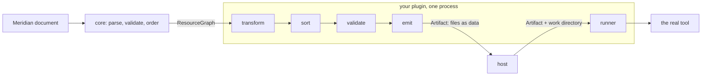

# Writing a plugin

A plugin compiles documents into one tool's files and runs that tool. It depends only on
`meridian-sdk`. Try [your first ResourceSet](../quickstart/first-resourceset.md) first.

## What you are building



Two required halves, two optional:

| Half | Trait | What it does | Side effects |
|---|---|---|---|
| Compiling | [`Emitter`](../../crates/meridian-sdk/src/types.rs) | turns a `ResourceGraph` into an `Artifact` (paths and file contents, as data), or refuses | none, ever |
| Running | [`Runner`](../../crates/meridian-sdk/src/run.rs) | writes the artifact to a work directory and drives the tool to `plan`, `apply` and report `outputs` | whatever the tool does |
| Importing, optional | [`Importer`](../../crates/meridian-sdk/src/import.rs) | reads the tool's existing configuration, handed to it as text, and returns documents as data with notes on what it could not carry over. See [An importer](#an-importer) | none, ever |
| Describing the tool's types, optional | [`SchemaSource`](../../crates/meridian-sdk/src/schemas.rs) | asks the installed tool for the schemas of its own resource types, so editors complete and check them. Called by `meridian schema sync` only, never by an editor. See [A schema source](#a-schema-source) | runs the tool, inside a work directory the host gives it |

The core has already parsed, validated and ordered the document. The one rule:

> A document either compiles to something that does what it says, or it does
> not compile and the author is told why. A plugin never emits output that
> quietly does less.

Refuse with a `CompileError` anything the tool cannot express
([capability model](../concepts/capability-model.md)).

### What the core has already done

Do not handle these again ([language reference](../reference/dsl/index.md)):

| In the document | What the core does with it |
|---|---|
| `kind` | checked against your category. Infrastructure as code and container orchestration take `Infrastructure` documents and refuse a `ResourceSet`; configuration management is the reverse; containerization takes both |
| `metadata.labels` | used to select documents on the command line (`--selector`). Not passed to plugins |
| `when` and `ifMissing` | evaluated, and the resource kept or pruned, before you see the tree. Only `runtimeWhen` reaches you |
| `dependsOn` | cycles and unknown resources are refused; the resources arrive in a valid order |
| `notifies[].on` | only `changed` is accepted |
| `spec.targetVersion` | refused unless your plugin declares versions with `Emitter::target_versions`. If it does, the version arrives as `graph.target_version` |
| `spec.settings` | refused unless your plugin declares the keys it reads with `Emitter::settings_keys`, and refused for any key outside them. What it declares arrives as `graph.settings`, with interpolation placed, and the values are yours to check |

## Before you start

1. **Check** [pull requests](https://github.com/ZanattaMichael/meridian-core/pulls) and
   [issues](https://github.com/ZanattaMichael/meridian-core/issues); open a "New plugin" issue.
2. **Pick the category**: `infrastructure-as-code`, `configuration-management`,
   `containerization` or `container-orchestration`.
3. **Pick the vocabulary** ([concepts](../concepts/ir-overview.md)): configuration management
   targets take the six [shared types](../reference/resource-types.md); others use the tool's
   own types and params, spelled as the tool does.

## Step 1: set up

Needs stable Rust and Python 3; tests use stand-ins for every tool.

```
git clone https://github.com/<you>/meridian-core
cd meridian-core
cargo test --workspace
```

If that fails on a fresh clone, [open an issue](https://github.com/ZanattaMichael/meridian-core/issues/new/choose).

## Step 2: scaffold the plugin

Run:

```
python3 tools/new_plugin.py nomad --category container-orchestration
```

The name (lower case, digits, hyphens) is the `spec.target`. It copies the
[template plugin](../../crates/meridian-plugin-template/README.md):

| Path | What it is |
|---|---|
| `plugins/nomad/` | the crate. Its binary is `meridian-target-nomad`, the name the host looks for |
| `plugins/nomad/src/` | `lib.rs`, the four stages (`transform.rs`, `sort.rs`, `validate.rs`, `emit.rs`), `runner.rs` and `main.rs` |
| `plugins/nomad/tests/` | `compile.rs` and `run.rs` |
| `plugins/nomad/testdata/` | golden files: the recorded output of the tests |
| `examples/nomad/site.yaml` | an example document, which a test compiles with the real plugin |
| `docs/targets/nomad.md` | the tool's documentation page, as a stub |

and adds it to the workspace. Check it:

```
cargo test -p meridian-target-nomad
cargo build -p meridian-cli -p meridian-target-nomad
target/debug/meridian plugins
target/debug/meridian compile examples/nomad/site.yaml --out build
```

It still drives the template's `filesync` tool. Replace it file by file; decisions are
marked `TODO(plugin)`:

```
grep -rn "TODO(plugin)" plugins/nomad docs/targets/nomad.md
```

## Step 3: write the example you want to work

Make `examples/nomad/site.yaml` a small realistic document and write the expected output by
hand. That becomes the first golden test.

- Tests read the target from the `  target: ` line; no trailing comment.
- The kind must suit the category (the scaffold sets it).

## Step 4: the compile stages

Four stages, one file each, called in order by `Emitter::emit`. First replace `Entry` in
`lib.rs` with a model of the tool's format.

### transform.rs

Maps each `Resource` to the model, or refuses it:

| Field | Meaning |
|---|---|
| `id` | the author's name for it, unique in the document |
| `type` | the resource type |
| `state` | the desired state, such as `present`; empty when the author gave none |
| `params` | a sorted map of name to [`Value`](../../crates/meridian-value/src/lib.rs) |
| `runtime_when` | a condition to check on the node during the apply; empty when there is none |
| `pos` | the file, line and column the author wrote it at |

#### Refusals

Use the template's `refuse` helper (rule, message, position):

```rust
use meridian_sdk::rules;

return Err(refuse(
    r,
    &rules::UNSUPPORTED_STATE,
    format!("has the state {other:?} (supported: present, absent)"),
));
```

Rules are constants in [`meridian_sdk::rules`](../../crates/meridian-sdk/src/rules.rs)
([generated page](../reference/refusal-rules.md)). Prefer the general ones:
`unsupported-resource-type`, `unsupported-state`, `unsupported-param`, `missing-param`,
`invalid-param`, `duplicate-resource`, `invalid-reference`, `unsupported-action`,
`unsupported-runtime-condition`. Say what is supported in the message. `.with_hint(...)`
overrides the hint.

Tool-specific rules (such as Salt's `shell-required`) go in a table in `lib.rs`, returned by
`Emitter::rules`:

```rust
pub(crate) mod own {
    use meridian_sdk::rules::Rule;

    pub(crate) const SHELL_REQUIRED: Rule = Rule::new(
        "shell-required",
        "an `exec` command holds shell syntax, and Salt always runs a command through a shell",
        "set param `shell` to true to say the shell syntax is intended",
    );

    pub(crate) const ALL: &[Rule] = &[SHELL_REQUIRED];
}

fn rules(&self) -> Vec<Rule> {
    own::ALL.to_vec()
}
```

Tests fail on reused general names or undeclared rules. Run with `UPDATE_GOLDEN=1` to update
the reference page.

#### References

Never pass `${id.param}` through as text ([references](../reference/dsl/references.md)):

- **No apply-time values** (most configuration management): call
  [`meridian_sdk::expr::resolve_declared`](../../crates/meridian-sdk/src/expr.rs) first in
  `emit`, as the template does.
- **Tool references** (Terraform, Bicep, Compose): use `meridian_sdk::expr::parse` and rewrite
  in the tool's syntax.

Compile `graph.outputs` into the tool's outputs here if it has them.

### sort.rs

Resources arrive in `dependsOn` order; write explicit edges if the tool has them. A notify
becomes one of:

| The tool | Do this | Declare |
|---|---|---|
| reacts to a change by itself (an Ansible handler) | compile the edge to it | `native_notify: true` |
| can be made to (a checksum in a label that forces a restart) | build it, and return a `Warning` saying what the operator will see | `synthetic_notify: true` |
| cannot | refuse the document | neither |
| | accept the edge and ignore it | never |

See [dependencies and notifications](../concepts/dependencies.md).

### validate.rs

Refuse what the tool would reject (bad names, conflicts, required pairings), with the
author's line. Each rule needs a row in the file's
[table](testing.md#a-table-for-every-validation-rule).

### emit.rs

Serialises the model; cannot fail. Output must be deterministic (no `HashMap` iteration;
use `meridian-yaml` for YAML) with relative paths inside the artifact.

### Capabilities, category and resource types

In `lib.rs` (published in the [capability matrix](../reference/capability-matrix.md)):

- `supported_resource_types()`: sorted; open-ended shapes like Bicep's
  `<Namespace>/<type>@<api-version>`.
- `capabilities()`: `native_notify`, `synthetic_notify`, `runtime_condition`, `secrets`,
  `credentials`, each proven by a test. `secrets` and `credentials` commit the runner to
  [private handover](#secrets) and [host credentials](#credentials). `adopt` is
  `Adoption::Import` (stateful tool; compile `Resource::adopt` into the tool's import and
  report `ChangeAction::Adopt`), `Adoption::Converge` (stateless; the SDK adds the warning)
  or `Adoption::None` (the host refuses `adopt`).
- `category()`: decides the document kind.
- `target_versions()`: only if output differs by tool version (DSC); otherwise versions are
  refused.
- `settings_keys()`: accepted [`spec.settings`](../reference/dsl/index.md#settings) keys
  (DSC: `engine`, `target`, `credential`); others are refused. Document each.
- `rules()`: tool-specific [refusal rules](#refusals).
- `placed_text()`: the tool's expression openers besides `${` and their literal escapes,
  applied to data-placed text (Ansible `{{`, `{%`, `{#`; ARM a leading `[`). Required for any
  templating tool.

```rust
fn placed_text(&self) -> Vec<PlacedEscape> {
    vec![PlacedEscape::anywhere("{{", "{{ '{{' }}")]
}
```

### Describe your resource types for editors

`resource_schemas()` gives [editor tools](../tooling/index.md) and the
[JSON Schema](../tooling/json-schema.md) each type's params and states.

```rust
fn resource_schemas(&self) -> Vec<ResourceSchema> {
    vec![ResourceSchema::closed("bucket", "An object storage bucket.")
        .states(&["present", "absent"], "present")
        .param(ParamSchema::new("name", ParamKind::String, "The bucket's name.").required())
        .param(
            ParamSchema::new("access", ParamKind::String, "Who may read it.")
                .values(&["private", "public"]),
        )]
}
```

- `ResourceSchema::closed` (no other params) or `::open` (passthrough).
- `.states(states, default)`; no states means no `state`.
- `.actions(...)`: allowed notify actions.
- Shared types use `meridian_sdk::schema::shared(name, params, required, states, default,
  actions)`.

Native types (`aws_instance`) are better served by [a schema source](#a-schema-source). Build
schemas from the transform stage's own tables; `schema_conformance.rs` checks they agree.

## Step 5: the runner

`runner.rs` runs the tool. It receives a `RunContext`:

| Field | Meaning |
|---|---|
| `document` | the document's name |
| `host` | the machine being configured; empty for a document that creates infrastructure |
| `work_dir` | a directory kept between runs, for the artifact and the tool's own state |
| `inputs` | values handed over from earlier stages of a workflow |
| `secrets` | the value of each secret the document's params hold, for a target that declared `secrets`; see [Secrets](#secrets) |
| `credential` | the credential the host is reached as, with the values of its secret fields, for a target that declared `credentials`; `None` when the document names none. See [Credentials](#credentials) |
| `save_plan` | on a plan: the operator asked for a saved plan (`plan --out`), and the host will keep what `Plan::saved` returns; see [Saved plans](#saved-plans) |
| `saved_plan` | on an apply: the plan this runner saved when the plan was taken, handed back by `apply --plan`; `None` when there is none |
| `debug_level` | the [`--tool-debug`](../reference/cli.md#asking-a-tool-for-more-output) level, `0` to `3`; see [Debug output](#debug-output) |

Implement up to three operations, declared in `operations()`.

`inputs` holds [`spec.imports`](../reference/dsl/outputs-and-hand-offs.md#imports) values. If
the tool has variables, pass each and declare:

```rust
fn accepts_inputs(&self) -> bool {
    true
}
```

Otherwise documents that import are refused. Never log or write an input; it may be a
secret.

| Operation | Contract |
|---|---|
| `plan` | report what an apply would change, and change nothing. If the tool cannot preview, set `Plan::unknown` so an empty list is never read as "in sync" |
| `apply` | make it so, and report what changed and any outputs |
| `outputs` | read the values the last apply produced from the tool's own state, without applying |
| `identifiers` | optional, with `reads_identifiers() -> true`: from the tool's own state, the identifier of each resource it manages, by resource id, in the form the tool's import takes. [`meridian retarget`](../operations/retargeting.md) writes them as `adopt:`. Read only; change nothing |
| `plan_destroy`, `destroy` | optional, with `destroys() -> true`: preview, then remove, everything the tool made for the artifact, as the tool's own destroy does, for [`meridian destroy`](../operations/destroying.md). A failed `destroy` puts what it removed in `RunError::changes`. Say false when the tool keeps no record of what it made |

[`meridian_sdk::tool`](../../crates/meridian-sdk/src/tool.rs): `write_artifact` syncs the
artifact into the work directory; `Tool` runs a command, relays output and turns failure into
a `RunError`.

1. **No shell command strings.** Use `arg`. Shell use needs a second reviewer.
2. **Secrets via `secret_arg`**; mark `sensitive` outputs.
3. **Do not guess output.** Prefer JSON (`Tool::capture_stdout`); an unknown line is an
   error.

Name the program with `MERIDIAN_<TOOL>`, as the template does.

### Saved plans

The host checks [saved plans](../operations/pull-requests.md) by artifact hash. Opt in only if
the tool saves its own plan (Terraform's `-out`):

```rust
fn saves_plans(&self) -> bool {
    true
}
```

In `plan`, when `context.save_plan` is set, return `Plan::saved` as `SavedPlan::new(bytes)`.
In `apply`, when `context.saved_plan` is `Some`, apply exactly that.

- **Save nothing holding a value** (Terraform saves none when `context.secrets` is set).
- **Report what the tool did**, not what the saved bytes say.

### Debug output

Declare what each `--tool-debug` level adds to the tool, return it from
`Runner::debug_levels`, and apply it where the tool is built:

```rust
pub const DEBUG: &[DebugLevel] = &[
    DebugLevel::args(&["-v"]),
    DebugLevel::args(&["-vvv"]),
    DebugLevel::env(&[("MYTOOL_LOG", "trace")]),
];

fn debug_levels(&self) -> &'static [DebugLevel] {
    DEBUG
}

// in plan and apply:
Tool::new(&self.program).debug(debug::pick(DEBUG, context.debug_level))
```

`pick` gives `None` at level 0 and the last entry for a level above it. A runner that runs a
second tool on another path declares that table in `Runner::more_debug_levels`, named (Puppet:
`("bolt", BOLT_DEBUG)`). Where the tool has no switch, `DebugLevel::does("...")` says in words
what the runner does itself at that level, and the runner reads `context.debug_level`. The table is what
`meridian plugins` and the capability matrix show. Keep debug output off any stream the
runner parses. Test the command at each level and that
level 0 adds nothing.

### Reporting failures

When the tool fails, read its structured output and add one `Failure` per resource to the
`RunError`:

```rust
use meridian_sdk::failure::{Cause, Failure};

let mut error = finished.into_error("mytool apply failed");
error.failures.push(
    Failure::new(Cause::ResourceFailed, "logs", "bucket name is taken")
        .endpoint("eu-west-1")
        .code("BucketAlreadyExists")
        .detail(full_message),
);
```

- `resource` is the document's id where the tool's address maps to one.
- Pick the [cause word](../reference/failure-causes.md) from the tool's own fields or codes;
  `Cause::from_message` finds the shared ones (unreachable, auth-failed, timed-out,
  reboot-required) in a message. `unknown` when nothing says.
- Read JSON where the tool offers it, and the tool's own fixed lines where it does not
  (Puppet's `Error:` lines, chef-client's formatter). `Tool::show_stdout_as` keeps
  one-record-a-line output whole for reading and shows a person each line's message.
- Leave masking to the host.

Test each cause the parser picks with a stand-in and, where a real tool can fail on purpose,
assert the failure in its real test.

### Settings

Every operator option (program, args, transport) is a setting, declared in `settings()` and
returned by `Runner::settings`:

```rust
pub fn settings() -> Vec<Setting> {
    vec![
        Setting::new("program", PROGRAM_VARIABLE, "mytool", "The `mytool` program to run, when it is not on `PATH`."),
        Setting::new("args", ARGS_VARIABLE, "", "Extra arguments for every run, split like a shell command line."),
    ]
}
```

Read them with `meridian_sdk::settings` (`text`, `optional`, `args`, `switch`), never
`std::env::var`: environment first, then `meridian.yaml`, then default. `args` splits like a
POSIX shell.

Short names are kebab-case (`args`, `ssh-args`); variables start `MERIDIAN_`. Every runner
needs an args setting. The [reference](../reference/plugin-settings.md) is generated, and
`plugin_settings.rs` fails on undeclared `MERIDIAN_*` constants.

### Being stopped

On Ctrl-C or `--stage-timeout`, `log.cancelled()` becomes true and
[`Tool::run`](../../crates/meridian-sdk/src/tool.rs) stops the process tree (`SIGTERM`, then
`SIGKILL` after 10 s). Runners with several steps should check `log.cancelled()` between
them and return a `RunError` listing `changes`:

```rust
for step in steps {
    if log.cancelled() {
        return Err(RunError { msg: "stopped".into(), changes: done, ..RunError::default() });
    }
    done.push(run_one(step, log)?);
}
```

Never ignore a cancel error and continue.

### Secrets

[Secrets](../reference/dsl/secrets.md) in params reach the plugin only if
`capabilities().secrets` is true:

1. **Compiling: a name, never a value.** The param is `Value::Secret`. Write a tool
   reference:

   ```rust
   fn emit(&self, graph: &ResourceGraph, data: &Data) -> Result<Emitted, CompileError> {
       let graph = graph.secrets_written_as(|name| format!("${{var.meridian_secret_{name}}}"));
       // ... compile `graph` as before
   }
   ```

   Declare what the reference needs (a `sensitive` Terraform variable) and suppress logging
   where possible (Ansible `no_log`).

2. **Running: the value, privately.** `context.secrets` holds the values. Only two ways:

   - a `SecretFile` (mode `0600`, private directory, wiped on drop):
     `context.secrets.json_file("vars.json", |name| format!("meridian_secret_{name}"))`, or
     `SecretFile::create` from `Part::Text` and `Part::JsonString` for other formats.
     `file.beside(name, text)` adds companion files (`hiera.yaml`, `top.sls`).
   - stdin: `Tool::stdin_secret(value)`.

   Never arguments or environment; otherwise refuse with a `RunError` (as Chef does for
   `chef-run`). Clean up or document anything the tool keeps (Terraform scrubs its plan).

Test with `meridian_plugin_testkit::secret_in_param` (compile) and
`meridian_plugin_testkit::secrets` (stand-in: value only in the `0600` file).

### Credentials

A host [credential](../reference/dsl/credentials.md) (`ssh`, `usernamePassword`) reaches the
plugin only if `capabilities().credentials` is true:

1. **Compiling:** `graph.credential` has `name`, `kind`, `ambient`, `text` fields, `flags`
   and `secret_fields` names. Write the plain fields; refuse unsupported ones (Ansible
   refuses `passphrase`). Never drop one silently.
2. **Running:** `context.credential.secret(field)` lends each secret. Pass keys as a
   `SecretFile` (`--private-key <path>`) and passwords in the secrets file. Never arguments
   or environment.

Test as for secrets, then update the [capability matrix](#step-7-documentation) and target
page.

## An importer

Optional. An importer in `src/import.rs` turns existing tool configuration into documents
for [`meridian import`](../operations/importing.md).

```rust
use meridian_sdk::{ImportError, ImportFormat, ImportSource, Imported, Importer};

pub struct MyToolImporter;

impl Importer for MyToolImporter {
    /// The files this importer reads, by name. `meridian import` uses the
    /// patterns to choose a plugin and to pick files out of a directory.
    fn formats(&self) -> Vec<ImportFormat> {
        vec![ImportFormat::new("mytool", "MyTool files", &["*.mytool", "mytool.yaml"])]
    }

    fn import(&self, source: &ImportSource) -> Result<Imported, ImportError> {
        // source.files: path -> text. Never read the disk yourself.
        todo!()
    }
}
```

and in `main.rs`:

```rust
meridian_sdk::serve(
    meridian_sdk::Plugin::new(MyTool)
        .with_runner(MyToolRunner::from_env())
        .with_importer(MyToolImporter),
)
```

What you return is **data, not YAML**:

| Type | What it holds |
|---|---|
| [`Imported`](../../crates/meridian-sdk/src/import.rs) | the documents, and the notes |
| `ImportedDocument` | `kind` (Infrastructure or ResourceSet), `name`, `host` for a ResourceSet, `target_version`, `resources`, `outputs`. Leave `target` empty and the host fills in your plugin's name |
| `ImportedResource` | `id`, `type`, `state`, `params`, `depends_on`, `notifies`, `runtime_when`, and `origin`: where in the source it came from, such as `main.tf:12` |
| `ImportNote` | one thing the operator should know: its level, where in the source, what it is about, and which resource it belongs beside |

`meridian` renders and validates the YAML.

### The rule

> Everything the source says is either in the document, or in a note. An importer never
> leaves something out quietly, and never invents an approximation.

| Call | When | In the document |
|---|---|---|
| `notes.untranslated(...)` | the source says something the document does not: a construct with no counterpart, a file that was not read, a computed value | a `TODO(meridian-import)` comment |
| `notes.changed(...)` | it is in the document, but not as the source wrote it, and may behave differently: a renamed id, an assumed default | a `TODO(meridian-import)` comment |
| `notes.info(...)` | carried over faithfully, in a way worth explaining | a plain comment |

Each note gives the location, what happened and what to do. `--strict` fails on the first
two levels.

- **No escape hatches**: no `exec` or passthrough stand-ins.
- **Do not evaluate**: carry literals, report computed values.
- **Runtime conditions stay** in `runtime_when`, if supported.

### What `meridian-import` gives you

[`meridian-import`](../../crates/meridian-import/src/lib.rs) provides:

| | |
|---|---|
| `yaml::read` | YAML and JSON as a tree that keeps key order and line numbers, with YAML 1.1 or 1.2 scalar rules, whichever your tool reads by |
| `hcl::parse` | HashiCorp's configuration language, in the shape its JSON syntax has, without evaluating expressions |
| `tf::import` | the Terraform language, for a target that speaks it |
| `Notes` | collects notes in the order raised |
| `literal` | makes a value's text literal to a document: `${` in the tool's own file is not a reference, and is written `$${` |
| `slug`, `unique_id` | turn a name in the source into a resource id, and keep ids unique |
| `diff::assert_same`, `diff::Rules` | compare two configurations by meaning, for the round-trip test |

- **Native types** (Terraform, Kubernetes, Compose, DSC): the emitter in reverse; translate
  only exact equivalents (`dependsOn`, `notifies`, references). Example:
  [`plugins/kubernetes/src/import.rs`](../../plugins/kubernetes/src/import.rs).
- **Shared types**: map the vocabulary, report the rest. Example:
  [`plugins/ansible/src/import.rs`](../../plugins/ansible/src/import.rs).

### Testing an importer

Import a realistic source, compile it, and compare with the source **by meaning**:

```rust
use meridian_import::diff::{assert_same, Rules};
use meridian_plugin_testkit::{assert_golden_text, import_source, notes_text, round_trip};

#[test]
fn a_configuration_comes_back_meaning_the_same() {
    let source = import_source(&testdata().join("web"), "web");
    // Imports, renders each document, reads it back, validates and compiles it.
    let (imported, trips) = round_trip(&MyToolImporter, &MyTool, &source);
    assert_eq!(imported.needing_attention(), 0, "{}", notes_text(&imported));
    assert_golden_text(&testdata(), "web.meridian.yaml", &trips[0].rendered.text);

    let original = parse(&source.files["web.mytool"]);
    let compiled = parse(&trips[0].emitted.artifact.files[OUTPUT_PATH]);
    assert_same(&original, &compiled, Rules::default());
}
```

`Rules` lists differences the tool ignores. Where spelling differs by design, compare with a
hand-written equivalent. Add a second test asserting the notes for an untranslatable source.

Document it in an **Importing** section on the target page, add it to the `target!` entry in
`crates/meridian-all-targets/src/lib.rs`, and regenerate the matrix.

## A schema source

Optional, for targets with native types. It returns
[`ResourceSchema`](../../crates/meridian-sdk/src/schema.rs)s for the types documents use, for
[`meridian schema sync`](../tooling/schema-sync.md) to cache. Set the `schemas` field in
`crates/meridian-all-targets/src/lib.rs`.

Your schema source is also what feeds [schema bundles](../tooling/schema-bundles.md):
`meridian schema sync --all-types` asks you twice, first for the documents'
types and then for every type your first answer listed by name, so a
source that lists the rest of the catalogue by name (as the first-party
ones do) can be packed into a bundle with no change. Nothing in a bundle
reaches your plugin; the host reads it.

```rust
use meridian_sdk::{Log, RunError, SchemaExport, SchemaRequest, SchemaSource};

pub struct MyToolSchemas;

impl SchemaSource for MyToolSchemas {
    fn export(&self, request: &SchemaRequest, log: &dyn Log) -> Result<SchemaExport, RunError> {
        // request.work_dir   a directory the host keeps for you between syncs
        // request.graphs     the documents, as `emit` would get them
        // request.types      the resource types they use, sorted and deduplicated
        let shown = Tool::new("mytool")
            .args(["describe", "--json"])
            .dir(&request.work_dir)
            .capture_stdout()
            .run_ok("mytool describe failed", log)?;
        let mut export = SchemaExport::new("mytool", &version_in(&shown.stdout).unwrap_or_default());
        export.schemas = read_schemas(&shown.stdout, &request.types);
        export.pin("my-provider", "2.5.2");
        export.note("3 other types listed by name only");
        export.tidy();
        Ok(export)
    }
}
```

and in `main.rs`:

```rust
meridian_sdk::serve(
    meridian_sdk::Plugin::new(MyTool)
        .with_runner(MyToolRunner::from_env())
        .with_schema_source(MyToolSchemas),
)
```

What you return:

| Field | What it holds |
|---|---|
| `schemas` | one `ResourceSchema` per type, under the exact name a document writes, never a pattern. A param carries its kind, whether it is required, its values, its own nested params for a map or a list of maps, and the flags `computed` (the tool sets it; a document reads it with `${id.path}` and must not write it), `sensitive` and `deprecated` |
| `tool`, `tool_version` | the tool that answered and its version |
| `pins` | the exact versions of the parts the schemas came from, by the tool's own name for each: a provider, a package, a server. The host records them in `meridian.lock`, so a cache from other versions is told apart |
| `notes` | what the operator should know: a type that could not be described, a provider that was skipped |

The rules a schema source keeps:

- **Advice only**; never contradict the tool. Omit types you cannot describe, with a note.
- **Write only in `request.work_dir`.**
- **May be slow and networked**; report progress through `log`.
- **Full schemas for `request.types`**; others as `ResourceSchema::open(name, description)`.
- **Read the tool's format**: `meridian_sdk::schema::params_from_json_schema`,
  `meridian_sdk::version_in`.
- **Published files via `meridian_sdk::fetch`** (HTTPS, `ETag`, offline fallback, SHA-256 pin;
  [decision 0036](../decisions/0036-a-published-schema-file-is-fetched-over-https-pinned-by-hash-and-reused-offline.md)).
  See the CloudFormation and Compose plugins.

Test with a saved sample and a [real-tool test](real-tool-tests.md). Document it on the target
page and in [Tool schemas](../tooling/schema-sync.md#what-each-target-exports).

## Step 6: tests

**Compile tests** (`tests/compile.rs`):

- Golden tests compare output byte for byte with `testdata/`. Record with

  ```
  UPDATE_GOLDEN=1 cargo test -p meridian-target-nomad
  ```

  and review the diff.
- Refusals are goldens too (`assert_golden_refusal`).
- Compile the shared [`fixtures/`](../../fixtures) for your category, or refuse with a reason.
- One test per refusal and mapping, named as a sentence.

**Run tests** (`tests/run.rs`) use `meridian_plugin_testkit::stand_in` with output captured
from the real tool.

**Real-tool tests** are optional at first: `#[ignore = "needs a real <tool>; see
docs/contributing/real-tool-tests.md"]`, `meridian_plugin_testkit::real_tool_asked("<TOOL>")`,
and a workflow with `-- --ignored` and `MERIDIAN_TEST_REAL_REQUIRED=1` (see
[`puppet.yml`](../../.github/workflows/puppet.yml)). See [real-tool tests](real-tool-tests.md). A
plugin tested only with stand-ins must say so.

## Step 7: documentation

Required for merge. Fill in `docs/targets/<name>.md`:

- Open with **What it does and does not support**.
- Examples are files under `examples/<name>/`.
- List every refusal rule and the fix.
- Name the tested tool versions.

Then add the target to:

| File | What to add |
|---|---|
| [`README.md`](../../README.md) | a row in the plugin table |
| [`docs/index.md`](../index.md) | the target, under its category in the Targets table |
| [`docs/quickstart/install.md`](../quickstart/install.md) | what the target needs installed |
| [`docs/concepts/ir-overview.md`](../concepts/ir-overview.md) and [`dependencies.md`](../concepts/dependencies.md) | the target, where the others of its category are listed |
| the page for its category under [`docs/reference/dsl/`](../reference/dsl/index.md) | a row for the target, saying how the language reads on it |
| `crates/meridian-all-targets/src/lib.rs` | a `target!` entry in `ALL`, in name order, and a dependency on the plugin in that crate's `Cargo.toml`. This is the one list of targets: it enrols the plugin in the capability matrix, the [conformance tests](#the-conformance-tests) and the tooling tests, and its own tests fail until every row above is done |

Regenerate the capability matrix:

```
UPDATE_GOLDEN=1 cargo test -p meridian-cli --test capability_matrix
```

### The conformance tests

Once in `ALL`, `crates/meridian-cli/tests/conformance.rs` checks each example: deterministic
relative output; `runtimeWhen` compiled or refused; notifies refused without capability;
unknown types refused; sorted types and a category.

Shared-type targets also go in `SHARED_DIALECT`, adding a column to the
[conformance matrix](../reference/conformance-matrix.md). Rows marked *same* must match.

```
UPDATE_GOLDEN=1 cargo test -p meridian-cli --test conformance
```

## Step 8: check everything and open the pull request

Run CI's checks:

```
cargo fmt --all --check
cargo clippy --workspace --all-targets --locked -- -D warnings
cargo test --workspace --locked
python3 tools/check_links.py
```

Open a pull request (a draft is fine). The plugin checklist:

- [ ] The example compiles, and its golden files are what the tool should get
- [ ] Everything the tool cannot express is refused, with a test for each refusal
- [ ] `capabilities()`, `category()` and `supported_resource_types()` claim only what a test proves
- [ ] `resource_schemas()` describes each type from the tables the transform stage checks, or is left out on purpose
- [ ] `placed_text()` declares every opening of the tool's own expression syntax, or the tool has none
- [ ] `settings()` declares every setting the runner reads, each read through `meridian_sdk::settings`
- [ ] a runner checks `RunContext.host` with `meridian_sdk::check_host` before handing it to a command line, and an emitter that writes the host into a file refuses one that is not a name
- [ ] The runner builds no shell command strings, or says where it does and why
- [ ] `docs/targets/<name>.md` is complete and opens with what is and is not supported
- [ ] The target is listed in the README, the docs index, the install page and the capability matrix
- [ ] The four CI commands pass locally

Review: [`CONTRIBUTING.md`](../../CONTRIBUTING.md#what-happens-to-your-pull-request).

## Reading other plugins

Good examples:

| To see | Read |
|---|---|
| the smallest complete plugin | [`crates/meridian-plugin-template`](../../crates/meridian-plugin-template/src/lib.rs) |
| a native target with a synthetic notify and outputs | [`plugins/docker`](../../plugins/docker/src/lib.rs) |
| the six abstract types, a native notify and a runtime condition | [`plugins/ansible`](../../plugins/ansible/src/lib.rs) |
| references between resources and to outputs | [`plugins/terraform`](../../plugins/terraform/src/lib.rs) |
| a runner that works over SSH, with a real-tool workflow | [`plugins/podman`](../../plugins/podman/src/lib.rs) |

## Versions: the SDK and the protocol

`meridian_sdk::serve` handles it: the highest protocol in `MERIDIAN_PLUGIN_PROTOCOLS` both
sides speak is chosen, and plugins newer than `meridian`'s SDK line are refused. Fix by
rebuilding the plugin or upgrading `meridian` ([compatibility](../reference/compatibility.md)).

Changing `PROTOCOL_VERSION` or `MIN_PROTOCOL_VERSION` needs two reviewers, a row from
[`compatibility.rs`](../../crates/meridian-cli/tests/compatibility.rs), and the
[deprecation policy](../plans/release-and-versioning.md#6-deprecation-policy).

## A plugin in another language, or outside this repository

A plugin is a gRPC process ([`plugin.proto`](../../proto/meridian/plugin/v1/plugin.proto)), so
any language works. Name it `meridian-target-<name>`, beside `meridian` or in `--plugin-dir`,
and [sign it](../reference/plugin-signatures.md#signing-plugins-of-your-own).

Without the Rust SDK (the only supported path with a test kit), do the handshake: pick the
highest version in `MERIDIAN_PLUGIN_PROTOCOLS` (e.g. `2,3`; unset means your newest), start
listening, and print `MERIDIAN-PLUGIN|<protocol>|<sdk version>|<network>|<address>` first on
stdout (`unix` socket path, `npipe` name, or loopback `tcp`). Report the same protocol from
`Describe`, and exit when stdin closes.
