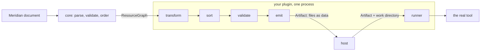

# Writing a plugin

A plugin teaches Meridian one tool. It compiles a Meridian document into the
files that tool reads, and it runs the tool to plan and apply them. This guide
takes you from nothing to a pull request, one step at a time. It assumes you
know the tool you are adding and can read Rust. It does not assume you know
Meridian's internals: a plugin depends on one crate, `meridian-sdk`, and nothing
else of Meridian's.

If you have not used Meridian yet, spend ten minutes on
[Your first ResourceSet](../quickstart/first-resourceset.md) first. Writing a
plugin is much easier once you have seen a document compiled and applied.

## What you are building



A plugin has two halves, and they never mix. A third and a fourth are optional.

| Half | Trait | What it does | Side effects |
|---|---|---|---|
| Compiling | [`Emitter`](../../crates/meridian-sdk/src/types.rs) | turns a `ResourceGraph` into an `Artifact` (paths and file contents, as data), or refuses | none, ever |
| Running | [`Runner`](../../crates/meridian-sdk/src/run.rs) | writes the artifact to a work directory and drives the tool to `plan`, `apply` and report `outputs` | whatever the tool does |
| Importing, optional | [`Importer`](../../crates/meridian-sdk/src/import.rs) | reads the tool's existing configuration, handed to it as text, and returns documents as data with notes on what it could not carry over. See [An importer](#an-importer) | none, ever |
| Describing the tool's types, optional | [`SchemaSource`](../../crates/meridian-sdk/src/schemas.rs) | asks the installed tool for the schemas of its own resource types, so editors complete and check them. Called by `meridian schema sync` only, never by an editor. See [A schema source](#a-schema-source) | runs the tool, inside a work directory the host gives it |

When a document reaches your plugin, the core has already parsed and validated
it, resolved the target host, and ordered the resources by `dependsOn`. Your job
is mapping and serialisation.

There is one rule that matters more than any other, and reviewers will hold
you to it:

> A document either compiles to something that does what it says, or it does
> not compile and the author is told why. A plugin never emits output that
> quietly does less.

That means refusing, with a `CompileError`, anything your tool cannot express: a
missing resource type, an unmapped param, a `notifies` it cannot act on. A
refusal is the plugin working, not failing. Background:
[The capability model](../concepts/capability-model.md).

### What the core has already done

You never see these, because the core settles them before your plugin is
called. They are listed so that you do not handle them twice. The language
itself is specified in the [language reference](../reference/dsl/index.md).

| In the document | What the core does with it |
|---|---|
| `kind` | checked against your category. Infrastructure as code and container orchestration take `Infrastructure` documents and refuse a `ResourceSet`; configuration management is the reverse; containerization takes both |
| `metadata.labels` | used to select documents on the command line (`--selector`). Not passed to plugins |
| `when` and `ifMissing` | evaluated, and the resource kept or pruned, before you see the tree. Only `runtimeWhen` reaches you |
| `dependsOn` | cycles and unknown resources are refused; the resources arrive in a valid order |
| `notifies[].on` | only `changed` is accepted |
| `spec.targetVersion` | refused unless your plugin declares versions with `Emitter::target_versions`. If it does, the version arrives as `graph.target_version` |
| `spec.settings` | refused unless your plugin declares the keys it reads with `Emitter::settings_keys`, and refused for any key outside them. What it declares arrives as `graph.settings`, with interpolation placed, and the values are yours to check |

## Before you start

1. **Check that nobody else is already on it.** Look through the
   [open pull requests](https://github.com/ZanattaMichael/meridian-core/pulls)
   and [issues](https://github.com/ZanattaMichael/meridian-core/issues) for the
   tool's name. If there is no issue, open one with the "New plugin" form and
   say you are taking it.
2. **Decide the category**: `infrastructure-as-code` (creates infrastructure),
   `configuration-management` (configures an existing machine),
   `containerization` (containers on one host) or `container-orchestration`
   (containers across a cluster). The core uses it to decide which workflows a
   plugin can join.
3. **Decide the vocabulary.** There are two families, described in
   [Documents, resources and targets](../concepts/ir-overview.md):
   - Configuration management targets share six abstract types (`package`,
     `file`, `service`, `user`, `group`, `exec`), so one document compiles for
     Ansible, Puppet or Chef. A new tool of this kind should take the same six
     where it can. They are specified in
     [Configuration management resource types](../reference/resource-types.md).
   - Every other target is native: `type` is the tool's own type and `params`
     its arguments, spelled exactly as the tool documents them. Do not invent a
     new abstraction.

## Step 1: set up

You need a stable Rust toolchain and Python 3. Nothing else: the test suite
uses stand-ins for every tool, so you do not need Terraform, Ansible or anything
like them installed.

```
git clone https://github.com/<you>/meridian-core
cd meridian-core
cargo test --workspace
```

If that does not pass on a fresh clone, stop and
[open an issue](https://github.com/ZanattaMichael/meridian-core/issues/new/choose).
It is a bug in the project, not in your setup.

## Step 2: scaffold the plugin

Do not start from an empty directory. Run:

```
python3 tools/new_plugin.py nomad --category container-orchestration
```

with your tool's name in place of `nomad`. The name is what documents will
write in `spec.target`: lower case, digits and hyphens.

This copies the [template plugin](../../crates/meridian-plugin-template/README.md)
and renames everything in it. You get:

| Path | What it is |
|---|---|
| `plugins/nomad/` | the crate. Its binary is `meridian-target-nomad`, the name the host looks for |
| `plugins/nomad/src/` | `lib.rs`, the four stages (`transform.rs`, `sort.rs`, `validate.rs`, `emit.rs`), `runner.rs` and `main.rs` |
| `plugins/nomad/tests/` | `compile.rs` and `run.rs` |
| `plugins/nomad/testdata/` | golden files: the recorded output of the tests |
| `examples/nomad/site.yaml` | an example document, which a test compiles with the real plugin |
| `docs/targets/nomad.md` | the tool's documentation page, as a stub |

It also adds the crate to the workspace in `Cargo.toml`. Prove it works before
you change anything:

```
cargo test -p meridian-target-nomad
cargo build -p meridian-cli -p meridian-target-nomad
target/debug/meridian plugins
target/debug/meridian compile examples/nomad/site.yaml --out build
```

`meridian plugins` lists your plugin with its category and what it can do, and
`build/site/` holds the files it compiled. At this point the plugin still
drives the template's imaginary tool, `filesync`. From here on you replace
that tool with yours, one file at a time. Every place that needs a decision is
marked `TODO(plugin)`:

```
grep -rn "TODO(plugin)" plugins/nomad docs/targets/nomad.md
```

## Step 3: write the example you want to work

Edit `examples/nomad/site.yaml` into a small, realistic document for your
tool, written the way you want users to write it. Then write down, by hand,
the files you expect it to compile to. That pair is your specification, and it
becomes the first golden test.

Two things to know about example files:

- A test reads the target from the line that starts `  target: `, so do not
  put a comment after it on the same line.
- The kind must suit the category, or the core refuses the document:
  `kind: ResourceSet` with a `targetHost` for a tool that configures a
  machine, and `kind: Infrastructure` for one that creates things. The
  scaffold already wrote the right kind for the category you gave it.

## Step 4: the compile stages

The stages are always the same four, in this order, each in its own file.
`Emitter::emit` in `lib.rs` just calls them in turn. Start by replacing the
`Entry` struct in `lib.rs` with a model of your tool's own file format.

### transform.rs

Maps each `Resource` to your model, or refuses it. A resource is plain data:

| Field | Meaning |
|---|---|
| `id` | the author's name for it, unique in the document |
| `type` | the resource type |
| `state` | the desired state, such as `present`; empty when the author gave none |
| `params` | a sorted map of name to [`Value`](../../crates/meridian-value/src/lib.rs) |
| `runtime_when` | a condition to check on the node during the apply; empty when there is none |
| `pos` | the file, line and column the author wrote it at |

#### Refusals

Almost every refusal lives in this stage. Build one with the `refuse` helper
the template gives you. It carries a rule, a message and the author's
position, so the operator is pointed at their own line:

```rust
use meridian_sdk::rules;

return Err(refuse(
    r,
    &rules::UNSUPPORTED_STATE,
    format!("has the state {other:?} (supported: present, absent)"),
));
```

The rule is a value, not a string: one of the constants in
[`meridian_sdk::rules`](../../crates/meridian-sdk/src/rules.rs), each with a
stable name, a description and a hint. The same mistake has the same name on
every target, so policy checks, editors and tests can rely on it. The
[refusal rules](../reference/refusal-rules.md) page is generated from the
registry. Use a general rule wherever one fits:
`unsupported-resource-type`, `unsupported-state`, `unsupported-param`,
`missing-param`, `invalid-param`, `duplicate-resource`, `invalid-reference`,
`unsupported-action` and `unsupported-runtime-condition` cover most refusals.
Say what is supported in the message, as above, so the author knows what to
write instead. The rule's hint is general; `.with_hint(...)` replaces it with a
specific one.

A mistake that exists on your tool only, such as Salt's `shell-required`,
gets a rule of the plugin's own. Declare it once, in a table in `lib.rs`, and
return the table from `Emitter::rules`:

```rust
pub(crate) mod own {
    use meridian_sdk::rules::Rule;

    pub(crate) const SHELL_REQUIRED: Rule = Rule::new(
        "shell-required",
        "an `exec` command holds shell syntax, and Salt always runs a command through a shell",
        "set param `shell` to true to say the shell syntax is intended",
    );

    pub(crate) const ALL: &[Rule] = &[SHELL_REQUIRED];
}

fn rules(&self) -> Vec<Rule> {
    own::ALL.to_vec()
}
```

A test fails if a plugin's own rule reuses a general rule's name, and the
conformance suite fails if a refusal uses a rule neither the registry nor the
plugin declares. Run the tests once with `UPDATE_GOLDEN=1` to add your rules to
the reference page.

#### References

A string in `params` may carry a reference, written `${id.param}` or
`${id.some.path}`. A plugin must never write one through as plain text, which
would hand the tool a literal `${...}`. What to do depends on the tool, and
[References](../reference/dsl/references.md) describes each family from the
user's side:

- **The tool has nothing to read at apply time.** True of most configuration
  management tools: a resource has only what the author wrote. Call
  [`meridian_sdk::expr::resolve_declared`](../../crates/meridian-sdk/src/expr.rs)
  first in `emit`, as the template does. It replaces each `${id.param}` with
  that param's value in the document, and refuses anything else as
  `invalid-reference`.
- **The tool has its own references** (Terraform, Bicep, Compose). Do not call
  `resolve_declared`. Use `meridian_sdk::expr::parse` to find each reference and
  rewrite it in the tool's spelling, refusing one that names an undeclared
  resource.

If your tool can report values, such as an address or an id, also compile each
entry of `graph.outputs` into the tool's own output mechanism here.

### sort.rs

Applies your tool's ordering rules and decides what a `notifies` becomes.

Resources arrive in an order that already satisfies `dependsOn`. A tool that
reads its input from top to bottom needs nothing more. A tool with its own way
to say "after" writes the edges into its model here.

A notify means "when this resource changes, do that to the other one". You
have three honest choices, and one dishonest one:

| The tool | Do this | Declare |
|---|---|---|
| reacts to a change by itself (an Ansible handler) | compile the edge to it | `native_notify: true` |
| can be made to (a checksum in a label that forces a restart) | build it, and return a `Warning` saying what the operator will see | `synthetic_notify: true` |
| cannot | refuse the document | neither |
| | accept the edge and ignore it | never |

How the existing plugins handle each case is in
[Dependencies and notifications](../concepts/dependencies.md).

### validate.rs

Checks what only your tool's rules can say, on the whole model: names the tool
would reject, two resources claiming one thing, a required pairing. The aim is
that a document the tool would refuse is refused here instead, before anything
runs, with the author's line number.

Each rule has a row in the table at the end of the file, which breaks it once
and checks the refusal; see
[a table for every validation rule](testing.md#a-table-for-every-validation-rule).

### emit.rs

Serialises the model to files, and does nothing else. It cannot fail, because
every decision has already been made.

The output must be byte-for-byte the same every time. Write in a fixed order
and never iterate a `HashMap`. For YAML, depend on `meridian-yaml`, which has
the deterministic writer the first-party plugins share. Paths in the artifact
are relative and must stay inside it.

### Capabilities, category and resource types

Back in `lib.rs`, fill in the three declarations. They are published in the
[capability matrix](../reference/capability-matrix.md), and users decide by
them, so each one is a promise:

- `supported_resource_types()`: every type you map, sorted. For a native
  target whose types are open-ended, describe the shape, as Bicep does with
  `<Namespace>/<type>@<api-version>`.
- `capabilities()`: `native_notify`, `synthetic_notify`, `runtime_condition`,
  `secrets` and `credentials`. Declare only what a test in your crate proves.
  `secrets` means a param may hold a secret, and commits your runner to
  [handing it over](#secrets) privately. `credentials` means your target
  reaches its host as the credential `targetHost.credential` names, with the
  [same commitment](#credentials).
- `category()`: chosen in the first step. It also decides which kind of
  document your target accepts (see the table near the top).
- `target_versions()`: only if tool versions need different output, as for
  DSC. Otherwise leave it out, and a document asking for a version is refused
  rather than ignored.
- `settings_keys()`: the `spec.settings` keys your target reads, for
  document-wide settings that belong to no resource (which engine runs it, how
  the host is reached). DSC declares `engine`, `target` and `credential`. The
  core refuses any other key before `emit`, so `graph.settings` holds only
  listed keys; check values as you check params, and document each key on
  your target page. If left out, any setting is refused. Do not model a
  tool-wide setting as a resource type.
- `rules()`: [refusal rules](../reference/refusal-rules.md) unique to your
  tool. Most targets leave it out and use only the general rules; see
  [Refusals](#refusals).
- `placed_text()`: your tool's expression openers other than `${`, and how to
  write each as literal text. The core applies them to every value an
  interpolation places from data before `emit`, so data can never open an
  expression the tool evaluates; the author's own text is untouched. Ansible
  declares Jinja's `{{`, `{%` and `{#`, each written `{{ '{{' }}`; ARM declares
  `[` at the start of a value, written `[[`. A tool whose files pass through a
  template engine must declare its openers, or `--data` values become live
  code. Leave it out if the tool has no such syntax.

```rust
fn placed_text(&self) -> Vec<PlacedEscape> {
    vec![PlacedEscape::anywhere("{{", "{{ '{{' }}")]
}
```

### Describe your resource types for editors

One optional declaration is worth making: `resource_schemas()`. It tells the
[editor tools](../tooling/index.md) what each resource type takes. With it, the
language server completes and documents params and states, `meridian lint` and
the editor flag unknown params in place, and the
[JSON Schema](../tooling/json-schema.md) checks them. Without it, types are
still offered by name, and your transform stage still refuses mistakes at
compile time.

```rust
fn resource_schemas(&self) -> Vec<ResourceSchema> {
    vec![ResourceSchema::closed("bucket", "An object storage bucket.")
        .states(&["present", "absent"], "present")
        .param(ParamSchema::new("name", ParamKind::String, "The bucket's name.").required())
        .param(
            ParamSchema::new("access", ParamKind::String, "Who may read it.")
                .values(&["private", "public"]),
        )]
}
```

- `ResourceSchema::closed`: the listed params are all there are; any other is
  an error. `ResourceSchema::open`: the type also takes unlisted params, as for
  a passthrough type.
- `.states(states, default)` lists `state` values and the default. A type with
  no states takes no `state`.
- `.actions(...)` lists the `action` values a `notifies` aimed at this type
  may ask for.
- A configuration management target that maps the shared types (`package`,
  `file`, `service`, `user`, `group`, `exec`) calls
  `meridian_sdk::schema::shared(name, params, required, states, default, actions)`
  with the lists its transform stage already checks. Shared param descriptions
  come from the SDK, so every target documents `mode` the same way. The
  template and first-party configuration management plugins do this.

A type whose params belong to the tool, such as `aws_instance` or
`apps/v1/Deployment`, is better described by the tool itself; that is what
[a schema source](#a-schema-source) is for. The two combine: a cached tool schema
refines a type the plugin only names, and leaves alone one the plugin describes
in full.

Build the description from the same tables your transform stage reads, never a
second list, so they cannot disagree. It is advice to editors and never replaces
your checks; the host does not enforce it at compile time.
`crates/meridian-tooling/tests/schema_conformance.rs` checks first-party plugins
by compiling a resource with every declared param and state, and confirming the
plugin accepts what it declared and refuses what it did not.

## Step 5: the runner

`runner.rs` hands the artifact to the real tool. The host gives you a
`RunContext`:

| Field | Meaning |
|---|---|
| `document` | the document's name |
| `host` | the machine being configured; empty for a document that creates infrastructure |
| `work_dir` | a directory kept between runs, for the artifact and the tool's own state |
| `inputs` | values handed over from earlier stages of a workflow |
| `secrets` | the value of each secret the document's params hold, for a target that declared `secrets`; see [Secrets](#secrets) |
| `credential` | the credential the host is reached as, with the values of its secret fields, for a target that declared `credentials`; `None` when the document names none. See [Credentials](#credentials) |

and you implement up to three operations. Declare only the ones you implement
in `operations()`; the host never calls the others.

`inputs` holds what the document's
[`spec.imports`](../reference/dsl/outputs-and-hand-offs.md#imports) brought
from other documents, by name. If your tool has variables or parameters, pass
every input to it as one and say so:

```rust
fn accepts_inputs(&self) -> bool {
    true
}
```

The default is `false`, and the host then refuses a document that imports,
instead of dropping its values without a word. Never write an input into a
file or a log: it may be a secret another tool produced.

| Operation | Contract |
|---|---|
| `plan` | report what an apply would change, and change nothing. If the tool cannot preview, set `Plan::unknown` so an empty list is never read as "in sync" |
| `apply` | make it so, and report what changed and any outputs |
| `outputs` | read the values the last apply produced from the tool's own state, without applying |

[`meridian_sdk::tool`](../../crates/meridian-sdk/src/tool.rs) has what nearly
every runner needs:

- `write_artifact` puts the artifact in the work directory, removes files the
  previous artifact wrote and this one does not, and leaves the tool's own
  state alone.
- `Tool` runs a command, relays its output to the operator line by line, and
  turns a non-zero exit into a `RunError` that says what was run.

Three rules for a runner:

1. **Never build a shell command string.** Pass arguments one by one with
   `arg`. If you truly need a shell, for example to run something over SSH,
   that code gets a second reviewer.
2. **Secrets go through `secret_arg`**, so they cannot appear in a log line or
   an error. Mark an output `sensitive` when the tool does, and Meridian masks
   it everywhere it prints.
3. **Do not guess at the tool's output.** Ask the tool for JSON where it can
   give it (`Tool::capture_stdout`). When you must read prose, treat a line you
   do not understand as an error. Skipping it would report a change as no
   change.

Let the operator point at the program with an environment variable named
`MERIDIAN_<TOOL>`, as the template does. The tests rely on it too.

### Settings

Everything an operator can configure about your runner is a **setting**: the
program's path, extra arguments for every call, a transport, a wait. Declare
each one once, in a `settings()` function the template already has, and return
the list from `Runner::settings`:

```rust
pub fn settings() -> Vec<Setting> {
    vec![
        Setting::new("program", PROGRAM_VARIABLE, "mytool", "The `mytool` program to run, when it is not on `PATH`."),
        Setting::new("args", ARGS_VARIABLE, "", "Extra arguments for every run, split like a shell command line."),
    ]
}
```

Read each through `meridian_sdk::settings`, never `std::env::var`:
`settings::text` for a value, `settings::optional` when unset means something,
`settings::args` for an argument list, `settings::switch` for yes/no. This is
what makes the project's `meridian.yaml` count: the host passes the
`spec.settings.<target>` map at start, and the helpers check the environment
variable first, then the project, then the default. `settings::args` splits like
a POSIX shell, so arguments with spaces can be quoted; never split on whitespace
yourself.

The short name is what a project writes under `spec.settings`: lower-case
words joined by `-`, such as `args` or `ssh-args`. The variable starts with
`MERIDIAN_`. Give every runner an argument-list setting, because an operator
always needs one eventually. `meridian plugins --settings` prints the list,
the [plugin settings reference](../reference/plugin-settings.md) is generated
from it, and `crates/meridian-cli/tests/plugin_settings.rs` fails when a
`MERIDIAN_*` constant in your `runner.rs` is not declared.

### Being stopped

On Ctrl-C or a `--stage-timeout`, the host calls your plugin's `Cancel`, which
the SDK handles: `log.cancelled()` becomes true for the log passed to `plan` and
`apply`, and [`Tool::run`](../../crates/meridian-sdk/src/tool.rs) stops the tool
and everything it started (`SIGTERM`, then `SIGKILL` ten seconds later; killed
on Windows) and returns a `RunError` saying the run was cancelled. A runner that
only uses `Tool` needs to do nothing.

A runner with its own loop, or several tools in a row, should check
`log.cancelled()` between steps and return a `RunError` whose `changes` list
what it did, so the record and terminal show it:

```rust
for step in steps {
    if log.cancelled() {
        return Err(RunError { msg: "stopped".into(), changes: done, ..RunError::default() });
    }
    done.push(run_one(step, log)?);
}
```

Never swallow the error `Tool::run` returns on a cancel and go on to the next
tool: the operator asked for the run to stop.

### Secrets

A document can put a [secret](../reference/dsl/secrets.md) in a resource's
params: a password, a key. The host hands it to your plugin only if
`capabilities().secrets` is true, and then in two halves:

1. **Compiling: a name, never a value.** The param arrives as
   `Value::Secret`, and `graph.secrets` names it. Your emitter writes a
   reference the tool resolves when it runs, and the simplest way is to do it
   first and compile the result:

   ```rust
   fn emit(&self, graph: &ResourceGraph, data: &Data) -> Result<Emitted, CompileError> {
       let graph = graph.secrets_written_as(|name| format!("${{var.meridian_secret_{name}}}"));
       // ... compile `graph` as before
   }
   ```

   Declare whatever the tool needs for the reference to resolve (Terraform
   needs the variable, marked `sensitive`), and tell the tool not to print it
   where the tool has a way to say so (Ansible's `no_log`).

2. **Running: the value, by a private channel.** `context.secrets` holds each
   value under the same name. Hand it to the tool one of two ways, and no
   other:

   - a file only the user can read, for a tool that reads its variables from
     one. `context.secrets.json_file("vars.json", |name| format!("meridian_secret_{name}"))`
     writes them all as one JSON object into a `SecretFile`: mode `0600`, in
     its own directory, in memory where possible, overwritten and removed on
     drop. Keep it until the tool exits, and pass the path (`-var-file=<path>`,
     `--extra-vars @<path>`). For another format, build a `SecretFile::create`
     from `Part::Text` and `Part::JsonString` pieces (Puppet writes Hiera YAML
     this way, Salt a pillar file). If the tool reaches the file through a
     second one, create that with `file.beside(name, text)` in the same private
     directory: a `hiera.yaml`, a pillar `top.sls`, a `client.rb`.
   - the tool's standard input, for a tool that reads a value from it.
     `Tool::stdin_secret(value)` pipes it straight from protected memory.

   Never an argument (every user can read it in `ps`) and never the
   environment (the tool passes it to everything it starts). If a tool takes a
   value no other way, refuse: return a `RunError` saying so and what to do
   instead, as the Chef plugin does for `chef-run`.
   The value is a `SecretValue`: it cannot be printed, cloned or compared by
   accident, and is wiped when the context drops. If the tool keeps what it was
   given (a saved plan, a state file), your plugin must clean it up or document
   it, as the Terraform plugin scrubs its saved plan.

Test both halves as the first-party plugins do: a compile test that the
reference is written and the value is not
(`meridian_plugin_testkit::secret_in_param`), and a run test against a stand-in
that copies the file it was given plus its arguments and environment
(`meridian_plugin_testkit::secrets`), asserting the value is in the file, mode
`0600`, and nowhere else. The host masks tool output, but that is the second
line of defence, not the first.

### Credentials

A document can name a [credential](../reference/dsl/credentials.md) for reaching
its host: an `ssh` or `usernamePassword` identity, with a plain-text user and a
secret key or password. The host passes it only if
`capabilities().credentials` is true, in the same two halves:

1. **Compiling: the shape, never a value.** `graph.credential` is a
   `Credential`: its `name`, `kind`, whether it is `ambient`, its `text`
   fields, its `flags`, and the *names* of its `secret_fields`. Write the
   plain fields where the tool reads an identity (Ansible puts the user after
   the host in the inventory), and refuse what the tool cannot take with a
   `CompileError` explaining why, as Ansible refuses a `passphrase`. Never drop
   a field silently: a half-used credential reaches the host as someone else.

2. **Running: the values, by a private channel.** `context.credential` is a
   `HeldCredential`: the same `declared` shape, and `secret(field)` lends
   each secret field as a `SecretValue`. Pass each the way the tool takes an
   identity: a key as a `SecretFile` of `Part::Secret(key)` given by the tool's
   flag (`--private-key <path>`); a password in the same `SecretFile` as the
   document's secrets, where the tool reads variables from one. `secrets()`
   iterates them. Never an argument or the environment. `Debug` prints only
   the name, type and field names.

Before calling your plugin, the core refuses a credential whose type a host
cannot take, or one for a target without the capability. Test both halves as
for secrets: a compile test that the user is written and the key is not, and a
stand-in test that copies the key file, its mode, and the arguments and
environment, asserting the key is in the file, mode `0600`, and nowhere else.
Then add the column to the [capability matrix](#step-7-documentation) and a
section on the target page saying where each field goes and what is refused.

## An importer

This step is optional. A plugin is complete without it, and `meridian plugins` simply
does not list `import` for one that has none.

An importer is a plugin's optional third half: it reads the tool's **existing**
configuration and returns equivalent Meridian documents for `meridian import` to
write ([what the operator sees](../operations/importing.md)). Write one when people
already have configuration for your tool. It lives in `src/import.rs`.

```rust
use meridian_sdk::{ImportError, ImportFormat, ImportSource, Imported, Importer};

pub struct MyToolImporter;

impl Importer for MyToolImporter {
    /// The files this importer reads, by name. `meridian import` uses the
    /// patterns to choose a plugin and to pick files out of a directory.
    fn formats(&self) -> Vec<ImportFormat> {
        vec![ImportFormat::new("mytool", "MyTool files", &["*.mytool", "mytool.yaml"])]
    }

    fn import(&self, source: &ImportSource) -> Result<Imported, ImportError> {
        // source.files: path -> text. Never read the disk yourself.
        todo!()
    }
}
```

and in `main.rs`:

```rust
meridian_sdk::serve(
    meridian_sdk::Plugin::new(MyTool)
        .with_runner(MyToolRunner::from_env())
        .with_importer(MyToolImporter),
)
```

What you return is **data, not YAML**:

| Type | What it holds |
|---|---|
| [`Imported`](../../crates/meridian-sdk/src/import.rs) | the documents, and the notes |
| `ImportedDocument` | `kind` (Infrastructure or ResourceSet), `name`, `host` for a ResourceSet, `target_version`, `resources`, `outputs`. Leave `target` empty and the host fills in your plugin's name |
| `ImportedResource` | `id`, `type`, `state`, `params`, `depends_on`, `notifies`, `runtime_when`, and `origin`: where in the source it came from, such as `main.tf:12` |
| `ImportNote` | one thing the operator should know: its level, where in the source, what it is about, and which resource it belongs beside |

`meridian` renders the documents in the current language and validates them. So an
importer never knows how a document is spelled, and when the language changes its output
changes with it.

### The rule

It is the compile rule, turned round:

> Everything the source says is either in the document, or in a note. An importer never
> leaves something out quietly, and never invents an approximation.

| Call | When | In the document |
|---|---|---|
| `notes.untranslated(...)` | the source says something the document does not: a construct with no counterpart, a file that was not read, a computed value | a `TODO(meridian-import)` comment |
| `notes.changed(...)` | it is in the document, but not as the source wrote it, and may behave differently: a renamed id, an assumed default | a `TODO(meridian-import)` comment |
| `notes.info(...)` | carried over faithfully, in a way worth explaining | a plain comment |

Write each note for the person who has to act on it: where it is in their file, what
happened, and what to do. `--strict` fails an import with any note of the first two
levels, so do not use them for things that are fine.

Three things reviewers will look for:

- **No escape hatches.** A construct with no matching resource type is `untranslated`.
  Turning it into an `exec`, or a passthrough that happens to compile, gives a document
  that claims more than it does.
- **Do not evaluate.** Variables, loops, templates and functions in the source are
  someone else's program. Carry literals; report computed values. The exception is a
  value written inline, such as a variable with a literal value.
- **Keep runtime conditions at runtime.** A condition the tool checks on the node goes
  in `runtime_when`, only if your target supports `runtimeWhen`. Never decide it at
  import.

### What `meridian-import` gives you

A plugin's library may depend on [`meridian-import`](../../crates/meridian-import/src/lib.rs)
as it does on the SDK. It depends on nothing of the compiler's.

| | |
|---|---|
| `yaml::read` | YAML and JSON as a tree that keeps key order and line numbers, with YAML 1.1 or 1.2 scalar rules, whichever your tool reads by |
| `hcl::parse` | HashiCorp's configuration language, in the shape its JSON syntax has, without evaluating expressions |
| `tf::import` | the Terraform language, for a target that speaks it |
| `Notes` | collects notes in the order raised |
| `literal` | makes a value's text literal to a document: `${` in the tool's own file is not a reference, and is written `$${` |
| `slug`, `unique_id` | turn a name in the source into a resource id, and keep ids unique |
| `diff::assert_same`, `diff::Rules` | compare two configurations by meaning, for the round-trip test |

Most targets fall into one of two shapes:

- **The target takes the tool's own types** (Terraform, Kubernetes, Compose, DSC). The
  importer is the emitter read backwards: each native object becomes a resource whose
  type is the native type and whose params are its fields. Translate only what a document
  says its own way (`dependsOn`, `notifies`, references) and only where the two mean
  exactly the same. [`plugins/kubernetes/src/import.rs`](../../plugins/kubernetes/src/import.rs)
  is the shortest example.
- **The target takes the abstract types** (`package`, `service`, `file`, ...). The
  importer maps the tool's vocabulary onto them, and reports everything outside it.
  [`plugins/ansible/src/import.rs`](../../plugins/ansible/src/import.rs) is the example.

### Testing an importer

An importer is tested by going all the way round: import a realistic source, compile the
document, and compare what was compiled with the source **by meaning**.
`meridian-plugin-testkit` does the first two:

```rust
use meridian_import::diff::{assert_same, Rules};
use meridian_plugin_testkit::{assert_golden_text, import_source, notes_text, round_trip};

#[test]
fn a_configuration_comes_back_meaning_the_same() {
    let source = import_source(&testdata().join("web"), "web");
    // Imports, renders each document, reads it back, validates and compiles it.
    let (imported, trips) = round_trip(&MyToolImporter, &MyTool, &source);
    assert_eq!(imported.needing_attention(), 0, "{}", notes_text(&imported));
    assert_golden_text(&testdata(), "web.meridian.yaml", &trips[0].rendered.text);

    let original = parse(&source.files["web.mytool"]);
    let compiled = parse(&trips[0].emitted.artifact.files[OUTPUT_PATH]);
    assert_same(&original, &compiled, Rules::default());
}
```

`Rules` lists differences your tool ignores, such as a null key versus an absent one.
Where compiled output is deliberately spelled differently from the source (task names,
another syntax for the same language), compare against the same configuration written
by hand in the target's spelling, and note that in the test.

Write a second test for a source full of things a document cannot say, and assert on the
notes. That test is the one that proves nothing is dropped quietly.

Then document it: an **Importing** section on the target's page with the mapping as a
table, everything that is reported and at which level, and links to the test's files.
Add the importer to the plugin's `target!` entry in
`crates/meridian-all-targets/src/lib.rs` and record the matrix again.

## A schema source

This step is optional, and only makes sense for targets whose resource types are
the tool's own: a Terraform provider's, a Kubernetes API server's, a Pulumi
package's, a DSC module's. A plugin without a schema source is complete;
`meridian schema sync` notes it and moves on.

A plugin that has one names it in its entry in
`crates/meridian-all-targets/src/lib.rs` (the `schemas` field), which puts
it in the capability matrix.

A schema source is the fourth half: given the documents using the target, it asks
the installed tool what each resource type takes and returns
[`ResourceSchema`](../../crates/meridian-sdk/src/schema.rs)s (as
`resource_schemas()` does), under the exact names documents use.
`meridian schema sync` calls it once, caches the result in the project's state
directory, and records versions in `meridian.lock`; the language server,
`meridian lint` and `meridian schema` read the cache and never call you. What the
operator sees is in
[Tool schemas](../tooling/schema-sync.md).

```rust
use meridian_sdk::{Log, RunError, SchemaExport, SchemaRequest, SchemaSource};

pub struct MyToolSchemas;

impl SchemaSource for MyToolSchemas {
    fn export(&self, request: &SchemaRequest, log: &dyn Log) -> Result<SchemaExport, RunError> {
        // request.work_dir   a directory the host keeps for you between syncs
        // request.graphs     the documents, as `emit` would get them
        // request.types      the resource types they use, sorted and deduplicated
        let shown = Tool::new("mytool")
            .args(["describe", "--json"])
            .dir(&request.work_dir)
            .capture_stdout()
            .run_ok("mytool describe failed", log)?;
        let mut export = SchemaExport::new("mytool", &version_in(&shown.stdout).unwrap_or_default());
        export.schemas = read_schemas(&shown.stdout, &request.types);
        export.pin("my-provider", "2.5.2");
        export.note("3 other types listed by name only");
        export.tidy();
        Ok(export)
    }
}
```

and in `main.rs`:

```rust
meridian_sdk::serve(
    meridian_sdk::Plugin::new(MyTool)
        .with_runner(MyToolRunner::from_env())
        .with_schema_source(MyToolSchemas),
)
```

What you return:

| Field | What it holds |
|---|---|
| `schemas` | one `ResourceSchema` per type, under the exact name a document writes, never a pattern. A param carries its kind, whether it is required, its values, its own nested params for a map or a list of maps, and the flags `computed` (the tool sets it; a document reads it with `${id.path}` and must not write it), `sensitive` and `deprecated` |
| `tool`, `tool_version` | the tool that answered and its version |
| `pins` | the exact versions of the parts the schemas came from, by the tool's own name for each: a provider, a package, a server. The host records them in `meridian.lock`, so a cache from other versions is told apart |
| `notes` | what the operator should know: a type that could not be described, a provider that was skipped |

The rules a schema source keeps:

- **It is advice.** `emit` and the tool still decide what compiles and applies.
  Never promise what the tool refuses or reject what it accepts. Leave out a
  type you cannot describe, with a note; the editor then knows it by name only.
- **It changes nothing outside `request.work_dir`.** Initialise the tool,
  download and keep lock files there; the host keeps the directory between
  syncs and never reads it.
- **It may be slow and use the network**: a person asked for the sync, not an
  editor. Report progress through `log`, which `meridian schema sync` shows.
- **Describe used types in full, the rest by name.** A provider with a thousand
  types would make the cache too big for an editor to load. Types in
  `request.types` get params; others get `ResourceSchema::open(name,
  description)` so completion offers them, and the next sync after a document
  uses one describes it. Note how many were listed by name.
- **Read the tool's own schema format.** Many tools publish JSON Schema;
  `meridian_sdk::schema::params_from_json_schema` reads it into params,
  following `$ref`s through your resolver, with a depth limit for recursive
  schemas. `meridian_sdk::version_in` extracts the version from
  `tool --version` output.
- **Fetch a published file through `meridian_sdk::fetch`.** When the vendor
  publishes the catalogue as a file (CloudFormation's registry zip, the Azure
  type definitions, a JSON Schema in a repository),
  `fetch(url, &request.work_dir, name, what, log)` downloads it over HTTPS into
  the work directory, keeps the server's `ETag` so unchanged files are not
  re-downloaded, falls back to the last copy (with a note) when offline, and
  returns its SHA-256 to pin (`Fetched::pin`). The rules are
  [decision 0036](../decisions/0036-a-published-schema-file-is-fetched-over-https-pinned-by-hash-and-reused-offline.md);
  the CloudFormation and Compose plugins are the shortest examples.

Test it twice: a unit test reading a saved sample of tool output into schemas,
and a [real-tool test](real-tool-tests.md) in `tests/real.rs` that runs against
the installed tool (same switch as the runner's tests) and checks a known type.
Then document it: a target-page section on what the sync asks the tool, what is
described in full or by name, and what is pinned, plus the target's row in [Tool schemas](../tooling/schema-sync.md#what-each-target-exports).

## Step 6: tests

The template's tests show both kinds. Keep them and add to them.

**Compile tests** (`tests/compile.rs`) call the emitter directly.

- Golden tests compile a document and compare the output byte for byte with
  the files in `testdata/`. Record them with

  ```
  UPDATE_GOLDEN=1 cargo test -p meridian-target-nomad
  ```

  then read the diff before committing. Golden files are reviewed like code:
  they are what your users get.
- Refusals are golden files too (`assert_golden_refusal`), since their wording
  is output.
- Compile the shared [`fixtures/`](../../fixtures) that fit your category, as
  the template does with `web_stack`. Every plugin compiles a fixture or
  refuses it for a stated reason.
- Add one small test per refusal and mapping decision. Name each test as a
  sentence stating what is true, like the existing ones.

**Run tests** (`tests/run.rs`) drive the runner against a stand-in: a shell
script, written by `meridian_plugin_testkit::stand_in`, that records how it
was called and prints what the real tool would print. Capture the real tool's
output once, by hand, and paste it into the stand-in, so the test is honest
about what the tool says.

**Real-tool tests** are welcome but not required in a first pull request. To add
one, mark each test `#[ignore = "needs a real <tool>; see
docs/contributing/real-tool-tests.md"]`, switch it on with
`meridian_plugin_testkit::real_tool_asked("<TOOL>")`, which reads
`MERIDIAN_TEST_REAL_<TOOL>`, and give it its own workflow file that runs it
with `-- --ignored` and `MERIDIAN_TEST_REAL_REQUIRED=1`, as
[`puppet.yml`](../../.github/workflows/puppet.yml) and
[`kubernetes.yml`](../../.github/workflows/kubernetes.yml) do. A test in
`crates/meridian-all-targets` fails if a plugin has an ignored test but no
workflow. [Real-tool tests](real-tool-tests.md) shows the shape and lists
existing ones. A plugin tested only against a stand-in must say so on its page.

## Step 7: documentation

A plugin without documentation is not finished, and will not be merged. Fill
in `docs/targets/<name>.md`. The stub has the sections every target page has.
The rules:

- It opens with **What it does and does not support**. State refusals as
  clearly as features.
- Every example is a file under `examples/<name>/`, so a test compiles it.
- List every refusal rule the plugin can raise and what the author should do
  about it.
- Name the versions of the tool you tested with, and how.

Then list the new target where users look for targets. Each is one line:

| File | What to add |
|---|---|
| [`README.md`](../../README.md) | a row in the plugin table |
| [`docs/index.md`](../index.md) | the target, under its category in the Targets table |
| [`docs/quickstart/install.md`](../quickstart/install.md) | what the target needs installed |
| [`docs/concepts/ir-overview.md`](../concepts/ir-overview.md) and [`dependencies.md`](../concepts/dependencies.md) | the target, where the others of its category are listed |
| the page for its category under [`docs/reference/dsl/`](../reference/dsl/index.md) | a row for the target, saying how the language reads on it |
| `crates/meridian-all-targets/src/lib.rs` | a `target!` entry in `ALL`, in name order, and a dependency on the plugin in that crate's `Cargo.toml`. This is the one list of targets: it enrols the plugin in the capability matrix, the [conformance tests](#the-conformance-tests) and the tooling tests, and its own tests fail until every row above is done |

The workspace lists `plugins/*`, so the crate needs no line in the root
`Cargo.toml`. The capability matrix itself is generated. After adding the
entry, record it:

```
UPDATE_GOLDEN=1 cargo test -p meridian-cli --test capability_matrix
```

### The conformance tests

`crates/meridian-cli/tests/conformance.rs` holds every target to the rules that
are the same for all of them. Once your plugin is in `ALL`, each of your
examples under `examples/<name>/` is used to check that:

- the example compiles to the same files twice, at relative paths;
- a `runtimeWhen` on any of its resources is compiled into the output or
  refused as `unsupported-runtime-condition`, and never dropped. This includes
  a settings resource, if your target has one;
- if your target declares no notify, a `notifies` between any two resources is
  refused;
- a type you do not map is refused as `unsupported-resource-type`;
- the types you declare are sorted, and you declare a category.

A target that shares the six configuration management types also goes into
`SHARED_DIALECT` in the same file, which adds a column for it to the generated
[conformance matrix](../reference/conformance-matrix.md). Record that page the
same way, and read the new column: a row marked *same* must match the other
targets.

```
UPDATE_GOLDEN=1 cargo test -p meridian-cli --test conformance
```

## Step 8: check everything and open the pull request

These are the checks CI runs. Run them all before you push:

```
cargo fmt --all --check
cargo clippy --workspace --all-targets --locked -- -D warnings
cargo test --workspace --locked
python3 tools/check_links.py
```

Then open a pull request. A draft is fine, and opening one early is the best
way to get help. The pull request form has a checklist; the plugin part of it
is this list:

- [ ] The example compiles, and its golden files are what the tool should get
- [ ] Everything the tool cannot express is refused, with a test for each refusal
- [ ] `capabilities()`, `category()` and `supported_resource_types()` claim only what a test proves
- [ ] `resource_schemas()` describes each type from the tables the transform stage checks, or is left out on purpose
- [ ] `placed_text()` declares every opening of the tool's own expression syntax, or the tool has none
- [ ] `settings()` declares every setting the runner reads, each read through `meridian_sdk::settings`
- [ ] a runner checks `RunContext.host` with `meridian_sdk::check_host` before handing it to a command line, and an emitter that writes the host into a file refuses one that is not a name
- [ ] The runner builds no shell command strings, or says where it does and why
- [ ] `docs/targets/<name>.md` is complete and opens with what is and is not supported
- [ ] The target is listed in the README, the docs index, the install page and the capability matrix
- [ ] The four CI commands pass locally

What happens next, and how review works, is in
[`CONTRIBUTING.md`](../../CONTRIBUTING.md#what-happens-to-your-pull-request).

## Reading other plugins

When you are unsure how to do something, a first-party plugin has probably
done it. Good ones to read:

| To see | Read |
|---|---|
| the smallest complete plugin | [`crates/meridian-plugin-template`](../../crates/meridian-plugin-template/src/lib.rs) |
| a native target with a synthetic notify and outputs | [`plugins/docker`](../../plugins/docker/src/lib.rs) |
| the six abstract types, a native notify and a runtime condition | [`plugins/ansible`](../../plugins/ansible/src/lib.rs) |
| references between resources and to outputs | [`plugins/terraform`](../../plugins/terraform/src/lib.rs) |
| a runner that works over SSH, with a real-tool workflow | [`plugins/podman`](../../plugins/podman/src/lib.rs) |

## Versions: the SDK and the protocol

You do not write any version handling. `meridian_sdk::serve` does it:

- **The protocol version** is agreed at start. `meridian` sets
  `MERIDIAN_PLUGIN_PROTOCOLS` to the versions it speaks; the SDK picks the
  highest it also speaks and announces it in the handshake line. So your plugin
  keeps loading on newer `meridian` releases as long as they share a protocol
  version.
- **The SDK version** is announced in the same line. `meridian` loads plugins
  built against its own SDK line, not newer ones.

When either check fails, `meridian` does not load the plugin and says which
side is behind. The fix is always one of two: rebuild the plugin against a
current `meridian-sdk`, or upgrade `meridian`.
[Compatibility](../reference/compatibility.md) has the tables.

Changing `PROTOCOL_VERSION` or `MIN_PROTOCOL_VERSION` in `meridian-sdk` is a
protocol change: it needs two reviewers, a row in the protocol table that
[`crates/meridian-cli/tests/compatibility.rs`](../../crates/meridian-cli/tests/compatibility.rs)
generates, and the old version kept until the
[deprecation policy](../plans/release-and-versioning.md#6-deprecation-policy)
lets it go.

## A plugin in another language, or outside this repository

A plugin is a separate gRPC process, defined in
[`proto/meridian/plugin/v1/plugin.proto`](../../proto/meridian/plugin/v1/plugin.proto),
so it can be written in any language and live in its own repository. Build a
binary named `meridian-target-<name>` and put it beside `meridian` or in a
`--plugin-dir` directory. A released `meridian` starts only plugins signed by a
trusted key, so your users need your public key, or must relax the check:
[Plugin signatures](../reference/plugin-signatures.md#signing-plugins-of-your-own)
shows how to make a key and sign a binary. A plugin written without the SDK must
also listen where the host can dial it: print one line to stdout,
`MERIDIAN-PLUGIN|<protocol>|<sdk version>|<network>|<address>`, where the
network is `unix` with a socket path, `npipe` with a Windows named pipe's
name, or `tcp` with a loopback address, and exit when stdin closes.
The Rust SDK is the supported path today, and the only one with a test kit. If
you write a plugin in another language, please open an issue about what was
hard.

A plugin that does not use the Rust SDK has to do the handshake itself: read
`MERIDIAN_PLUGIN_PROTOCOLS` (a comma-separated list such as `2,3`; when it is
not set, use your newest version), pick the highest version you also speak,
and print `MERIDIAN-PLUGIN|<protocol>|<sdk version>|unix|<socket path>` as the
first line on stdout once you are listening. Report the same protocol version
from `Describe`. For `<sdk version>`, give the release of the Rust SDK whose
behaviour you implement.
