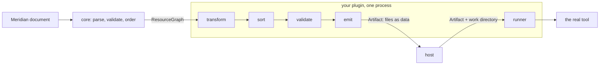

# Writing a plugin

A plugin teaches Meridian one tool. It compiles a Meridian document into the
files that tool reads, and it runs the tool to plan and apply them. This guide
takes you from nothing to a pull request, one step at a time. It assumes you
know the tool you are adding and can read Rust. It does not assume you know
Meridian's internals: a plugin depends on one crate, `meridian-sdk`, and nothing
else of Meridian's.

If you have not used Meridian yet, spend ten minutes on
[Your first ResourceSet](../quickstart/first-resourceset.md) first. Writing a
plugin is much easier once you have seen a document compiled and applied.

## What you are building



A plugin has two halves, and they never mix. A third is optional.

| Half | Trait | What it does | Side effects |
|---|---|---|---|
| Compiling | [`Emitter`](../../crates/meridian-sdk/src/types.rs) | turns a `ResourceGraph` into an `Artifact` (paths and file contents, as data), or refuses | none, ever |
| Running | [`Runner`](../../crates/meridian-sdk/src/run.rs) | writes the artifact to a work directory and drives the tool to `plan`, `apply` and report `outputs` | whatever the tool does |
| Importing, optional | [`Importer`](../../crates/meridian-sdk/src/import.rs) | reads the tool's existing configuration, handed to it as text, and returns documents as data with notes on what it could not carry over. See [An importer](#an-importer) | none, ever |

By the time a document reaches your plugin, the core has already parsed it,
validated it, resolved the target host to a literal and put the resources in an
order that satisfies every `dependsOn`. Your job is mapping and serialisation.

There is one rule that matters more than any other, and reviewers will hold
you to it:

> A document either compiles to something that does what it says, or it does
> not compile and the author is told why. A plugin never emits output that
> quietly does less.

In practice that means refusing, with a `CompileError`, anything your tool
cannot express: a resource type it does not have, a param you do not map, a
`notifies` it cannot act on. A refusal is not a failure of your plugin. It is
the plugin working. The background is in
[The capability model](../concepts/capability-model.md).

### What the core has already done

You never see these, because the core settles them before your plugin is
called. They are listed so that you do not handle them twice. The language
itself is specified in the [language reference](../reference/dsl/index.md).

| In the document | What the core does with it |
|---|---|
| `kind` | checked against your category. Infrastructure as code and container orchestration take `Infrastructure` documents and refuse a `ResourceSet`; configuration management is the reverse; containerization takes both |
| `metadata.labels` | used to select documents on the command line (`--selector`). Not passed to plugins |
| `when` and `ifMissing` | evaluated, and the resource kept or pruned, before you see the tree. Only `runtimeWhen` reaches you |
| `dependsOn` | cycles and unknown resources are refused; the resources arrive in a valid order |
| `notifies[].on` | only `changed` is accepted |
| `spec.targetVersion` | refused unless your plugin declares versions with `Emitter::target_versions`. If it does, the version arrives as `graph.target_version` |

## Before you start

1. **Check that nobody else is already on it.** Look through the
   [open pull requests](https://github.com/ZanattaMichael/meridian-core/pulls)
   and [issues](https://github.com/ZanattaMichael/meridian-core/issues) for the
   tool's name. If there is no issue, open one with the "New plugin" form and
   say you are taking it, so two people do not write the same plugin.
2. **Decide the category.** It is one of `infrastructure-as-code` (it creates
   infrastructure), `configuration-management` (it configures a machine that
   exists), `containerization` (containers on one host) or
   `container-orchestration` (containers across a cluster). The core uses the
   category to decide which workflows a plugin can join.
3. **Decide the vocabulary.** There are two families, described in
   [Documents, resources and targets](../concepts/ir-overview.md):
   - Configuration management targets share six abstract types (`package`,
     `file`, `service`, `user`, `group`, `exec`), so the same document compiles
     for Ansible, Puppet or Chef. A new tool of that kind should take the same
     six, as far as it can. They are specified in
     [Configuration management resource types](../reference/resource-types.md).
   - Every other target is native: a resource's `type` is the tool's own type
     and its `params` are the tool's own arguments, written exactly as the
     tool's documentation writes them. Do not invent a new abstraction.

## Step 1: set up

You need a stable Rust toolchain and Python 3. Nothing else: the test suite
uses stand-ins for every tool, so you do not need Terraform, Ansible or anything
like them installed.

```
git clone https://github.com/<you>/meridian-core
cd meridian-core
cargo test --workspace
```

If that does not pass on a fresh clone, stop and
[open an issue](https://github.com/ZanattaMichael/meridian-core/issues/new/choose).
It is a bug in the project, not in your setup.

## Step 2: scaffold the plugin

Do not start from an empty directory. Run:

```
python3 tools/new_plugin.py nomad --category container-orchestration
```

with your tool's name in place of `nomad`. The name is what documents will
write in `spec.target`: lower case, digits and hyphens.

This copies the [template plugin](../../crates/meridian-plugin-template/README.md)
and renames everything in it. You get:

| Path | What it is |
|---|---|
| `plugins/nomad/` | the crate. Its binary is `meridian-target-nomad`, the name the host looks for |
| `plugins/nomad/src/` | `lib.rs`, the four stages (`transform.rs`, `sort.rs`, `validate.rs`, `emit.rs`), `runner.rs` and `main.rs` |
| `plugins/nomad/tests/` | `compile.rs` and `run.rs` |
| `plugins/nomad/testdata/` | golden files: the recorded output of the tests |
| `examples/nomad/site.yaml` | an example document, which a test compiles with the real plugin |
| `docs/targets/nomad.md` | the tool's documentation page, as a stub |

It also adds the crate to the workspace in `Cargo.toml`. Prove it works before
you change anything:

```
cargo test -p meridian-target-nomad
cargo build -p meridian-cli -p meridian-target-nomad
target/debug/meridian plugins
target/debug/meridian compile examples/nomad/site.yaml --out build
```

`meridian plugins` lists your plugin with its category and what it can do, and
`build/site/` holds the files it compiled. At this point the plugin still
drives the template's imaginary tool, `filesync`. From here on you replace
that tool with yours, one file at a time. Every place that needs a decision is
marked `TODO(plugin)`:

```
grep -rn "TODO(plugin)" plugins/nomad docs/targets/nomad.md
```

## Step 3: write the example you want to work

Edit `examples/nomad/site.yaml` into a small, realistic document for your
tool, written the way you want users to write it. Then write down, by hand,
the files you expect it to compile to. That pair is your specification, and it
becomes the first golden test.

Two things to know about example files:

- A test reads the target from the line that starts `  target: `, so do not
  put a comment after it on the same line.
- The kind must suit the category, or the core refuses the document:
  `kind: ResourceSet` with a `targetHost` for a tool that configures a
  machine, and `kind: Infrastructure` for one that creates things. The
  scaffold already wrote the right kind for the category you gave it.

## Step 4: the compile stages

The stages are always the same four, in this order, each in its own file.
`Emitter::emit` in `lib.rs` just calls them in turn. Start by replacing the
`Entry` struct in `lib.rs` with a model of your tool's own file format.

### transform.rs

Maps each `Resource` to your model, or refuses it. A resource is plain data:

| Field | Meaning |
|---|---|
| `id` | the author's name for it, unique in the document |
| `type` | the resource type |
| `state` | the desired state, such as `present`; empty when the author gave none |
| `params` | a sorted map of name to [`Value`](../../crates/meridian-value/src/lib.rs) |
| `runtime_when` | a condition to check on the node during the apply; empty when there is none |
| `pos` | the file, line and column the author wrote it at |

Almost every refusal lives in this stage. Build one with the `refuse` helper
the template gives you. It carries a stable rule name, a message and the
author's position, so the operator is pointed at their own line:

```rust
return Err(refuse(
    r,
    "unsupported-state",
    format!("has the state {other:?} (supported: present, absent)"),
));
```

Use the rule names the other plugins already use where they fit:
`unsupported-resource-type`, `unsupported-state`, `unsupported-action`,
`unsupported-runtime-condition`, `missing-param`. Say what is supported in the
message, as above, so the author knows what to write instead.

#### References

A string in `params` may carry a reference, written `${id.param}` or
`${id.some.path}`. A plugin must never write one through as plain text, which
would hand the tool a literal `${...}`. What to do depends on the tool, and
[References](../reference/dsl/references.md) describes each family from the
user's side:

- **The tool has nothing to read at apply time.** Most configuration
  management tools are like this: all a resource has is what the author
  wrote. Call
  [`meridian_sdk::expr::resolve_declared`](../../crates/meridian-sdk/src/expr.rs)
  first thing in `emit`, as the template does. It replaces each `${id.param}`
  with the value the document gives that param, and refuses anything it cannot
  settle with the rule `invalid-reference`.
- **The tool has its own references.** Terraform, Bicep and Compose do. Do not
  call `resolve_declared`. Use `meridian_sdk::expr::parse` to find each
  reference and rewrite it into the tool's own spelling in this stage, refusing
  one that names a resource the document does not declare.

If your tool can report values, such as an address or an id, also compile each
entry of `graph.outputs` into the tool's own output mechanism here.

### sort.rs

Applies your tool's ordering rules and decides what a `notifies` becomes.

Resources arrive in an order that already satisfies `dependsOn`. A tool that
reads its input from top to bottom needs nothing more. A tool with its own way
to say "after" writes the edges into its model here.

A notify means "when this resource changes, do that to the other one". You
have three honest choices, and one dishonest one:

| The tool | Do this | Declare |
|---|---|---|
| reacts to a change by itself (an Ansible handler) | compile the edge to it | `native_notify: true` |
| can be made to (a checksum in a label that forces a restart) | build it, and return a `Warning` saying what the operator will see | `synthetic_notify: true` |
| cannot | refuse the document | neither |
| | accept the edge and ignore it | never |

How the existing plugins handle each case is in
[Dependencies and notifications](../concepts/dependencies.md).

### validate.rs

Checks what only your tool's rules can say, on the whole model: names the tool
would reject, two resources claiming one thing, a required pairing. The aim is
that a document the tool would refuse is refused here instead, before anything
runs, with the author's line number.

Each rule has a row in the table at the end of the file, which breaks it once
and checks the refusal; see
[a table for every validation rule](testing.md#a-table-for-every-validation-rule).

### emit.rs

Serialises the model to files, and does nothing else. It cannot fail, because
every decision has already been made.

The output must be byte-for-byte the same every time. Write in a fixed order
and never iterate a `HashMap`. For YAML, depend on `meridian-yaml`, which has
the deterministic writer the first-party plugins share. Paths in the artifact
are relative and must stay inside it.

### Capabilities, category and resource types

Back in `lib.rs`, fill in the three declarations. They are published in the
[capability matrix](../reference/capability-matrix.md), and users decide by
them, so each one is a promise:

- `supported_resource_types()`: every type you map, sorted. For a native
  target whose types are open-ended, describe the shape, as Bicep does with
  `<Namespace>/<type>@<api-version>`.
- `capabilities()`: `native_notify`, `synthetic_notify` and
  `runtime_condition`. Declare only what a test in your crate proves.
- `category()`: the one you chose before you started. It also decides which
  kind of document your target accepts, as the table near the top says.
- `target_versions()`: only if the tool comes in versions that need different
  output, as DSC does. Leave it out otherwise, and a document that asks your
  target for a version is refused instead of being silently ignored.

## Step 5: the runner

`runner.rs` hands the artifact to the real tool. The host gives you a
`RunContext`:

| Field | Meaning |
|---|---|
| `document` | the document's name |
| `host` | the machine being configured; empty for a document that creates infrastructure |
| `work_dir` | a directory kept between runs, for the artifact and the tool's own state |
| `inputs` | values handed over from earlier stages of a workflow |

and you implement up to three operations. Declare only the ones you implement
in `operations()`; the host never calls the others.

`inputs` holds what the document's
[`spec.imports`](../reference/dsl/outputs-and-hand-offs.md#imports) brought
from other documents, by name. If your tool has variables or parameters, pass
every input to it as one and say so:

```rust
fn accepts_inputs(&self) -> bool {
    true
}
```

The default is `false`, and the host then refuses a document that imports,
instead of dropping its values without a word. Never write an input into a
file or a log: it may be a secret another tool produced.

| Operation | Contract |
|---|---|
| `plan` | report what an apply would change, and change nothing. If the tool cannot preview, set `Plan::unknown` so an empty list is never read as "in sync" |
| `apply` | make it so, and report what changed and any outputs |
| `outputs` | read the values the last apply produced from the tool's own state, without applying |

[`meridian_sdk::tool`](../../crates/meridian-sdk/src/tool.rs) has what nearly
every runner needs:

- `write_artifact` puts the artifact in the work directory, removes files the
  previous artifact wrote and this one does not, and leaves the tool's own
  state alone.
- `Tool` runs a command, relays its output to the operator line by line, and
  turns a non-zero exit into a `RunError` that says what was run.

Three rules for a runner:

1. **Never build a shell command string.** Pass arguments one by one with
   `arg`. If you truly need a shell, for example to run something over SSH,
   that code gets a second reviewer.
2. **Secrets go through `secret_arg`**, so they cannot appear in a log line or
   an error. Mark an output `sensitive` when the tool does, and Meridian masks
   it everywhere it prints.
3. **Do not guess at the tool's output.** Ask the tool for JSON where it can
   give it (`Tool::capture_stdout`). When you must read prose, treat a line you
   do not understand as an error. Skipping it would report a change as no
   change.

Let the operator point at the program with an environment variable named
`MERIDIAN_<TOOL>`, as the template does. The tests rely on it too.

## An importer

This step is optional. A plugin is complete without it, and `meridian plugins` simply
does not list `import` for one that has none.

An importer is the third half of a plugin: it reads the tool's **existing**
configuration and returns the Meridian documents that describe the same thing, so
`meridian import` can write them
([what the operator sees](../operations/importing.md)). Write one when people already
have a body of configuration for your tool. It lives in `src/import.rs`.

```rust
use meridian_sdk::{ImportError, ImportFormat, ImportSource, Imported, Importer};

pub struct MyToolImporter;

impl Importer for MyToolImporter {
    /// The files this importer reads, by name. `meridian import` uses the
    /// patterns to choose a plugin and to pick files out of a directory.
    fn formats(&self) -> Vec<ImportFormat> {
        vec![ImportFormat::new("mytool", "MyTool files", &["*.mytool", "mytool.yaml"])]
    }

    fn import(&self, source: &ImportSource) -> Result<Imported, ImportError> {
        // source.files: path -> text. Never read the disk yourself.
        todo!()
    }
}
```

and in `main.rs`:

```rust
meridian_sdk::serve(
    meridian_sdk::Plugin::new(MyTool)
        .with_runner(MyToolRunner::from_env())
        .with_importer(MyToolImporter),
)
```

What you return is **data, not YAML**:

| Type | What it holds |
|---|---|
| [`Imported`](../../crates/meridian-sdk/src/import.rs) | the documents, and the notes |
| `ImportedDocument` | `kind` (Infrastructure or ResourceSet), `name`, `host` for a ResourceSet, `target_version`, `resources`, `outputs`. Leave `target` empty and the host fills in your plugin's name |
| `ImportedResource` | `id`, `type`, `state`, `params`, `depends_on`, `notifies`, `runtime_when`, and `origin`: where in the source it came from, such as `main.tf:12` |
| `ImportNote` | one thing the operator should know: its level, where in the source, what it is about, and which resource it belongs beside |

`meridian` renders the documents in the current language and validates them. So an
importer never knows how a document is spelled, and when the language changes its output
changes with it.

### The rule

It is the compile rule, turned round:

> Everything the source says is either in the document, or in a note. An importer never
> leaves something out quietly, and never invents an approximation.

| Call | When | In the document |
|---|---|---|
| `notes.untranslated(...)` | the source says something the document does not: a construct with no counterpart, a file that was not read, a computed value | a `TODO(meridian-import)` comment |
| `notes.changed(...)` | it is in the document, but not as the source wrote it, and may behave differently: a renamed id, an assumed default | a `TODO(meridian-import)` comment |
| `notes.info(...)` | carried over faithfully, in a way worth explaining | a plain comment |

Write each note for the person who has to act on it: where it is in their file, what
happened, and what to do. `--strict` fails an import with any note of the first two
levels, so do not use them for things that are fine.

Three things reviewers will look for:

- **Do not fall back to an escape hatch.** A construct your target has no resource type
  for is `untranslated`. Turning it into an `exec`, or a passthrough that happens to
  compile, produces a document that claims more than it does.
- **Do not evaluate.** Variables, loops, templates and functions in the source are
  somebody else's program. Carry what is declared with literals; report what is computed.
  The one exception is something whose value is written right there, such as a variable
  with a literal value.
- **Keep runtime conditions at runtime.** A condition the tool evaluates on the node goes
  in `runtime_when`, and only if your target supports `runtimeWhen`. Never decide one at
  import time.

### What `meridian-import` gives you

A plugin's library may depend on [`meridian-import`](../../crates/meridian-import/src/lib.rs)
as it does on the SDK. It depends on nothing of the compiler's.

| | |
|---|---|
| `yaml::read` | YAML and JSON as a tree that keeps key order and line numbers, with YAML 1.1 or 1.2 scalar rules, whichever your tool reads by |
| `hcl::parse` | HashiCorp's configuration language, in the shape its JSON syntax has, without evaluating expressions |
| `tf::import` | the Terraform language, for a target that speaks it |
| `Notes` | collects notes in the order raised |
| `literal` | makes a value's text literal to a document: `${` in the tool's own file is not a reference, and is written `$${` |
| `slug`, `unique_id` | turn a name in the source into a resource id, and keep ids unique |
| `diff::assert_same`, `diff::Rules` | compare two configurations by meaning, for the round-trip test |

Most targets fall into one of two shapes:

- **The target takes the tool's own types** (Terraform, Kubernetes, Compose, DSC). The
  importer is the emitter read backwards: each native object becomes a resource whose
  type is the native type and whose params are its fields. Translate only what a document
  says its own way (`dependsOn`, `notifies`, references) and only where the two mean
  exactly the same. [`plugins/kubernetes/src/import.rs`](../../plugins/kubernetes/src/import.rs)
  is the shortest example.
- **The target takes the abstract types** (`package`, `service`, `file`, ...). The
  importer maps the tool's vocabulary onto them, and reports everything outside it.
  [`plugins/ansible/src/import.rs`](../../plugins/ansible/src/import.rs) is the example.

### Testing an importer

An importer is tested by going all the way round: import a realistic source, compile the
document, and compare what was compiled with the source **by meaning**.
`meridian-plugin-testkit` does the first two:

```rust
use meridian_import::diff::{assert_same, Rules};
use meridian_plugin_testkit::{assert_golden_text, import_source, notes_text, round_trip};

#[test]
fn a_configuration_comes_back_meaning_the_same() {
    let source = import_source(&testdata().join("web"), "web");
    // Imports, renders each document, reads it back, validates and compiles it.
    let (imported, trips) = round_trip(&MyToolImporter, &MyTool, &source);
    assert_eq!(imported.needing_attention(), 0, "{}", notes_text(&imported));
    assert_golden_text(&testdata(), "web.meridian.yaml", &trips[0].rendered.text);

    let original = parse(&source.files["web.mytool"]);
    let compiled = parse(&trips[0].emitted.artifact.files[OUTPUT_PATH]);
    assert_same(&original, &compiled, Rules::default());
}
```

`Rules` names the differences your tool does not care about, such as a key that is null
and a key that is absent. Where the compiled output is spelled differently from the
source on purpose (task names, a different syntax for the same language), compare with
the same configuration written by hand in the target's spelling, and say so in the test.

Write a second test for a source full of things a document cannot say, and assert on the
notes. That test is the one that proves nothing is dropped quietly.

Then document it: an **Importing** section on the target's page with the mapping as a
table, everything that is reported and at which level, and links to the test's files.
Add the importer to the plugin's `row(...)` in
`crates/meridian-cli/tests/capability_matrix.rs` and record the matrix again.

## Step 6: tests

The template's tests show both kinds. Keep them and add to them.

**Compile tests** (`tests/compile.rs`) call the emitter directly.

- Golden tests compile a document and compare the output byte for byte with
  the files in `testdata/`. Record them with

  ```
  UPDATE_GOLDEN=1 cargo test -p meridian-target-nomad
  ```

  then read the diff before you commit it. Golden files are reviewed like
  code, because they are what your users will get.
- Refusals are golden files too (`assert_golden_refusal`), because the wording
  an operator reads is output like any other.
- Compile the shared documents in [`fixtures/`](../../fixtures) that make
  sense for your category, as the template does with `web_stack`. Every plugin
  either compiles a fixture or refuses it for a stated reason.
- Add one small test per refusal and per mapping decision. Name each test as a
  sentence that says what is true, as the existing ones do.

**Run tests** (`tests/run.rs`) drive the runner against a stand-in: a shell
script, written by `meridian_plugin_testkit::stand_in`, that records how it
was called and prints what the real tool would print. Capture the real tool's
output once, by hand, and paste it into the stand-in, so the test is honest
about what the tool says.

**Real-tool tests** are welcome but not required for a first pull request. If
you add one, gate it behind an environment variable and give it its own
workflow file, as [`terraform.yml`](../../.github/workflows/terraform.yml)
and [`kubernetes.yml`](../../.github/workflows/kubernetes.yml) do.
[Real-tool tests](real-tool-tests.md) gives the shape one should have and lists
the existing ones. A plugin that has only been tested against a stand-in must
say so on its documentation page.

## Step 7: documentation

A plugin without documentation is not finished, and will not be merged. Fill
in `docs/targets/<name>.md`. The stub has the sections every target page has.
The rules:

- It opens with **What it does and does not support**. Say what it refuses as
  plainly as what it does.
- Every example on the page is a file under `examples/<name>/`, so a test
  compiles it and it cannot rot.
- List every refusal rule the plugin can raise and what the author should do
  about it.
- Name the versions of the tool you tested with, and how.

Then list the new target where users look for targets. Each is one line:

| File | What to add |
|---|---|
| [`README.md`](../../README.md) | a row in the plugin table |
| [`docs/index.md`](../index.md) | the target, under its category in the Targets table |
| [`docs/quickstart/install.md`](../quickstart/install.md) | what the target needs installed |
| [`docs/concepts/ir-overview.md`](../concepts/ir-overview.md) and [`dependencies.md`](../concepts/dependencies.md) | the target, where the others of its category are listed |
| the page for its category under [`docs/reference/dsl/`](../reference/dsl/index.md) | a row for the target, saying how the language reads on it |
| `crates/meridian-cli/tests/capability_matrix.rs` | a `row(...)` for the plugin, and a dev-dependency on it in `crates/meridian-cli/Cargo.toml` |
| `crates/meridian-cli/tests/support/mod.rs` | the plugin's emitter in `emitters()`, which enrols it in the [conformance tests](#the-conformance-tests) |

The capability matrix itself is generated. After adding the row, record it:

```
UPDATE_GOLDEN=1 cargo test -p meridian-cli --test capability_matrix
```

### The conformance tests

`crates/meridian-cli/tests/conformance.rs` holds every target to the rules that
are the same for all of them. Once your emitter is in `emitters()`, each of your
examples under `examples/<name>/` is used to check that:

- the example compiles to the same files twice, at relative paths;
- a `runtimeWhen` on any of its resources is compiled into the output or
  refused as `unsupported-runtime-condition`, and never dropped. This includes
  a settings resource, if your target has one;
- if your target declares no notify, a `notifies` between any two resources is
  refused;
- a type you do not map is refused as `unsupported-resource-type`;
- the types you declare are sorted, and you declare a category.

A target that shares the six configuration management types also goes into
`SHARED_DIALECT` in the same file, which adds a column for it to the generated
[conformance matrix](../reference/conformance-matrix.md). Record that page the
same way, and read the new column: a row marked *same* must match the other
targets.

```
UPDATE_GOLDEN=1 cargo test -p meridian-cli --test conformance
```

## Step 8: check everything and open the pull request

These are the checks CI runs. Run them all before you push:

```
cargo fmt --all --check
cargo clippy --workspace --all-targets --locked -- -D warnings
cargo test --workspace --locked
python3 tools/check_links.py
```

Then open a pull request. A draft is fine, and opening one early is the best
way to get help. The pull request form has a checklist; the plugin part of it
is this list:

- [ ] The example compiles, and its golden files are what the tool should get
- [ ] Everything the tool cannot express is refused, with a test for each refusal
- [ ] `capabilities()`, `category()` and `supported_resource_types()` claim only what a test proves
- [ ] The runner builds no shell command strings, or says where it does and why
- [ ] `docs/targets/<name>.md` is complete and opens with what is and is not supported
- [ ] The target is listed in the README, the docs index, the install page and the capability matrix
- [ ] The four CI commands pass locally

What happens next, and how review works, is in
[`CONTRIBUTING.md`](../../CONTRIBUTING.md#what-happens-to-your-pull-request).

## Reading other plugins

When you are unsure how to do something, a first-party plugin has probably
done it. Good ones to read:

| To see | Read |
|---|---|
| the smallest complete plugin | [`crates/meridian-plugin-template`](../../crates/meridian-plugin-template/src/lib.rs) |
| a native target with a synthetic notify and outputs | [`plugins/docker`](../../plugins/docker/src/lib.rs) |
| the six abstract types, a native notify and a runtime condition | [`plugins/ansible`](../../plugins/ansible/src/lib.rs) |
| references between resources and to outputs | [`plugins/terraform`](../../plugins/terraform/src/lib.rs) |
| a runner that works over SSH, with a real-tool workflow | [`plugins/podman`](../../plugins/podman/src/lib.rs) |

## Versions: the SDK and the protocol

You do not write any version handling. `meridian_sdk::serve` does it:

- **The protocol version** is agreed when your plugin starts. `meridian` sets
  `MERIDIAN_PLUGIN_PROTOCOLS` to the versions it speaks, the SDK picks the
  highest one it also speaks, and announces it in the handshake line. Your
  plugin therefore keeps loading on newer releases of `meridian` for as long
  as they still speak a protocol version your SDK does.
- **The SDK version** your plugin was built against is announced in the same
  line. `meridian` loads a plugin built against the same SDK line as its own,
  and not a newer one.

When either check fails, `meridian` does not load the plugin and says which
side is behind. The fix is always one of two: rebuild the plugin against a
current `meridian-sdk`, or upgrade `meridian`.
[Compatibility](../reference/compatibility.md) has the tables.

Changing `PROTOCOL_VERSION` or `MIN_PROTOCOL_VERSION` in `meridian-sdk` is a
protocol change: it needs two reviewers, a row in the protocol table that
[`crates/meridian-cli/tests/compatibility.rs`](../../crates/meridian-cli/tests/compatibility.rs)
generates, and the old version kept until the
[deprecation policy](../plans/release-and-versioning.md#6-deprecation-policy)
lets it go.

## A plugin in another language, or outside this repository

A plugin is a separate process that speaks gRPC, and the protocol is defined
in [`proto/meridian/plugin/v1/plugin.proto`](../../proto/meridian/plugin/v1/plugin.proto).
So a plugin can be written in any language, and can live in its own
repository: build a binary named `meridian-target-<name>`, put it beside
`meridian` or in a directory named by `--plugin-dir`, and the host finds it.
The Rust SDK is the supported path today, and the only one with a test kit.
If you write one in another language, please open an issue and tell us what
was hard; that is how the protocol gets better.

A plugin that does not use the Rust SDK has to do the handshake itself: read
`MERIDIAN_PLUGIN_PROTOCOLS` (a comma-separated list such as `2,3`; when it is
not set, use your newest version), pick the highest version you also speak,
and print `MERIDIAN-PLUGIN|<protocol>|<sdk version>|unix|<socket path>` as the
first line on stdout once you are listening. Report the same protocol version
from `Describe`. For `<sdk version>`, give the release of the Rust SDK whose
behaviour you implement.
