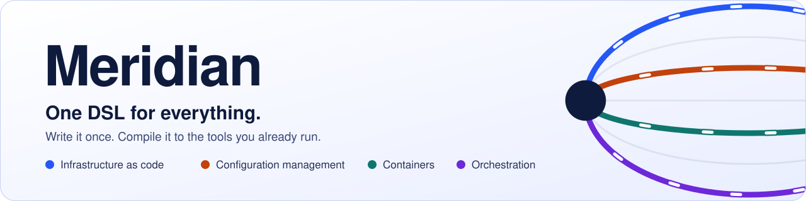
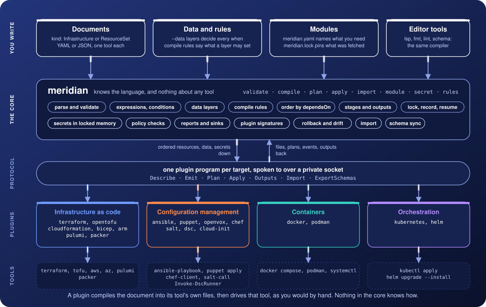

# Meridian

<picture>
  <source media="(prefers-color-scheme: dark)" srcset="branding/banner/meridian-banner-dark-animated.svg">
  
</picture>

Meridian is one declarative language that compiles to Ansible, Puppet, Chef, DSC,
cloud-init, Terraform, CloudFormation, Bicep, ARM templates, Pulumi, Docker Compose,
Kubernetes and Helm, then runs the chosen tool to plan and apply it. A target that cannot do
what a document asks refuses it at compile time.

The core knows the language; each plugin knows one tool.

| Start here | |
|---|---|
| [Install](quickstart/install.md) | releases, building from source, what each target needs |
| [Windows](quickstart/windows.md) | what differs on Windows |
| [Your first ResourceSet](quickstart/first-resourceset.md) | one document from validate to apply |
| [A two-stage workflow](quickstart/first-two-stage.md) | one tool creates a machine, another configures it |
| [Worked workflows](quickstart/workflows.md) | eight workflows across every target |
| [Importing existing configuration](operations/importing.md) | `meridian import` |
| [Adopting what exists](reference/dsl/resources.md#adopting-what-exists) | `adopt` an existing thing instead of creating another |
| [Moving a document to another tool](operations/retargeting.md) | `meridian retarget` |
| [Destroying what was applied](operations/destroying.md) | `meridian destroy` |

| Concepts | |
|---|---|
| [How it fits together](reference/dsl/how-it-fits-together.md) | one document from file to running tool |
| [Documents, resources and targets](concepts/ir-overview.md) | the two document kinds and two families of types |
| [Dependencies and notifications](concepts/dependencies.md) | `dependsOn` and `notifies` per tool |
| [The capability model](concepts/capability-model.md) | why a document compiles exactly or not at all |
| [The two-stage architecture](concepts/two-stage-architecture.md) | Infrastructure, ResourceSet and the hand-off |
| [Running safely](concepts/run-safety.md) | locks, run records, resume, rollback, drift, policy |
| [Compile rules](concepts/compile-rules.md) | what a data layer may override |
| [Secrets in memory](concepts/secrets-in-memory.md) | how a secret is held and handed to a tool |

| Operating | |
|---|---|
| [Testing documents and modules](reference/testing.md) | `meridian test` |
| [Running in a pipeline](operations/running-in-a-pipeline.md) | one job per CI engine |
| [A saved plan](operations/pull-requests.md) | `plan --out` and `apply --plan` from a pull request |

| Editor tools | |
|---|---|
| [Overview](tooling/index.md) | |
| [Language server](tooling/language-server.md) | completion, hover, errors, navigation |
| [Visual Studio Code](tooling/vscode.md) | the extension |
| [Other editors](tooling/other-editors.md) | Neovim, Helix, Emacs, pre-commit |
| [Formatter](tooling/formatter.md) | `meridian fmt` |
| [Linter](tooling/linter.md) | `meridian lint` |
| [JSON Schema](tooling/json-schema.md) | `meridian schema` |
| [Tool schemas](tooling/schema-sync.md) | `meridian schema sync` |
| [Schema bundles](tooling/schema-bundles.md) | signed schemas from an OCI registry, no tool needed |
| [MCP server](tooling/mcp-server.md) | `meridian mcp` |

| Reference | |
|---|---|
| [The `meridian` command](reference/cli.md) | commands, options, exit status |
| [Machine-readable output](reference/cli-json.md) | `--output json` |
| [The Meridian language](reference/dsl/index.md) | every document field |
| Language items | [resources](reference/dsl/resources.md), [`dependsOn`](reference/dsl/dependson.md), [`notifies`](reference/dsl/notifies.md), [conditions](reference/dsl/conditions.md), [references](reference/dsl/references.md), [outputs and hand-offs](reference/dsl/outputs-and-hand-offs.md) |
| Language by segment | [configuration management](reference/dsl/configuration-management.md), [infrastructure as code](reference/dsl/infrastructure-as-code.md), [containerization](reference/dsl/containerization.md), [container orchestration](reference/dsl/container-orchestration.md) |
| [Common infrastructure types](reference/dsl/common-infrastructure-types.md) | `network`, `subnet`, `firewall`, `address`, `vm` |
| [Resource types](reference/resource-types.md) | the six shared configuration management types |
| [Modules](reference/modules.md) | manifest, sources, versions, lockfile |
| [Lint rules](reference/lint.md) | |
| [Compile rules](reference/compile-rules.md) | |
| [Error codes](reference/errors.md) | |
| [Plugin signatures](reference/plugin-signatures.md) | which plugins may start |
| [Policy checks](reference/policy.md) | Rego with Open Policy Agent |
| [State, runs and backends](reference/state.md) | |
| [Reports and sinks](reference/reporting.md) | |
| [Report server](reference/report-server.md) | |
| [Capability matrix](reference/capability-matrix.md) | generated |
| [Plugin settings](reference/plugin-settings.md) | generated |
| [Conformance matrix](reference/conformance-matrix.md) | generated |
| [Infra conformance matrix](reference/infra-conformance-matrix.md) | generated |
| [Refusal rules](reference/refusal-rules.md) | generated |
| [Compatibility](reference/compatibility.md) | generated |

| Targets | |
|---|---|
| Configuration management | [ansible](targets/ansible.md), [puppet](targets/puppet.md), [openvox](targets/openvox.md), [chef](targets/chef.md), [dsc](targets/dsc.md), [salt](targets/salt.md), [cloud-init](targets/cloud-init.md) |
| Infrastructure as code | [terraform](targets/terraform.md), [opentofu](targets/opentofu.md), [cloudformation](targets/cloudformation.md), [bicep](targets/bicep.md), [arm](targets/arm.md), [pulumi](targets/pulumi.md), [packer](targets/packer.md) |
| Containers | [docker](targets/docker.md), [podman](targets/podman.md), [kubernetes](targets/kubernetes.md), [helm](targets/helm.md) (with Kustomize) |

| Contributing | |
|---|---|
| [`CONTRIBUTING.md`](../CONTRIBUTING.md) | setup, checks, review |
| [Writing a plugin](contributing/writing-a-plugin.md) | add a tool |
| [How Meridian is tested](contributing/testing.md) | |
| [Real-tool tests](contributing/real-tool-tests.md) | |
| [Releasing](contributing/releasing.md) | |
| [Documentation site](contributing/documentation-site.md) | publishing, pages, graphics |
| [Code of Conduct](../CODE_OF_CONDUCT.md) | |
| [`SECURITY.md`](../SECURITY.md) | reporting security issues |

| Design | |
|---|---|
| [Design plan](plans/design-plan.md) | IR, pipeline, SDK, architecture |
| [Testing plan](plans/testing-plan.md) | |
| [Documentation plan](plans/documentation-plan.md) | |
| [Governance](plans/governance.md) | |
| [Migration and adoption](plans/migration-and-adoption.md) | |
| [Observability](plans/observability.md) | |
| [Release and versioning](plans/release-and-versioning.md) | |
| [Modules and versioning](plans/modules-and-versioning.md) | |
| [Security](plans/security.md) | |
| [Run safety](plans/run-safety.md) | |
| [Reporting](plans/reporting.md) | |
| [Language expansion](plans/language-expansion.md) | |
| [Decision records](decisions/README.md) | |
