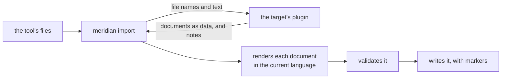

# Importing existing configuration

`meridian import` reads configuration you already have, written for one of the tools
Meridian drives, and writes the Meridian documents that describe the same thing. It is
how an estate that already exists gets into Meridian without being typed in again.

```
meridian import ./compose.yaml -o imported
```

Importing only reads. It runs no tool, contacts no machine and changes no file other
than the documents it writes.

| It reads | With the plugin | And writes |
|---|---|---|
| Terraform configuration, `*.tf` and `*.tf.json` | [terraform](../targets/terraform.md#importing) | one Infrastructure document |
| OpenTofu configuration, `*.tf`, `*.tofu` and their JSON forms | [opentofu](../targets/opentofu.md#importing) | one Infrastructure document |
| Ansible playbooks and task files | [ansible](../targets/ansible.md#importing) | one ResourceSet for each play |
| Compose files | [docker](../targets/docker.md#importing) | one Infrastructure document |
| Kubernetes manifests | [kubernetes](../targets/kubernetes.md#importing) | one Infrastructure document |
| PowerShell DSC configurations, DSC v3 documents, DscPipelineRunner projects | [dsc](../targets/dsc.md#importing) | one ResourceSet for each node |

Which plugins can import is a fact about what is installed, so `meridian plugins` lists
it, and the [capability matrix](../reference/capability-matrix.md) has a column for it.
A plugin that does not import is simply not offered. Each importer belongs to its
target's plugin, so a plugin Meridian's authors never wrote can import too:
[writing a plugin](../contributing/writing-a-plugin.md#an-importer) says how.

## The one rule

**Nothing is dropped quietly.** A tool's own configuration says more than a document
can, and an importer that left the difference out without a word would hand you a
document that looks complete and is not. So everything the source says ends up in one of
four places:

| What happened | In the report | In the document |
|---|---|---|
| Carried over as written | counted | the resource, with a comment naming the file and line it came from |
| Carried over faithfully, in a way worth explaining | under **notes** | a plain comment |
| Carried over, but **changed**: the document may behave differently | under **changed** | a comment that starts `TODO(meridian-import)` |
| **Not translated**: the document does less than the source did | under **not translated** | a comment that starts `TODO(meridian-import)` |

Search a document for `TODO(meridian-import)` and you have the whole list of what to
look at before it is applied. Where a note is about one resource the marker sits beside
that resource; otherwise it is at the top of the document.

## A first import

[`plugins/docker/testdata/import/shop/compose.yaml`](../../plugins/docker/testdata/import/shop/compose.yaml)
is a Compose file for a small shop: a database, a cache, a migration, the application and
a proxy.

```
$ meridian import shop -o imported
imported shop with the docker plugin: 1 document, 10 resources
  shop (Infrastructure, 10 resources) -> imported/shop.yaml
notes (2):
  compose.yaml:5: x-logging: left out: an extension field is not part of the project. Anything that reused it through a YAML anchor was written out in full
  compose.yaml: project directory: relative paths in the file (a build context, a bind mount, an env_file) are resolved against /srv/shop, the directory the file was in, as Compose did
everything in the source was carried over
```

The report goes to standard error and the documents to the directory named with `-o`, one
file each. Without `-o` the documents are printed, so an import can be read before
anything is written.

`imported/shop.yaml` begins:

```yaml
# Imported from shop by `meridian import`.
#
# compose.yaml:5: x-logging: left out: an extension field is not part of the
#   project. Anything that reused it through a YAML anchor was written out in
#   full
apiVersion: meridian/v1
kind: Infrastructure
metadata:
  name: shop
spec:
  target: docker
  resources:
    # From compose.yaml:12
    - id: db
      type: service
      params:
        environment:
          POSTGRES_DB: shop
          POSTGRES_PASSWORD_FILE: /run/secrets/db_password
        image: postgres:16
```

What a document says in its own way is translated, not copied. The application waited
for the database to be healthy and asked to be restarted with it, which in Compose is
`depends_on` with `restart: true`. In the document the database says it:

```yaml
    - id: db
      type: service
      notifies:
        - resource: app
          action: restart
```

The whole document is
[`shop.meridian.yaml`](../../plugins/docker/testdata/import/shop.meridian.yaml), which a
test compares with what the importer writes.

## When something cannot be carried over

[`plugins/terraform/testdata/import/web-vm`](../../plugins/terraform/testdata/import/web-vm)
is a Terraform configuration in four files. It imports, and six things in it need a
person:

```
$ meridian import web-vm --from terraform -o imported
imported web-vm with the terraform plugin: 1 document, 15 resources
  web-vm (Infrastructure, 15 resources, 6 TODO) -> imported/web-vm.yaml
not translated: the documents do less than the source until these are written (4):
  main.tf:83: moved block: a moved block changes what the state records and has no counterpart in a document. Do it once with the tool before Meridian takes over, then it is not needed
  outputs.tf:1: output "address": a document's output has a name and a value, so "description" was left out
  outputs.tf:10: output "instance_ids": a document's output has a name and a value. `sensitive` was left out, so the value is shown in plans and logs unless what it reads is itself marked sensitive
  versions.tf:1: terraform.required_version: the constraint ">= 1.6" on the tool's own version has nowhere to go in a document; pin the terraform binary Meridian runs instead
changed: carried over, but not as the source wrote it (2):
  main.tf:37: aws_instance.web: a document's ids are unique and "web" was taken or reserved, so this is "web_aws_instance" here and aws_instance.web_aws_instance once compiled. An existing state still knows it as aws_instance.web: move it with `terraform state mv aws_instance.web aws_instance.web_aws_instance` before applying, or it is destroyed and created again.
  ...
6 things to look at before applying; each is marked TODO(meridian-import) in the documents
```

Each line says where in the source the thing is, what happened to it, and what to do. In
the document the same text is beside the resource it is about:

```yaml
    # From main.tf:37
    # TODO(meridian-import): changed: main.tf:37: aws_instance.web: a
    #   document's ids are unique and "web" was taken or reserved, so this is
    #   "web_aws_instance" here and aws_instance.web_aws_instance once compiled.
    #   ...
    - id: web_aws_instance
      type: aws_instance
```

A document with markers is still a valid document: it validates and compiles. The
markers are comments, and removing one is how you record that you dealt with it.

### As a check

`--strict` makes an import fail when anything was changed or not translated. The
documents are still written, and the exit status is `1`:

```
$ meridian import web-vm --from terraform -o imported --strict
...
error: --strict: 6 things to look at; see the TODO(meridian-import) markers
```

That turns the question "could Meridian take this over as it stands?" into something a
script can ask of every directory in a repository, without applying anything.

## Saying which tool

Left to itself, `meridian import` works out the plugin from the file names. A file named
`compose.yaml` is a Compose file; `site.yml` and `playbook.yml` are playbooks;
`Datum.yml` and `*.dsc.yaml` are DSC's.

Many names are not that telling. `web.yaml` could be a manifest, a playbook or a DSC
document, and `main.tf` is read by both Terraform and OpenTofu. Then the import stops and
asks:

```
error: these files could belong to more than one tool; say which with --from (one of: opentofu, terraform)
```

`--from` names the plugin:

```
meridian import ./infra --from opentofu
meridian import ./k8s/web.yaml --from kubernetes
```

The choice between `terraform` and `opentofu` is also the choice of which tool Meridian
will run for the imported document, so it is not guessed.

## What is imported from where

A path may be a file or a directory. A directory contributes the files in it that the
plugin's formats claim, and with `-r` the files in the directories inside it too. Hidden
files and directories are skipped. Several paths may be given; they are read as one
source.

The document's name is `--name` when given. Otherwise it is the name of the directory, or
of the file without its extension; a file with a generic name such as `main.tf` or
`compose.yaml` takes the name of the directory it is in. An importer that finds a name in
the source itself, such as a Compose project's `name`, a play's name or a
`Configuration`'s, uses that.

When a source holds several things that each become a document (three plays, two `Node`
blocks), each gets a file of its own under `-o`, named after the document.

A file that already exists under `-o` is not replaced unless `--force` is given, so an
import cannot overwrite a document somebody has since edited.

## What "the same" means

An imported document is checked the way its tests check it: the document is compiled
back to the tool's own format and compared with the original **by meaning**, not as
text. For every importer there is a test that does exactly this with a realistic source,
and its inputs and expected outputs are files you can read:

| Importer | Source | Round-trip test |
|---|---|---|
| terraform | [`web-vm/`](../../plugins/terraform/testdata/import/web-vm) | [`plugins/terraform/tests/import.rs`](../../plugins/terraform/tests/import.rs) |
| opentofu | the same, and an encrypted-state configuration | [`plugins/opentofu/tests/import.rs`](../../plugins/opentofu/tests/import.rs) |
| ansible | [`web/site.yml`](../../plugins/ansible/testdata/import/web/site.yml) | [`plugins/ansible/tests/import.rs`](../../plugins/ansible/tests/import.rs) |
| docker | [`shop/compose.yaml`](../../plugins/docker/testdata/import/shop/compose.yaml) | [`plugins/docker/tests/import.rs`](../../plugins/docker/tests/import.rs) |
| kubernetes | [`web/web.yaml`](../../plugins/kubernetes/testdata/import/web/web.yaml) | [`plugins/kubernetes/tests/import.rs`](../../plugins/kubernetes/tests/import.rs) |
| dsc | [`iis/WebServer.ps1`](../../plugins/dsc/testdata/import/iis/WebServer.ps1), a v3 document, a runner project | [`plugins/dsc/tests/import.rs`](../../plugins/dsc/tests/import.rs) |

Be clear about what that does and does not promise.

- **It is not an identity on text.** Comments in the source are not carried. Keys come
  out sorted. A compiled Ansible task is named after its resource's id, and a Terraform
  configuration comes back in the JSON syntax. None of that changes what the tool does.
- **It is an identity on meaning, for what was carried over.** Where it is not, there is
  a marker saying so. A document with no markers compiles to something its tool reads the
  way it read the original.
- **A runtime condition stays a runtime condition.** An Ansible `when:` becomes
  `runtimeWhen`, which the tool still evaluates on the node when it applies. Nothing that
  depends on a fact is decided at import time.
- **What a program computes is not evaluated.** A PowerShell configuration with a loop in
  it, a Jinja expression over a play variable, a Compose `${VARIABLE}`: importing does not
  run them, so it cannot know what they would have produced. They are reported.

## After importing

1. **Read the markers.** `grep -n 'TODO(meridian-import)' imported/*.yaml`.
2. **Validate**: `meridian validate imported/*.yaml`. Every imported document is
   validated before it is written, so this passes until you edit one.
3. **Compile and compare**: `meridian compile imported/*.yaml --out build`, then look at
   `build/` next to what you imported. This is the round trip, done on your own
   configuration.
4. **Plan before you apply**: `meridian plan imported/*.yaml`. For a tool that keeps
   state, a clean import of configuration that is already applied plans no changes. If it
   plans a replacement, a marker said why.

Two things deserve care, and both are the tool's rules and not Meridian's:

- **Terraform and OpenTofu state.** A document's ids are unique across the document, and
  a Terraform configuration's names are unique only within a type. When two resources
  share a name the importer renames one and says so, with the `state mv` command that
  tells the existing state about the new address. Run it before the first apply.
- **Where the tool keeps its working files.** Meridian runs each tool in its own state
  directory. A Terraform configuration with a `backend` keeps using that backend; one
  that kept local state needs the state file moved or a backend added. See
  [coexisting with what you have](../plans/migration-and-adoption.md#2-coexistence-model).

## Options

| Option | Meaning |
|---|---|
| `PATHS...` | the files to import, or directories holding them |
| `--from TARGET` | the plugin whose tool the files belong to; needed when the names fit more than one |
| `--name NAME` | what to call the imported document |
| `-o DIR`, `--out DIR` | write the documents into this directory, one file each; left out, they are printed |
| `-r`, `--recursive` | look in the directories inside a directory too |
| `--force` | replace a document that already exists under `--out` |
| `--strict` | exit `1` when anything was changed or not translated; the documents are still written |
| `--plugin-dir DIR` | where to look for plugins, as for every command |

Exit status is `0` when the import succeeded, whatever it reported; `1` when the source
could not be read, no plugin could import it, or `--strict` found something; `2` for a
mistake in the command line.

A source holding more than 3 MiB of text is refused: import it in smaller groups. So is
a source the plugin cannot parse, and a parse error names the file and the line.

## How it works



The plugin does not write YAML. It returns each document as data (resources, their
params, their dependencies) with its notes, and `meridian` renders that in the current
language. So when the language changes, every importer's output changes with it, and no
importer has to know how a document is spelled.

Importing is an optional part of the [plugin protocol](../contributing/writing-a-plugin.md#an-importer):
a plugin says which formats it imports when it describes itself, and one that says none
is never asked.
