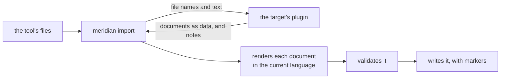

# Importing existing configuration

`meridian import` reads existing configuration for one of the tools Meridian drives and
writes Meridian documents that describe the same thing, so existing estates do not have
to be retyped.

```
meridian import ./compose.yaml -o imported
```

Importing only reads. It runs no tool, contacts no machine, and writes nothing but the
documents.

| It reads | With the plugin | And writes |
|---|---|---|
| Terraform configuration, `*.tf` and `*.tf.json` | [terraform](../targets/terraform.md#importing) | one Infrastructure document |
| OpenTofu configuration, `*.tf`, `*.tofu` and their JSON forms | [opentofu](../targets/opentofu.md#importing) | one Infrastructure document |
| Ansible playbooks and task files | [ansible](../targets/ansible.md#importing) | one ResourceSet for each play |
| Compose files | [docker](../targets/docker.md#importing) | one Infrastructure document |
| Kubernetes manifests | [kubernetes](../targets/kubernetes.md#importing) | one Infrastructure document |
| PowerShell DSC configurations, DSC v3 documents, DscPipelineRunner projects | [dsc](../targets/dsc.md#importing) | one ResourceSet for each node |

`meridian plugins` lists which installed plugins can import, and the
[capability matrix](../reference/capability-matrix.md) has a column for it. Each
importer belongs to its target's plugin, so third-party plugins can import too:
[writing a plugin](../contributing/writing-a-plugin.md#an-importer) says how.

## The one rule

**Nothing is dropped silently.** A tool's configuration can say more than a document
can. An importer that hid the difference would hand you a document that looks complete
but is not. So everything in the source lands in one of four places:

| What happened | In the report | In the document |
|---|---|---|
| Carried over as written | counted | the resource, with a comment naming the file and line it came from |
| Carried over faithfully, in a way worth explaining | under **notes** | a plain comment |
| Carried over, but **changed**: the document may behave differently | under **changed** | a comment that starts `TODO(meridian-import)` |
| **Not translated**: the document does less than the source did | under **not translated** | a comment that starts `TODO(meridian-import)` |

Search for `TODO(meridian-import)` to get the full list of what to review before
applying. A note about one resource sits beside it; others go at the top of the
document.

## A first import

[`plugins/docker/testdata/import/shop/compose.yaml`](../../plugins/docker/testdata/import/shop/compose.yaml)
is a Compose file for a small shop: database, cache, migration, application and proxy.

```
$ meridian import shop -o imported
imported shop with the docker plugin: 1 document, 10 resources
  shop (Infrastructure, 10 resources) -> imported/shop.yaml
notes (2):
  compose.yaml:5: x-logging: left out: an extension field is not part of the project. Anything that reused it through a YAML anchor was written out in full
  compose.yaml: project directory: relative paths in the file (a build context, a bind mount, an env_file) are resolved against /srv/shop, the directory the file was in, as Compose did
everything in the source was carried over
```

The report goes to stderr and the documents to the `-o` directory, one file each.
Without `-o` the documents are printed, so you can read an import before writing it.

`imported/shop.yaml` begins:

```yaml
# Imported from shop by `meridian import`.
#
# compose.yaml:5: x-logging: left out: an extension field is not part of the
#   project. Anything that reused it through a YAML anchor was written out in
#   full
apiVersion: meridian/v1
kind: Infrastructure
metadata:
  name: shop
spec:
  target: docker
  resources:
    # From compose.yaml:12
    - id: db
      type: service
      params:
        environment:
          POSTGRES_DB: shop
          POSTGRES_PASSWORD_FILE: /run/secrets/db_password
        image: postgres:16
```

Concepts with a Meridian equivalent are translated, not copied. The application waits
for a healthy database and restarts with it, which Compose writes as `depends_on` with
`restart: true`. In the document, the database says it:

```yaml
    - id: db
      type: service
      notifies:
        - resource: app
          action: restart
```

The whole document is
[`shop.meridian.yaml`](../../plugins/docker/testdata/import/shop.meridian.yaml), which a
test compares with what the importer writes.

## When something cannot be carried over

[`plugins/terraform/testdata/import/web-vm`](../../plugins/terraform/testdata/import/web-vm)
is a Terraform configuration in four files. It imports, with six things that need a
person:

```
$ meridian import web-vm --from terraform -o imported
imported web-vm with the terraform plugin: 1 document, 15 resources
  web-vm (Infrastructure, 15 resources, 6 TODO) -> imported/web-vm.yaml
not translated: the documents do less than the source until these are written (4):
  main.tf:83: moved block: a moved block changes what the state records and has no counterpart in a document. Do it once with the tool before Meridian takes over, then it is not needed
  outputs.tf:1: output "address": a document's output has a name and a value, so "description" was left out
  outputs.tf:10: output "instance_ids": a document's output has a name and a value. `sensitive` was left out, so the value is shown in plans and logs unless what it reads is itself marked sensitive
  versions.tf:1: terraform.required_version: the constraint ">= 1.6" on the tool's own version has nowhere to go in a document; pin the terraform binary Meridian runs instead
changed: carried over, but not as the source wrote it (2):
  main.tf:37: aws_instance.web: a document's ids are unique and "web" was taken or reserved, so this is "web_aws_instance" here and aws_instance.web_aws_instance once compiled. An existing state still knows it as aws_instance.web: move it with `terraform state mv aws_instance.web aws_instance.web_aws_instance` before applying, or it is destroyed and created again.
  ...
6 things to look at before applying; each is marked TODO(meridian-import) in the documents
```

Each line gives the source location, what happened, and what to do. The document repeats
the text beside the resource:

```yaml
    # From main.tf:37
    # TODO(meridian-import): changed: main.tf:37: aws_instance.web: a
    #   document's ids are unique and "web" was taken or reserved, so this is
    #   "web_aws_instance" here and aws_instance.web_aws_instance once compiled.
    #   ...
    - id: web_aws_instance
      type: aws_instance
```

A document with markers is still valid: it validates and compiles. Markers are comments;
delete one to record that you dealt with it.

### As a check

`--strict` fails an import when anything was changed or not translated. The documents
are still written, and the exit status is `1`:

```
$ meridian import web-vm --from terraform -o imported --strict
...
error: --strict: 6 things to look at; see the TODO(meridian-import) markers
```

A script can then ask of every directory in a repository, without applying anything:
"could Meridian take this over as it stands?"

## Saying which tool

By default `meridian import` picks the plugin from file names: `compose.yaml` is
Compose; `site.yml` and `playbook.yml` are playbooks; `Datum.yml` and `*.dsc.yaml` are
DSC.

Many names are ambiguous. `web.yaml` could be a manifest, playbook or DSC document, and
both Terraform and OpenTofu read `main.tf`. The import then stops and asks:

```
error: these files could belong to more than one tool; say which with --from (one of: opentofu, terraform)
```

`--from` names the plugin:

```
meridian import ./infra --from opentofu
meridian import ./k8s/web.yaml --from kubernetes
```

Choosing `terraform` or `opentofu` also chooses which tool Meridian will run, so it is
never guessed.

## What is imported from where

A path may be a file or directory. A directory contributes the files the plugin's
formats claim; `-r` includes subdirectories. Hidden files and directories are skipped.
Several paths are read as one source.

The document name is `--name` if given. Otherwise it is the directory name, or the file
name without its extension; generic names such as `main.tf` or `compose.yaml` take the
directory's name. A name in the source itself (a Compose project's `name`, a play's name,
a `Configuration`'s) wins.

When a source holds several documents' worth (three plays, two `Node` blocks), each gets
its own file under `-o`, named after the document.

Existing files under `-o` are not replaced without `--force`, so an import cannot
overwrite a document someone has edited.

## What "the same" means

Importer tests compile each imported document back to the tool's format and compare it
with the original **by meaning**, not as text. Every importer has such a test with a
realistic source, and its inputs and expected outputs are readable files:

| Importer | Source | Round-trip test |
|---|---|---|
| terraform | [`web-vm/`](../../plugins/terraform/testdata/import/web-vm) | [`plugins/terraform/tests/import.rs`](../../plugins/terraform/tests/import.rs) |
| opentofu | the same, and an encrypted-state configuration | [`plugins/opentofu/tests/import.rs`](../../plugins/opentofu/tests/import.rs) |
| ansible | [`web/site.yml`](../../plugins/ansible/testdata/import/web/site.yml) | [`plugins/ansible/tests/import.rs`](../../plugins/ansible/tests/import.rs) |
| docker | [`shop/compose.yaml`](../../plugins/docker/testdata/import/shop/compose.yaml) | [`plugins/docker/tests/import.rs`](../../plugins/docker/tests/import.rs) |
| kubernetes | [`web/web.yaml`](../../plugins/kubernetes/testdata/import/web/web.yaml) | [`plugins/kubernetes/tests/import.rs`](../../plugins/kubernetes/tests/import.rs) |
| dsc | [`iis/WebServer.ps1`](../../plugins/dsc/testdata/import/iis/WebServer.ps1), a v3 document, a runner project | [`plugins/dsc/tests/import.rs`](../../plugins/dsc/tests/import.rs) |

What this does and does not promise:

- **Not identical text.** Comments are dropped, keys are sorted, Ansible tasks are named
  after resource ids, and Terraform comes back as JSON. None of this changes what the
  tool does.
- **Identical meaning, for what was carried over.** Anything else has a marker. A
  document with no markers compiles to something the tool reads as it read the original.
- **Runtime conditions stay runtime.** An Ansible `when:` becomes `runtimeWhen`, still
  evaluated on the node at apply. Nothing fact-dependent is decided at import.
- **Computed values are not evaluated.** A PowerShell loop, a Jinja expression over a
  play variable, a Compose `${VARIABLE}`: importing does not run them, so it reports
  them.

## After importing

1. **Read the markers.** `grep -n 'TODO(meridian-import)' imported/*.yaml`.
2. **Validate**: `meridian validate imported/*.yaml`. Imported documents are validated
   before being written, so this passes until you edit one.
3. **Compile and compare**: `meridian compile imported/*.yaml --out build`, then compare
   `build/` with the original. This is the round trip on your own configuration.
4. **Plan before applying**: `meridian plan imported/*.yaml`. For a stateful tool, a
   clean import of already-applied configuration plans no changes. A planned
   replacement will have a marker explaining it.

Two things need care, both the tool's rules rather than Meridian's:

- **Terraform and OpenTofu state.** Document ids are unique across the document;
  Terraform names are unique only within a type. When two resources share a name, the
  importer renames one and prints the `state mv` command that updates existing state.
  Run it before the first apply.
- **Where the tool keeps working files.** Meridian runs each tool in its own state
  directory. A Terraform configuration with a `backend` keeps using it; one with local
  state needs the state file moved or a backend added. See
  [coexisting with what you have](../plans/migration-and-adoption.md#2-coexistence-model).

## Options

| Option | Meaning |
|---|---|
| `PATHS...` | the files to import, or directories holding them |
| `--from TARGET` | the plugin whose tool the files belong to; needed when the names fit more than one |
| `--name NAME` | what to call the imported document |
| `-o DIR`, `--out DIR` | write the documents into this directory, one file each; left out, they are printed |
| `-r`, `--recursive` | look in the directories inside a directory too |
| `--force` | replace a document that already exists under `--out` |
| `--strict` | exit `1` when anything was changed or not translated; the documents are still written |
| `--plugin-dir DIR` | where to look for plugins, as for every command |

Exit status: `0` when the import succeeded, whatever it reported; `1` when the source
could not be read, no plugin could import it, or `--strict` found something; `2` for a
command-line mistake.

Sources over 3 MiB of text are refused; import in smaller groups. Unparseable sources
are refused too, with the file and line.

## How it works



The plugin does not write YAML. It returns each document as data (resources, params,
dependencies) plus notes, and `meridian` renders it in the current language. When the
language changes, every importer's output follows, and no importer needs to know the
syntax.

Importing is an optional part of the [plugin protocol](../contributing/writing-a-plugin.md#an-importer):
a plugin lists the formats it imports when it describes itself; one that lists none is
never asked.
