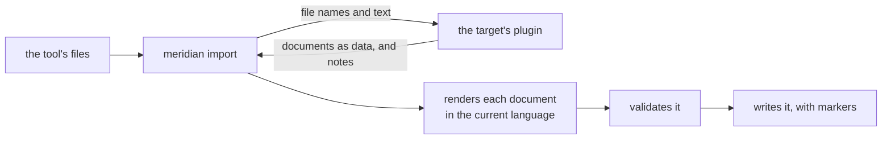

# Importing existing configuration

`meridian import` turns a tool's existing configuration into Meridian documents.

```
meridian import ./compose.yaml -o imported
```

It runs no tool and writes only the documents.

| It reads | With the plugin | And writes |
|---|---|---|
| Terraform configuration, `*.tf` and `*.tf.json` | [terraform](../targets/terraform.md#importing) | one Infrastructure document |
| OpenTofu configuration, `*.tf`, `*.tofu` and their JSON forms | [opentofu](../targets/opentofu.md#importing) | one Infrastructure document |
| Ansible playbooks and task files | [ansible](../targets/ansible.md#importing) | one ResourceSet for each play |
| Compose files | [docker](../targets/docker.md#importing) | one Infrastructure document |
| Kubernetes manifests | [kubernetes](../targets/kubernetes.md#importing) | one Infrastructure document |
| PowerShell DSC configurations, DSC v3 documents, DscPipelineRunner projects | [dsc](../targets/dsc.md#importing) | one ResourceSet for each node |

`meridian plugins` and the [capability matrix](../reference/capability-matrix.md) show which
plugins import. Third-party plugins can too
([how](../contributing/writing-a-plugin.md#an-importer)).

## The one rule

**Nothing is dropped silently.** Everything lands in one of four places:

| What happened | In the report | In the document |
|---|---|---|
| Carried over as written | counted | the resource, with a comment naming the file and line it came from |
| Carried over faithfully, in a way worth explaining | under **notes** | a plain comment |
| Carried over, but **changed**: the document may behave differently | under **changed** | a comment that starts `TODO(meridian-import)` |
| **Not translated**: the document does less than the source did | under **not translated** | a comment that starts `TODO(meridian-import)` |

Search for `TODO(meridian-import)` before applying. Resource notes sit beside the resource;
others at the top.

## A first import

[`plugins/docker/testdata/import/shop/compose.yaml`](../../plugins/docker/testdata/import/shop/compose.yaml)
has a database, cache, migration, application and proxy.

```
$ meridian import shop -o imported
imported shop with the docker plugin: 1 document, 10 resources
  shop (Infrastructure, 10 resources) -> imported/shop.yaml
notes (2):
  compose.yaml:5: x-logging: left out: an extension field is not part of the project. Anything that reused it through a YAML anchor was written out in full
  compose.yaml: project directory: relative paths in the file (a build context, a bind mount, an env_file) are resolved against /srv/shop, the directory the file was in, as Compose did
everything in the source was carried over
```

The report goes to stderr, documents to `-o` (or stdout without it).

`imported/shop.yaml` begins:

```yaml
# Imported from shop by `meridian import`.
#
# compose.yaml:5: x-logging: left out: an extension field is not part of the
#   project. Anything that reused it through a YAML anchor was written out in
#   full
apiVersion: meridian/v1
kind: Infrastructure
metadata:
  name: shop
spec:
  target: docker
  resources:
    # From compose.yaml:12
    - id: db
      type: service
      params:
        environment:
          POSTGRES_DB: shop
          POSTGRES_PASSWORD_FILE: /run/secrets/db_password
        image: postgres:16
```

Equivalent concepts are translated: Compose's `depends_on` with `restart: true` becomes a
notify on the database:

```yaml
    - id: db
      type: service
      notifies:
        - resource: app
          action: restart
```

Full document: [`shop.meridian.yaml`](../../plugins/docker/testdata/import/shop.meridian.yaml).

## When something cannot be carried over

[`plugins/terraform/testdata/import/web-vm`](../../plugins/terraform/testdata/import/web-vm)
imports with six things to review:

```
$ meridian import web-vm --from terraform -o imported
imported web-vm with the terraform plugin: 1 document, 15 resources
  web-vm (Infrastructure, 15 resources, 6 TODO) -> imported/web-vm.yaml
not translated: the documents do less than the source until these are written (4):
  main.tf:83: moved block: a moved block changes what the state records and has no counterpart in a document. Do it once with the tool before Meridian takes over, then it is not needed
  outputs.tf:1: output "address": a document's output has a name and a value, so "description" was left out
  outputs.tf:10: output "instance_ids": a document's output has a name and a value. `sensitive` was left out, so the value is shown in plans and logs unless what it reads is itself marked sensitive
  versions.tf:1: terraform.required_version: the constraint ">= 1.6" on the tool's own version has nowhere to go in a document; pin the terraform binary Meridian runs instead
changed: carried over, but not as the source wrote it (2):
  main.tf:37: aws_instance.web: a document's ids are unique and "web" was taken or reserved, so this is "web_aws_instance" here and aws_instance.web_aws_instance once compiled. An existing state still knows it as aws_instance.web: move it with `terraform state mv aws_instance.web aws_instance.web_aws_instance` before applying, or it is destroyed and created again.
  ...
6 things to look at before applying; each is marked TODO(meridian-import) in the documents
```

Each line gives the location, what happened and what to do; the document repeats it:

```yaml
    # From main.tf:37
    # TODO(meridian-import): changed: main.tf:37: aws_instance.web: a
    #   document's ids are unique and "web" was taken or reserved, so this is
    #   "web_aws_instance" here and aws_instance.web_aws_instance once compiled.
    #   ...
    - id: web_aws_instance
      type: aws_instance
```

Markers are comments; the document still compiles. Delete each one once handled.

### As a check

`--strict` exits `1` when anything was changed or not translated; documents are still
written:

```
$ meridian import web-vm --from terraform -o imported --strict
...
error: --strict: 6 things to look at; see the TODO(meridian-import) markers
```

## Saying which tool

The plugin is picked from file names (`compose.yaml`, `site.yml`, `playbook.yml`,
`Datum.yml`, `*.dsc.yaml`). Ambiguous names such as `web.yaml` or `main.tf` stop the
import:

```
error: these files could belong to more than one tool; say which with --from (one of: opentofu, terraform)
```

`--from` names the plugin:

```
meridian import ./infra --from opentofu
meridian import ./k8s/web.yaml --from kubernetes
```

## What is imported from where

- Paths are files or directories (`-r` for subdirectories; hidden ones skipped), read as
  one source.
- The name is the source's own, else `--name`, else the directory or file name.
- Several documents (plays, `Node` blocks) get one file each.
- Existing files need `--force`.

## What "the same" means

Every importer's test compiles the import back and compares it with the original **by
meaning**:

| Importer | Source | Round-trip test |
|---|---|---|
| terraform | [`web-vm/`](../../plugins/terraform/testdata/import/web-vm) | [`plugins/terraform/tests/import.rs`](../../plugins/terraform/tests/import.rs) |
| opentofu | the same, and an encrypted-state configuration | [`plugins/opentofu/tests/import.rs`](../../plugins/opentofu/tests/import.rs) |
| ansible | [`web/site.yml`](../../plugins/ansible/testdata/import/web/site.yml) | [`plugins/ansible/tests/import.rs`](../../plugins/ansible/tests/import.rs) |
| docker | [`shop/compose.yaml`](../../plugins/docker/testdata/import/shop/compose.yaml) | [`plugins/docker/tests/import.rs`](../../plugins/docker/tests/import.rs) |
| kubernetes | [`web/web.yaml`](../../plugins/kubernetes/testdata/import/web/web.yaml) | [`plugins/kubernetes/tests/import.rs`](../../plugins/kubernetes/tests/import.rs) |
| dsc | [`iis/WebServer.ps1`](../../plugins/dsc/testdata/import/iis/WebServer.ps1), a v3 document, a runner project | [`plugins/dsc/tests/import.rs`](../../plugins/dsc/tests/import.rs) |

- **Not identical text:** comments dropped, keys sorted, Ansible tasks named by id,
  Terraform as JSON.
- **Identical meaning** for what was carried over; the rest has a marker.
- **Runtime conditions stay runtime:** Ansible `when:` becomes `runtimeWhen`.
- **Computed values are reported, not evaluated.**

## After importing

1. `grep -n 'TODO(meridian-import)' imported/*.yaml`
2. `meridian validate imported/*.yaml`
3. `meridian compile imported/*.yaml --out build`, and compare with the original.
4. `meridian plan imported/*.yaml`. A clean import of applied configuration plans no changes.

- **Terraform and OpenTofu state.** Names that collide across types are renamed; run the
  printed `state mv` before the first apply.
- **Local state** must be moved, or a `backend` added. See
  [coexistence](../plans/migration-and-adoption.md#2-coexistence-model).

## Options

| Option | Meaning |
|---|---|
| `PATHS...` | the files to import, or directories holding them |
| `--from TARGET` | the plugin whose tool the files belong to; needed when the names fit more than one |
| `--name NAME` | what to call the imported document |
| `-o DIR`, `--out DIR` | write the documents into this directory, one file each; left out, they are printed |
| `-r`, `--recursive` | look in the directories inside a directory too |
| `--force` | replace a document that already exists under `--out` |
| `--strict` | exit `1` when anything was changed or not translated; the documents are still written |
| `--plugin-dir DIR` | where to look for plugins, as for every command |

Exit `0` on success, `1` for an unreadable source, no importer, or a `--strict` finding,
`2` for a usage error. Sources over 3 MiB and unparseable ones are refused.

## How it works



The plugin returns documents as data plus notes; `meridian` renders the YAML. Importing is
an optional part of the [plugin protocol](../contributing/writing-a-plugin.md#an-importer).
