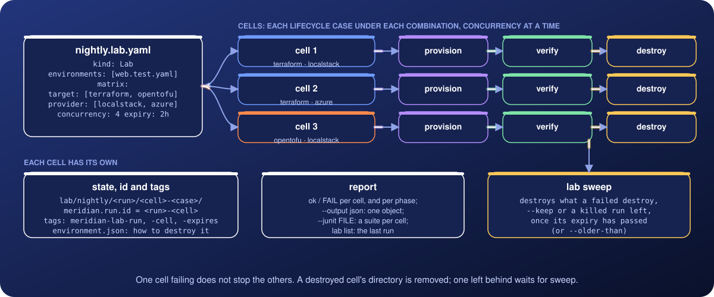

# Running a lab of environments

`meridian lab` builds and tears down many environments side by side: each
[lifecycle case](../reference/testing.md#lifecycle-cases) of some Test files, under each
combination of a matrix of values. One combination of one case is a **cell**.

<p align="center"></p>

## A lab

```yaml
# nightly.lab.yaml
apiVersion: meridian/v1
kind: Lab
metadata:
  name: nightly
spec:
  environments: [tests/web-tier.test.yaml]
  matrix:
    target: [terraform, opentofu]
    provider: [localstack, azure]
  exclude:
    - {target: opentofu, provider: azure}
  concurrency: 4
  expiry: 2h
```

| Field | Required | Value |
|---|---|---|
| `metadata.name` | yes | Lowercase letters, digits and `-`; names the lab's directory |
| `spec.environments` | yes | Test files, relative to the lab file. Their `run: lifecycle` cases are the environments; other cases are ignored |
| `spec.matrix` | no | Axes, each a list of values (text, numbers or `true`/`false`). An axis is named with letters, digits and `_`, not `run` or `cell`. No matrix: one cell per case |
| `spec.exclude` | no | Combinations left out; each names some axes and a value of each |
| `spec.concurrency` | no | How many cells run at once. Default `1` |
| `spec.expiry` | no | How long a cell's environment lives before `lab sweep` destroys it: `30m`, `2h`. Default `2h` |

The example has three cells: terraform on localstack, terraform on azure, opentofu on
localstack.

## What a cell's documents read

| Name | Value |
|---|---|
| `meridian.lab.<axis>` | The cell's value for that axis, as text |
| `meridian.lab.run` | The lab run's id, `l` and 8 hex digits |
| `meridian.lab.cell` | The cell's number, from 1 |
| `meridian.run.id` | `<lab run>-<cell>`, as in `l3f9a2c1d-2`. Name and tag what the cell makes with it |

A document picks its cells with `when`:

```yaml
kind: Infrastructure
metadata: {name: network-tf}
spec:
  target: terraform
  when: meridian.lab.target == 'terraform'
  resources:
    - id: bucket
      type: objectStore
      params:
        name: "web-${{ meridian.run.id }}"
```

A target that cannot [destroy](destroying.md) is refused only when a cell runs its documents.

## Running

```
meridian lab run nightly.lab.yaml                           # every cell
meridian lab run nightly.lab.yaml --filter target=terraform # only these
meridian lab run nightly.lab.yaml --junit lab.xml           # a testsuite per cell, a testcase per phase
meridian lab run nightly.lab.yaml --output json             # one object
```

Each cell provisions, verifies and destroys, as `meridian test` does, under
`<state>/lab/<lab>/<run>/<cell>-<case>/`. One cell failing does not stop the others. The run
exits `1` if any cell failed or could not run. `--keep` leaves every cell's environment.

`meridian lab list nightly.lab.yaml` shows each cell and how it ended in the last run:

```
nightly.lab.yaml (nightly, last run l3f9a2c1d)
  passed    site: web tier [provider=localstack, target=terraform]
  failed    site: web tier [provider=azure, target=terraform]
  not-run   site: web tier [provider=localstack, target=opentofu]
3 cells
```

## Sweeping

A cell's directory is removed after its destroy succeeds. It stays when the destroy fails,
`--keep` was given, or the run was killed. Its `environment.json` records the documents, data,
selector, run id and expiry.

```
meridian lab sweep                    # destroy every environment whose expiry has passed
meridian lab sweep --older-than 30m   # and every one made at least 30m ago
meridian lab sweep --older-than 0s    # every one
```

Sweep covers `lab/` and the `tests/` environments `meridian test --keep` left, removes each
directory it destroys, and exits `1` if one could not be destroyed. Run it before and after a
scheduled lab run.

## What is not here yet

- **Tags on every resource** (`meridian.lab/run`, `meridian.lab/cell`,
  `meridian.lab/expires`) through each target's tag mechanism, and a sweep that finds
  resources by those tags when the state directory is gone.
- **Faults** to break an environment and the diagnosis each must produce
  ([issue 237](https://github.com/ZanattaMichael/meridian-core/issues/237)).
- **The self-hosted runner and workflow** ([issue 238](https://github.com/ZanattaMichael/meridian-core/issues/238)).

See [decision 0054](../decisions/0054-a-lab-is-a-matrix-over-lifecycle-cases-and-sweep-reads-the-state.md).
