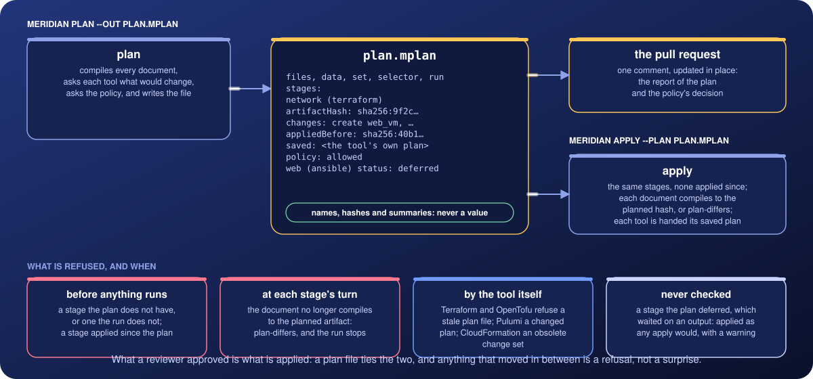

# A saved plan, and applying it from a pull request

<p align="center"></p>

`plan --out` writes what was planned; `apply --plan` applies exactly that, or refuses.
Pull request automation uses it: a plan on every push, posted as one comment and saved as
an artifact, then applied by a job that can apply nothing else. See
[GitHub Actions](#github-actions) and [GitLab CI](#gitlab-ci).

## The plan file

```sh
meridian plan site.yaml -l env=prod --out plan.mplan
meridian apply --plan plan.mplan
```

`plan --out FILE` writes one JSON object with:

- the documents, each `--data` file and its hash, each `--set`, the selector and the
  command line;
- the run id;
- per stage: name, kind, target, **artifact hash**, changes, policy decision, the hash of
  what was last applied, and the **tool's saved plan** where there is one (base64).

No file is written if any stage failed or was denied (exit `1`).

`apply --plan FILE` takes its inputs from the file; any given on the command line must
match. `--resume` is not allowed. With `--output json` both carry a `plan` object
([see](../reference/cli-json.md#compile-plan-apply-drift-rollback-destroy)). A file applies once.

## What `apply --plan` checks

Before anything runs:

- **Same stages** as the run would apply.
- **Nothing applied since** to any stage, by any run.

Otherwise it is `refused` (`kind: plan`, exit `1`), holding only the lock.

Then per stage:

- **Same artifact.** The recompiled hash must match, or the stage fails with
  `plan-differs` and later stages do not run. A stage now excluded by `spec.when` fails
  too. A changed `--data` file is named in the failure but is not a refusal by itself.
- **The tool's plan**, where saved, is applied as is (Terraform and OpenTofu plan files,
  Pulumi update plans, CloudFormation change sets).
- **Otherwise the same changes** (*guarded*). The stage is planned again just before its
  apply, and the changes compared by resource and action (not by summary: ARM's `what-if`
  words the same change differently). Any difference fails the stage with `plan-differs`,
  listing each change the tool would now make that the plan did not show, and each it
  showed that it would no longer make. Something changed between that plan and the apply
  is not caught.
- **A tool that cannot say** what it would change (a plan marked `unknown`, such as
  `chef` on another machine through `chef-run`) cannot be guarded: the
  stage fails with `plan-differs` unless `--accept-unknown` is given, which applies it with
  a warning.

A `deferred` stage (waiting on an output) is applied normally with a warning that it was
not checked.

## Which tools save a plan

| Target | Saved plan | Not saved when |
|---|---|---|
| `terraform`, `opentofu` | the `-out` plan file, applied with `terraform apply <file>` | the run handed over a secret: a Terraform plan file holds every variable's value, so it is scrubbed instead, and the stage is guarded |
| `pulumi` | the update plan of `preview --save-plan`, applied with `up --plan` | the run handed over a secret, for the same reason; guarded instead |
| `cloudformation` | the change set, which is not discarded; the file holds its name | never: the change set's values stay with CloudFormation |
| every other target | none (*guarded*) | the apply checks the artifact hash, plans again and refuses other changes |

See the [capability matrix](../reference/capability-matrix.md) and `Runner::saves_plans`
([writing a plugin](../contributing/writing-a-plugin.md#saved-plans)).

## GitHub Actions

Tested by
[`saved-plan.yml`](https://github.com/ZanattaMichael/meridian-core/blob/main/.github/workflows/saved-plan.yml)
against the fake target, including refusal of a changed document.

- [`.github/actions/plan`](https://github.com/ZanattaMichael/meridian-core/tree/main/.github/actions/plan)
  runs `meridian plan --out`, posts the report as one comment edited in place, and keeps
  the plan, report and state directory as an artifact. Outputs: `has-changes`,
  `plan-file`, `run`.
- [`.github/actions/apply`](https://github.com/ZanattaMichael/meridian-core/tree/main/.github/actions/apply)
  runs `meridian apply --plan` on that artifact.

Both need `meridian` on `PATH`
([install step](running-in-a-pipeline.md#the-shape-of-every-job)) or a version in
`install`.

<!-- github-actions-snippet -->
```yaml
name: infrastructure

on:
  pull_request:
  push:
    branches: [main]

permissions:
  contents: read
  pull-requests: write     # the plan comment
  id-token: write          # the job's OIDC identity, for credentials declared from: ambient

# One run at a time: the plan's record is carried to the apply.
concurrency:
  group: meridian-${{ github.ref }}

env:
  MERIDIAN_PLUGIN_SIGNATURES: require
  SITE_DB_PASSWORD: ${{ secrets.SITE_DB_PASSWORD }}

jobs:
  plan:
    runs-on: ubuntu-latest
    outputs:
      has-changes: ${{ steps.plan.outputs.has-changes }}
    steps:
      - uses: actions/checkout@v4
      - id: plan
        uses: ZanattaMichael/meridian-core/.github/actions/plan@v0.1.0
        with:
          install: '0.1.0'
          files: site.yaml
          args: -l env=prod --policy policies/

  apply:
    needs: plan
    if: github.ref == 'refs/heads/main' && needs.plan.outputs.has-changes == 'true'
    runs-on: ubuntu-latest
    environment: production     # reviewers and the pause before production live here
    steps:
      - uses: actions/checkout@v4
      - uses: ZanattaMichael/meridian-core/.github/actions/apply@v0.1.0
        with:
          install: '0.1.0'
```

The pull request's plan is the comment. On `main` the plan is taken again from the merged
tree and applied behind the environment's approval. With a
[shared backend](running-in-a-pipeline.md#sharing-the-record-between-jobs) the artifact's
`.meridian/` is not needed.

The comment is the `--report markdown` output, with no values.

## GitLab CI

Not executed in CI. The plan job keeps the file and report as artifacts; a manual apply job
behind a protected environment applies it.

```yaml
stages: [plan, apply]

plan:
  stage: plan
  script:
    - meridian plan site.yaml -l env=prod --out meridian.mplan --report markdown=meridian-plan.md
  artifacts:
    when: always
    paths: [meridian.mplan, meridian-plan.md, .meridian/]
    expire_in: 1 week

apply:
  stage: apply
  needs: [plan]
  rules:
    - if: $CI_COMMIT_BRANCH == $CI_DEFAULT_BRANCH
      when: manual               # the approval
  environment:
    name: production
  script:
    - meridian apply --plan meridian.mplan
  artifacts:
    when: always
    paths: [.meridian/]
```

Install and identity steps are in the [GitLab snippet](running-in-a-pipeline.md#gitlab-ci).

## What a plan file holds, and what it never holds

Names, hashes and one-line changes (`create web_vm: aws_instance`), never artifacts. A
Terraform, OpenTofu or Pulumi plan is left out when the run handled a secret;
CloudFormation keeps only the change set's name.

Do not commit the file. Keep it as a pipeline artifact.
