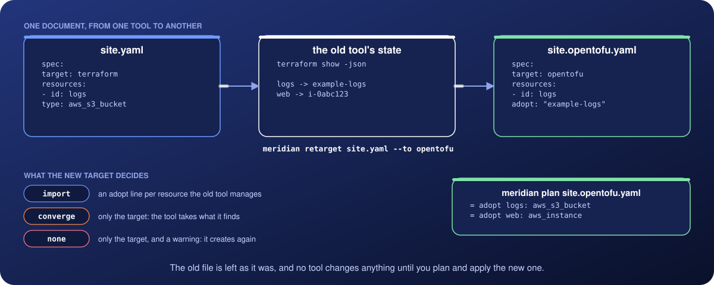

# Moving a document to another tool

<p align="center"></p>

`meridian retarget` moves a document to another target, such as Terraform to OpenTofu,
without recreating what the first tool made:

```
meridian retarget site.yaml --to opentofu
```

```
network: terraform -> opentofu, 3 resources adopted
wrote site.opentofu.yaml; check it with `meridian plan site.opentofu.yaml`
```

It reads each resource's identifier from the old tool's state and writes a new file with
the new `spec.target` and an [`adopt:`](../reference/dsl/resources.md#adopting-what-exists)
line per resource. The original file is unchanged. Planning the new file shows
`= adopt`, not `+ create`:

```
meridian plan site.opentofu.yaml
```

## What depends on the new target

| New target adopts by | What `retarget` writes |
|---|---|
| `import` (Terraform, OpenTofu, Pulumi) | `adopt:` for each resource the old tool manages |
| `converge` (Ansible, Puppet, Kubernetes, Bicep and the others in the [capability matrix](../reference/capability-matrix.md)) | only the new `spec.target`: the tool makes what exists match the document |
| no | only the new `spec.target`, and a warning that the first apply creates every resource again |

## Which old tools can be read

Old targets that report identifiers: Terraform and OpenTofu (`terraform show -json`, the
`id`) and Pulumi (`pulumi stack export`). For other old targets, write `adopt:` by hand or use
`--no-adopt`. Where a provider's import format for a type is not its `id`, correct that
line before applying.

## Options

| Option | |
|---|---|
| `--to TARGET` | the target to move to; its plugin must be installed |
| `--out FILE` | where to write. See [Where the moved file goes](#where-the-moved-file-goes) |
| `--no-adopt` | read nothing from the old tool and write no `adopt:` lines |
| `--state-dir DIR` | where the old tool's state is, as for `apply` |

## Where the moved file goes

The first of these that is set decides:

1. `--out FILE` on the command line.
2. `spec.retarget.out` in the project's [`meridian.yaml`](../reference/modules.md#the-manifest),
   a pattern relative to the file moved:

   ```yaml
   spec:
     retarget:
       out: "moved/{name}.{target}.{ext}"
   ```

   `{name}` is the file name without extension, `{ext}` the extension. It must contain
   `{target}` and cannot be absolute.
3. The default, `{name}.{target}.{ext}`: `site.opentofu.yaml` beside `site.yaml`.

An existing file is never overwritten; missing directories are created. JSON `outFrom`
is `cli`, `manifest` or `default`. A global setting is
[issue 219](https://github.com/ZanattaMichael/meridian-core/issues/219).

## How it is tested

- A property test checks identifiers round-trip and other lines are unchanged across
  layouts (indent, CRLF, comments, key order, no final newline).
- End-to-end tests against a stand-in tool cover full, partial and multi-document moves,
  moving back, and each refusal.
- CI moves a real Terraform apply to real OpenTofu, whose first plan only adopts; see
  [real-tool tests](../contributing/real-tool-tests.md#moving-from-terraform-to-opentofu).

## Limits

- YAML only, rewritten as text so comments and layout are kept. JSON is refused.
- `${` in an identifier is written `$${`.
- An existing `adopt:` is kept; `state: absent` gets none.
- Flow-style resources (`- {id: x, ...}`) and resources the file does not write (from a
  module) are listed as notes to handle by hand.
- `spec.targetVersion` and `spec.settings` are kept and noted.
- The old state still holds every resource. After the new apply, remove them with the
  old tool (`terraform state rm` in `.meridian/infrastructure/<name>/terraform`). Never
  `meridian apply` the old file with resources removed: that destroys them.

`--output json` prints one object; see [machine-readable output](../reference/cli-json.md#retarget).
