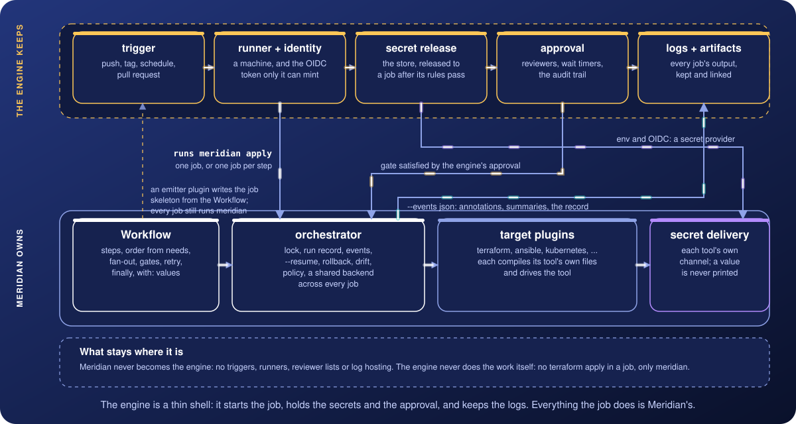

# Running Meridian in a pipeline

<p align="center"></p>

Any pipeline engine can run Meridian as one job today, with no plugin: the job
runs `meridian apply` and Meridian does the rest. This page splits the work
between engine and Meridian, gives a snippet per engine, and explains what
`meridian` does differently inside one.

The GitHub Actions snippet runs for real on every change, against the fake
target, in [`.github/workflows/pipeline-shell.yml`](https://github.com/ZanattaMichael/meridian-core/blob/main/.github/workflows/pipeline-shell.yml):
two jobs sharing one record, a plan, an apply, a failure, and `apply --resume`.
A test keeps this page in line with that workflow, command by command.
**The other snippets were reviewed by hand but not executed**, as each notes.
If one is wrong for your engine, please open an issue with the fix.

## Contents

- [Who owns what](#who-owns-what)
- [The shape of every job](#the-shape-of-every-job)
- [GitHub Actions](#github-actions) (executed in CI)
- [Azure Pipelines](#azure-pipelines)
- [GitLab CI](#gitlab-ci)
- [Buildkite](#buildkite)
- [Jenkins](#jenkins)
- [Argo Workflows](#argo-workflows)
- [Tekton](#tekton)
- [Octopus Deploy](#octopus-deploy)
- [What `meridian` does inside an engine](#what-meridian-does-inside-an-engine)
- [Checking the job's identity first](#checking-the-jobs-identity-first)
- [Sharing the record between jobs](#sharing-the-record-between-jobs)
- [Approvals](#approvals)

[A saved plan, and applying it from a pull request](pull-requests.md) builds
on these jobs: a plan on every push, posted as one comment, and applied
after the approval by a job that can apply nothing else.

## Who owns what

The engine decides *when and as whom* a run happens and keeps what it produced.
Meridian decides *what* happens, in what order, and keeps the record.

| The engine owns | Meridian owns |
|---|---|
| **Triggers**: a push, a pull request, a schedule, a button | **Order**: Infrastructure before ResourceSets, imports before the documents that read them, one run at a time on the [lock](../concepts/run-safety.md#one-run-at-a-time) |
| **Runners and their identity**: where the job runs, and the OIDC token or service connection it runs as | **Secrets delivery**: a secret reaches the tool by a [private channel](../reference/dsl/secrets.md#handing-a-secret-to-a-tool) and is never on a command line, in a file the engine keeps, or in a log |
| **Secret release**: which secrets a job may read, and when | **The record**: every run's [events](../reference/state.md#events) and run-state, in a backend the next job can reach |
| **Environments, reviewers and approvals**: who may deploy to production, and the pause before it | **Resume and rollback**: `apply --resume` continues a failed apply from the step that failed; `--on-failure rollback` and `meridian rollback` put one back |
| **Logs and artifacts**: the job's log, its summary page, and the files it keeps | **Drift and policy**: `meridian drift` says whether what was applied is still there; `--policy` asks a policy before anything is applied |

The engine never sees a value Meridian holds, and no secret is ever printed
([how a secret is held](../concepts/secrets-in-memory.md)). Rely on that, not on
the engine's masking, which only hides values it already knows.

## The shape of every job

Every snippet below does the same six things:

1. **Install a pinned `meridian` and plugins** from the release and verify
   them. The [install script](../quickstart/install.md#linux-and-macos) takes
   `MERIDIAN_VERSION`; with `MERIDIAN_VERIFY=cosign` it refuses to install
   unless the release signature verifies. A released `meridian` already starts
   only [signed plugins](../reference/plugin-signatures.md);
   `MERIDIAN_PLUGIN_SIGNATURES=require` makes that explicit and applies it to
   source builds too.
2. **Pin the modules.** `meridian module install --locked` fails if
   `meridian.lock` would change, so a job never fetches an unpinned module.
3. **Check before running.** `meridian validate` reads the documents without
   loading plugins. `meridian secret check` reports whether every declared
   secret, and every `from: ambient` credential, would be found on this runner,
   without reading a value.
4. **`plan` on a pull request, `apply` on the protected branch.** With
   `--detailed-exitcode`, a plan exits `2` when there are changes, so a job can
   tell "nothing to do" from "changes waiting".
5. **Share the record.** The lock, run-state and runs must be reachable by the
   next job on another runner, so a failed apply can resume and a plan sees the
   last apply. See [sharing the record between jobs](#sharing-the-record-between-jobs).
6. **Keep the events.** `--events json` writes every event to stdout, one per
   line, for the engine to keep as an artifact. `meridian report --from FILE`
   builds a report from it later, anywhere. The human-readable report moves to
   stderr, where the job log shows it.

Secrets reach `spec.secrets` through the [`env` provider](../reference/dsl/secrets.md#the-providers):
the engine puts the secret in the job environment, the document names the
variable, and Meridian removes it from its own environment once read, so no
later plugin or tool inherits it. The engine's identity reaches
`spec.credentials` as [`from: ambient`](../reference/dsl/credentials.md#from-ambient):
the engine's action or service connection signs the job in, and the tool finds
that sign-in as it would on a laptop. No value lands in any file the engine
keeps.

```yaml
spec:
  secrets:
    - name: db_password
      from: env
      key: SITE_DB_PASSWORD        # set by the engine from its secret store
  credentials:
    - name: deployer
      type: aws
      from: ambient                # the job's OIDC identity, exchanged by the engine
```

## GitHub Actions

Executed on every change by `pipeline-shell.yml`, against the fake target.
`id-token: write` lets the job exchange its OIDC token for a cloud identity;
`aws-actions/configure-aws-credentials`, `azure/login` and
`google-github-actions/auth` each leave a sign-in that `from: ambient` finds.
`plan` keeps the state directory as an artifact and `apply` takes it back. The
`concurrency` group stops two runs racing for it.

<!-- github-actions-snippet -->
```yaml
name: infrastructure

on:
  pull_request:
  push:
    branches: [main]
  workflow_dispatch:
    inputs:
      resume:
        description: continue the apply that failed, from the step that failed
        type: boolean
        default: false

permissions:
  contents: read
  id-token: write          # the job's OIDC identity, for credentials declared from: ambient

# One run of this workflow at a time: the record is carried between its jobs.
concurrency:
  group: meridian-${{ github.ref }}

env:
  MERIDIAN_VERSION: '0.1.0'
  MERIDIAN_VERIFY: cosign
  MERIDIAN_PLUGIN_SIGNATURES: require
  SITE_DB_PASSWORD: ${{ secrets.SITE_DB_PASSWORD }}

jobs:
  plan:
    runs-on: ubuntu-latest
    steps:
      - uses: actions/checkout@v4
      - name: Install a pinned Meridian, checking the release's signature
        run: |
          curl -fsSL "https://github.com/ZanattaMichael/meridian-core/releases/download/v$MERIDIAN_VERSION/install.sh" | sh
          echo "$HOME/.meridian/bin" >> "$GITHUB_PATH"
      - name: Pin the modules
        run: meridian module install --locked
      - name: Check the documents, the secrets and the job's identity
        run: |
          meridian validate site.yaml
          meridian secret check site.yaml
      - name: Plan
        run: |
          mkdir -p events
          meridian plan site.yaml --events json > events/plan.jsonl
      - name: Keep the events and the record
        if: always()
        uses: actions/upload-artifact@v4
        with:
          name: meridian-plan
          path: |
            events/
            .meridian/
          include-hidden-files: true

  apply:
    needs: plan
    if: github.ref == 'refs/heads/main'
    runs-on: ubuntu-latest
    environment: production     # reviewers and the pause before production live here
    steps:
      - uses: actions/checkout@v4
      - name: Install a pinned Meridian, checking the release's signature
        run: |
          curl -fsSL "https://github.com/ZanattaMichael/meridian-core/releases/download/v$MERIDIAN_VERSION/install.sh" | sh
          echo "$HOME/.meridian/bin" >> "$GITHUB_PATH"
      - name: Take the record from the plan job
        uses: actions/download-artifact@v4
        with:
          name: meridian-plan
      - name: Apply
        if: ${{ !inputs.resume }}
        run: meridian apply site.yaml --events json > events/apply.jsonl
      - name: Continue the apply that failed
        if: ${{ inputs.resume }}
        run: meridian apply site.yaml --resume --events json > events/resume.jsonl
      - name: Keep the events and the record
        if: always()
        uses: actions/upload-artifact@v4
        with:
          name: meridian-apply
          path: |
            events/
            .meridian/
          include-hidden-files: true
```

With nothing else in the workflow, the job page shows a refused document as an
annotation at its line, a failed step as an annotation at its document, and the
report as the step summary. If the apply fails, fix the cause and run the
workflow by hand with `resume` ticked: the job loads the failed run's record
from the artifact and continues from the failed step.

## Azure Pipelines

Reviewed, not executed. A [workload identity federation service
connection](https://learn.microsoft.com/azure/devops/pipelines/library/connect-to-azure)
signs the job in without a secret; `AzureCLI@2` leaves the Azure CLI logged in
for `from: ambient`. The record passes between stages as a pipeline artifact.

```yaml
trigger:
  branches:
    include: [main]
pr:
  branches:
    include: ['*']

variables:
  MERIDIAN_VERSION: '0.1.0'
  MERIDIAN_VERIFY: cosign
  MERIDIAN_PLUGIN_SIGNATURES: require

stages:
  - stage: plan
    jobs:
      - job: plan
        pool: { vmImage: ubuntu-latest }
        steps:
          - checkout: self
          - bash: |
              curl -fsSL "https://github.com/ZanattaMichael/meridian-core/releases/download/v$MERIDIAN_VERSION/install.sh" | sh
              echo "##vso[task.prependpath]$HOME/.meridian/bin"
            displayName: Install a pinned Meridian
          - bash: meridian module install --locked
            displayName: Pin the modules
          - task: AzureCLI@2
            displayName: Check, then plan, as the service connection's identity
            inputs:
              azureSubscription: production          # a workload identity federation connection
              scriptType: bash
              scriptLocation: inlineScript
              inlineScript: |
                meridian validate site.yaml
                meridian secret check site.yaml
                mkdir -p events
                meridian plan site.yaml --events json > events/plan.jsonl
            env:
              SITE_DB_PASSWORD: $(SITE_DB_PASSWORD)   # a secret variable, from a variable group or Key Vault
          - publish: .meridian
            artifact: meridian-record
            condition: always()
          - publish: events
            artifact: meridian-events
            condition: always()

  - stage: apply
    dependsOn: plan
    condition: and(succeeded(), eq(variables['Build.SourceBranch'], 'refs/heads/main'))
    jobs:
      - deployment: apply
        environment: production                     # approvals and checks live on the environment
        pool: { vmImage: ubuntu-latest }
        strategy:
          runOnce:
            deploy:
              steps:
                - checkout: self
                - bash: |
                    curl -fsSL "https://github.com/ZanattaMichael/meridian-core/releases/download/v$MERIDIAN_VERSION/install.sh" | sh
                    echo "##vso[task.prependpath]$HOME/.meridian/bin"
                  displayName: Install a pinned Meridian
                - download: current
                  artifact: meridian-record
                - bash: mv "$(Pipeline.Workspace)/meridian-record" .meridian
                  displayName: Take the record from the plan stage
                - task: AzureCLI@2
                  displayName: Apply
                  inputs:
                    azureSubscription: production
                    scriptType: bash
                    scriptLocation: inlineScript
                    inlineScript: |
                      mkdir -p events
                      meridian apply site.yaml --events json > events/apply.jsonl
                  env:
                    SITE_DB_PASSWORD: $(SITE_DB_PASSWORD)
                - publish: events
                  artifact: meridian-apply-events
                  condition: always()
```

Inside Azure Pipelines, `meridian` writes each problem as a
`##vso[task.logissue]` line (shown as an issue) and the report as a summary tab
via `task.uploadsummary`. To re-run after a failure, download the failed run's
record and run `meridian apply site.yaml --resume`; a `resume` parameter can
choose the command, as in the GitHub snippet.

## GitLab CI

Reviewed, not executed. `id_tokens` gives the job an OIDC token that the
cloud CLI exchanges for an identity. GitLab has no annotation syntax or job
summary; the JUnit report shows steps on the merge request as tests, and the
`markdown` report is an artifact file.

```yaml
variables:
  MERIDIAN_VERSION: '0.1.0'
  MERIDIAN_VERIFY: cosign
  MERIDIAN_PLUGIN_SIGNATURES: require

default:
  image: ubuntu:24.04
  before_script:
    - apt-get update -qq && apt-get install -y -qq curl ca-certificates
    - curl -fsSL "https://github.com/ZanattaMichael/meridian-core/releases/download/v$MERIDIAN_VERSION/install.sh" | sh
    - export PATH="$HOME/.meridian/bin:$PATH"
    - meridian module install --locked

stages: [plan, apply]

plan:
  stage: plan
  id_tokens:
    AWS_WEB_IDENTITY_TOKEN: { aud: sts.amazonaws.com }      # for an aws credential declared from: ambient
  variables:
    AWS_ROLE_ARN: arn:aws:iam::123456789012:role/deploy
  script:
    - printf '%s' "$AWS_WEB_IDENTITY_TOKEN" > "$CI_PROJECT_DIR/.oidc-token"
    - export AWS_WEB_IDENTITY_TOKEN_FILE="$CI_PROJECT_DIR/.oidc-token"
    - meridian validate site.yaml
    - meridian secret check site.yaml
    - mkdir -p events
    - meridian plan site.yaml --events json --report junit=meridian-plan.xml --report markdown=meridian-plan.md > events/plan.jsonl
  artifacts:
    when: always
    paths: [events/, .meridian/, meridian-plan.md]
    reports:
      junit: meridian-plan.xml

apply:
  stage: apply
  needs: [plan]
  rules:
    - if: $CI_COMMIT_BRANCH == $CI_DEFAULT_BRANCH
  environment:
    name: production            # protected environments hold the approval
  id_tokens:
    AWS_WEB_IDENTITY_TOKEN: { aud: sts.amazonaws.com }
  variables:
    AWS_ROLE_ARN: arn:aws:iam::123456789012:role/deploy
  script:
    - printf '%s' "$AWS_WEB_IDENTITY_TOKEN" > "$CI_PROJECT_DIR/.oidc-token"
    - export AWS_WEB_IDENTITY_TOKEN_FILE="$CI_PROJECT_DIR/.oidc-token"
    - mkdir -p events
    - meridian apply site.yaml --events json --report junit=meridian-apply.xml > events/apply.jsonl
  artifacts:
    when: always
    paths: [events/, .meridian/]
    reports:
      junit: meridian-apply.xml
```

`.oidc-token` holds the engine's own short-lived OIDC token, not a Meridian
secret. `SITE_DB_PASSWORD` comes from a masked CI variable, as on every engine.
`.meridian/` passes from `plan` to `apply` as an artifact; use a
[shared backend](#sharing-the-record-between-jobs) once more than one pipeline
touches the same documents.

## Buildkite

Reviewed, not executed. Buildkite runs commands in a pseudo-terminal by
default, so `meridian` assumes a person is watching; set
`MERIDIAN_ANNOTATIONS=on` to write for the engine anyway. The report reaches the
build page through `buildkite-agent annotate`, which `meridian` runs itself when
the agent is on `PATH`. The OIDC token comes from
`buildkite-agent oidc request-token`.

```yaml
env:
  MERIDIAN_VERSION: '0.1.0'
  MERIDIAN_VERIFY: cosign
  MERIDIAN_PLUGIN_SIGNATURES: require
  MERIDIAN_ANNOTATIONS: 'on'

steps:
  - label: ':mag: plan'
    key: plan
    commands:
      - curl -fsSL "https://github.com/ZanattaMichael/meridian-core/releases/download/v$MERIDIAN_VERSION/install.sh" | sh
      - export PATH="$HOME/.meridian/bin:$PATH"
      - meridian module install --locked
      - buildkite-agent oidc request-token --audience sts.amazonaws.com > .oidc-token
      - export AWS_WEB_IDENTITY_TOKEN_FILE="$PWD/.oidc-token" AWS_ROLE_ARN=arn:aws:iam::123456789012:role/deploy
      - meridian validate site.yaml
      - meridian secret check site.yaml
      - mkdir -p events
      - meridian plan site.yaml --events json > events/plan.jsonl
    artifact_paths:
      - events/**
      - .meridian/**
    plugins:
      - secrets#v1.0.0:                      # or the agent's secrets hook: a value into SITE_DB_PASSWORD
          env:
            SITE_DB_PASSWORD: site-db-password

  - block: ':rocket: apply to production'   # the approval is the engine's
    if: build.branch == 'main'

  - label: ':rocket: apply'
    depends_on: plan
    if: build.branch == 'main'
    commands:
      - curl -fsSL "https://github.com/ZanattaMichael/meridian-core/releases/download/v$MERIDIAN_VERSION/install.sh" | sh
      - export PATH="$HOME/.meridian/bin:$PATH"
      - buildkite-agent artifact download '.meridian/**' . --step plan
      - buildkite-agent oidc request-token --audience sts.amazonaws.com > .oidc-token
      - export AWS_WEB_IDENTITY_TOKEN_FILE="$PWD/.oidc-token" AWS_ROLE_ARN=arn:aws:iam::123456789012:role/deploy
      - mkdir -p events
      - meridian apply site.yaml --events json > events/apply.jsonl
    artifact_paths:
      - events/**
      - .meridian/**
    plugins:
      - secrets#v1.0.0:
          env:
            SITE_DB_PASSWORD: site-db-password
```

## Jenkins

Reviewed, not executed. A declarative pipeline, with the secret from the
credentials store and the record stashed between stages (on one agent, the
workspace carries it). `meridian` detects Jenkins by `JENKINS_URL`. Jenkins has
no annotation syntax; the JUnit report puts steps on the build page, and the
`html` report can be published.

```groovy
pipeline {
  agent any
  environment {
    MERIDIAN_VERSION = '0.1.0'
    MERIDIAN_VERIFY = 'cosign'
    MERIDIAN_PLUGIN_SIGNATURES = 'require'
    PATH = "${env.HOME}/.meridian/bin:${env.PATH}"
    SITE_DB_PASSWORD = credentials('site-db-password')
  }
  stages {
    stage('install') {
      steps {
        sh 'curl -fsSL "https://github.com/ZanattaMichael/meridian-core/releases/download/v$MERIDIAN_VERSION/install.sh" | sh'
        sh 'meridian module install --locked'
      }
    }
    stage('plan') {
      steps {
        sh 'meridian validate site.yaml'
        sh 'meridian secret check site.yaml'
        sh 'mkdir -p events && meridian plan site.yaml --events json --report junit=meridian-plan.xml > events/plan.jsonl'
      }
      post {
        always {
          junit 'meridian-plan.xml'
          archiveArtifacts artifacts: 'events/**', allowEmptyArchive: true
          stash name: 'record', includes: '.meridian/**', allowEmpty: true
        }
      }
    }
    stage('apply') {
      when { branch 'main' }
      input { message 'Apply to production?' }     // the approval is the engine's
      steps {
        unstash 'record'
        sh 'mkdir -p events && meridian apply site.yaml --events json --report junit=meridian-apply.xml --report html=meridian-apply.html > events/apply.jsonl'
      }
      post {
        always {
          junit 'meridian-apply.xml'
          archiveArtifacts artifacts: 'events/**, meridian-apply.html', allowEmptyArchive: true
        }
      }
    }
  }
}
```

The cloud identity is whatever the agent has: an instance role, a
credentials-binding step exporting cloud variables, or an OIDC plugin.
`from: ambient` finds any of them, and `meridian secret check` says which.

## Argo Workflows

Reviewed, not executed. A workflow template whose steps run the released
container image; the record lives on a shared volume and the events are an
output artifact. `meridian` detects Argo by its `ARGO_*` variables. The cloud
identity is the pod's: a service account with workload identity (IRSA, Azure
Workload Identity, GKE Workload Identity) leaves the token file that
`from: ambient` finds.

```yaml
apiVersion: argoproj.io/v1alpha1
kind: WorkflowTemplate
metadata:
  name: meridian-apply
spec:
  entrypoint: run
  serviceAccountName: meridian-deployer        # bound to a cloud identity through workload identity
  volumeClaimTemplates:
    - metadata: { name: record }
      spec:
        accessModes: [ReadWriteOnce]
        resources: { requests: { storage: 1Gi } }
  arguments:
    parameters:
      - name: resume
        value: 'false'
  templates:
    - name: run
      steps:
        - - name: plan
            template: meridian
            arguments:
              parameters: [{ name: command, value: 'plan' }]
        - - name: approve
            template: approve                  # a suspend step: the approval is the engine's
        - - name: apply
            template: meridian
            arguments:
              parameters: [{ name: command, value: 'apply' }]
            when: '{{workflow.parameters.resume}} == false'
          - name: resume
            template: meridian
            arguments:
              parameters: [{ name: command, value: 'apply --resume' }]
            when: '{{workflow.parameters.resume}} == true'
    - name: approve
      suspend: {}
    - name: meridian
      inputs:
        parameters: [{ name: command }]
        artifacts:
          - name: documents
            path: /work
            git: { repo: https://github.com/example/infrastructure.git, revision: main }
      container:
        image: ghcr.io/zanattamichael/meridian:0.1.0
        workingDir: /work
        command: [sh, -ec]
        args:
          - |
            mkdir -p events
            meridian module install --locked
            meridian validate site.yaml
            meridian secret check site.yaml
            meridian {{inputs.parameters.command}} site.yaml --events json > events/run.jsonl
        env:
          - name: MERIDIAN_PLUGIN_SIGNATURES
            value: require
          - name: MERIDIAN_STATE_DIR
            value: /record
          - name: SITE_DB_PASSWORD
            valueFrom:
              secretKeyRef: { name: site, key: db-password }
        volumeMounts:
          - { name: record, mountPath: /record }
      outputs:
        artifacts:
          - name: events
            path: /work/events
```

## Tekton

Reviewed, not executed. One task with a step per command, a workspace for the
record, and a result for the run. Tekton sets `TEKTON_*` variables in each step.
The identity is the pod's service account, as on Argo.

```yaml
apiVersion: tekton.dev/v1
kind: Task
metadata:
  name: meridian
spec:
  params:
    - name: command
      default: apply
  workspaces:
    - name: source
    - name: record                    # a PersistentVolumeClaim, shared by every run
  stepTemplate:
    image: ghcr.io/zanattamichael/meridian:0.1.0
    workingDir: $(workspaces.source.path)
    env:
      - name: MERIDIAN_PLUGIN_SIGNATURES
        value: require
      - name: MERIDIAN_STATE_DIR
        value: $(workspaces.record.path)
      - name: SITE_DB_PASSWORD
        valueFrom:
          secretKeyRef: { name: site, key: db-password }
  steps:
    - name: pin
      script: meridian module install --locked
    - name: check
      script: |
        meridian validate site.yaml
        meridian secret check site.yaml
    - name: run
      script: |
        mkdir -p events
        meridian $(params.command) site.yaml --events json > events/run.jsonl
```

A `PipelineRun` chains a `plan` run of the task, a manual approval (a
`custom task`, or a pipeline that stops and is started again), and an
`apply` run; the second `apply` after a failure passes
`command: apply --resume`.

## Octopus Deploy

Reviewed, not executed. A script step in a deployment process. Octopus holds
the environments, targets, sensitive variables and approval (a manual
intervention step before this one), and runs the script on a worker or target.
`meridian` does not detect `OCTOPUS_*`, so the default writes nothing for the
engine (or set `MERIDIAN_ANNOTATIONS=off`); attach the markdown report as an
artifact with Octopus's service message.

```bash
#!/bin/bash
set -euo pipefail
export MERIDIAN_VERSION='0.1.0' MERIDIAN_VERIFY=cosign MERIDIAN_PLUGIN_SIGNATURES=require
curl -fsSL "https://github.com/ZanattaMichael/meridian-core/releases/download/v$MERIDIAN_VERSION/install.sh" | sh
export PATH="$HOME/.meridian/bin:$PATH"

# Octopus variables arrive through get_octopusvariable; a sensitive one is a
# secret in Meridian's sense only once it is in the job's environment.
export SITE_DB_PASSWORD="$(get_octopusvariable 'Site.DbPassword')"

meridian module install --locked
meridian validate site.yaml
meridian secret check site.yaml
mkdir -p events
meridian apply site.yaml \
    --backend dir --backend-config path=/mnt/meridian/record \
    --events json --report markdown=meridian-apply.md > events/apply.jsonl

new_octopusartifact "$PWD/meridian-apply.md" "meridian-apply.md"
new_octopusartifact "$PWD/events/apply.jsonl" "events.jsonl"
```

## What `meridian` does inside an engine

Every engine sets a well-known variable in its jobs. When `meridian` finds one
and stdout is not a terminal, it writes for the engine as well as for the log
reader:

| Engine | Detected by | Annotations | Summary |
|---|---|---|---|
| GitHub Actions | `GITHUB_ACTIONS` | `::error file=…,line=…::` workflow commands, shown on the pull request at the line | appended to `$GITHUB_STEP_SUMMARY` |
| Azure Pipelines | `TF_BUILD` | `##vso[task.logissue type=error;sourcepath=…;linenumber=…]` | a file in `$AGENT_TEMPDIRECTORY`, named with `##vso[task.uploadsummary]` |
| Buildkite | `BUILDKITE` | none in the log | `buildkite-agent annotate --context meridian`, when the agent is on the `PATH` |
| GitLab CI | `GITLAB_CI` | none: the engine has no syntax for one | none: use `--report junit=` and the artifacts |
| Jenkins | `JENKINS_URL` | none | none: use `--report junit=` and `--report html=` |
| Argo Workflows | any `ARGO_*` | none | none: keep the events as an output artifact |
| Tekton | any `TEKTON_*` | none | none: keep the events on a workspace |

Output comes from two sources only. An annotation is either a document
diagnostic (as `validate` reports it) or a step of the run's report, built from
the run's [events](../reference/state.md#events). The summary is the Markdown
report that `--report markdown=FILE` writes, plus where the record is kept. No
third place formats errors, so annotations and the log never disagree
([decision 0033](../decisions/0033-annotations-come-from-events-and-the-report-only.md)).
An event never holds a value, so neither does an annotation or a summary.

Annotations go to stderr beside the human-readable error; engines read
commands from either stream. Stdout stays the command's result, so
`--events json` and `--output json` are unaffected. Output is never coloured or
animated.

`--annotations off` (or `MERIDIAN_ANNOTATIONS=off`) turns this off.
`--annotations on` keeps it on when stdout is a terminal, as on Buildkite. See
[the command reference](../reference/cli.md#inside-a-pipeline-engine).

## Checking the job's identity first

A missing or wrong identity otherwise surfaces late, from the tool, after the
plan starts. [`meridian secret check`](../reference/cli.md#secret-check) looks
for every `from: ambient` credential where the tool would, before anything
runs, without reading a value:

```
$ meridian secret check site.yaml
site (site.yaml)
  db_password  env    ok: the environment variable SITE_DB_PASSWORD is set
  deployer     aws    ambient, ok: the environment holds AWS_WEB_IDENTITY_TOKEN_FILE and AWS_ROLE_ARN (web identity, such as a pipeline's OIDC token)
```

| Type | Looked for, in order |
|---|---|
| `aws` | `AWS_ACCESS_KEY_ID` with `AWS_SECRET_ACCESS_KEY`; `AWS_WEB_IDENTITY_TOKEN_FILE` with `AWS_ROLE_ARN`; container credentials; the credentials and config files (`AWS_PROFILE`); the instance metadata service (`AWS_EC2_METADATA_SERVICE_ENDPOINT`, unless `AWS_EC2_METADATA_DISABLED`), asked whether the instance has a role |
| `azure` | `AZURE_CLIENT_ID` and `AZURE_TENANT_ID` with `AZURE_CLIENT_SECRET`, `AZURE_FEDERATED_TOKEN_FILE` or `AZURE_CLIENT_CERTIFICATE_PATH`; the managed identity endpoint (`IDENTITY_ENDPOINT`); the Azure CLI's login (`AZURE_CONFIG_DIR`); the instance metadata service (`AZURE_IMDS_ENDPOINT`), asked whether the machine has a managed identity |
| `gcp` | `GOOGLE_APPLICATION_CREDENTIALS`; `CLOUDSDK_AUTH_ACCESS_TOKEN`; gcloud's application default credentials file (`CLOUDSDK_CONFIG`); the metadata server (`GCE_METADATA_HOST`), asked whether the instance has a service account |
| `ssh` | the agent `SSH_AUTH_SOCK` names |
| `kubeconfig` | the files `KUBECONFIG` names, or `~/.kube/config` |
| any other | not checked: the tool finds it in its own way |

A metadata service is asked once, with a one-second timeout, only if the
environment and files gave no answer. A credential that would not be found is
`MISSING`, fails the check, and is annotated like any problem. Run the check
first in every job, as the snippets do.

## Sharing the record between jobs

Meridian's record (lock, run-state and runs) makes a run resumable and a plan
comparable with the last apply. A job's runner disappears when the job ends, so
the record must be somewhere the next job can reach:

- **Carry the state directory as an artifact**, as the GitHub, Azure, GitLab
  and Buildkite snippets do: the plan job keeps `.meridian/`, the apply job
  takes it, a resume takes the failed run's. This is enough while one pipeline
  owns the documents and runs one job at a time (each snippet has a
  concurrency group). It carries no secret: the record never holds a value.
- **A shared backend** (`--backend NAME`) keeps the record and lock in a store
  every runner reaches, so two pipelines, or a pipeline and a laptop, cannot
  apply the same documents at once. A backend is a small program named
  `meridian-backend-<name>`;
  [`meridian-backend-dir`](https://github.com/ZanattaMichael/meridian-core/tree/main/examples/backends)
  keeps the record in a directory such as a mounted share, and
  [the contract](../reference/state.md#writing-a-backend) is small enough to
  wrap your object store's CLI in an afternoon. No object-store backend ships
  yet.

Each tool's own state (a Terraform or Pulumi backend) is set in the document
and is not part of Meridian's record.
[Sharing the record](../concepts/run-safety.md#sharing-the-record) has the
whole picture.

## Approvals

Approvals belong to the engine: its environments, reviewers, audit trail and
pause before production. `meridian apply` asks no questions and needs no
`--auto-approve`; the engine's gate sits in front of the job, as each snippet
shows (`environment: production`, a `deployment` job, a protected environment,
a `block` step, an `input`, a `suspend`, a manual intervention). Letting a
document name the gate it expects is
[issue 185](https://github.com/ZanattaMichael/meridian-core/issues/185),
and generating the pipeline file from the workflow is
[issue 186](https://github.com/ZanattaMichael/meridian-core/issues/186).
Neither is needed today.

A [saved plan](pull-requests.md) ties what reviewers approved to what the job
applies: the plan job writes `plan --out`, and the job behind the gate runs
`apply --plan`, which refuses if anything changed since.
