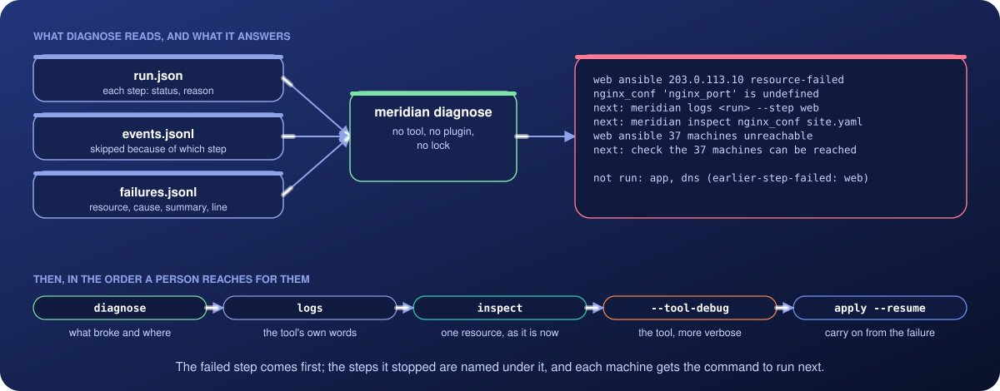

# Troubleshooting a failed run

<p align="center"></p>

Use these in order:

| Step | Command | Answers |
|---|---|---|
| 1 | `meridian diagnose` | which step, machine and resource failed, the [cause](../reference/failure-causes.md), and what to run next |
| 2 | `meridian logs` | what the tool printed, [kept on this machine](../reference/state.md#runsidlogs) |
| 3 | `meridian inspect RESOURCE <files> --step NAME` | the failed resource as it is now, beside what the document declares |
| 4 | `meridian apply … --tool-debug --tool-debug-step NAME --resume=RUN` | the same step again, [more verbose](../reference/cli.md#asking-a-tool-for-more-output), from where it failed |
| 5 | `meridian bug-report` | one archive of the run, to attach to an issue |

## `meridian diagnose`

```
$ meridian diagnose
run 2026-11-18T09-14-03Z-0cc7: apply, failed (1 of 3 steps failed; 2 not run because of it)

web  ansible  203.0.113.10  resource-failed
  nginx_conf  template: 'nginx_port' is undefined  site.yaml:42
  next: meridian logs 2026-11-18T09-14-03Z-0cc7 --step web
  next: meridian inspect nginx_conf site.yaml --step web
  next: meridian apply site.yaml --tool-debug --tool-debug-step web --resume=2026-11-18T09-14-03Z-0cc7

web  ansible  37 machines  unreachable
  203.0.113.11, 203.0.113.12, 203.0.113.13, 203.0.113.14, 203.0.113.15 and 32 more
  ssh: connect to host 203.0.113.11 port 22: Connection timed out
  next: check that the 37 machines can be reached at the address and port the step uses; then meridian logs 2026-11-18T09-14-03Z-0cc7 --step web

not run: app, dns (earlier-step-failed: web)
```

- It reads the last run that failed, or the one named: `meridian diagnose RUN`.
- Failed steps come first, then the steps not run because of them.
- Three or more machines that failed one step with the same cause are one entry.
- It reads `run.json`, `events.jsonl` and [`failures.jsonl`](../reference/state.md#resource-failures).
  It runs no tool, loads no target plugin and takes no lock, so it works while another run
  holds the state.
- On a machine that did not run the step, `failures.jsonl` is not there: resources and
  causes come from the events, without the tool's words.

| Option | Keeps |
|---|---|
| `--step NAME` | the step of that document |
| `--endpoint ENDPOINT` | the failures on that machine |
| `--cause WORD` | failures with that [cause](../reference/failure-causes.md), or steps with that reason, such as `tool-failed` |

### What `next` suggests

| Cause or reason | Next |
|---|---|
| `unreachable` | check the machine, then its log |
| `auth-failed` | check the credential the step uses, then its log |
| `compile-refused`, `no-plugin`, `not-supported` | `meridian validate` on the files |
| anything else | the step's log; `meridian inspect` on the first resource named; for `tool-failed` and `timed-out`, the same command with `--tool-debug`, and `--resume` after an apply |

`--output json` prints [one object](../reference/cli-json.md#diagnose). The
[MCP server](../tooling/mcp-server.md) offers the same as its `diagnose` tool.

## `meridian inspect`

Reads one resource as its tool sees it now: desired, actual, and the properties that
differ. It compiles only the step that declares the resource and changes nothing; no
lock is taken. Secrets are masked and never compared. See
[`inspect`](../reference/cli.md#inspect); targets that can are in the
[capability matrix](../reference/capability-matrix.md).
