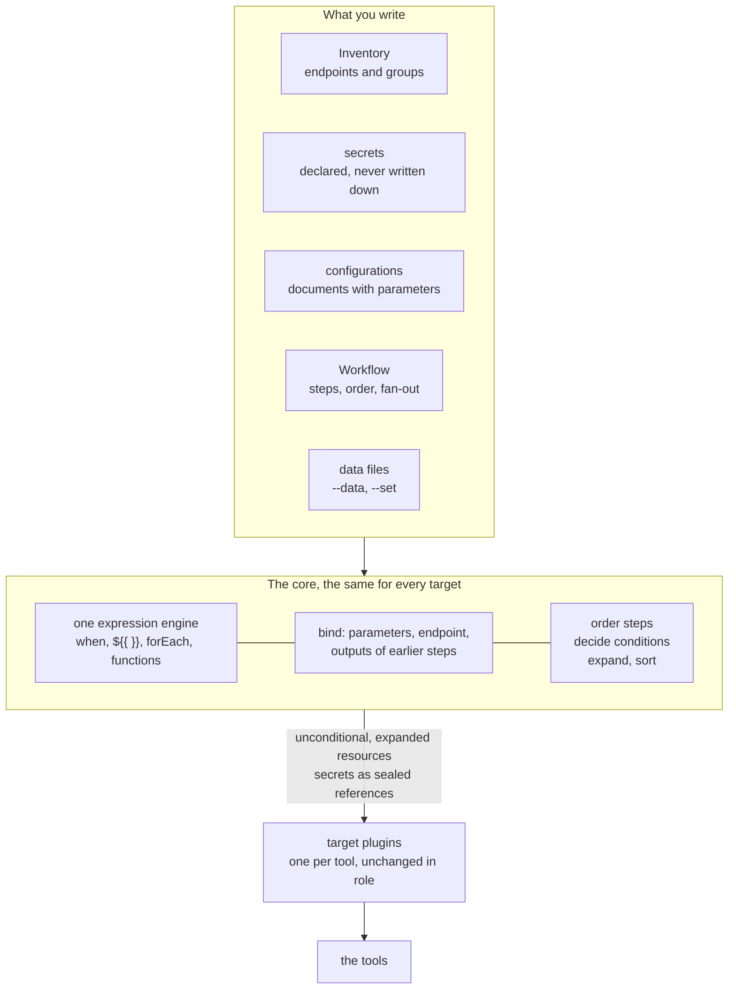
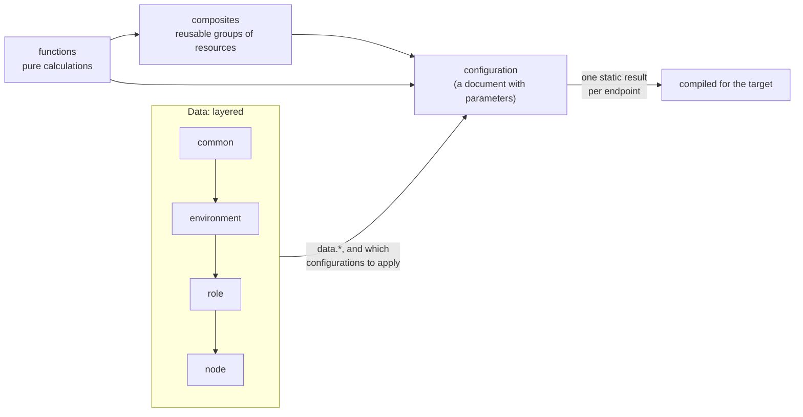
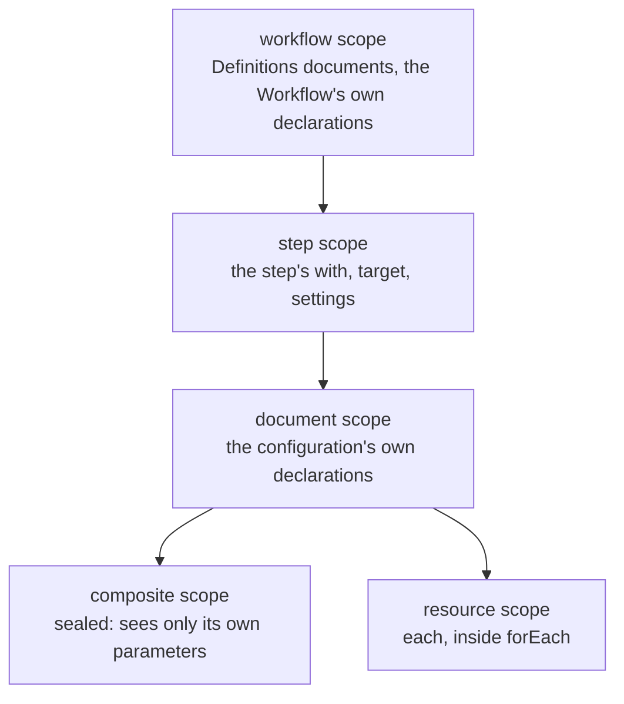
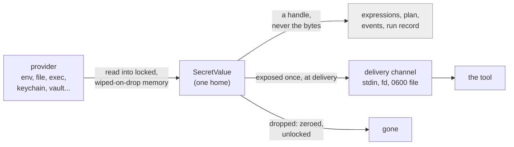
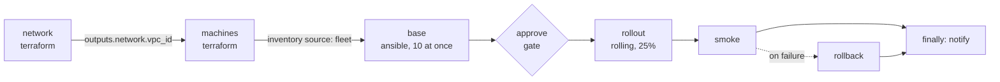
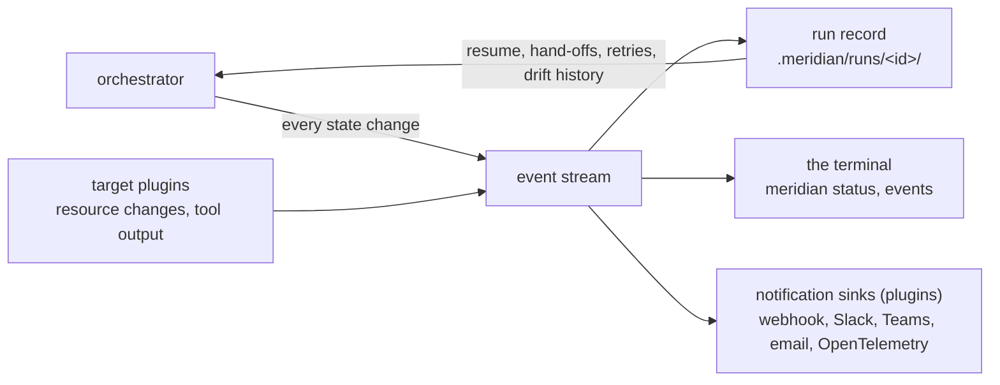

# Language expansion: expressions, data, reuse, endpoints, secrets, workflows and run state

**Status: accepted, not yet built.** The owner accepted this design and every
recommendation in [section 17](#17-decisions-for-the-owner) on 2026-11-17.
Nothing in it is implemented yet; the
[language reference](../reference/dsl/index.md) stays the description of what
the `meridian` command accepts today. Each phase in
[section 18](#18-delivery-in-phases) lands as its own pull request and moves its
part of this plan into the reference.

The choices marked **Decision** are the ones the rest of the design hangs on.

## Contents

1. [What this changes, in one picture](#1-what-this-changes-in-one-picture)
2. [One expression language](#2-one-expression-language)
3. [Conditions](#3-conditions)
4. [Interpolation and templating](#4-interpolation-and-templating)
5. [Common properties: one document shape](#5-common-properties-one-document-shape)
6. [Configurations: documents with parameters](#6-configurations-documents-with-parameters)
7. [Hierarchical data and merging](#7-hierarchical-data-and-merging)
8. [Composites](#8-composites)
9. [Declarations: everything the compiler needs](#9-declarations-everything-the-compiler-needs)
10. [Targets and endpoints](#10-targets-and-endpoints)
11. [Secrets](#11-secrets)
12. [Credentials](#12-credentials)
13. [Workflows](#13-workflows)
14. [Run state, events and notifications](#14-run-state-events-and-notifications)
15. [Prior art](#15-prior-art)
16. [Compatibility](#16-compatibility)
17. [Decisions for the owner](#17-decisions-for-the-owner)
18. [Delivery in phases](#18-delivery-in-phases)
19. [Test plan](#19-test-plan)

## 1. What this changes, in one picture

Today the language has two kinds of document, one small condition language that
reads `--data` files, references that each plugin rewrites, and one tie between
documents (an output becomes a `targetHost`). This plan adds five things and
keeps one rule.

The rule: **everything in this plan is decided by the core, before a plugin
sees the document.** A plugin still receives resources that are unconditional,
fully expanded and in order. So a condition, a function or an interpolation
cannot mean one thing on Ansible and another on Terraform, because neither tool
ever sees it.



| Area | Today | Proposed |
|---|---|---|
| Conditions | `when` on a resource: `==`, `!=`, `!`, `&&`, `\|\|`, `defined()` over `data.*` | the full expression language, on resources, documents, outputs, workflow steps and endpoints; named conditions defined once and reused |
| Templating | none in the core; `${id.param}` settled per plugin | `${{ expression }}` in any value of a document, `forEach`, file templates, a function library |
| Document shape | `Infrastructure` and `ResourceSet` have different fields | one shared `spec`; the kind only says which segments take it |
| Reuse | none | three ways: layered data, composites, functions; a document declares `parameters` and is instantiated with values |
| Data | `--data` files, a later file replacing an earlier one's keys | a `Data` document of layers chosen per endpoint, with a merge strategy per key, and `final` keys |
| Declarations | none | typed parameters, variables, named conditions, functions, requirements; all checked before anything runs |
| Where it runs | `targetHost`, one host, ResourceSet only | `endpoints` for every segment, from an `Inventory` document |
| Secrets | none (planned in [security](security.md)) | declared with a provider, read as `secret.<name>`, never printed or stored |
| Credentials | whatever each tool finds for itself | typed, named identities built from secrets, used by endpoints, tools, stores and sinks |
| Run state | which document was last applied, and whether it worked | an event stream and a run record: status, resume, drift, locking |
| Notifications | none | sinks as plugins: webhook, Slack, Teams, email, OpenTelemetry |
| Workflows | every Infrastructure document, then every ResourceSet | a `Workflow` document: steps, dependencies, fan-out, gates, failure handling |

## 2. One expression language

There is one expression language. `when`, `${{ }}`, `forEach`, a parameter's
default and a workflow step's condition are all the same grammar, evaluated by
the same code (a new crate, `meridian-expr`), with the same errors. The
condition language of today is a strict subset of it, so every `when` written
today keeps its meaning.

### 2.1 Values

| Type | Written | Notes |
|---|---|---|
| null | `null` | |
| boolean | `true`, `false` | |
| number | `3`, `-1`, `1.5` | integers and floats; `3 == 3.0` |
| text | `'prod'`, `"prod"` | `\'`, `\"`, `\\`, `\n`, `\t` escapes |
| list | `[1, 2, 3]` | |
| mapping | `{name: 'web', port: 80}` | keys are text |

A value can also be **secret** ([section 11](#11-secrets)) or **not known yet**
(an output of a step that has not run, [section 13](#13-workflows)). Both are
properties of a value, not types, and both spread to anything computed from it.

### 2.2 Names an expression can read

| Name | Holds | Known |
|---|---|---|
| `data.<key>` | the layered data resolved for this endpoint ([section 7](#7-hierarchical-data-and-merging)), then the `--data` files and `--set` | always |
| `param.<name>` | a declared parameter: the value this instance was given ([9.3](#93-parameters)) | always |
| `var.<name>` | a declared variable ([9.4](#94-variables)) | always |
| `cond.<name>` | a named condition (`spec.conditions`), true or false | always |
| `each.key`, `each.value`, `each.index` | the current item, inside `forEach` | always |
| `endpoint.name`, `.type`, `.address`, `.labels`, `.groups`, `.vars` | the endpoint this instance runs on | always |
| `meridian.document`, `.kind`, `.target`, `.workflow`, `.step`, `.mode` | about the run itself; `mode` is `compile`, `plan` or `apply` | always |
| `secret.<name>` | a declared secret | at plan and apply; a sealed reference at compile |
| `outputs.<document>.<name>` | an output of another document | after that document is applied |
| `steps.<step>.outputs.<name>`, `steps.<step>.status` | the same, by workflow step | after the step |
| `facts.<path>` | facts gathered from the endpoint | see [3.4](#34-conditions-that-depend-on-the-machine) |
| `<id>.<param>` | a param of another resource in the same document | always |

A name the run does not set is an error, never an empty value:
`data.env is not set (give it with --data or --set, or test for it with
defined(data.env))`.

### 2.3 Operators

From loosest to tightest:

| Operators | Meaning |
|---|---|
| `c ? a : b` | choice; only the chosen side is evaluated |
| `a ?? b` | `a`, or `b` when `a` is null or not set |
| `\|\|` | or; the right side is read only when the left leaves the answer open |
| `&&` | and; likewise |
| `==`, `!=` | the same value, of the same type (numbers compare by value) |
| `<`, `<=`, `>`, `>=` | numbers with numbers, text with text. Anything else is an error, not `false` |
| `in`, `not in` | an element of a list, a key of a mapping, or text inside text |
| `=~`, `!~` | text matches a regular expression |
| `+`, `-` | numbers; `+` also joins text with text and list with list |
| `*`, `/`, `%` | numbers. Division by zero is an error |
| `!`, unary `-` | not, negative |
| `a.b`, `a[0]`, `a['k']`, `f(x)` | field, index, key, call |

Rules:

- There is no silent conversion. `'3' == 3` is false, `'3' + 3` is an error
  that names both types. Convert on purpose: `toNumber('3')`.
- `&&`, `||` and `!` take booleans only. Text or a number is not a yes or a no.
- A condition must come out `true` or `false`.
- Evaluation always ends: there are no loops, no recursion and no user code.
- Evaluation is pure. The same document and the same data always give the same
  result. The only windows to the outside are named and visible: `env()`,
  `file()`, `template()`, secrets and facts.

### 2.4 Functions

One built-in library, the same for every target and every place an expression
can be written.

| Group | Functions |
|---|---|
| Presence | `defined(x)`, `coalesce(a, b, ...)`, `default(x, fallback)`, `required(x, 'message')` |
| Text | `lower`, `upper`, `title`, `trim`, `trimPrefix`, `trimSuffix`, `replace`, `split`, `join`, `format`, `startsWith`, `endsWith`, `contains`, `substr`, `indent`, `quote`, `regexMatch`, `regexReplace`, `regexFind` |
| Numbers | `min`, `max`, `abs`, `floor`, `ceil`, `round`, `sum` |
| Lists and mappings | `length`, `keys`, `values`, `entries`, `merge`, `deepMerge`, `concat`, `flatten`, `unique`, `sort`, `reverse`, `first`, `last`, `slice`, `range`, `zip`, `lookup(map, key, fallback)`, `pick`, `omit`, `any`, `all` |
| Selection | `where(list, 'field', value)`, `pluck(list, 'field')`, `groupBy(list, 'field')` |
| Types | `type(x)`, `toString`, `toNumber`, `toBool`, `toJson`, `fromJson`; `toYaml`, `fromYaml` with phase 3 |
| Encoding | `base64Encode`, `base64Decode`, `urlEncode`, `sha256` (no SHA-1 or MD5: a weak hash should be a deliberate choice of the tool, not a convenience here) |
| Network | `cidrHost`, `cidrSubnet`, `cidrNetmask`, `cidrContains` |
| Versions | `semverCompare(a, b)`, `semverSatisfies(v, '>=1.2 <2')` |
| Files | `file('path')`, `fileExists('path')`, `template('path', {vars})`, `basename`, `dirname`, `joinPath` |
| Environment | `env('NAME')`, `env('NAME', fallback)` |
| Conditions | `matchesSelector(labels, 'tier=web,env!=dev')` |

Paths given to `file` and `template` are relative to the document that names
them and may not leave the directory tree of the files given to the command.

A project can also define its own functions, as named expressions with
arguments. They are expressions, not code, so they stay pure and always end:

```yaml
spec:
  functions:
    fqdn:
      args: [host]
      result: "format('%s.%s.example.com', host, data.env)"
  resources:
    - id: hosts_entry
      type: file
      params:
        path: /etc/hostname
        content: ${{ fqdn(endpoint.name) }}
```

A user function cannot call itself, directly or through another.

## 3. Conditions

**Decision A.** Every condition in the language is a Meridian expression,
decided by the core. No target evaluates, translates or even receives one.
That is what makes conditions the same across targets: there is only one place
they are decided.

### 3.1 Where a condition can be written

| Place | Effect when false |
|---|---|
| a resource: `when` | the resource is not in the compiled output (as today) |
| a document: `spec.when` | the document is not a stage of this run; reported as `skipped: its when is false` |
| an output: `when` | the output is not declared |
| a `dependsOn` or `notifies` entry: `when` | the entry is dropped |
| a workflow step: `when` | the step is skipped; steps that depend on it follow their `ifSkipped` |
| an inventory endpoint or group member: `when` | the endpoint is not part of the inventory for this run |

`ifMissing` keeps its meaning and applies wherever a condition can remove the
other end of something.

### 3.2 Named conditions

A condition used more than once is defined once and read as `cond.<name>`:

```yaml
spec:
  conditions:
    is_prod: "data.env == 'prod'"
    is_debian: "endpoint.labels.os == 'debian'"
    needs_tls: "cond.is_prod || data.force_tls ?? false"
  resources:
    - id: cert
      type: file
      when: cond.needs_tls
      params: {path: /etc/ssl/site.pem, content: "${{ secret.site_cert }}"}
    - id: apt_cache
      type: exec
      when: cond.is_debian && !cond.is_prod
      params: {command: apt-get update}
```

Conditions shared by several documents live in a `Definitions` document
([section 6.3](#63-shared-definitions)), so a whole workflow agrees on what
"production" means.

### 3.3 What a condition does to a plan

`plan` and `compile` report every decision, so a removed resource is never a
surprise:

```
site (ResourceSet, target ansible, endpoint web01)
  when: 2 resources removed
    cert         cond.needs_tls is false
    debug_log    data.env != 'prod' is false
```

A condition that reads a secret reports the resource and the answer and never
the operand ([security plan section 2](security.md#2-what-secret-true-guarantees-per-stage)).

### 3.4 Conditions that depend on the machine

Today `runtimeWhen` is the only way to decide on something the machine knows,
and it is written in each tool's own language, so it is the one condition that
is *not* the same across targets.

**Decision B.** Machine-dependent conditions become ordinary `when`
expressions over `facts.*`, gathered by Meridian from the endpoint before the
document is compiled. This is the design the
[design plan, section 6](design-plan.md#6-condition--fact-gathering-pipeline)
already chose.

```yaml
- id: apt_cache
  type: exec
  when: "facts.os.family == 'debian' && !facts.files['/var/lib/apt/periodic/update-success-stamp'].exists"
  params: {command: apt-get update}
```

- A small, fixed set of facts with the same names on every system:
  `facts.os.family`, `.name`, `.version`, `.arch`, `facts.kernel`,
  `facts.hostname`, `facts.fqdn`, `facts.memory.totalMb`, `facts.cpu.count`,
  `facts.network.addresses`, `facts.packages['name'].version`,
  `facts.services['name'].state`, `facts.files['path'].exists`.
- Facts are gathered over the endpoint's own connection
  ([section 10](#10-targets-and-endpoints)), only for a document that reads them,
  and only the groups it reads.
- A document whose endpoint does not exist yet is deferred until it does, the
  same way a document waiting on an output is deferred today.
- Facts are shown with `meridian facts <endpoint>` and recorded with the plan,
  so a reviewer can see what a decision was based on.
- `runtimeWhen` stays as a clearly labelled escape hatch for the narrow case
  that must be checked at the instant of apply. It is documented as the tool's
  own language and as not portable, and `meridian validate --portable` refuses
  it.

## 4. Interpolation and templating

### 4.1 `${{ expression }}`

**Decision C.** An expression is written inside a value as `${{ ... }}`.

```yaml
spec:
  target: terraform
  variables:
    name: "${{ data.project }}-${{ data.env }}"
  resources:
    - id: web
      type: aws_instance
      params:
        instance_type: "${{ cond.is_prod ? 'm5.large' : 't3.micro' }}"
        count: ${{ data.replicas ?? 1 }}
        tags:
          Name: ${{ var.name }}
          Owner: ${{ upper(data.team) }}
```

Why this spelling: `${id.path}` already means "a reference the tool resolves",
and several tools own `{{ }}` (Ansible, Helm, Salt, Packer) and `%{ }`
(Terraform, Hiera) in text Meridian must pass through untouched. `${{ }}`
collides with none of them and reads as "the same idea, decided earlier".

| You write | You get |
|---|---|
| a value that is only `${{ expr }}` | the expression's value with its type: a number stays a number, a list stays a list |
| `${{ expr }}` inside longer text | the value placed in the text. It must be text, a number or a boolean; a list or mapping is an error (use `join` or `toJson`) |
| `$${{` | a literal `${{`, following the existing `$${` rule |
| `${id.path}` | unchanged: a reference, rewritten by the plugin and resolved by the tool |

Two rules were settled while building phase 2:

- **A placed value is literal.** A value an interpolation places into `params`
  or an output's `value` is handed to the plugin with the escape for a literal
  `${`, so text that came from data can never become a reference the tool
  resolves. Only what the author wrote in the document is a reference.
- **A variable holds no reference.** A variable is worked out before the tool
  runs, so `${id.path}` inside one is refused; the reference is written where
  it is used.

The two forms sit side by side, and the difference is *when* the value exists:

| | `${{ ... }}` | `${id.path}` |
|---|---|---|
| Decided by | Meridian's core | the tool, through the plugin |
| Decided when | before compiling | while the tool plans or applies |
| Reads | data, parameters, variables, endpoint, secrets, outputs of earlier steps | attributes of resources the tool creates in this run |
| Same on every target | yes | no: it is the tool's own value |

### 4.2 Where interpolation is allowed

| Place | Allowed |
|---|---|
| any value inside `params`, however deep | yes |
| `state`, `targetVersion`, an output's `value`, `spec.variables`, a parameter's `default` | yes |
| `metadata.labels` values, `spec.settings`, `spec.endpoints` | yes |
| `spec.target` | yes, from `data`, `param` and `var` only (the plugin must be known before anything else is) |
| the top level of a `Workflow`, `Inventory` or `Definitions` document: step `with`, endpoint `address`, `connection`, `vars` | yes |
| `id` | only inside a `forEach`, and it must use `each` |
| `apiVersion`, `kind`, `metadata.name`, `type`, the names in `dependsOn` and `notifies`, mapping keys | no. These are the document's skeleton; `validate` must be able to check them without any data |
| `runtimeWhen` | no. It is passed through untouched |

`when`, `forEach` and `conditions` are already expressions, so they are written
bare, without `${{ }}`. Writing the braces there is accepted and means the same.

### 4.3 `variables`

In full: [9.4](#94-variables). Named values computed once per document instance, in any order (a variable may
read another; a cycle is an error naming the variables in it):

```yaml
spec:
  variables:
    site_root: "/srv/${{ param.site }}"
    ports: "${{ cond.is_prod ? [80, 443] : [8080] }}"
```

### 4.4 `forEach`

A resource, an output, a workflow step or a whole `resources` block can be
repeated over a list or a mapping:

```yaml
resources:
  - id: vhost_${{ each.key }}
    forEach: data.sites               # a mapping: name -> settings
    type: file
    params:
      path: /etc/nginx/sites-enabled/${{ each.key }}.conf
      content: ${{ template('vhost.conf.tmpl', {name: each.key, site: each.value}) }}
    notifies:
      - resource: nginx_svc
        action: reload
```

- Over a mapping, `each.key` and `each.value`; over a list, `each.value` and
  `each.index`, and `each.key` is the index as text.
- The `id` must differ for every item, so it must use `each`. Ids that collide
  after expansion are an error naming both items.
- `dependsOn: [{resource: vhost_*}]` is not a pattern language. To depend on
  every instance, name the template: `resource: vhost`, `all: true`.
- An empty collection expands to nothing, and follows `ifMissing` for anything
  that named it.
- `forEach` over a secret, or over a value not known yet, is an error: the
  shape of a document cannot depend on something that cannot be shown.

### 4.5 File templates

`template('path', vars)` renders a file with the same expression language, plus
blocks for loops and choices. Inside a template only `vars` and the names of
[section 2.2](#22-names-an-expression-can-read) are visible.

```
# vhost.conf.tmpl
server {
    server_name ${{ name }};
${{ for port in site.ports }}
    listen ${{ port }};
${{ end }}
${{ if site.tls }}
    ssl_certificate /etc/ssl/${{ name }}.pem;
${{ else }}
    # plain http
${{ end }}
}
```

A line that holds only a block tag leaves no blank line behind. Everything else
in the file, including the tool's own `{{ }}` and `%{ }`, is passed through
untouched.

### 4.6 Order of evaluation

```mermaid
flowchart LR
    A["1. data, --set"] --> B["2. parameters bound<br/>(with, defaults)"]
    B --> C["3. endpoint bound<br/>(one instance per endpoint)"]
    C --> D["4. variables, conditions"]
    D --> E["5. spec.when<br/>document kept or skipped"]
    E --> F["6. forEach expanded"]
    F --> G["7. when on resources<br/>ifMissing applied"]
    G --> H["8. every ${{ }} placed"]
    H --> I["9. sort by dependsOn"]
    I --> J["10. plugin compiles<br/>${id.path} rewritten"]
```



Steps 1 to 9 are the core and identical for every target. Step 10 is the only
one a plugin takes part in.

## 5. Common properties: one document shape

**Decision D.** `Infrastructure` and `ResourceSet` take the same `spec`. The
kind stops deciding which fields exist and only says which segments accept the
document, as it does today. Every existing document stays valid.

### 5.1 The shared `spec`

| Field | Today | Proposed for every document |
|---|---|---|
| `target` | both | unchanged |
| `targetVersion` | both | unchanged |
| `settings` | a different pseudo-resource per target (`provider`, `runner`, `settings`, ...) | one mapping for the tool's own settings; see [5.3](#53-settings) |
| `endpoints` | `targetHost`, ResourceSet only | where the document is applied; see [section 10](#10-targets-and-endpoints) |
| `segment`, `targets` | none | the configuration's type; see [5.5](#55-the-configuration-type) |
| `parameters` | none | typed values the caller gives; see [9.3](#93-parameters) |
| `variables`, `conditions`, `functions`, `requires` | none | [section 9](#9-declarations-everything-the-compiler-needs) |
| `secrets`, `credentials` | none | sections [11](#11-secrets) and [12](#12-credentials) |
| `extends`, `merge` | none | an overlay on another document; see [7.6](#76-layering-documents) |
| `when` | none | whether the document runs at all |
| `resources` | both | unchanged |
| `outputs` | Infrastructure only | every document; see [5.4](#54-outputs-on-every-document) |
| `description` | none | free text, shown by `plan` |

### 5.2 Common resource fields

Every resource, on every target, takes exactly these fields. A target still
decides what `type`, `state` and `params` mean; it never adds or removes a
field.

| Field | Meaning | Status |
|---|---|---|
| `id`, `type`, `state`, `params` | as today | unchanged |
| `dependsOn`, `notifies` | as today, plus `when` on an entry | extended |
| `when` | the full expression language | extended |
| `forEach` | repeat the resource | new |
| `description` | free text; written as a comment where the tool's file has comments | new |
| `labels` | text to text; for `--resource-selector`, and for `dependsOn` by label | new |
| `runtimeWhen` | the tool's own language; not portable | unchanged, see [3.4](#34-conditions-that-depend-on-the-machine) |

`state` gets two words that mean the same on every target, `present` (the
default everywhere) and `absent`. A target that cannot express `absent` for a
type refuses it, as now. Words beyond those two (`running`, `latest`,
`directory`) stay with the flavour.

### 5.3 `settings`

Each target today takes its tool-wide settings as a pseudo-resource with its
own type name. That is the largest place the segments diverge. Proposed:

```yaml
spec:
  target: terraform
  settings:
    providers:
      aws: {region: "${{ endpoint.connection.region }}"}
    backend:
      s3: {bucket: tfstate, key: "${{ meridian.document }}.tfstate"}
```

`spec.settings` is a mapping the target checks, exactly as it checks `params`.
The pseudo-resources keep working, with a warning naming the `settings` key to
move to, and are removed in the next `apiVersion`. Each target's page lists its
settings in one table of the same shape.

### 5.4 Outputs on every document

A ResourceSet can declare outputs too. With no tool to report them, they are
values the core already knows: params, facts, param.

```yaml
outputs:
  - name: listen_port
    value: ${{ var.port }}
  - name: kernel
    value: ${{ facts.kernel }}
  - name: admin_password
    value: ${{ secret.admin_password }}
    sensitive: true
```

An output gains `sensitive` (masked everywhere; implied when the value is
secret), `description` and `when`. Any document can read any earlier
document's outputs as `outputs.<document>.<name>`, which lifts the limits
listed in
[what cannot be expressed yet](../reference/dsl/outputs-and-hand-offs.md#what-cannot-be-expressed-yet):
an Infrastructure document can read another's output, and an output can be
placed in a param.

### 5.5 The configuration type

Every document, composite and definition has a **type**, made of three parts
that the compiler checks against each other. Two are written; one is the kind.

```yaml
apiVersion: meridian/v1
kind: ResourceSet
metadata: {name: webserver}
spec:
  segment: configuration-management
  targets: [ansible, salt, puppet]
  target: "${{ param.tool }}"
```

| Part | Says | Values |
|---|---|---|
| `kind` | what the document is | `Infrastructure`, `ResourceSet`, and the new `Workflow`, `Inventory`, `Data`, `Definitions`, `Composite` |
| `spec.segment` | what family of tool it is written for | `infrastructure-as-code`, `configuration-management`, `containerization`, `container-orchestration` |
| `spec.targets` | which tools it has been written to work with | a list of target names; empty means any target of the segment |

- With a literal `spec.target`, the segment is known from the plugin and need
  not be written. If it is written and disagrees, the document is refused.
- When `target` is an expression or is left to the workflow, `segment` is
  required. That is what lets `validate` check a reusable configuration (its
  kind, the endpoint types it can run on, which composites it may use) without
  knowing yet which tool will run it.
- A target outside `targets` is refused: `configuration "webserver" is written
  for ansible, salt, puppet; step "rollout" asks for chef`.
- A composite's `segment` and `targets` must cover the document using it, so a
  Terraform-only composite cannot be placed in a CloudFormation document.
- The type is shown by `meridian describe`, and a workflow can select on it:
  `endpoints`, `-l` and `--segment configuration-management`.

## 6. Configurations: documents with parameters

A **configuration** is a document that declares `parameters`. It describes
something once ("a web server", "a network") and is applied as many times as
it is given values and endpoints.

### 6.1 Declaring parameters

```yaml
apiVersion: meridian/v1
kind: ResourceSet
metadata:
  name: webserver
spec:
  target: ansible
  parameters:
    site:
      type: string
      description: the site's name
    port:
      type: number
      default: 8080
      validate: "param.port > 0 && param.port < 65536"
    tls:
      type: bool
      default: "${{ data.env == 'prod' }}"
    upstreams:
      type: list
      default: []
  resources:
    - id: vhost
      type: file
      params:
        path: /etc/nginx/sites-enabled/${{ param.site }}.conf
        content: ${{ template('vhost.conf.tmpl', param) }}
```

| Field | Value |
|---|---|
| `type` | `string`, `number`, `bool`, `list`, `map`, `any`. A value of another type is refused, not converted |
| `default` | a value or an expression. A parameter without one is required |
| `description` | free text |
| `validate` | a condition that must hold, with an optional `message` |
| `sensitive` | `true`: the value is treated as a secret from here on |
| `enum` | a list of the values allowed |

Every field of a parameter, the nested types, and where a value comes from are
in [9.3](#93-parameters).

### 6.2 Giving values and endpoints

A configuration is instantiated in one of three ways, from simplest to most
explicit:

1. **Directly.** A document whose parameters all have defaults (or none) runs as it
   does today.
2. **From the command line.** `meridian apply webserver.yaml --param site=shop
   --endpoint web01`.
3. **From a workflow step**, which is how one configuration is used many times:

```yaml
kind: Workflow
metadata: {name: site}
spec:
  steps:
    - name: shop
      run: webserver
      with: {site: shop, port: 8443}
      endpoints: {groups: [web]}
    - name: blog
      run: webserver
      with: {site: blog}
      endpoints: {names: [web03]}
```

Each use is an **instance**, named `<step>` or `<step>@<endpoint>`. State,
compiled files and reports are kept per instance, so two uses of one
configuration never share anything.

### 6.3 Shared definitions

A `Definitions` document holds what several documents should agree on. It has
no resources and is never a stage.

```yaml
apiVersion: meridian/v1
kind: Definitions
metadata: {name: common}
spec:
  conditions:
    is_prod: "data.env == 'prod'"
  variables:
    domain: "${{ data.env }}.example.com"
  functions:
    fqdn: {args: [host], result: "format('%s.%s', host, var.domain)"}
  secrets:
    - name: deploy_key
      from: env
      key: DEPLOY_KEY
```

Every document given to the same command sees them. A document's own
definition of the same name wins, with a warning, so a shared meaning is not
changed by accident.

## 7. Hierarchical data and merging

A configuration says *how* something is set up. Data says *with what*. Keeping
them apart is what lets one configuration serve a hundred machines: the
machines differ in data, not in the document. This section defines the data
side: where values come from, how layers combine, and how that drives which
configurations an endpoint gets.

### 7.1 Three ways to reuse, and when to use each

**Decision I.** Reuse is offered three ways. They are not alternatives to
choose between once; each answers a different question, and all three work in
every segment because all three are resolved by the core.

| Way | Reuses | Answers | Section |
|---|---|---|---|
| **Data** (the Datum and Hiera way) | values, and the choice of configurations | "what differs between this machine and that one?" | this section |
| **Composites** | a group of resources, used like one resource | "what is a 'site' or a 'database' made of?" | [section 8](#8-composites) |
| **Functions** | a calculation | "how is a name, a port list or a rule set worked out?" | [2.4](#24-functions), [8.5](#85-functions-that-build-resources) |



### 7.2 The `Data` document

The layers are declared in a `Data` document. It replaces the separate
`hierarchy.yaml` of the
[design plan, section 5](design-plan.md#5-data-resolution-layer-hiera-style-not-datum-dependent);
the merge engine already in the core (`meridian-resolve`) is what runs it.

```yaml
apiVersion: meridian/v1
kind: Data
metadata:
  name: site
spec:
  layers:
    - name: common
      path: data/common.yaml
    - name: environment
      path: "data/environment/${{ endpoint.labels.env }}.yaml"
    - name: location
      path: "data/location/${{ endpoint.vars.datacenter }}.yaml"
      optional: true
    - name: roles
      paths: "${{ map(split(endpoint.labels.roles, ','), 'r', format('data/role/%s.yaml', r)) }}"
    - name: node
      path: "data/node/${{ endpoint.name }}.yaml"
      optional: true
    - name: overrides
      values:
        monitoring: {enabled: true}
  merge:
    default: replace
    keys:
      packages:        {strategy: append, unique: true}
      users:           {strategy: mergeByKey, key: name}
      sysctl:          {strategy: deep}
      "nginx.vhosts":  {strategy: deep}
      "firewall.rules": {strategy: append, unique: true, sortBy: priority}
      admin_password:  {strategy: forbid}
  strict: true
```

| Field | Value |
|---|---|
| `layers[]` | in order, **least specific first**. A later layer is nearer and wins |
| `name` | unique; what `meridian explain` reports as the origin of a value |
| `path`, `paths` | a YAML or JSON file, or several (a list, or a glob). May read `endpoint.*`, `param.*`, `meridian.*` and `--set` values, but not `data.*`: a layer cannot depend on the result it is part of |
| `values` | data written in place, instead of a file |
| `from` | instead of a file: a data source plugin (`from: consul`, `from: http`, `from: ssm`), with `settings` |
| `optional` | `true`: a missing file is an empty layer. Otherwise missing is an error |
| `when` | whether the layer takes part |
| `merge` | how values of the same key combine across layers ([7.3](#73-merge-strategies)) |
| `strict` | `true`: a key no document reads is reported, and a path variable that is not set is an error and not an empty segment |

The result is resolved **once per endpoint**, because the paths read the
endpoint, and is what `data.*` means for that instance. `--data` files and
`--set` values are the last layers, in the order given, so the command line
always wins. With no `Data` document, `--data` behaves exactly as today.

Several `Data` documents may be given; each is a namespace, read as
`data.<key>` when there is one and as `data.<name>.<key>` when there are more.

### 7.3 Merge strategies

One vocabulary, used everywhere two definitions of the same thing can meet.

| Strategy | Mappings | Lists | Everything else |
|---|---|---|---|
| `replace` (the default) | the nearer value replaces the whole | the same | the same |
| `deep` | merged key by key, recursively | replaced whole | replaced |
| `append` | merged key by key | farther items, then nearer | replaced |
| `prepend` | merged key by key | nearer items, then farther | replaced |
| `mergeByKey` | merged key by key | items are mappings, matched on `key` and merged; unmatched items are added | replaced |
| `forbid` | a key set in more than one layer is an error naming both layers | the same | the same |

Options: `unique: true` removes repeated items (the first is kept), `sortBy`
orders a list of mappings by a field after merging, and `nulls: remove` lets a
nearer `null` delete a key instead of setting it.

A rule is given for a key path. `*` stands for one level, and the most
specific path wins:

```yaml
merge:
  default: replace
  keys:
    "services.*.env": {strategy: deep}
    "services.*.ports": {strategy: append, unique: true}
    "services.web.ports": {strategy: replace}
```

A layer can also step outside the rule for one value, in the data itself.
These are the only directives, and they work the same at every merge point:

```yaml
# data/node/web07.yaml
packages: !replace [nginx]          # ignore every lower layer for this key
sysctl:
  vm.swappiness: !unset             # remove what a lower layer set
users: !append
  - {name: oncall, groups: [sudo]}
```

In JSON, where there are no tags, the same is written
`{"$replace": [...]}`, `{"$unset": true}`, `{"$append": [...]}`.

### 7.4 What merges where

**Decision J.** Every place the language combines two definitions is listed
here, with its order and its default. There are no others, each takes the same
`merge` block to change its strategy, and `plan` can show the origin of any
value.

| What meets | Order, farthest to nearest | Default | Can be changed |
|---|---|---|---|
| data layers | `layers` in order, then `--data` files, then `--set` | `replace` per top-level key | yes: `Data.spec.merge` |
| an endpoint's `vars` | inventory `defaults`, groups in the order declared, the endpoint | `deep` | yes: `Inventory.spec.merge` |
| an endpoint's `connection` | inventory `defaults` for its type, groups, the endpoint | `deep` | yes |
| `settings` of the tool | workflow `defaults`, step, document | `deep` | yes: `spec.merge.settings` |
| `target`, `targetVersion` | workflow `defaults`, step, document | `replace` | no: a single value |
| parameters | the parameter's `default`, `data.<configuration>.<input>` ([7.5](#75-configurations-driven-by-data)), the step's `with`, `--param` | `replace` per input | per input: `merge:` on the input |
| a composite's parameters | the composite's defaults, the `with` of the resource using it | `replace` per input | per input |
| `Definitions` and a document | each `Definitions` in the order given, then the document | by name; the document wins with a warning | no |
| a document that `extends` another ([7.6](#76-layering-documents)) | the base, then each overlay in order | resources `mergeByKey` on `id`, their `params` `deep` | yes: `spec.merge` |
| labels | workflow `defaults`, step, document; inventory `defaults`, groups, endpoint | `deep` | no |
| `credentials`, `secrets`, `secretStores` | by name; the nearest replaces the whole entry | `replace` | **never**: half of two credentials is not a credential |

Where a value came from is always answerable:

```
$ meridian explain data.packages --endpoint web07
data.packages = [curl, vim, nginx, certbot]     strategy: append, unique
  common        data/common.yaml:4              [curl, vim]
  roles         data/role/web.yaml:2            [nginx, curl]
  node          data/node/web07.yaml:9          [certbot]
```

A secret's origin is shown; its value is not.

### 7.5 Configurations driven by data

This is the part of Datum and of Puppet's classification that makes a fleet
manageable: a machine's data says which configurations it gets, and gives them
their values.

**Automatic input lookup.** A parameter a step does not set is looked up in the
data under the configuration's name before its default is used:

```yaml
# data/role/web.yaml
webserver:
  port: 8443
  tls: true
```

gives the configuration `webserver` its `port` and `tls` on every endpoint
with that role, with nothing written in the workflow.

**Assignment from data.** A step can take the list of configurations from the
data instead of naming one, so adding a role to a machine is a change to a data
file and nothing else:

```yaml
# data/common.yaml
configurations: [baseline, monitoring]
# data/role/web.yaml
configurations: [webserver]
```

```yaml
kind: Data
spec:
  merge:
    keys:
      configurations: {strategy: append, unique: true}
---
kind: Workflow
metadata: {name: converge}
spec:
  steps:
    - name: configure
      assign: data.configurations
      endpoints: {groups: [all]}
      strategy: {parallel: 20}
```

Each endpoint runs the configurations its own resolved data lists, in that
order, each as its own instance (`configure/webserver@web07`). A name with no
document behind it is an error naming the layer that asked for it.

### 7.6 Layering documents

A document can be an overlay on another, for the case where an environment
needs a structural difference and not only a different value:

```yaml
apiVersion: meridian/v1
kind: ResourceSet
metadata: {name: webserver-prod}
spec:
  extends: webserver
  resources:
    - id: vhost                       # same id: merged into the base's resource
      params: {mode: "0640"}
    - id: waf                         # new id: added
      type: package
      params: {name: modsecurity}
    - id: debug_log
      remove: true                    # taken out of the base
```

Resources are matched on `id`; a matched resource's `params` merge `deep`, and
every other field of it is replaced when the overlay sets it. An overlay cannot
change `kind`. A chain of `extends` is followed; a loop is an error.

## 8. Composites

A **composite** is a named group of resources with parameters, used inside a
document as if it were one resource. It is the unit of reuse *within* a
document, where a configuration is the unit of reuse *across* endpoints.

### 8.1 Defining one

```yaml
apiVersion: meridian/v1
kind: Composite
metadata:
  name: nginx_site
spec:
  segment: configuration-management
  parameters:
    name: {type: string}
    port: {type: number, default: 80}
    root: {type: string, default: "/srv/${{ param.name }}"}
  resources:
    - id: root
      type: file
      state: directory
      params: {path: "${{ param.root }}"}
    - id: vhost
      type: file
      params:
        path: /etc/nginx/sites-enabled/${{ param.name }}.conf
        content: ${{ template('vhost.conf.tmpl', param) }}
      dependsOn: [{resource: root}]
  outputs:
    - name: url
      value: "http://${{ endpoint.address }}:${{ param.port }}"
```

### 8.2 Using one

```yaml
resources:
  - id: nginx_svc
    type: service
    state: running
    params: {name: nginx}

  - id: shop
    composite: nginx_site
    with: {name: shop, port: 8443}
    notifies:
      - resource: nginx_svc
        action: reload

  - id: site_${{ each.key }}
    forEach: data.sites
    composite: nginx_site
    with: ${{ each.value }}
```

### 8.3 Rules

- A composite is expanded by the core before anything is sorted or compiled. A
  plugin sees plain resources and never learns a composite existed, which is
  why a composite works on every target.
- Inner ids are prefixed with the instance: `shop.root`, `shop.vhost`. They are
  what plans and errors report.
- The instance stands for all of its resources in an edge. `dependsOn: shop`
  waits for every inner resource; a `dependsOn` *on* the instance applies to
  every inner resource; a `notifies` on the instance fires when any inner
  resource changes. One inner resource can be named: `resource: shop.vhost`.
- `when`, `forEach`, `labels` and `description` on the instance apply to the
  whole of it.
- A composite's outputs are read as `shop.url`, like a param.
- Composites nest. A composite that uses itself, directly or through another,
  is refused by `validate`.
- A composite cannot read `data.*`. Everything it depends on comes in through
  its parameters, so it can be moved between projects. It can read `endpoint.*`,
  `meridian.*` and `secret.*` given to it as a parameter.

### 8.4 One composite, several tools

A composite declares what it can be used with ([5.5](#55-the-configuration-type)),
and can hold a variant per tool with an ordinary `when`:

```yaml
kind: Composite
metadata: {name: object_store}
spec:
  segment: infrastructure-as-code
  targets: [terraform, opentofu, cloudformation]
  parameters:
    name: {type: string}
  resources:
    - id: bucket
      when: "meridian.target in ['terraform', 'opentofu']"
      type: aws_s3_bucket
      params: {bucket: "${{ param.name }}"}
    - id: bucket
      when: "meridian.target == 'cloudformation'"
      type: AWS::S3::Bucket
      params: {BucketName: "${{ param.name }}"}
```

Two resources may share an id only when their conditions can never both hold;
if both are kept, that is the duplicate-id error of today.

### 8.5 Functions that build resources

A user function ([2.4](#24-functions)) can return any value, including a list
of resources, and `include` places such a list in a document or a composite:

```yaml
spec:
  functions:
    open_ports:
      args: [ports]
      result: >-
        map(ports, 'p', {
          id: format('allow_%s', p),
          type: 'exec',
          params: {command: format('ufw allow %s/tcp', p)}
        })
  resources:
    - include: ${{ open_ports(data.firewall.ports) }}
```

`map(list, 'name', expression)` and `filter(list, 'name', condition)` are the
two functions that take an expression; they are bounded by the list, so
evaluation still always ends. Included resources are checked exactly like
written ones.

Choosing between the three:

| You want | Use |
|---|---|
| the same resources with different values | a composite |
| resources whose number and shape are computed | a function with `include`, or `forEach` |
| different values per machine, with no change to any document | data |
| a whole document applied to many endpoints | a configuration, assigned by a workflow or by data |

## 9. Declarations: everything the compiler needs

A document should say, in the document, everything it needs from outside
itself. The compiler can then check all of it before anything runs, and a
reader can see a document's whole contract in one place. This section gathers
every kind of declaration, with how each is scoped, typed, validated, supplied
and overridden.

### 9.1 The declarations

| Declaration | Written in | Read as | Is | Can be overridden |
|---|---|---|---|---|
| **parameter** | `spec.parameters` | `param.<name>` | a typed value the caller must or may give | by the caller only |
| **variable** | `spec.variables` | `var.<name>` | a named value the document works out or fixes | by a nearer scope, unless `final` |
| **condition** | `spec.conditions` | `cond.<name>` | a named true or false ([3.2](#32-named-conditions)) | by a nearer scope, unless `final` |
| **function** | `spec.functions` | `name(...)` | a named calculation ([2.4](#24-functions)) | by a nearer scope, unless `final` |
| **secret** | `spec.secrets` | `secret.<name>` | a value fetched from a provider, never written down ([section 11](#11-secrets)) | whole, by name, unless `final` |
| **credential** | `spec.credentials` | by name, where a credential is asked for | a typed identity ([section 12](#12-credentials)) | whole, by name, unless `final` |
| **requirement** | `spec.requires` | | what must be true of the run itself ([9.6](#96-requirements)) | no: requirements add up |

Parameters come in from outside; everything else is defined inside. That is
the line between `param` and `var`: a parameter is a question the document
asks, a variable is an answer the document already has.

### 9.2 Scopes

A declaration is visible in the scope it is written in and in every scope
inside that one.



- The nearest declaration of a name is the one read.
- A composite is sealed: it sees its own declarations and its parameters, and
  nothing of the document using it, so it means the same wherever it is used.
- A name can be declared once per scope. Twice in one scope is an error with
  both positions.
- The namespaces are separate: `param.env`, `var.env` and `data.env` are three
  different things and never shadow each other.

### 9.3 Parameters

Typed, validated values given by whoever uses the document.

```yaml
spec:
  parameters:
    environment:
      type: string
      enum: [dev, staging, prod]
      description: which environment this is
    replicas:
      type: integer
      default: 2
      min: 1
      max: 20
    domains:
      type: list
      items: {type: string, pattern: "^[a-z0-9.-]+$"}
      minLength: 1
    database:
      type: map
      properties:
        host: {type: string}
        port: {type: integer, default: 5432}
      required: [host]
    admin_password:
      type: string
      sensitive: true
    rollout:
      type: string
      default: "${{ param.environment == 'prod' ? 'rolling' : 'all' }}"
      validate:
        - rule: "param.rollout != 'all' || param.environment != 'prod'"
          message: production is never rolled out all at once
```

| Field | Value |
|---|---|
| `type` | `string`, `number`, `integer`, `bool`, `list`, `map`, `any`. A value of another type is refused, never converted, except text from the command line or the environment, which is read as the declared type |
| `items` | for a `list`: the declaration every item must meet |
| `properties`, `required`, `additionalProperties` | for a `map`: its keys, each a declaration |
| `default` | a value or an expression over other parameters, variables and data. A parameter with no default is required |
| `enum`, `pattern`, `min`, `max`, `minLength`, `maxLength` | simple checks |
| `validate` | a list of `rule` (a condition) and `message` |
| `sensitive` | `true`: the value is a secret from here on ([section 11](#11-secrets)) |
| `description` | shown by `meridian describe` and in errors |
| `deprecated` | text: using the parameter warns with it |

All parameters are checked together and every problem is reported at once:

```
web.yaml:9:5: spec.parameters.replicas: 40 is more than the maximum, 20 (given by --param replicas=40)
web.yaml:6:5: spec.parameters.environment: required, and nothing gives it (--param environment=..., MERIDIAN_PARAM_ENVIRONMENT, or a --param-file)
```

**Where a value comes from**, farthest to nearest:

| For the parameters of | Sources, the later winning |
|---|---|
| the top level: a `Workflow`, or a document run directly | `default`; each `--param-file` in order; the environment, `MERIDIAN_PARAM_<NAME>`; `--param name=value` |
| a configuration run by a step | `default`; the data, `data.<configuration>.<parameter>` ([7.5](#75-configurations-driven-by-data)); the step's `with` |
| a composite | `default`; the `with` of the resource using it |

A secret is given to a parameter like any value, `with: {admin_password:
"${{ secret.admin }}"}`, and stays secret. A value given for a parameter that
is not declared is an error, so a misspelt name is caught.

### 9.4 Variables

Named values the document defines. A variable may read parameters, data,
other variables and anything else an expression can read.

```yaml
spec:
  variables:
    name: "${{ param.project }}-${{ param.environment }}"
    site_root:
      value: "/srv/${{ var.name }}"
      type: string
    log_level:
      value: "${{ cond.is_prod ? 'warn' : 'debug' }}"
      enum: [debug, info, warn, error]
    region:
      value: eu-west-1
      final: true
      description: fixed for compliance; not to be changed below the organisation level
```

- The short form is the value alone. The long form adds `type`, the same
  checks as a parameter, `description`, and `final`.
- Variables may be written in any order. A cycle is an error naming the
  variables in it.
- A variable is worked out once per instance and is the same everywhere it is
  read.
- A variable whose value is secret, or is not known yet, carries that with it.
- Variables are not set from the command line. To let a caller choose, declare
  a parameter and build the variable from it; that keeps "what can be changed
  from outside" to one list.

### 9.5 Overriding, and `final`

A nearer scope may declare a name a farther scope already declares. By
default the nearer one is used and `plan` says so:

```
note: variable "log_level" of Definitions "common" (common.yaml:8) is overridden by document "web" (web.yaml:12)
```

**Decision K.** A declaration marked `final: true` cannot be overridden by any
nearer scope. An attempt is an error at `validate`, naming both:

```
web.yaml:14:5: spec.variables.region: "region" is final in Definitions "org" (org.yaml:6) and cannot be set again here
```

`final` is accepted on variables, conditions, functions, secrets, credentials,
secret stores, a parameter's `default` (the caller may then not give it), and
on a key of a `Data` layer:

```yaml
kind: Data
spec:
  layers:
    - name: organisation
      path: data/org.yaml
      final: [region, audit.*, admin_password]
```

A later layer that sets a final key is an error, so an organisation-level
value cannot be changed by a node file. This is the rule the owner asked for,
with DscPipelineRunner's layered files as the model: there a more specific
file's variables are merged over the baseline's and win, so the refusal itself
is new in Meridian.

`final` is the mechanism. Which names must be final, who may declare what at
which level, and other policies over layering are compile rules, designed in
their own plan and their own crate (`meridian-rules`, with a `rules.yaml` that
is never a layer and never merged); they are expressed in terms of this
section's scopes and of [what merges where](#74-what-merges-where). A `final`
written here and a `final` rule written there are the same check and give the
same message.

### 9.6 Requirements

What must be true of the run for the document to mean what it says. Checked
first, before anything is resolved, and all reported together.

```yaml
spec:
  requires:
    meridian: ">=0.6"
    targets:
      terraform: ">=1.6 <2"
    plugins:
      - secret/vault
      - notify/slack
    environment: [AWS_PROFILE]
    data: [env, region, network.cidr]
    endpoints:
      types: [host]
      labels: [os, role]
    facts: [os.family]
    tools:
      - name: terraform
        version: ">=1.6"
```

| Key | Requires |
|---|---|
| `meridian` | the version of the `meridian` command |
| `targets` | the version of the tool a target drives, as the plugin reports it |
| `plugins` | plugins that must be installed: `target/<name>`, `secret/<name>`, `notify/<name>`, `data/<name>` |
| `environment` | environment variables that must be set |
| `data` | data keys that must resolve for every endpoint of the document |
| `endpoints` | the types the document can be pointed at, and labels each endpoint must carry |
| `facts` | fact groups to gather, when they cannot be seen from the expressions |
| `tools` | programs that must be on the machine running Meridian, with a version |

Requirements of a workflow, its documents and their composites add up; none
replaces another.

### 9.7 Seeing the contract

`meridian describe <file>` prints every declaration of a document and where
each value would come from, without resolving any secret:

```
webserver (ResourceSet, configuration-management, targets: ansible, salt)
  parameters
    site          string   required
    port          integer  default 8080      from data.webserver.port
    admin         string   sensitive         from step "rollout" with
  variables
    site_root     string   /srv/<site>
    region        string   eu-west-1         final, from Definitions "org"
  conditions      is_prod, needs_tls
  secrets         site_cert (vault: corp)
  requires        meridian >=0.6; data: env; endpoints: host
```

## 10. Targets and endpoints

Two words that have been used loosely are pinned down:

- A **target** is the tool: the plugin named by `spec.target`. It says *what
  compiles and runs* the document.
- An **endpoint** is the place a document is applied to: a machine, a cluster,
  a cloud account, a container daemon. It says *where*.

### 10.1 How the target is set

In order, the first that gives a value:

1. `spec.target` in the document. It may be an expression over `data`,
   `param` and `var`, so one configuration can serve `puppet` and `openvox`.
2. The workflow step's `target`, for a document that sets none.
3. The workflow's `defaults.target`.

A document with no target from any of the three is refused. `targetVersion`
and `settings` follow the same three levels, the nearest winning, and
`settings` merged key by key.

### 10.2 Endpoint types

**Decision E.** Every segment gets an endpoint, not only configuration
management. The endpoint's `type` says what kind of place it is, and a plugin
declares which types its tool can be pointed at.

| Type | Is | Taken by |
|---|---|---|
| `host` | a machine reached over SSH or WinRM, or `local` | configuration management; containerization on that host's daemon |
| `cloud` | an account, subscription or project, and a region | infrastructure as code |
| `cluster` | a Kubernetes API: a context or a kubeconfig, and a namespace | container orchestration |
| `daemon` | a container engine socket or URL | containerization |

A document pointed at a type its target does not take is refused before
compiling: `endpoint "prod-eks" is a cluster, and target "ansible" configures
hosts`.

### 10.3 The `Inventory` document

```yaml
apiVersion: meridian/v1
kind: Inventory
metadata: {name: prod}
spec:
  defaults:
    host:
      connection: {transport: ssh, credential: deploy}
  endpoints:
    - name: web01
      type: host
      address: 10.0.1.11
      labels: {role: web, os: debian}
      vars: {rack: a}
    - name: web02
      type: host
      address: 10.0.1.12
      labels: {role: web, os: debian}
    - name: win01
      type: host
      address: 10.0.2.20
      labels: {role: app, os: windows}
      connection: {transport: winrm, credential: win_admin}
    - name: aws-prod
      type: cloud
      connection: {provider: aws, region: eu-west-1, credential: aws_prod}
    - name: shop
      type: cluster
      connection: {credential: prod_cluster, namespace: shop}
      when: cond.is_prod
  groups:
    - name: web
      selector: role=web
      vars: {http_port: 80}
    - name: frontends
      members: [web01, web02]
      groups: [edge]
  sources:
    - name: fleet
      from: outputs
      document: machines
      output: addresses            # a list of addresses, or of {name, address, labels}
      type: host
      labels: {role: web}
```

| Field | Value |
|---|---|
| `endpoints[].name` | unique in the workflow; what everything else calls it |
| `type` | one of the four types |
| `address` | for a `host`: a name or address. `local` means the machine running Meridian |
| `connection` | how it is reached. The keys depend on the type; they are the same for every target that takes the type |
| `labels` | text to text; selected with the same selector language as `-l` |
| `vars` | values read as `endpoint.vars.<key>`. Group vars are merged under the endpoint's own |
| `when` | whether the endpoint is in the inventory for this run |
| `groups[]` | a name, and members by `selector`, by `members`, by other `groups`, or any mix |
| `sources[]` | endpoints that are not written down: produced by an output of a document in the workflow, or by a plugin (`from: aws-ec2`, `from: azure`) |

An endpoint from a source that has not been applied yet is not known, and the
documents aimed at it are deferred, as a `targetHost` waiting on an output is
today.

### 10.4 Pointing a document at endpoints

```yaml
spec:
  endpoints:
    names: [web01]
    groups: [web]
    selector: "os=debian,role!=db"
```

- The three forms combine: named endpoints, plus the members of the groups,
  narrowed by the selector.
- The nearest wins: `--endpoint` and `--limit` on the command line, then the
  workflow step, then the document.
- **One instance per endpoint.** The document is bound, decided, expanded and
  compiled once for each endpoint, with `endpoint.*` set. That is what lets
  one configuration produce a different, static result per machine. How many
  run at once is the workflow's business ([section 13.3](#133-fan-out)).
- A selection that matches nothing is an error, as an empty `-l` is.
- `targetHost` keeps working and means an unnamed `host` endpoint:
  `from: inline` is `address`, `from: infrastructure` is a one-endpoint source.

### 10.5 What the connection is used for

The plugin is handed the endpoint and writes it where its tool expects it (an
Ansible inventory entry, a Terraform provider's region, a `--context`), so the
same endpoint definition serves every target. Meridian itself uses a `host`
connection for one thing only: gathering facts.

Connection values are where credentials meet the language, so they take
secrets and are masked like them.

## 11. Secrets

This section makes the [security plan](security.md) concrete. Nothing here
loosens it.

### 11.1 Declaring a secret

A secret is declared by name, with where it comes from. Its value is never
written in a document.

```yaml
spec:
  secrets:
    - name: db_password
      from: env
      key: DB_PASSWORD
    - name: tls_key
      from: file
      path: /run/secrets/site.key
    - name: api_token
      from: vault
      store: corp                     # a configured store, below
      path: secret/data/shop/api
      field: token
    - name: registry_auth
      from: exec
      command: [pass, show, registry]
      optional: true
```

### 11.2 Providers and stores

**Decision F.** Secret providers are plugins, like targets. Three are built in
because they need nothing installed; the rest are separate programs
(`meridian-secret-<name>`) speaking the existing plugin protocol, so adding a
secret manager never changes the core.

| Provider | Reads from | Shipped |
|---|---|---|
| `env` | an environment variable of the `meridian` process | built in |
| `file` | a file, whole or one key of a YAML or JSON file | built in |
| `exec` | the standard output of a command you name | built in |
| `vault` | HashiCorp Vault or OpenBao, KV and dynamic engines | plugin |
| `aws-secretsmanager`, `aws-ssm` | AWS Secrets Manager, Parameter Store | plugin |
| `azure-keyvault` | Azure Key Vault | plugin |
| `gcp-secretmanager` | Google Secret Manager | plugin |
| `sops` | a SOPS-encrypted file (age, PGP, cloud KMS) | plugin |
| `kubernetes` | a key of a Secret in a cluster endpoint | plugin |

A provider that needs settings is configured once as a **store**, in a
`Definitions` document, and the settings may themselves read secrets from a
simpler provider:

```yaml
kind: Definitions
metadata: {name: stores}
spec:
  secretStores:
    - name: corp
      provider: vault
      settings:
        address: https://vault.example.com
        auth: {method: approle, roleId: "${{ env('VAULT_ROLE_ID') }}", secretId: "${{ secret.vault_secret_id }}"}
  secrets:
    - name: vault_secret_id
      from: env
      key: VAULT_SECRET_ID
```

### 11.3 Reading a secret

```yaml
params:
  content: "password=${{ secret.db_password }}\n"
  url: "postgres://app:${{ urlEncode(secret.db_password) }}@db/app"
```

A secret is a value with a mark, and the mark spreads: text that contains a
secret is secret, and so is the result of any function given one.

| Rule | Why |
|---|---|
| A secret is fetched at `plan` and `apply`, not at `validate` or `compile` | `compile --out` writes files to disk; it writes a named placeholder, `(secret db_password)` |
| It is printed as `(sensitive)` everywhere: plans, logs, errors, traces, `--out` | a value that cannot print itself cannot leak through a format string |
| It is never written to run-state, even hashed | [security plan, section 4](security.md#4-the-run-state-store) |
| The tool's own output is filtered for every secret value of the run before it is shown | a tool may echo what it was given |
| A `when` may read one; the report shows the answer, never the operand | branching on a secret is legitimate |
| It cannot be used in an `id`, `metadata`, a label, a `forEach`, `spec.target` or an output not marked `sensitive` | those are shown, stored or shape the document |
| A secret that cannot be fetched is an error naming the secret and the provider, never the path's contents; `optional: true` makes it null | a run must not half-apply without a credential |
| A fetched value lives in locked memory only while a stage needs it, and is wiped after | [11.5](#115-holding-a-secret-in-memory) |

### 11.4 How a secret reaches the tool

**Decision G.** A secret is delivered through the tool's own secret mechanism,
never as a plain literal in a compiled file, unless the document says so.

The plugin receives a sealed reference where the value would be, and delivers
the value at apply time by the route its tool has:

| Target | Route | Encrypted at rest by the tool |
|---|---|---|
| `terraform`, `opentofu` | a `sensitive` variable, passed in a variables file only the user can read ([11.6](#116-handing-a-secret-to-a-tool)) | no: plaintext in state. `plan` warns; `--strict-secrets` refuses ([security plan, section 5](security.md#5-terraforms-plaintext-in-state-problem)) |
| `pulumi` | a Pulumi secret | yes |
| `cloudformation`, `bicep`, `arm` | a `NoEcho` or `@secure()` parameter | not stored in the template |
| `ansible` | an extra var passed in a file only the user can read, `no_log` on the task | yes |
| `puppet`, `openvox` | a `Sensitive` value | masked in reports |
| `chef` | a `sensitive` resource property | masked |
| `salt` | pillar, passed for the run | not stored on the master |
| `dsc` | a credential parameter of the runner | yes |
| `kubernetes`, `helm` | a `Secret` object the workload references; `--set` from memory | as the cluster stores Secrets |
| `docker`, `podman` | a secret of the engine, or an environment file removed after the run | engine secret: yes |
| `packer` | a `sensitive` variable | masked |
| `cloud-init` | none: user-data is readable on the machine | refused |

A target with no route refuses a document that gives it a secret. A resource
may override that, in the open:

```yaml
- id: legacy_conf
  type: file
  params:
    path: /etc/legacy.conf
    content: "token=${{ secret.api_token }}\n"
  secretDelivery: literal
```

`literal` writes the value into the compiled file for the apply only, is
reported by every `plan` as a warning, and is refused under `--strict-secrets`.

### 11.5 Holding a secret in memory

**Decision N.** A secret value has one home in the process: a type that
cannot print itself, wipes its bytes when it is dropped, and is kept out of
swap and out of core dumps. Every other representation is a reference to it.

The honest limit first. The [security plan, section 1.3](security.md#13-adversaries-assumed)
does not claim to protect plaintext from an adversary with live access to the
process's memory, and this section does not change that: a debugger attached
as the same user, or root, can read a secret while it is in use. What this
section does is make sure a secret is in memory **only while it is being used,
in one place, and nowhere afterwards**: not in a swap file, a core dump, a
crash report, a log, a panic message, a freed buffer or another process's
environment.



A new crate, `meridian-secret`, owns all of it. Nothing else in the workspace
may hold secret bytes, and a lint in CI enforces that (below).

| Property | How | Limit, stated plainly |
|---|---|---|
| Wiped when dropped | the value lives in `meridian-secret`'s own `SecretValue`, a fixed buffer mapped for it alone; `zeroize` overwrites it with a write the compiler cannot remove | a copy made before the value reached this type (a provider's own buffer, a parser's) is wiped only if that code wipes it; so providers read straight into the buffer, see below |
| Never moved or grown | the buffer is allocated once at its final size and never reallocated; a `String` or `Vec` that grows leaves its old contents behind in freed memory, so neither is used | |
| Kept out of swap | the buffer's pages are locked with `mlock` (Linux, macOS) or `VirtualLock` (Windows; not built yet, the value is wiped there but not locked) | the limit on locked memory is small by default (`RLIMIT_MEMLOCK`, often 64 KiB to 8 MiB). When locking fails the run goes on and says so once: `warning: secrets could not be locked in memory (RLIMIT_MEMLOCK); they may reach swap`. `--strict-secrets` makes it an error |
| Kept out of core dumps | at start, before any secret is read: `setrlimit(RLIMIT_CORE, 0)` and `prctl(PR_SET_DUMPABLE, 0)` on Linux, `PT_DENY_ATTACH` on macOS (not built yet); the buffer's pages are also marked `MADV_DONTDUMP` | `PR_SET_DUMPABLE` also stops another process of the same user attaching a debugger or reading `/proc/<pid>/mem`. Root still can |
| Guarded | a locked buffer sits between two inaccessible guard pages, so an overrun in either direction faults instead of reading a neighbour | costs two pages per secret. As built, every secret has a mapping of its own; a shared arena for small ones is left until a run holds enough secrets to need it |
| Not inherited | the buffer's pages are marked `MADV_WIPEONFORK` (Linux), so a child created by `fork` sees zeroes; every file descriptor Meridian opens is close-on-exec | |
| Cannot print | `SecretValue` implements `Debug` and `Display` as `(sensitive)` and does not implement `Serialize`, `Clone`, `PartialEq`, `Hash` or `Deref` | comparison is a named, constant-time function; a copy is a named function that allocates a second locked buffer |
| Exposed by name | the bytes are reached only through `expose(|bytes| ...)`, which lends them to a closure and gives nothing back that outlives it | every call site is one of a short, reviewed list; CI fails if `expose(` appears outside `meridian-secret` and the delivery module |
| Short-lived | a secret is fetched just before the first stage that needs it and dropped when the last stage that needs it ends, not at the end of the run | a workflow that needs a database password only in its last step does not hold it through the first hour |
| Never cached | a fetched value is not written anywhere to save a second fetch; a retry fetches again | |

**How the mark travels.** [Section 11.3](#113-reading-a-secret) says a secret
is a value with a mark and the mark spreads. In memory that works without ever
copying the bytes into an ordinary value:

- An expression never holds secret bytes. `secret.db_password` evaluates to a
  **handle**: a number naming a slot in the run's secret table. `Value` gains
  one variant for it, and that variant prints, compares, hashes and serializes
  as `(sensitive)`.
- A function given a handle (`urlEncode(secret.db_password)`, or text with a
  secret inside it) does its work inside `meridian-secret`, on locked memory,
  and returns a new handle to the new locked buffer. Text built from literal
  parts and handles is kept as its parts, and joined only inside the delivery
  channel.
- So a plan, an event, an error, a `Debug` dump of any structure and the run
  record can only ever contain `(sensitive)`: the bytes were never in the
  structures those are made from. This is stronger than masking output after
  the fact, which fails the first time someone forgets.
- The existing output filter stays as the second line: every line a tool
  prints is searched for the bytes of every secret in the run (and their
  base64 and URL-encoded forms) and masked before it is shown, logged or sent
  to a sink. The search runs inside `meridian-secret`, against locked memory.

**Reading from a provider.** The three built-in providers read straight into
a locked buffer, with no intermediate `String`:

| Provider | Read | What is left behind |
|---|---|---|
| `env` | copied from the process environment into a locked buffer, then the variable is removed from Meridian's own environment so no child inherits it | the kernel's copy of the initial environment (`/proc/<pid>/environ`) is not ours to wipe. This is why `env` is the weakest provider, and the documentation says so |
| `file` | `read` into a locked buffer from a file descriptor opened with `O_CLOEXEC`; refused when the file is readable by group or others, unless `allowWideMode: true` | the page cache holds the file as it always did |
| `exec` | the command's standard output is read through a pipe into a locked buffer; its arguments never carry a secret; its standard error is shown masked | |
| a provider plugin | see [11.8](#118-plugins-and-the-process-boundary) | |

**Panics and crashes.** A panic message is built from `Debug` and `Display`,
which a secret does not have, so a panic cannot print one. The binary is built
to abort on a panic inside `meridian-secret` after wiping the secret table,
and installs a panic hook that wipes it before unwinding anywhere else. With
core dumps disabled, an abort leaves nothing on disk. `SIGINT` and `SIGTERM`
wipe the table before exiting.

### 11.6 Handing a secret to a tool

A secret leaves Meridian's memory at exactly one moment: when a plugin
delivers it to its tool. The channel is chosen from this list, in this order,
and a plugin states which it uses so that it can be reviewed and tested.

| Rank | Channel | Why it is in this place |
|---|---|---|
| 1 | the tool's standard input, or a pipe on a file descriptor the tool is told to read | nothing touches a disk; nothing is visible to another process |
| 2 | a file on a memory-backed filesystem (`$XDG_RUNTIME_DIR`, `/dev/shm`, `/run/user/<uid>`), created with `O_EXCL` and mode `0600` inside a directory of mode `0700`, wiped and unlinked when the tool exits and again by a guard on any exit path | for tools that only read a file. Never swapped to a real disk on Linux tmpfs when the pages are locked by the tool; visible only to the same user |
| 3 | the same file in the stage's work directory, when no memory-backed filesystem exists (Windows uses the user's profile temp with an ACL for the user only) | a real disk, so it is overwritten before it is unlinked; `plan` says which stages do this |
| 4 | an environment variable of the tool's process only | readable by the same user through `/proc/<pid>/environ` and inherited by everything the tool starts. Allowed only where the tool has no other way to take the value, listed in the table below, and reported by `plan` |
| never | a command-line argument | visible to every user of the machine in `ps`. A plugin that puts a secret in `argv` fails the contract suite |
| never | a compiled file, unless the document says `secretDelivery: literal` ([11.4](#114-how-a-secret-reaches-the-tool)) | |

What each target uses. Where the table in 11.4 said "in the environment", this
replaces it:

| Target | Channel |
|---|---|
| `terraform`, `opentofu` | rank 2: a `*.auto.tfvars.json` on a memory-backed filesystem, passed with `-var-file`; the variable is declared `sensitive`. Provider credentials: rank 4, because the providers read only the environment or their own files |
| `pulumi` | rank 1: `pulumi config set --secret` reading the value from standard input; the passphrase by rank 2 (`PULUMI_CONFIG_PASSPHRASE_FILE`) |
| `cloudformation`, `bicep`, `arm` | rank 2: a parameters file |
| `ansible` | rank 2: an extra-vars file passed as `-e @file`; connection passwords by rank 2 (`--connection-password-file`); the vault password by rank 1 or 2 |
| `puppet`, `openvox`, `chef`, `salt` | rank 2: a data file the run reads (hiera, attributes JSON, pillar) |
| `dsc` | rank 1: a `PSCredential` built from a secure string read from standard input |
| `kubernetes`, `helm` | rank 1: the `Secret` manifest is piped to `kubectl apply -f -`; `helm` takes `--values -` from standard input |
| `docker`, `podman` | rank 1: `docker secret create name -` and `podman secret create name -` read standard input; registry logins use `--password-stdin` |
| `packer` | rank 2: a `-var-file` |
| SSH keys, for any target | the agent: the key is added to an agent Meridian starts for the run (`ssh-add -` from standard input, with a lifetime) and the tool is given only the agent's socket |

A temporary file is created by `meridian-secret`, not by each plugin, so the
mode, the directory, the wipe and the cleanup guard are written once and
tested once. A crash that skips the guard leaves a file in a `0700` directory
on a filesystem that does not survive a reboot; the next run removes any such
directory it finds whose owning process is gone.

### 11.7 The operating system's own stores

The best place for a long-lived credential on a workstation is the store the
operating system already protects, and the best on a server is a secret
manager. Both are providers, so nothing about the model changes; three are
added to the built-in and shipped lists of [11.2](#112-providers-and-stores).

| Provider | Store | Notes |
|---|---|---|
| `keychain` | macOS Keychain | read through the Security framework; the user is prompted the first time, and the item can be limited to the `meridian` binary |
| `credential-manager` | Windows Credential Manager, protected by DPAPI | per user; nothing for Meridian to store |
| `secret-service` | the freedesktop Secret Service (GNOME Keyring, KWallet) | needs a session bus; not present on most servers, and the provider says so instead of hanging |
| `keyring` | the Linux kernel keyring (`keyctl`), session or user keyring | never touches a disk, expires on its own; the right store for a value that should live for one login |
| `systemd-creds` | a credential passed to a unit (`LoadCredentialEncrypted=`), read from `$CREDENTIALS_DIRECTORY` | for Meridian run as a service or timer; encrypted at rest with the machine's TPM or host key |
| `tpm` | a value sealed to the machine's TPM | plugin; for unattended machines |

```yaml
spec:
  secrets:
    - name: deploy_key
      from: keychain                # macOS; the same document may give others
      service: meridian
      account: deploy
    - name: registry_password
      from: keyring
      key: user:meridian:registry
```

A secret may list several sources, tried in order, so one document works on a
laptop and in CI:

```yaml
    - name: api_token
      from:
        - {provider: keychain, service: meridian, account: api}
        - {provider: secret-service, attributes: {app: meridian, name: api}}
        - {provider: env, key: API_TOKEN}
```

`meridian secret set <name>` stores a value in the first writable store a
secret names, reading it from standard input or a prompt with echo off, never
from an argument. `meridian secret check` says, for every secret a project
declares, which store would answer, without fetching the value.

Meridian itself stores no credential, ever. There is no Meridian vault, no
encrypted file of its own and no cache: every scheme of that kind ends with a
key that has to be kept somewhere, and the stores above are that somewhere.

**Credentials outside a run.** Some work needs a credential when nothing is
being compiled: installing a module from a private registry, for one. The
same model answers it. `meridian-secret` gives a small function for it,
`resolve_credential(project, name)`, which returns the credential's fields
with every secret field as a `SecretValue`, fetched at that moment and dropped
by the caller. The module installer uses it with a `registry`,
`usernamePassword` or `token` credential, and hands the value to its HTTP
client through `expose`, never through a formatted header string that could be
logged.

### 11.8 Plugins and the process boundary

A plugin is a separate program. A secret that crosses to it has left the
memory this section protects, so the boundary is where the design must be
most exact.

| Threat | What stops it |
|---|---|
| A plugin is handed secrets it does not need | a target plugin is sent a secret only when a resource it compiles uses it, and only at `plan` or `apply`, never at `compile`. At `compile` it gets a sealed reference: a name and a random id, which is all it needs to lay out the tool's files |
| The value is read off the wire | the plugin protocol runs over a Unix socket in a `0700` directory owned by the user (a named pipe with a user-only ACL on Windows). The TCP fallback in the handshake is refused for any run that carries a secret. The socket's peer is checked to be the child Meridian started (`SO_PEERCRED`) |
| The value lingers in protocol buffers | a secret is not a field of the ordinary request message. It is sent in its own message on its own stream, into a buffer the SDK allocates locked, and both ends wipe their encode and decode buffers. The SDK's generated types for it carry no `Debug` |
| The plugin logs it | the SDK gives a plugin the same `SecretValue` type, with the same missing `Debug` and `Display`, so the easy mistakes do not compile. Everything a plugin logs or returns still passes through the host's output filter |
| The plugin puts it in `argv` or a world-readable file | the contract suite runs each plugin against a recording tool that captures its arguments, environment, standard input and every file it is shown with its mode, and fails on a secret in `argv`, in a file wider than `0600`, or in the environment of a target not listed for rank 4 |
| The plugin keeps it | the SDK drops and wipes the value when the stage ends; a plugin process does not outlive its run. Plugin processes are started with core dumps disabled and are not dumpable, the same as the host |
| A malicious or compromised plugin | not stopped by any of the above: a plugin given a secret can do anything with it. The defences are the ones for any code you run: a plugin is a signed release from a named publisher ([governance](governance.md)), a document's `requires` pins it, and a plugin is given only the secrets of the resources it compiles. A plugin that should never see secrets can be told so in the project's settings: `plugins: {<name>: {secrets: deny}}` |
| A secret provider plugin returns a value over the same wire | the same stream, in the other direction; the provider's settings are sent to it and never echoed back in an error |
| A notification sink receives a secret | it cannot: events are built from structures that hold handles, and a sink is never sent a secret stream. A sink's own credential reaches it by the same stream as any plugin's |

### 11.9 What is tested

Each claim above has a test that fails when the claim stops being true. The
fixture secret is a long random value generated per test run, so finding it
anywhere is never a coincidence.

| Claim | Test |
|---|---|
| A secret is in no output | every command (`validate`, `compile`, `plan`, `apply`, `status`, `events`, `explain`, `describe`) is run over fixtures that use the secret in every allowed place, on every target, and standard output, standard error, `--events json`, the run record, the state directory and every compiled file are searched for the value and its base64, hex and URL-encoded forms |
| Nor in a failure | the same, with a failure injected at each stage (provider error, expression error, plugin crash, tool exit 1, tool that echoes its input) |
| Nor in a panic | a build with a test-only switch that panics while a secret is held, at each point it is held; the panic output is searched, and the process is checked to have exited without a core file |
| It has no text form | `format!("{:?}")`, `format!("{}")`, `serde_json::to_string` and `to_string()` of a secret, of a `Value` holding a handle, and of every structure that can contain one give `(sensitive)`; a compile-fail test asserts `SecretValue` is not `Clone`, `Serialize` or `Deref` |
| It is wiped | after a secret is dropped, the bytes at its buffer's address are read through a test-only raw pointer and are zero; under Miri and AddressSanitizer in CI |
| It is not in the process's memory afterwards | on Linux, a test reads its own `/proc/self/mem` across every writable mapping after a full run has ended (and the tool has exited) and does not find the value |
| It is locked and undumpable | `/proc/self/smaps` shows the buffer's pages `Locked` and `dd` (`VM_DONTDUMP`); `/proc/self/status` shows the process not dumpable; `RLIMIT_CORE` is 0 |
| It is not in `argv` or the environment | the recording tool of 11.8, for every target; and `/proc/<pid>/cmdline` and `environ` of the tool process are read while it runs |
| Files are tight and removed | the mode of every delivery file and its directory is checked while the tool runs; after the run, and after a run killed with `SIGKILL` followed by another run, none remain |
| Children inherit nothing | a child process started during a run lists its open file descriptors and its environment; no secret, no descriptor it was not given |
| The mark spreads | a property test builds random expressions over secrets and plain values and asserts the result is a handle whenever any input was |
| `expose` is rare | CI greps the workspace for `expose(` and fails on any call outside the two allowed modules |

These run on Linux and macOS in CI, and the wipe, format and argument tests on
Windows. What cannot be tested from inside the process (that root cannot read
the memory) is not claimed.

## 12. Credentials

A secret is one hidden value. A **credential** is an identity: a typed bundle
that says how to prove who you are to an endpoint, a tool, a secret store or a
notification sink. Declaring credentials by name keeps "who am I to this
system" out of every document that only needs to say "use the deploy identity".

### 12.1 Declaring a credential

```yaml
spec:
  credentials:
    - name: deploy
      type: ssh
      user: deploy
      privateKey: "${{ secret.deploy_key }}"
      passphrase: "${{ secret.deploy_key_passphrase }}"
    - name: win_admin
      type: usernamePassword
      user: Administrator
      password: "${{ secret.win_admin }}"
    - name: aws_prod
      type: aws
      roleArn: arn:aws:iam::123456789012:role/meridian
      from: ambient
    - name: azure_prod
      type: azure
      tenantId: 00000000-0000-0000-0000-000000000000
      clientId: 11111111-1111-1111-1111-111111111111
      clientSecret: "${{ secret.azure_client_secret }}"
    - name: prod_cluster
      type: kubeconfig
      kubeconfig: "${{ secret.prod_kubeconfig }}"
      context: prod
    - name: slack_bot
      type: token
      token: "${{ secret.slack_token }}"
```

| Type | Fields | Used for |
|---|---|---|
| `ssh` | `user`, `privateKey` or `password` or `agent: true`, `passphrase`, `certificate` | `host` endpoints |
| `usernamePassword` | `user`, `password`, `domain` | WinRM hosts, registries, basic auth |
| `token` | `token`, `scheme` | APIs, notification sinks, secret stores |
| `certificate` | `certificate`, `privateKey`, `ca` | mutual TLS, DSC |
| `aws` | `accessKeyId` and `secretAccessKey`, or `profile`, or `roleArn`, `region` | `cloud` endpoints, AWS secret providers |
| `azure` | `tenantId`, `clientId`, `clientSecret` or `certificate` or `managedIdentity: true`, `subscriptionId` | `cloud` endpoints, Key Vault |
| `gcp` | `serviceAccountKey` or `impersonate`, `project` | `cloud` endpoints, Secret Manager |
| `kubeconfig` | `kubeconfig` or `token` and `server` and `ca`, `context` | `cluster` endpoints |
| `registry` | `server`, `user`, `password` | `daemon` endpoints, image pulls |

Credential types are a fixed, checked list, so a misspelt field is an error
and not an authentication failure an hour later. A plugin can add a type.

### 12.2 Rules

- Every field that holds secret material (`password`, `privateKey`, `token`,
  `clientSecret`, ...) **must be a secret**. A literal there is refused by
  `validate`: `spec.credentials[1].password: a password is written in the
  document; declare a secret and read it with ${{ secret.<name> }}`.
- `from: ambient` means "whatever the tool finds for itself": its environment,
  its profile, its agent. It is what happens today, it is the default when a
  document names no credential, and it lets a credential be named and typed
  without Meridian ever holding it.
- A credential is used by name, wherever one is asked for:

  ```yaml
  endpoints:
    - name: web01
      type: host
      address: 10.0.1.11
      connection: {transport: ssh, credential: deploy}
  ```

  The same holds for `settings.credential` of a target, `secretStores[].credential`
  and a notification sink's `credential`.
- A credential of the wrong type for its use is refused before anything runs:
  `endpoint "shop" is a cluster and takes a kubeconfig credential; "deploy" is ssh`.
- A credential is never merged. A nearer declaration of the same name replaces
  the whole of it, and a `final` one cannot be replaced
  ([9.5](#95-overriding-and-final)).
- A credential is delivered to the tool by the plugin, by the tool's own
  route, chosen in the order of [11.6](#116-handing-a-secret-to-a-tool):
  standard input or a file descriptor, an agent, a file readable only by the
  user and removed after the run, and the tool's environment only where the
  tool takes it no other way. Never a command-line argument. It is never in a
  compiled file, a plan, a log, an event or the run record.
- `plan` names the credential each instance will use, so "which identity
  touches production" can be reviewed:

  ```
  rollout@web01 (ansible)   endpoint web01 as credential "deploy" (ssh, user deploy)
  ```

## 13. Workflows

### 13.1 The `Workflow` document

Without one, a run behaves as today: every document is a step, ordered by what
it reads. With one, the workflow says what runs, on what, in which order.

```yaml
apiVersion: meridian/v1
kind: Workflow
metadata:
  name: release
spec:
  parameters:
    version: {type: string}
  defaults:
    retry: {attempts: 2, delay: 10s}
    timeout: 30m
  steps:
    - name: network
      run: network

    - name: machines
      run: machines
      with: {count: "${{ data.web_count }}"}
      dependsOn: [network]

    - name: base
      run: baseline
      endpoints: {groups: [web]}
      strategy: {parallel: 10}

    - name: approve
      gate: manual
      message: "Roll ${{ param.version }} out to production?"
      when: cond.is_prod
      dependsOn: [base]

    - name: rollout
      run: webserver
      with: {version: "${{ param.version }}"}
      endpoints: {groups: [web]}
      strategy:
        rolling: {batch: "25%", maxFailures: 1, pause: 30s}
      dependsOn: [approve]
      ifSkipped: continue

    - name: smoke
      run: smoke-test
      dependsOn: [rollout]
      onFailure: [rollback]

    - name: rollback
      run: webserver
      with: {version: "${{ data.previous_version }}"}
      endpoints: {groups: [web]}
      manual: true

  finally:
    - name: notify
      run: notify
      with: {status: "${{ meridian.status }}"}
```

### 13.2 Steps

| Field | Value |
|---|---|
| `name` | unique in the workflow |
| `run` | the `metadata.name` of a document, or another `Workflow` |
| `steps` | instead of `run`: a nested group of steps, ordered and conditioned as one |
| `gate` | instead of `run`: `manual` waits for approval (`meridian approve`, or `--auto-approve`); `condition` waits until an expression holds, with a `timeout` |
| `with` | values for the document's parameters |
| `endpoints` | which endpoints to run on ([section 10.4](#104-pointing-a-document-at-endpoints)) |
| `target`, `targetVersion`, `settings` | for a document that leaves them open ([section 10.1](#101-how-the-target-is-set)) |
| `action` | `apply` (default), `plan` (never changes anything, even under `meridian apply`), `destroy` |
| `dependsOn` | step names that must have succeeded |
| `when` | a condition; false means skipped |
| `ifSkipped` | on a step that depends on a skipped one: `skip` (default) or `continue` |
| `forEach` | repeat the step |
| `strategy` | how instances run ([13.3](#133-fan-out)) |
| `retry` | `attempts`, `delay`, `backoff` |
| `timeout` | a duration |
| `onFailure` | `stop` (default), `continue`, or a list of steps to run |
| `manual` | `true`: runs only when named by `onFailure` or `--step` |

### 13.3 Fan-out

A step aimed at several endpoints is several instances.

| `strategy` | Meaning |
|---|---|
| none | one after another, in inventory order |
| `parallel: N` | at most N at once |
| `rolling: {batch, maxFailures, pause}` | in batches of a number or a percentage; stop when failures exceed `maxFailures`; wait `pause` between batches |
| `canary: {first: 1, then: rolling}` | a first batch, a `gate`, then the rest |

### 13.4 Order

**Decision H.** The order of steps comes from what they need, not from their
kind.



A step runs after: every step in its `dependsOn`; every step whose outputs it
reads (`outputs.x.y`, `steps.x.outputs.y`); and every step that produces an
endpoint it runs on. Steps with nothing between them may run at the same time,
up to `--parallelism`. A cycle is refused by `validate`, naming the steps.

"Every Infrastructure document, then every ResourceSet" is what this rule
gives for today's workflows, since the only tie today runs in that direction.

### 13.5 Running part of a workflow

`--step`, `--from-step`, `--to-step`, `-l` for labels and `--endpoint` or
`--limit` for endpoints all narrow a run. A step left out is treated as
already done: its outputs are read from its last apply, and what needs them is
deferred if there has not been one.

### 13.6 Failure

- A failed instance fails its step once `maxFailures` is passed. A failed step
  stops the steps that depend on it; unrelated steps finish.
- `onFailure` runs the named steps, then the workflow fails. Nothing is rolled
  back unless a step says how.
- `finally` always runs, and sees `meridian.status` and `steps.<name>.status`.
- A run can be resumed: `meridian apply --resume` skips the instances the
  run-state records as done for the same compiled content.

## 14. Run state, events and notifications

An orchestrator that hands values between tools, retries and resumes has to
know what is running, what finished, what failed and what drifted. This
section gives it that knowledge in two layers: a record of events, and sinks
that are told about them. It builds on the
[observability plan](observability.md#5-orchestrator-audit-log) and keeps the
[security plan's](security.md#4-the-run-state-store) rule: no secret value is
ever in it.



### 14.1 Events

Every change of state is one event. Events are the only way state changes are
recorded, so the record, the terminal and every sink always agree.

```json
{"run": "2026-11-17T09-14-03Z-7f3a", "seq": 42, "time": "2026-11-17T09:15:11.204Z",
 "type": "step.failed", "workflow": "release", "step": "rollout",
 "instance": "rollout@web02", "endpoint": "web02", "target": "ansible",
 "attempt": 2, "detail": {"reason": "tool-exit", "exitCode": 2, "resource": "nginx_svc"}}
```

| Event | When |
|---|---|
| `run.started`, `run.succeeded`, `run.failed`, `run.cancelled` | the run as a whole |
| `step.queued`, `step.started`, `step.succeeded`, `step.failed`, `step.skipped`, `step.deferred`, `step.retrying` | a step |
| `instance.started`, `instance.succeeded`, `instance.failed` | one endpoint of a fanned-out step |
| `batch.started`, `batch.finished` | a batch of a rolling strategy |
| `gate.waiting`, `gate.approved`, `gate.rejected`, `gate.timedOut` | a gate; approval records who |
| `resource.planned`, `resource.changed`, `resource.unchanged`, `resource.failed` | a resource, by its id, as the tool reports it |
| `output.produced` | an output exists; the name always, the value only when not sensitive |
| `drift.detected`, `drift.none` | a drift check found a difference, or none |
| `secret.fetched`, `secret.failed` | the name and the provider, never the value |
| `notification.sent`, `notification.failed` | a sink was told, or could not be |
| `policy.passed`, `policy.warned`, `policy.denied` | a pre-apply policy check |
| `rollback.started`, `rollback.succeeded`, `rollback.failed`, `rollback.unavailable` | a rollback of a failed step |
| `lock.acquired`, `lock.released` | the run's lock |

Every event has `run`, `seq` (strictly increasing), `time`, `type` and the
identifiers that apply. `detail` has a fixed shape per type, and a reason in it
is one of a fixed list of words, never text a tool printed. Values that could
hold a secret are not in an event at all; they are not masked after the fact.

### 14.2 The run record

Each run has a directory under the state directory:

| File | Holds |
|---|---|
| `runs/<id>/run.json` | the workflow, the command, who ran it, the selection, the hash of every document and data file, and the final status |
| `runs/<id>/events.jsonl` | every event, in order. Written whole at each step boundary, not appended, because remote backends cannot append |
| `runs/<id>/plan/<instance>.json` | what each instance planned: resource ids and actions, and the decisions of every condition |
| `state.json` | the latest status of every instance, derived from the events; what `--resume` and deferred stages read |
| `lock` | held while a run that changes things is in progress |

- The record says what Meridian did. It is never the source of truth about
  the infrastructure; each tool keeps its own state and outputs are read back
  from the tool.
- Two applies of the same workflow cannot run at once: the second is refused
  with the id of the first, or waits with `--lock-timeout`.
- The state directory can live somewhere shared. **Decision L.** State
  backends are plugins (`local` built in; `s3`, `azure-blob`, `gcs`, `http`
  as plugins), so a team's runs, locks and history are in one place. A backend
  is a program named `meridian-backend-<name>`, run once per operation (get,
  put, delete, list, lock, unlock). The implementation, with drift, rollback
  and policy checks, is specified in the run-safety plan.
- Records older than `--keep-runs` (by default the last 50) are pruned.

Commands over the record:

| Command | Shows |
|---|---|
| `meridian status` | the current or last run: every step and instance with its state |
| `meridian runs` | past runs, with status and duration |
| `meridian events [run] --follow --type step.failed` | the event stream, live or recorded, filtered |
| `meridian apply --resume [run]` | continues a failed or interrupted run from the instances not yet done |
| `meridian approve <run> <gate>` | answers a waiting gate |
| `meridian cancel <run>` | stops after the instances now running |
| `--events json` on any command | the stream on standard output, one event per line, for CI |

### 14.3 How the orchestrator uses it

| Need | Uses |
|---|---|
| hand-off | `output.produced` tells waiting steps a value exists; the value is read from the tool |
| retry | `step.failed` with attempts left gives `step.retrying` after the delay |
| resume | an instance whose last event is `instance.succeeded` for the same compiled content is not run again |
| rolling updates | `instance.failed` counts against `maxFailures` |
| `finally` and `onFailure` | read `steps.<name>.status`, which is the step's last event |
| stale plans | an `apply` of a plan older than its threshold warns ([observability](observability.md#34-staleness-threshold)) |

### 14.4 Drift

`meridian drift <files>` plans every step with no intention of applying, and
reports what differs from the documents:

```
drift: 2 of 14 instances differ
  base@web03 (ansible)        1 resource   sshd_config   content differs
  network (terraform)         1 resource   web_sg        ingress rule added outside Meridian
```

A resource that differs because the *document* changed since its last apply is
reported as pending, not drifted; the two are told apart by the hash of the
compiled content. It emits `drift.detected` or `drift.none` per instance, exits non-zero when
anything drifted, and is meant to be run on a schedule by whatever already
schedules things (CI, cron). A workflow can react:

```yaml
spec:
  drift:
    onDetected: notify            # notify (default), or apply
    ignore:
      - resource: app_conf
        params: [mtime]
```

### 14.5 Notification sinks

**Decision M.** Notification sinks are plugins (`meridian-notify-<name>`),
like targets and secret providers. Two need nothing installed and are built in.

| Sink | Sends to | Shipped |
|---|---|---|
| `webhook` | any HTTP endpoint, as JSON, signed with a shared secret | built in |
| `command` | a program you name, the event on its standard input | built in |
| `slack` | a Slack channel | plugin |
| `teams` | a Microsoft Teams channel | plugin |
| `email` | SMTP | plugin |
| `opentelemetry` | an OTLP collector: a trace per run with a span per step and instance, metrics, and events as logs | plugin |
| `pagerduty`, `opsgenie` | an incident | plugin |

They are configured per workflow, or once in a `Definitions` document for
every workflow:

```yaml
kind: Workflow
metadata: {name: release}
spec:
  notifications:
    - name: deploys
      sink: slack
      credential: slack_bot
      settings: {channel: "#deploys"}
      on: [run.started, run.succeeded, run.failed, gate.waiting]
      when: cond.is_prod

    - name: pager
      sink: pagerduty
      credential: pagerduty_key
      on: [run.failed, drift.detected]
      filter: "event.step != 'smoke'"
      message: "${{ event.workflow }} ${{ event.type }} at step ${{ event.step }}"

    - name: traces
      sink: opentelemetry
      settings: {endpoint: "https://otel.example.com:4317"}
      on: ["*"]
```

| Field | Value |
|---|---|
| `name` | unique in the workflow |
| `sink` | the plugin |
| `credential` | a declared [credential](#12-credentials); never a literal token |
| `settings` | the sink's own settings, checked by the plugin |
| `on` | event types; `step.*` and `*` are accepted |
| `when` | whether the sink is active for this run |
| `filter` | a condition over `event.*`, for finer choice |
| `message` | a template for sinks that show text; a sensible default per event |
| `digest` | a duration: events within it are sent as one message |
| `required` | `true`: a failure to notify fails the run. By default it is a warning and a `notification.failed` event, because a chat outage must not stop a deployment |

Rules: a sink receives events, which hold no secret values, so nothing can
leak through one. Delivery is retried with backoff and never blocks a step.
A step can also notify on its own, with `notify: [pager]` and the same `on`.

## 15. Prior art

What was looked at for layered data, composition and reuse, what Meridian
takes from each, and what it leaves.

| System | Its model | Merge behaviour | Taken | Left |
|---|---|---|---|---|
| **Puppet Hiera** | data in layers chosen by facts; classes look their parameters up by name | `first`, `unique`, `hash`, `deep`, chosen per key with `lookup_options`; knockout prefix | layers chosen per node; per-key strategies; automatic parameter lookup ([7.5](#75-configurations-driven-by-data)); `explain` | strategies set inside the data itself; lookups scattered through code |
| **DSC Datum** | Hiera for DSC: a resolution order of paths, roles composed onto nodes, the node's data lists its configurations | `MostSpecific`, `hash`, `deep`, with tuple keys for lists of mappings and knockout | data decides which configurations a node gets; `mergeByKey`; roles as a layer | PowerShell at run time; a separate lookup function in every configuration |
| **DscPipelineRunner** | layered pipeline files with variables and secrets, and a policy file that is never merged | variables deep-merge and the most specific file wins | layered files as the shape; a policy kept apart from the data it governs ([compile rules](#95-overriding-and-final)) | no way to stop a more specific file overriding a baseline variable or secret: `final` adds that, enforced at compile |
| **Kustomize** | a base and overlays that patch it; no templates | strategic merge patch (lists merged on a key), JSON patch | overlays on documents, matched on `id` ([7.6](#76-layering-documents)); explicit removal | no parameters at all, which pushes real variation into patch sprawl |
| **Helm values** | one values tree per chart, overridden by files and `--set`; Go templates | mappings deep-merged, lists replaced, `null` deletes | later-file-wins, `--set`, `nulls: remove`; values separated from templates | text templating of YAML, where a wrong indent is a runtime error; no types |
| **Jsonnet** | a language that generates JSON; objects inherit with `+` and late-bound `self`/`super` | explicit: `+:` to merge a field, plain `:` to replace | functions that return structure ([8.5](#85-functions-that-build-resources)); merging stated at the point of merge | a general programming language: unbounded evaluation, and config only programmers can read |
| **CUE** | values and types are one lattice; everything is unified | unification: order does not matter, and a conflict is an error | `forbid`, for values that must have one source; types and validation on declarations | no overriding at all, which makes "common, except here" awkward, and that is the main thing layered data is for |
| **Nix modules** | modules declare typed options and set values; the system merges all definitions | per option type; priorities with `mkDefault`, `mkForce`, `mkOverride` | typed, described declarations; a merge strategy that belongs to the key | priority numbers; a lazy functional language |
| **Terraform modules** | modules with typed variables, locals and outputs | none: a variable has one value | parameters, variables and outputs with types and validation ([section 9](#9-declarations-everything-the-compiler-needs)) | no layered data, so per-environment variation becomes file copies or wrappers |
| **Ansible** | inventory with group and host variables; 22 levels of precedence | replace, or one global switch to merge hashes | inventory groups carrying variables | a precedence order nobody can recite; a global merge switch |
| **Crossplane compositions** | a composite resource defined from others, with patches from inputs | patches per field | composites as a type built from resources ([section 8](#8-composites)) | a controller and a cluster needed to resolve one |

The position this leaves Meridian in: **ordered layers with explicit, per-key
strategies** (Hiera and Datum) for data, because overriding is the point;
**unification-style refusal** (CUE) available per key through `forbid` and
`final`, where a value must not be overridden; **overlays** (Kustomize) for
structure; **typed declarations** (Nix, Terraform) so that all of it is
checked; and **expressions, not a programming language** (unlike Jsonnet and
Nix), so that evaluation always ends and a document stays readable by the
people who operate what it describes.

## 16. Compatibility

- `apiVersion` stays `meridian/v1`. Everything here is additive: a document
  that is valid today is valid after every phase and compiles to the same
  files. The examples test asserts that, byte for byte.
- `when`: today's language is a subset. One message changes: `<` and `>` stop
  being syntax errors.
- `${id.param}` on the shared-type targets keeps working. `${{ id.param }}`
  does the same job in the core, for every target.
- `targetHost` and the settings pseudo-resources keep working and are
  documented as the older spelling.
- Plugins: the protocol gains sealed secret references and the endpoint
  record. A plugin built before them is given neither and refuses a document
  that needs them, so nothing degrades silently.

## 17. Decisions for the owner

All thirteen were accepted as recommended on 2026-11-17. The alternatives are
kept here as the record of what was weighed.

| | Decision | Recommended | Main alternative |
|---|---|---|---|
| A | Who decides a condition | the core only, one engine, no target ever sees one | let targets translate conditions into their own conditionals |
| B | Conditions about the machine | `when` over `facts.*` gathered by Meridian; `runtimeWhen` kept as a non-portable escape hatch | a fixed list of portable checks compiled into each tool's guard; or leave `runtimeWhen` as it is |
| C | Spelling of an expression in a value | `${{ expr }}` | `%{ expr }`, or widening `${ }` |
| D | Document shape | one shared `spec` for both kinds; old fields kept | a new single kind replacing both |
| E | Endpoints | every segment gets one; four types; an `Inventory` document | keep `targetHost` for hosts and leave clouds and clusters to tool settings |
| F | Secret providers | `env`, `file`, `exec` built in; the rest as plugins | all built in |
| G | Secret delivery | through the tool's own mechanism; a literal only when the document says so | bake literals and mask the output |
| H | Step order | from dependencies, outputs and endpoints | keep kind order and add explicit ordering on top |
| I | Reuse | three ways, all in the core: layered data, composites, functions | one mechanism only (data, as Datum; or modules, as Terraform) |
| J | Merging | ordered layers, the nearest winning; a named strategy per key (`replace`, `deep`, `append`, `prepend`, `mergeByKey`, `forbid`); one table of every merge point | unification with no overriding (CUE); or strategies written inside the data (Hiera) |
| K | Overriding | allowed by default and reported; `final` forbids it, on variables, conditions, secrets, credentials and data keys | forbidden by default, with an explicit `overridable` |
| L | Run state | an append-only event stream and a run record; state backends as plugins | keep the single last-apply file |
| M | Notifications | sinks as plugins, configured per workflow, credentials from the credential model | built-in webhook only |
| N | Secrets in memory | one locked, wiped-on-drop home per secret; handles everywhere else; delivery by standard input or a user-only file, never argv; the operating system's stores as providers; Meridian stores no credential itself ([11.5](#115-holding-a-secret-in-memory) to [11.9](#119-what-is-tested)) | mask output only |

## 18. Delivery in phases

Each phase is one pull request with its tests, examples and reference pages,
green before the next starts.

| Phase | Lands | Depends on |
|---|---|---|
| 1 (built) | `meridian-expr`: the expression language and function library; `when` moves onto it; `--set`. Reference: [expressions and functions](../reference/dsl/expressions.md) | |
| 2 (built) | Reference: [interpolation, variables and named conditions](../reference/dsl/interpolation.md). `${{ }}` in every allowed place; `variables`; named `conditions`; `when` on documents, outputs and edges; decisions shown in `plan` | 1 |
| 3 | `forEach`; `file()` and `template()` with blocks | 2 |
| 4 | the shared `spec`: `settings`, `description`, resource `labels`, outputs on every document, `outputs.<doc>.<name>` anywhere | 2 |
| 5 | declarations: typed `parameters` with validation and sources, `variables`, `final`, `requires`, `Definitions`, user functions, `meridian describe` | 2 |
| 5a | `Data`: layers per endpoint on the existing merge engine, the strategies, `final` keys, the in-data directives, `meridian explain`; the compile-rules hook after layers load | 5 |
| 5b | `Composite`, `include`, `extends`, the configuration type (`segment`, `targets`) | 5 |
| 6 | `Inventory`, endpoint types, `spec.endpoints`, one instance per endpoint, `--endpoint`, sources from outputs | 4, 5 |
| 6a | `meridian-secret`: the locked, wiped-on-drop value, process hardening, the secret handle in `Value` and how the mark spreads, the output filter, the delivery helpers (standard input, user-only files), `spec.secrets` with the `env`, `file`, `exec` and operating-system store providers, `meridian secret set` and `check`, `resolve_credential`, and the tests of [11.9](#119-what-is-tested). **Built so far:** the crate, the handle and the mark, `spec.secrets` with `env`, `file` and `exec`, fetched per stage and wiped after it, `--strict-secrets` and the warning when memory cannot be locked, `meridian secret check`, and `resolve_credential` for the `registry`, `usernamePassword` and `token` types ([reference](../reference/dsl/secrets.md), [how it is held](../concepts/secrets-in-memory.md)). **Still to come:** the operating-system stores, several sources for one secret, `meridian secret set` | 2 |
| 7 | secrets and credentials on targets: credential types, sealed references and the secret stream in the protocol, delivery on every target by its channel of [11.6](#116-handing-a-secret-to-a-tool), the plugin contract suite with the recording tool | 6, 6a |
| 7a | events and the run record: the event stream, `status`, `runs`, `events`, locking, `--events json` | 4 |
| 8 | `Workflow`: steps, order from needs, `with`, `assign` from data, fan-out strategies, gates, failure handling, resume | 5a, 6, 7a |
| 8a | notification sinks: the sink protocol, `webhook` and `command` built in, then `slack`, `teams`, `email`, `opentelemetry` | 7, 7a |
| 8b | drift: `meridian drift`, `drift.*` events, the workflow's `drift` block | 7a |
| 9 | secret provider plugins: `vault`, `sops`, the cloud managers, `kubernetes` | 7 |
| 10 | facts: gathering over the endpoint connection, `facts.*`, `meridian facts`, `validate --portable` | 6 |

## 19. Test plan

| Layer | What is tested |
|---|---|
| Expression engine | every operator against every pair of types (a table test: result or the exact error); precedence; short-circuit; every function with normal, edge and wrong-type arguments; property tests that evaluation is deterministic and always ends |
| Same across targets | one fixture set of conditions, interpolations and `forEach` run against all targets through the plugin test kit, asserting each plugin received identical resources. This is the test that makes "the same on every target" a fact, not a promise |
| Parsing | every place an expression is allowed, and every place it is refused, with the message and position |
| Compatibility | every existing example compiles to byte-identical output after each phase |
| Secrets | the secret fixture's value appears in no compiled file, log line, plan, error or state file for any target; the tool-output filter; every `(sensitive)` rendering; and every claim of [11.9](#119-what-is-tested): wiped, locked, undumpable, never in `argv`, files user-only and removed |
| Data and merging | every strategy against every pair of value shapes; path patterns and which is most specific; the directives; `final` keys; layers chosen per endpoint; missing and optional layers; `explain` output |
| Declarations | every type and check of a parameter, with all problems reported at once; each source and their order; scopes and shadowing; `final`; cycles among variables; every key of `requires` |
| Composites | expansion and id prefixing; edges to, from and into an instance; nesting; self-use refused; sealing; `forEach` of a composite; variants per target |
| Credentials | each type's fields; a literal where a secret must be; wrong type for the use; never present in compiled files, plans, events or the record |
| Events and run record | the exact event sequence for each workflow shape; the record after a crash at each point; resume; locking; no secret in any event or file |
| Notifications | `on`, `when` and `filter`; digest; retry; a failing sink does not fail the run unless `required` |
| Inventory | selection by name, group, nested group and selector; group var merging; sources that are not known yet; type mismatches |
| Workflows | ordering from each kind of need; cycles; every strategy with injected failures; gates; skip and `ifSkipped`; `onFailure`, `finally`; resume |
| Examples | a set under `examples/language/` for each feature, and complete scenarios under `examples/workflow/` (three-tier site, rolling release, multi-region, cluster then workloads), each compiled in CI and shown on a reference page |
