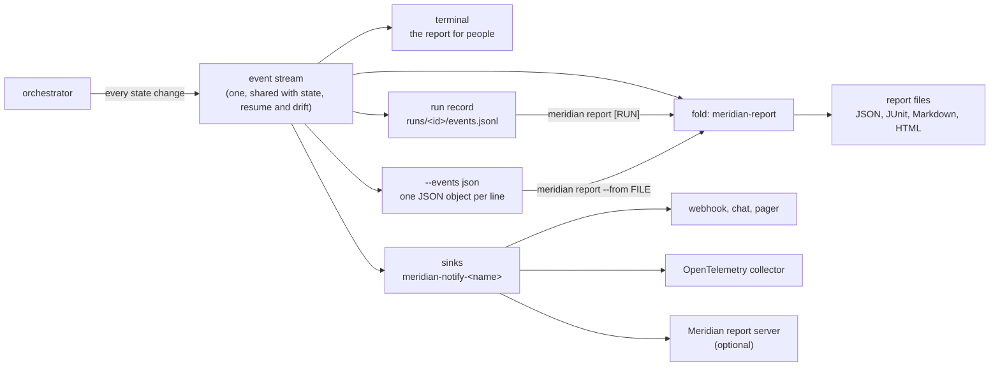
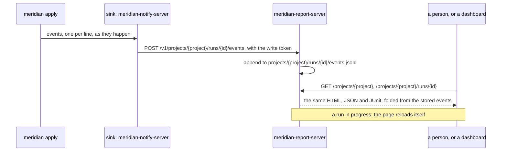

# Reporting: what a run tells people and other systems

Status: design note. The owner chose on 2026-11-17 to stream locally, export
through sinks, **and** build a Meridian report server
([decision](#6-decisions)). Parts 1 and 2 are built in the pull request that
adds this note; [delivery](#7-delivery) says what follows.

A run already says everything it does as events
([run safety, section 2](run-safety.md#2-events-and-the-run-record);
[language expansion, section 14](language-expansion.md#14-run-state-events-and-notifications)).
Reporting adds nothing to that stream and does not run beside it. It is three
ways of reading the one stream: live, as a file, and somewhere else.

## Contents

1. [The questions, answered](#1-the-questions-answered)
2. [The shape](#2-the-shape)
3. [Reports](#3-reports)
4. [Sinks](#4-sinks)
5. [The report server](#5-the-report-server)
6. [Decisions](#6-decisions)
7. [Delivery](#7-delivery)
8. [How others do it](#8-how-others-do-it)

## 1. The questions, answered

| Question | Answer |
|---|---|
| Should it stream? | Yes, and it is the base of everything else. Every state change is an event the moment it happens: on the terminal for a person, as one JSON object per line with `--events json` for a program, and to every sink. A report file is the same stream, folded once the run ends |
| Should it be a remote endpoint? | Meridian *pushes to* remote endpoints through sinks, and never needs one to run. The Meridian report server is one such endpoint: optional, fed by a sink, and a run does not fail because it is down unless you ask for that |
| What must never happen? | A secret in a report. An event holds names, never values, so there is nothing to mask: a report or a sink cannot leak what it was never given |

## 2. The shape

Three rules hold the design together.

1. **One stream.** A report is a fold over events and reads nothing else: not
   a document, not an artifact, not what a tool printed. The live run, the
   recorded run and a file of events carried from another machine therefore
   give the same report, byte for byte, and a new consumer never needs a new
   hook in the orchestrator.
2. **Local first.** Everything works with no network and nothing installed.
   Remote delivery is an addition a team opts into, per run.
3. **Names, not values.** The rule the security plan set for the run record
   holds for every report and sink, because they are made from the same
   events.

## 3. Reports

`--report FORMAT=FILE` on `compile`, `plan`, `apply`, `drift` and `rollback`
writes a report when the run ends, however it ends. `meridian report` writes
one later, from the record or from a file of events.

| Format | For | A step is |
|---|---|---|
| `json` | programs; the shape is named `meridian.report/v1` | an object, with its resources and output names |
| `junit` | CI systems, nearly all of which show JUnit XML as test results | a test case; failed, drifted or not put back is a failure, an unfinished step is an error |
| `markdown` | a pull request comment, or a CI job summary such as `$GITHUB_STEP_SUMMARY` | a table row |
| `html` | one self-contained page to keep as a build artifact; no scripts, no network | a table row |

A failure is reported as its fixed reason word and that word's meaning. What
the tool printed stays on the terminal of the run, because a tool can quote a
value.

A [policy](run-safety.md#8-policy-checks-before-apply) result is folded in
as what the events carry: passed or denied, and how many rules denied and
warned. SARIF, the right format for findings that point at a rule and a
place in a document, is not written yet, because a `policy.*` event holds
counts and neither a rule nor a place. It needs those two names added to the
event, which is the run-safety work's to decide.

## 4. Sinks

A sink is a program that is sent the events as they happen, one JSON object
per line on its standard input, and forwards them. This is the
`meridian-notify-<name>` plugin of the language expansion's decision M, with
its contract written down:

| | |
|---|---|
| Found as | `meridian-notify-<name>` in a plugin directory; `command` is built in and runs any program |
| Given | events on standard input until the run ends; settings as `MERIDIAN_NOTIFY_<SETTING>`; `MERIDIAN_NOTIFY_PROTOCOL=1` |
| Says | exit 0 when everything was delivered |
| `on` | which event types it is sent: `run.*,step.failed`; everything by default |
| `required` | `true`: the run fails when the sink does. By default a failed sink is a warning, because a chat outage must not stop a deployment |

A sink never holds a step up: each has its own queue and thread, a full queue
drops and counts the event, and a sink still running after `--sink-timeout`
is stopped. One program per run, fed a stream, is what lets a sink batch,
keep one connection open, or build one trace per run.

Until the `Workflow` kind exists, sinks are named on the command line
(`--sink`, `--sink-config`, `MERIDIAN_SINKS`). `spec.notifications` then
configures the same sinks with the same fields, adding `when`, `filter`,
`message`, `digest` and `credential`.

## 5. The report server

The owner asked for a Meridian report server as well. It is designed as one
more reader of the stream, so it cannot become a second source of truth.

| Choice | Built |
|---|---|
| What it stores | events, in the run record's own layout, so `meridian report --from` and the server agree and a directory of records can be served as it is |
| What it shows | projects, a project's runs, a run's report (the HTML of part 1, reloading itself while the run is going), and every report format over HTTP |
| How runs reach it | the `server` sink. Meridian itself gains no server dependency and no new failure mode |
| Who may write | the holder of one write token, sent by the sink as a bearer token. A read token is optional. TLS is left to what already terminates it for you |
| What it trusts | nothing it is sent: every line must be an event of the run named, and what is stored is the event written out again |
| What it is not | not a scheduler, not a place to start runs from, and not a store of state or secrets |

## 6. Decisions

| | Decision | Chosen | Alternative |
|---|---|---|---|
| P1 | How runs are reported | stream locally, write report files, export through sinks, and also build a Meridian report server (**owner, 2026-11-17**) | local stream and sinks only; or local only |
| P2 | What a report is made from | events only | the orchestrator's in-memory results, which a recorded run does not have |
| P3 | Sink contract | one program per run, events on standard input | one program per event, which cannot batch or keep a connection |
| P4 | A failed sink | a warning, unless `required` | always fatal |
| P5 | Failure detail | the fixed reason word; the tool's text stays on the terminal | the tool's text, masked |
| P6 | The server's storage | event files in the run record's layout, folded on request | a database, which would be a second thing to keep in step |
| P7 | The server's access control | one write token, an optional read token, TLS at a proxy | users and roles in the server |

P2 to P7 are recommendations the owner has not been asked to confirm one by
one.

## 7. Delivery

| Part | Holds | State |
|---|---|---|
| 1 | crate `meridian-report`; `--report`, `meridian report`; sinks with the built-in `command` sink and two reference sinks (`file`, `webhook` over `curl`); docs | this pull request |
| 2 | crate `meridian-report-server` and its `server` sink; [guide](../reference/report-server.md) | this pull request |
| 3 | an OpenTelemetry sink (a trace per run, a span per step), and a built-in webhook that needs no `curl` | after 2 |
| 4 | SARIF | when a `policy.*` event names the rule and the place |
| 5 | for the server, if wanted: a token per project, live push in place of page reloads, an index so a list does not fold every run | on request |

`notification.sent` and `notification.failed` events are not emitted by part
1: a sink's result is known only after the run's last event, so it is
reported on the terminal and in the exit status. They arrive with
`spec.notifications`, where a message is delivered during the run.

## 8. How others do it

| System | Live | Kept | Remote | Taken | Left |
|---|---|---|---|---|---|
| Terraform, OpenTofu | `-json` writes machine-readable lines as things happen | the plan file; state | HCP Terraform keeps run history as a hosted service and notifies by webhook | a line-per-event stream as the base | run history only in a hosted product |
| Ansible | callback plugins receive each event; the `junit` callback writes test results | whatever a callback writes | ARA and AWX record runs on a server, fed by a callback | events to pluggable receivers; JUnit for CI | callbacks as in-process code, which can see every value |
| Puppet, OpenVox | the agent's log | a report per run | the agent sends its report to the server, which hands it to report processors (`store`, `http`, `puppetdb`) | a report per run pushed to processors | reports that carry log text, which can hold values |
| Spacelift, similar platforms | a run view in the service | run history in the service | the service is the endpoint; webhooks out | a run page with history | needing the service in order to run at all |
