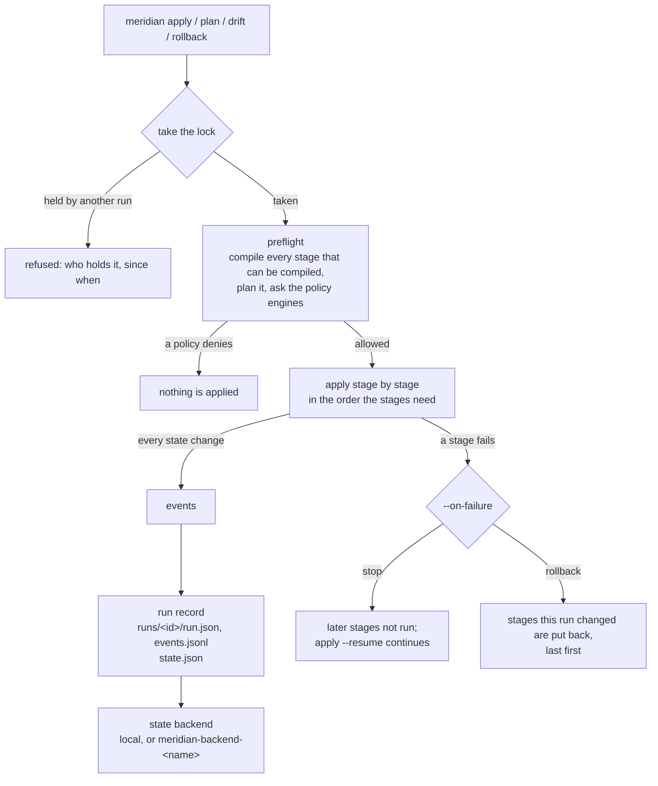
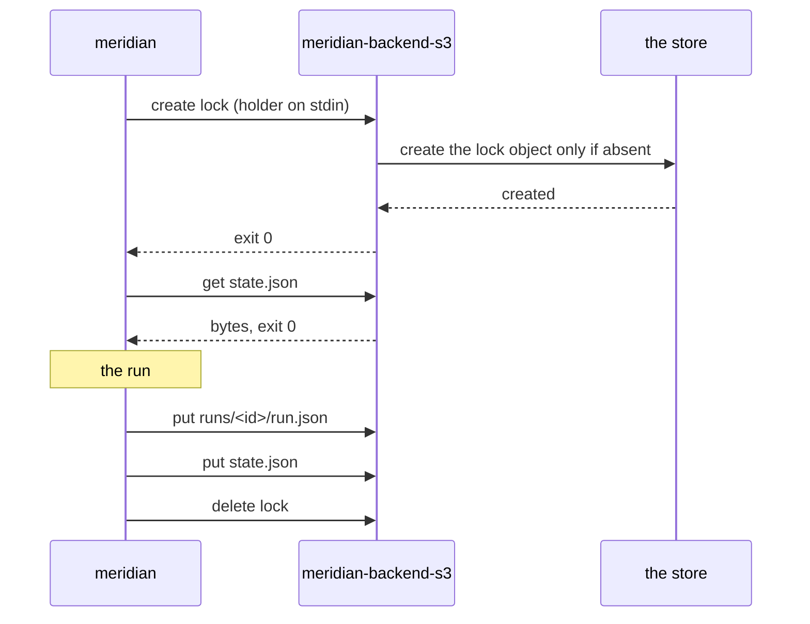
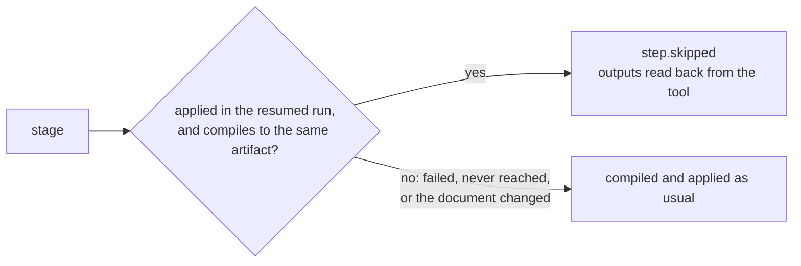
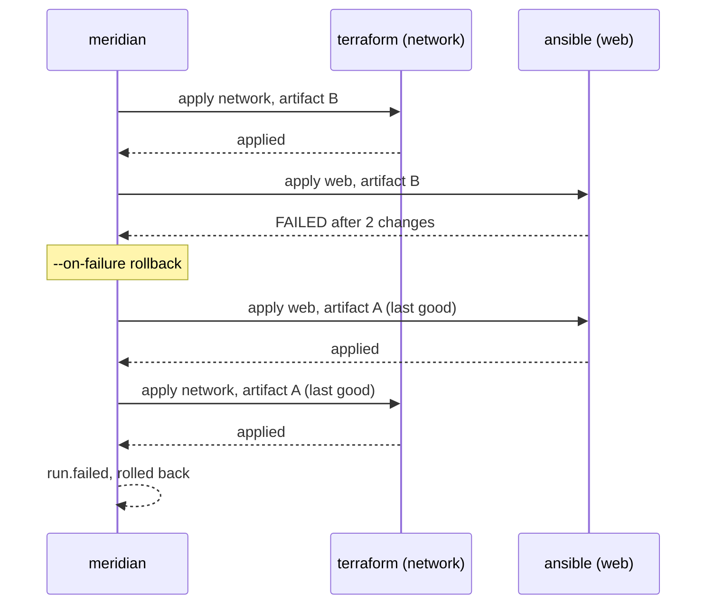

# Run safety: state, locking, resume, rollback, drift, policy and imports

Status: **built**, as pull request 60, merged 2026-11-17. This note was
written before the code and is kept as the design; the
[running safely](../concepts/run-safety.md) concept page and the [state reference](../reference/state.md) describe what is built where
the two differ. Its [decisions for the owner](#11-decisions-for-the-owner)
were built as recommended and have not been confirmed; see
[As built](#13-as-built). It amends
[design plan §11.5](design-plan.md) and the "What this does not do" section of
[the two-stage architecture](../concepts/two-stage-architecture.md), and it
implements the run-state half of
[the language expansion, section 14](https://github.com/ZanattaMichael/meridian-core/pull/59)
instead of inventing a second model. Where this note and that section differ,
[the differences](#10-where-this-differs-from-the-language-expansion) are
listed.

Today a run compiles and applies stage by stage, stops at the first failure,
and writes one small file saying what was last applied. Nothing stops two
runs colliding, a failed run starts again from the top, nothing can be put
back, drift is whatever each tool happens to notice, and nothing can refuse a
change before it is made. This note closes those gaps, and the one in
[issue 47](https://github.com/ZanattaMichael/meridian-core/issues/47): a
stage cannot hand a value to the stage that creates a machine.

## Contents

1. [The shape](#1-the-shape)
2. [Events and the run record](#2-events-and-the-run-record)
3. [Where state lives: backends](#3-where-state-lives-backends)
4. [Locking](#4-locking)
5. [Resume](#5-resume)
6. [Rollback](#6-rollback)
7. [Drift](#7-drift)
8. [Policy checks before apply](#8-policy-checks-before-apply)
9. [Imports: handing a value to any stage](#9-imports-handing-a-value-to-any-stage)
10. [Where this differs from the language expansion](#10-where-this-differs-from-the-language-expansion)
11. [Decisions for the owner](#11-decisions-for-the-owner)
12. [Delivery](#12-delivery)

## 1. The shape



Principles carried over, not changed:

- **Each tool owns its state.** Meridian's record says what Meridian did. It
  is never the truth about infrastructure, and outputs are read back from the
  tool that owns them.
- **No secret value is persisted, in any form** ([security plan §4](security.md#4-the-run-state-store)).
  Events and the record carry names, ids, hashes of artifacts and counts.
- **The core knows no tool.** Everything here is built from what a plugin
  already declares: `plan`, `apply`, `outputs`.

## 2. Events and the run record

Every change of state is one event, and events are the only way state is
recorded, so the terminal, the record and (later) notification sinks agree.

```json
{"run": "2026-11-17T09-14-03Z-0cc7", "seq": 7, "time": "2026-11-17T09:15:11.204Z",
 "type": "step.failed", "step": "web", "instance": "web", "target": "ansible",
 "endpoint": "203.0.113.10", "attempt": 1,
 "detail": {"kind": "ResourceSet", "reason": "tool-failed", "changed": 2}}
```

The envelope is the language expansion's: `run`, `seq` (strictly increasing),
`time`, `type`, `workflow`, `step`, `instance`, `endpoint`, `target`,
`attempt`, `detail`. Until the `Workflow` kind exists, a step is a document,
`step` is its name, `instance` equals `step`, `workflow` is empty and
`attempt` is 1.

| Event | When | `detail` |
|---|---|---|
| `run.started` | the lock is held and the run begins | `mode`, `command`, `resumes` (a run id, when resuming) |
| `run.succeeded`, `run.failed` | the run ends | `steps`, `failed` |
| `step.started` | a stage begins | `kind` |
| `step.succeeded` | a stage did what was asked | `kind`, `artifact` (hash), `changes` (count) |
| `step.failed` | a stage failed | `kind`, `reason`, `changes` (what was done before failing) |
| `step.skipped` | it was not run: resume found it already applied from the same artifact, or an earlier step failed | `kind`, `reason` (`already-applied` with `artifact` and `appliedIn`, or `earlier-step-failed` with `becauseOf`) |
| `step.deferred` | it needs a value that does not exist yet | `waitingOn`, `output` |
| `resource.planned`, `resource.changed` | one line of a plan or an apply | `resource`, `action` |
| `output.produced` | an output exists | `name`, `sensitive`; never the value |
| `drift.detected`, `drift.none`, `drift.unknown` | `meridian drift` compared a stage; `unknown` when it could not call it either way | `changes`; for `unknown` a `reason` (`never-applied`, `no-preview`, `document-changed`, `last-apply-failed`) |
| `policy.passed`, `policy.denied` | a policy engine answered for a stage, or could not be asked | `denials`, `warnings` (counts), `asked` |
| `rollback.started`, `rollback.succeeded`, `rollback.failed`, `rollback.unavailable` | a stage is put back | `to` (artifact hash), `reason` |
| `lock.acquired`, `lock.released` | the lock changes hands | `id` |

`reason` is a fixed word (`tool-failed`, `plugin-failed`, `compile-refused`,
`not-supported`, `no-plugin`, `state-failed`, `policy-denied`), never the
tool's text: a tool's error can quote a
value. The text is shown on the terminal, masked, and not persisted.

The record, under the state:

| Key | Holds |
|---|---|
| `runs/<id>/run.json` | the command and mode, who ran it (user, host, best effort), the selection, when it started and ended, the status, and each step's status, target, artifact hash and change count |
| `runs/<id>/events.jsonl` | every event of the run, one per line, in `seq` order |
| `state.json` | the last apply of every step: target, artifact hash, status, the run that did it, and the artifact hash of the last apply that succeeded |
| `lock` | who holds the state, and for what |

`run.json` is written when the run starts with the status `running`, and again
at every step boundary. A run that dies leaves `running` and its events up to
the last boundary, which is the state most worth being able to see. Records
beyond the newest `--keep-runs` (50) are pruned at the end of a run.

Commands over the record: `meridian status` (the current or last run),
`meridian runs` (history), `meridian events [run]` (the stream, with
`--type`), and `--events json` on a run to put the stream on standard output
for CI.

## 3. Where state lives: backends

The record is small and its operations are few, so a backend is five verbs
over named blobs:

| Verb | Does |
|---|---|
| `get <key>` | the blob, or "not there" |
| `put <key>` | stores the blob, replacing it whole |
| `create <key>` | stores the blob only if the key is not there, atomically |
| `delete <key>` | removes it |
| `list <prefix>` | the keys under a prefix |

The lock is the key `lock`, taken with `create` and released with `delete`,
so the one thing a backend has to get right is an atomic `create`.

`local` is built in: files under the state directory, written by rename so a
crash never leaves half a file, mode `0600`.

Any other backend is a program named `meridian-backend-<name>`, found in the
plugin directories like a target. Meridian runs it once per verb, with the
verb and key as arguments, the blob on standard input or output, the backend's
settings as `MERIDIAN_BACKEND_<SETTING>` environment variables, and the exit
status as the answer (0 done, 3 not there, 4 already there, anything else a
failure with the reason on standard error).



Why a program per verb and not the gRPC plugin protocol: a backend has no
long-lived state and nothing to negotiate, a shell script around `aws s3api`
or `az storage blob` can be one, and the target protocol stays about
compiling and running tools. Chosen with `--backend <name>` and
`--backend-config key=value`, or `MERIDIAN_BACKEND`.

**What a backend does not hold.** Each tool's working directory (Terraform's
`.terraform`, a rendered playbook) stays on the machine that runs Meridian.
A tool's own state belongs in that tool's own remote backend, configured in
the document. A shared Meridian backend gives a team one lock, one history and
one answer to "what was applied last".

## 4. Locking

One lock per state. It is taken by anything that runs a tool (`plan`, `apply`,
`drift`, `rollback`) and not by `compile` or `validate`.

- The lock records an id, the user and host, the process id, the command and
  the time. A second run is refused, and told all of that.
- `--lock-timeout 5m` waits instead, retrying with backoff.
- Meridian never breaks a lock by itself. A process on another machine cannot
  be seen to be dead, and guessing wrong is the collision the lock exists to
  prevent. `meridian unlock <id>` removes a lock left by a run that died, and
  needs the id so the wrong lock cannot be removed by habit.
- The lock is released when the run ends, however it ends, short of the
  process being killed.

## 5. Resume

`meridian apply --resume` continues the last run if it failed or was
interrupted; `--resume <run>` names one.



- "The same" is the artifact hash, so an edited document is applied again and
  an untouched one is not.
- A skipped Infrastructure stage still hands on its outputs: they are read
  from its tool, exactly as a `plan` of existing infrastructure reads them.
- If the tool cannot report them, the stage is applied again instead of
  guessed at. An apply is idempotent; a guess is not.
- Resuming a run that succeeded is refused: there is nothing to continue.

## 6. Rollback

There are two honest things a core that knows no tool can do when a run fails
part-way: stop, or re-apply what was there before.

`--on-failure stop` (the default) is today's behaviour. `--on-failure
rollback` puts back every stage the run changed, the failed one first and then
the others in reverse order, by applying the artifact of that stage's last
successful apply. `meridian rollback <files>` does the same for the last run
on request, including one that succeeded.



- **Snapshots.** To re-apply an artifact Meridian must still have it. After a
  successful apply the artifact is kept beside the stage's working directory
  (`history/`), the newest two per stage. It is kept on the machine only and is
  never sent to a backend, because an artifact can hold whatever the document
  holds. A machine without the snapshot reports `rollback.unavailable` and says
  how to do it by hand: check out the previous revision and apply.
- **A first apply has nothing to go back to.** Removing what a first apply
  created needs a `destroy` operation, which the plugin protocol does not
  have. That stage is reported as not rolled back and left as it is. Adding
  `destroy` is proposed to the protocol versioning work, not done here.
- **A rollback that fails stops.** Nothing further is put back, the run says
  exactly which stages are in which state, and the lock is released.
- **What it cannot promise.** Re-applying an old artifact restores what the
  tool manages. It does not restore data a tool destroyed. `plan` marks a
  replacement with `!` for that reason, and a policy can refuse one
  ([section 8](#8-policy-checks-before-apply)).

## 7. Drift

`meridian drift <files>` asks, for every stage, whether the world still
matches what was applied. It plans and never applies.

| The stage | Reported as |
|---|---|
| was never applied | `never applied` |
| compiles to the artifact last applied, and the plan is empty | `in sync` (`drift.none`) |
| compiles to the artifact last applied, and the plan has changes | `drifted`, with the changes (`drift.detected`) |
| compiles to something else | `pending`: the documents changed since the last apply, so differences are changes waiting to be applied and cannot be told from drift |
| its tool cannot preview | `unknown`, said plainly and not counted as in sync |

Exit status: 0 nothing drifted, 2 something drifted, 1 the check itself
failed. It is meant to be run on a schedule by whatever already schedules
things. The asymmetry between tools stays visible: a tool with no real preview
reports `unknown`.

## 8. Policy checks before apply

A policy answers "may this change be made?" before it is made.

- `--policy <path>` (repeatable) on `plan` and `apply` names policy files or
  directories, and `--policy-engine <name>` the engine (default `opa`).
- An engine is a program named `meridian-policy-<name>`, found like a target.
  It is given the policy paths as arguments and one JSON document on standard
  input, and answers with decisions on standard output. `meridian-policy-opa`
  ships with Meridian and runs `opa eval` over Rego, reading `deny` and `warn`
  from the package `meridian`, the convention Conftest uses.
- The input, per stage: the run (`mode`), the stage (`name`, `kind`, `target`,
  `category`, `host`, `labels`), the resources as compiled (`id`, `type`,
  `state`, `params`), the artifact's files, and the plan (`changes` with
  `resource`, `action`, `summary`; `unknown`) when the target can plan.

```rego
package meridian

import rego.v1

deny contains msg if {
    some change in input.plan.changes
    change.action == "replace"
    input.stage.labels.env == "prod"
    msg := sprintf("%s would be destroyed and recreated in prod", [change.resource])
}
```

**When it runs.** Before the first apply, every stage that can be compiled is
compiled, planned and checked. Any `deny` fails the run with nothing applied.
A stage that cannot be compiled yet, because it waits on an output, or that
its tool cannot preview yet, is checked at its turn, just before its own
apply. Under `plan` the decisions are shown and a `deny` makes the command
fail, so CI can gate a merge; a plan goes on past a denial so that it shows
every one. `drift` and `rollback` ask no policy: a rollback puts back what
was applied before, and a newer policy must not hold a failed change in
place.

**Failing closed.** An engine that is missing, exits non-zero or answers with
something unreadable is a denial. A policy that could not be asked has not
said yes.

**Secrets.** The input holds params and artifact files, which hold whatever
the document holds. It is handed to the engine on standard input, never
written to disk and never recorded. The decision messages are shown on the
terminal, masked, and are not recorded either, because a message can quote
the input: the record keeps how many denials and warnings there were. (As
first written this note recorded the masked messages; building it showed
that masking only covers values a tool marked sensitive.)

## 9. Imports: handing a value to any stage

[Issue 47](https://github.com/ZanattaMichael/meridian-core/issues/47): values
flow only from an Infrastructure stage to a ResourceSet's host. A cloud-init
document compiles to user-data, and the Terraform document that creates the
machine cannot receive it.

Any document may declare `spec.imports`, beside `targetHost`, in the same
`from` / `ref` style. The name is `imports` and not `inputs` so that it is
not read as the language expansion's `spec.parameters`, which are values a
caller gives; an import is a value another document produces.

```yaml
kind: Infrastructure
metadata: {name: machine}
spec:
  target: terraform
  imports:
    - name: user_data          # arrives as the tool's variable of this name
      from: artifact           # a file another document compiles to
      ref: bootstrap           # that document
      file: user-data
      sensitive: true
    - name: vpc_id
      from: output             # a value another document's apply produced
      ref: network
      output: vpc_id
  resources:
    - id: user_data
      type: variable
      params: {type: string, sensitive: true}
    - id: web
      type: aws_instance
      params:
        user_data: ${var.user_data}
```

| | `from: artifact` | `from: output` |
|---|---|---|
| Known | at compile time; no tool runs | after `ref` has been applied |
| Needs | `ref` to compile | `ref` to have been applied, in this run or before |
| Before it is known | never deferred, unless `ref` itself is | the stage is deferred, as a ResourceSet waiting on a host is |

- **Delivery.** Imports arrive in `RunContext.inputs`, which already exists and
  which Terraform, OpenTofu, Pulumi, Packer and ARM already hand to their tool
  as variables or parameters. No value is spliced into text by the core.
- **Order.** Stages are ordered by what they need: a stage runs after every
  stage whose output it reads or whose host it is given. With no imports this
  is exactly today's order. A cycle is refused by `validate`, naming both
  documents.
- **Secrets.** `sensitive: true`, or a sensitive output, masks the value
  wherever Meridian prints, as outputs are masked today.
- **Refusal.** A target declares whether it accepts imports. A document that
  declares imports for one that does not is refused when it is compiled.

As built: the declaration is `Runner::accepts_inputs`, carried in the plugin's
description as a new field, so the protocol version did not change and an
older plugin reports that it takes none. Terraform, OpenTofu, Packer, Pulumi
and ARM say yes. The Terraform target gained the `variable` resource type,
without which a Terraform document had nowhere to receive a value. For
`from: artifact`, `ref` may name a document of either kind, and a name shared
by an Infrastructure document and a ResourceSet is refused as ambiguous. A
document the run leaves out is compiled for the file it is imported for, and
nothing of it is applied.

This is deliberately the declared, tool-variable half of the problem. Reading
`${{ outputs.<document>.<name> }}` inside any value is the language
expansion's phases 2 and 4. It will resolve through this same mechanism and
ordering, after which an import `from: output` is the long spelling of the
same thing.

## 10. Where this differs from the language expansion

| Section 14 says | This note | Why |
|---|---|---|
| `events.jsonl` is appended as it happens | written whole at each step boundary | a remote backend has no append; the content is the same |
| state backends are plugins | programs named `meridian-backend-<name>`, one run per verb | [section 3](#3-where-state-lives-backends) |
| `meridian drift` reports what differs from the documents | also separates `drifted` from `pending` using the last applied artifact hash, with a `drift.unknown` event for what is neither drifted nor in sync | a changed document is not drift |
| no events for policy, rollback or the lock | `policy.*`, `rollback.*`, `lock.*` added | new state changes need events |
| `output.produced` carries the value when it is not sensitive | never the value | a tool does not always know which of its values are secret |
| `step.failed` carries the tool's reason | a fixed word | a tool can quote a value in an error |
| `plan/<instance>.json`, gates, retries, instances, `cancel`, `approve` | not built here | they belong to the `Workflow` kind |

## 11. Decisions for the owner

| | Decision | Recommended | Main alternative |
|---|---|---|---|
| R1 | Remote backends | a small program per backend, one run per verb | a gRPC plugin service like targets |
| R2 | A stale lock | never broken automatically; `meridian unlock <id>` | break it when the holding process is gone on the same host |
| R3 | Rollback | re-apply the last good artifact; first applies are left and reported | add `destroy` to the plugin protocol now |
| R4 | Rollback snapshots | on the machine only, two per stage | in the backend, so any machine can roll back, at the cost of artifacts leaving the machine |
| R5 | Policy engine failure | fail closed | warn and continue |
| R6 | Policy timing | preflight before the first apply, deferred stages at their turn | only per stage, at its turn |
| R7 | Imports | declared `spec.imports`, delivered as the tool's variables | wait for `outputs.<doc>.<name>` in params |

Work proceeds on the recommended column; any of these can be turned without
redoing the rest.

## 12. Delivery

Each is one pull request with tests, reference pages and diagrams, green
before the next.

| | Lands |
|---|---|
| 1 | this note |
| 2 | events, the run record, the `local` backend, the backend protocol, locking, `unlock`, `status`, `runs`, `events`, `--events json`, `apply --resume` |
| 3 | snapshots, `--on-failure rollback`, `meridian rollback`, `meridian drift` |
| 4 | policy checks, `meridian-policy-opa`, a CI job against real OPA |
| 5 | `spec.imports`, ordering by need, the cloud-init to Terraform example |

## 13. As built

Everything in sections 2 to 9 was built in pull request 60, on the
recommended side of every decision in section 11. The owner has not confirmed
R1 to R7; each can still be turned without redoing the rest, and a change
becomes an issue. What differs from the note:

- `spec.imports` needed a protocol field, `DescribeResponse.accepts_inputs`,
  and a `variable` resource type in the Terraform and OpenTofu compilers, so a
  target says whether it takes inputs; `meridian plugins` and the
  [capability matrix](../reference/capability-matrix.md) show it as `inputs`.
- Policy events carry counts only. `policy.finding` events, with the rule,
  the resource and the level, are
  [issue 102](https://github.com/ZanattaMichael/meridian-core/issues/102).
- A document's secrets are fetched once, at the stage's own turn, and never
  in the policy preflight; the preflight asks a document that declares
  secrets at its turn instead.
