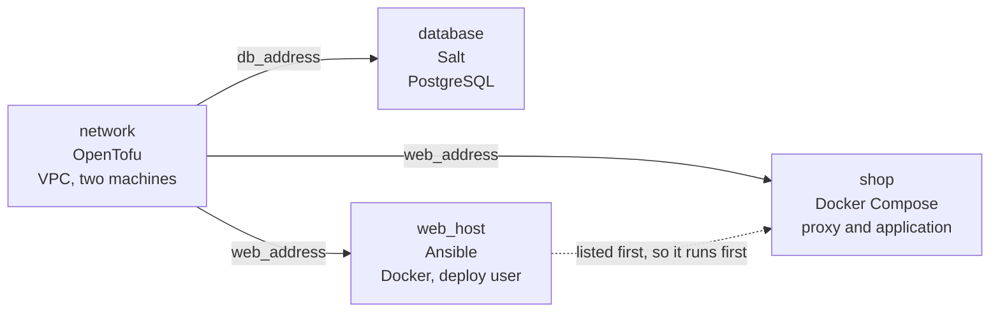
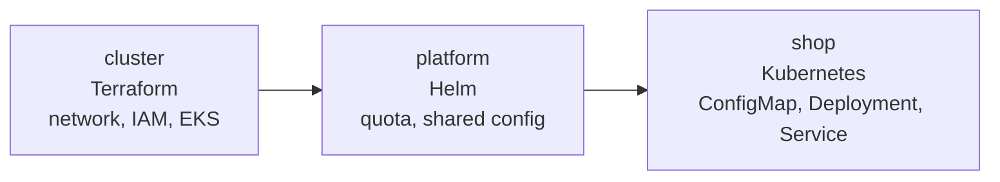
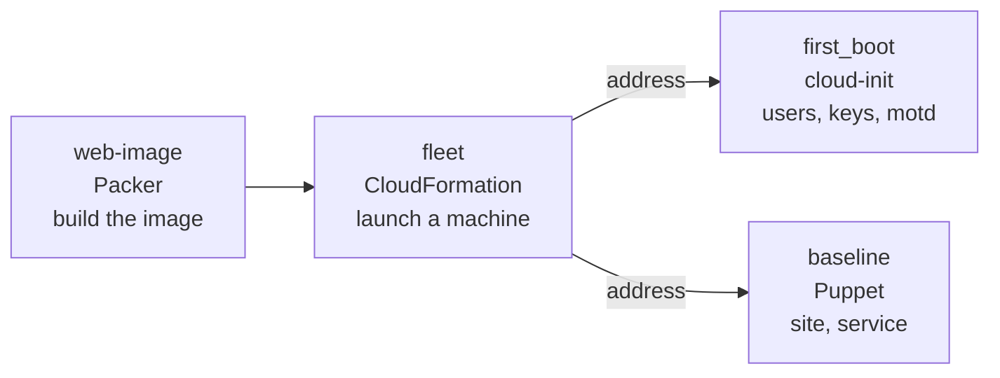
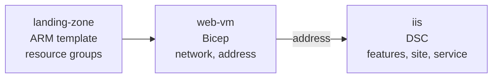
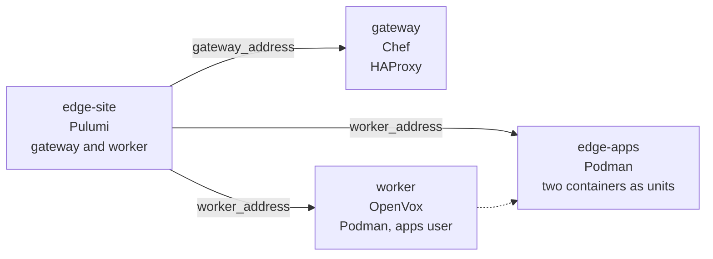
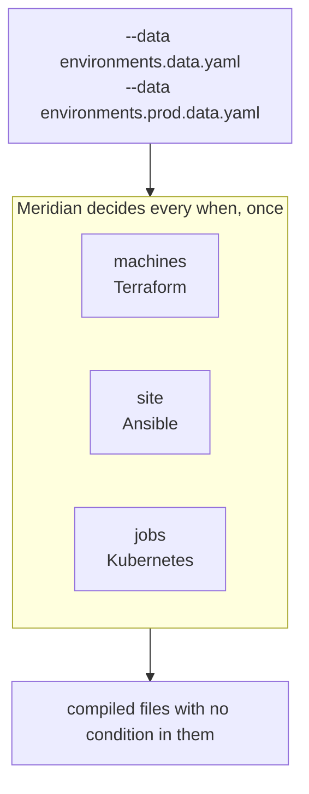
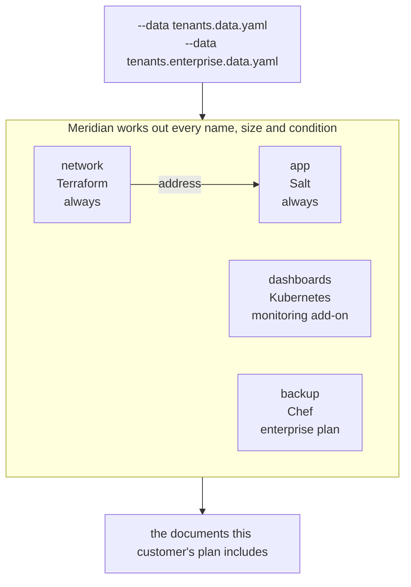
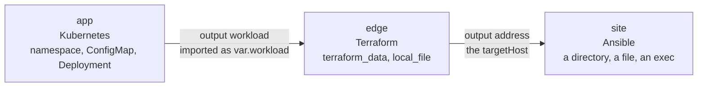

# Worked workflows

A workflow is several documents given to one `meridian` command. Below are eight,
each a file under [`examples/workflow/`](../../examples/workflow). Together they
use every target, each fitting tools together a different way.

A test compiles every file here with the real plugins, in every way shown. The
last one, the vertical slice, is also applied for real on every push, with a
real cluster, Terraform and Ansible.

| Workflow | Tools, in the order they run | Shows |
|---|---|---|
| [Three-tier application](#three-tier-application) | OpenTofu, Salt, Ansible, Docker | several machines from one provisioning stage; labels to run part of a workflow |
| [Cluster platform](#cluster-platform) | Terraform, Helm, Kubernetes | three Infrastructure documents in a fixed order |
| [Golden image](#golden-image) | Packer, CloudFormation, cloud-init, Puppet | build once, launch, bootstrap, then keep converged |
| [Windows web server](#windows-web-server) | ARM, Bicep, DSC | two deployment scopes, then configuration over WinRM |
| [Edge site](#edge-site) | Pulumi, Chef, OpenVox, Podman | two machines with different roles; containers under systemd |
| [Environments](#environments) | Terraform, Ansible, Kubernetes | one workflow for every environment, decided by `--data` |
| [Tenants](#tenants) | Terraform, Salt, Kubernetes, Chef | one workflow for every customer: the plan decides which documents run, which resources they hold and what size they are |
| [Vertical slice](#vertical-slice) | Kubernetes, Terraform, Ansible | the one that runs for real in CI: an output imported by Terraform, a host read by Ansible, and a second plan that changes nothing |

New to workflows? Start with [a two-stage workflow](first-two-stage.md). The
full rules are in [the language reference](../reference/dsl/index.md#workflows-several-documents).
The three that matter most here:

- Every Infrastructure document runs before any ResourceSet. Within a kind,
  documents run in the order they are given.
- A ResourceSet names its machine with `targetHost`. When that is an output of an
  Infrastructure document, the ResourceSet is **deferred** until the output
  exists: `compile` and `plan` report it and compile nothing for it.
- When a stage fails, the stages after it do not run. Nothing is rolled back.

## Three-tier application

[`examples/workflow/three-tier.yaml`](../../examples/workflow/three-tier.yaml)



One Infrastructure document creates two machines and declares three outputs.
Three ResourceSets each take a host from one. No address appears in the file.

```
$ meridian compile examples/workflow/three-tier.yaml --out out
network (Infrastructure, target opentofu)
  compiled 1 file into out/network
database (ResourceSet, target salt)
  deferred: needs the output "db_address" of Infrastructure "network", which has not been applied yet
web_host (ResourceSet, target ansible)
  deferred: needs the output "web_address" of Infrastructure "network", which has not been applied yet
shop (ResourceSet, target docker)
  deferred: needs the output "web_address" of Infrastructure "network", which has not been applied yet
```

`meridian apply` runs OpenTofu, reads the outputs, then compiles and runs each
ResourceSet against its address.

Things to notice in the file:

- **Two ResourceSets, one machine.** `web_host` (Ansible) and `shop` (Docker)
  both read `web_address`. Ansible installs Docker and Compose then runs the
  containers. `shop` runs after `web_host` only because it is listed after it:
  ResourceSets run in the order given.
- **The same six types on two tools.** `database` compiles for Salt and
  `web_host` for Ansible. Both use `package`, `file`, `service`, `user`,
  `group` and `exec`; either could switch tools by changing `target`.
- **A reference inside a file's content.** `data_directory = '${data_dir.path}'`
  is settled when the document is compiled: the path is written once.
- **Labels.** Every document carries `stage` and, where it applies, `tier`:

  ```
  meridian apply examples/workflow/three-tier.yaml -l tier=db
  meridian apply examples/workflow/three-tier.yaml -l 'stage!=provision'
  ```

  The first runs only the database. The second skips OpenTofu and configures
  the machines from its last apply; each ResourceSet reads its host from that
  apply.

## Cluster platform

[`examples/workflow/cluster-platform.yaml`](../../examples/workflow/cluster-platform.yaml)



All three documents are `kind: Infrastructure`, so they run in file order: the
cluster, then shared platform pieces, then one application. Nothing is
deferred; `meridian compile` writes all three.

- **`dependsOn` where the tool cannot see the order.** The cluster's IAM role
  needs its policy before the cluster is created. No cluster param mentions the
  policy attachment, so the document states the order.
- **A chart built from the document.** In `platform`, `values`, `chart` and
  `release` are settings, and `${values.cpuLimit}` becomes a read of
  `.Values.cpuLimit` in the chart's templates, so it can still be overridden at
  install time.
- **A notify the tool does not have.** Kubernetes does not roll a Deployment
  when a mounted ConfigMap changes. `notifies` on `shop_config` adds that, and
  the compile explains how:

  ```
  warning: kubernetes: shop_app: restarts by rolling its pods whenever the content of "shop_config" changes; ...
  ```

The second and third documents reach the cluster through a kubeconfig context.
Outputs go from an Infrastructure document to a ResourceSet's `targetHost`, not
to another Infrastructure document.

## Golden image

[`examples/workflow/golden-image.yaml`](../../examples/workflow/golden-image.yaml)



Four tools, each doing what it does best. Packer bakes slow installs into an
image. CloudFormation launches it. cloud-init handles first boot. Puppet keeps
the machine converged after that.

- **Two configuration tools, two jobs.** `first_boot` and `baseline` are both
  ResourceSets on the same machine, and both use the shared types. cloud-init
  takes params the others do not (`ssh_authorized_keys` on a `user`), and
  refuses what a first boot cannot do, such as removing a package. The
  [conformance matrix](../reference/conformance-matrix.md) has every difference.
- **An exec that runs once.** `creates:` makes `ssh-keygen -A` a no-op once the
  host key exists, so a plan does not show it as a change every time.
- **What is not connected.** The image id Packer reports is an output, and the
  CloudFormation document's `ImageId` is written by hand. An output cannot yet
  fill a param of another Infrastructure document; a comment in the example
  marks this.

## Windows web server

[`examples/workflow/windows-web.yaml`](../../examples/workflow/windows-web.yaml)



- **Two documents for two scopes.** A template deploys to one scope. The ARM
  document creates the resource groups at subscription scope; the network inside
  one is a separate Bicep deployment. Both compile to what Azure Resource Manager
  deploys.
- **The tool's own expressions pass through.** `${resourceGroup().location}` and
  `${uniqueString(resourceGroup().id)}` are Bicep's functions, not Meridian's.
  A `${...}` that does not reference a resource in the document passes to the
  tool unchanged.
- **DSC resources are DSC's own.** `PSDscResources/WindowsFeature` is the
  module and the resource, and `Ensure: Present` is the resource's own
  property. `spec.settings` says how the configuration is run: which engine,
  how the host is reached, and the name of a credential the runner resolves
  itself. No secret is in the file.

## Edge site

[`examples/workflow/edge-fleet.yaml`](../../examples/workflow/edge-fleet.yaml)



- **Roles as labels.** `role=gateway` and `role=worker` select the documents
  for one machine: `meridian apply examples/workflow/edge-fleet.yaml -l role=worker`
  runs OpenVox and then Podman, and leaves the gateway alone.
- **A reload, not a restart.** The HAProxy configuration notifies its service
  with `action: reload`. Chef supports that. Puppet would refuse it, because
  Puppet refreshes a service by restarting it.
- **Containers as systemd units.** The Podman document compiles to Quadlet
  files (`api.container`, `edge-net.network`, ...). `dependsOn` becomes the
  unit's own ordering, and `${collector.name}` is the name the container is
  reachable by.

## Environments

[`examples/workflow/environments.yaml`](../../examples/workflow/environments.yaml),
with [`environments.data.yaml`](../../examples/workflow/environments.data.yaml) and
[`environments.prod.data.yaml`](../../examples/workflow/environments.prod.data.yaml)



One file describes development and production. The differences are decided by
[`when`](../reference/dsl/conditions.md#when), from data given on the command
line:

```
meridian compile examples/workflow/environments.yaml \
    --data examples/workflow/environments.data.yaml

meridian compile examples/workflow/environments.yaml \
    --data examples/workflow/environments.data.yaml \
    --data examples/workflow/environments.prod.data.yaml
```

The first is development. The second layers production on top: a key in the
later file replaces the same key in the earlier one entirely.

| Resource | Document | Condition | Development | Production |
|---|---|---|---|---|
| `bastion` | `machines` (Terraform) | `data.env != 'prod'` | kept | removed |
| `web_ip` | `machines` (Terraform) | `data.env == 'prod'` | removed | kept |
| `audit_bucket` | `machines` (Terraform) | `defined(data.audit) && data.audit.enabled` | removed | kept |
| `debug_log` | `site` (Ansible) | `data.env != 'prod'` | kept | removed |
| `tls_conf` | `site` (Ansible) | `data.features.tls && defined(data.certificate)` | removed | kept |
| `budget` | `jobs` (Kubernetes) | `data.replicas == 3 \|\| data.high_availability` | removed | kept |
| `load_test` | `jobs` (Kubernetes) | `data.env != 'prod' && (data.load_test == true)` | kept | removed |

What the example is there to show:

- **A condition means the same on every target.** `data.env != 'prod'` is
  used in Terraform, Ansible and Kubernetes documents. Meridian decides it before
  compiling, so no tool sees it or can read it differently. A removed resource
  is absent from the compiled files.
- **`ifMissing: skip`.** `ready` depends on `bastion`, which production removes.
  Without `ifMissing: skip` the production compile is refused: depending on
  something missing is usually a mistake.
- **Guarding an optional key.** `defined(data.audit) && data.audit.enabled`
  reads `audit.enabled` only when `audit` is set. Development's data has no
  `audit` key and still compiles.
- **No data, no answer.** Without `--data`, the compile is refused:
  `data.env is not set (give it with --data, or test for it with defined(data.env))`.
  A missing key never makes a condition false.
- **`runtimeWhen` is the other kind.** `apt_cache` in the Ansible document
  uses `runtimeWhen`, which Meridian does not decide: it becomes the task's
  `when:` and Ansible checks it on the machine.

## Tenants

[`examples/workflow/tenants.yaml`](../../examples/workflow/tenants.yaml),
with [`tenants.data.yaml`](../../examples/workflow/tenants.data.yaml) and
[`tenants.enterprise.data.yaml`](../../examples/workflow/tenants.enterprise.data.yaml)



No customer is named in the file. Tenant, plan and add-ons come from data, and
the plan decides which documents run, which resources they hold, and their
values.

```
meridian compile examples/workflow/tenants.yaml \
    --data examples/workflow/tenants.data.yaml

meridian compile examples/workflow/tenants.yaml \
    --data examples/workflow/tenants.data.yaml \
    --data examples/workflow/tenants.enterprise.data.yaml
```

The first is a starter-plan customer; the command reports what the plan left
out:

```
network (Infrastructure, target terraform)
  when: 2 removed
    resource "db": cond.own_database is false
    output "database": cond.own_database is false
  compiled 1 file into out/network
dashboards (Infrastructure, target kubernetes)
  skipped: its when (data.addons.monitoring ?? false) is false
app (ResourceSet, target salt)
  when: 2 removed
    resource "site_cert": cond.tls is false
    "site_conf" depends on "site_cert": cond.tls is false
  deferred: needs the output "address" of Infrastructure "network", which has not been applied yet
backup (ResourceSet, target chef)
  skipped: its when (data.plan == 'enterprise') is false
```

| What | Where | Starter | Enterprise |
|---|---|---|---|
| `dashboards` document | `spec.when: data.addons.monitoring ?? false` | skipped | compiled |
| `backup` document | `spec.when: data.plan == 'enterprise'` | skipped | compiled |
| `db` and the `database` output | `when: cond.own_database` | removed | kept |
| `site_cert`, and the order `site_conf` waits in | `when: cond.tls` | removed | kept |
| `instance_type` | `cond.enterprise ? 'm6i.large' : 't3.small'` | `t3.small` | `m6i.large` |
| `listen` in the site configuration | `join(var.ports, ' ')` | `8080` | `80 443` |
| `RETAIN_DAYS` | `data.backup.retain_days ?? 30` | not compiled | `90` |

What the example is there to show:

- **A condition on a whole document.** `spec.when` removes the document from the
  run: nothing is compiled, no plugin starts, and the command names the
  condition. A customer without the monitoring add-on has no `dashboards`
  directory.
- **Named conditions, decided once.** `conditions:` gives a condition a name,
  read as `cond.<name>`. `own_database` reads `enterprise`, so "an enterprise
  tenant, or anyone with the add-on" is written once and used by a resource and
  an output.
- **Variables and functions.** `variables:` are evaluated once per document and
  read as `var.<name>`. `cidrSubnet(data.cidr, 8, 1)` turns the tenant's
  `10.20.0.0/16` into `10.20.1.0/24`; `upper`, `title`, `join`, `merge` and
  `toString` shape the rest. Every one is in
  [the function reference](../reference/dsl/expressions.md#functions).
- **Values keep their type.** A value that is a single interpolation keeps its
  type: `multi_az` is a boolean, `allocated_storage` a number, `tags` a mapping.
  Inside longer text it becomes text.
- **Interpolations beside references.** `vpc_id: ${main.id}` is a reference,
  left for Terraform to resolve. `cidr_block: ${{ var.app_cidr }}` is an
  interpolation, decided by Meridian. Both sit in the same resource.
- **Text from data is never a reference.** The customer's message of the day
  holds `${EDITOR}`. Every target writes it to `/etc/motd` as typed, never as a
  reference to a resource called `EDITOR`.
  [Interpolation](../reference/dsl/interpolation.md) has the rule.
- **Optional data.** `data.addons.database ?? false` and
  `data.backup.retain_days ?? 30` give fallbacks for keys that may be missing,
  so the starter data file can omit them.
- **One thing changed by hand.** `--set tenant=globex` compiles the same
  workflow for another customer without a file of their own.

## Vertical slice

[`examples/workflow/vertical-slice.yaml`](../../examples/workflow/vertical-slice.yaml),
with [`vertical-slice.data.yaml`](../../examples/workflow/vertical-slice.data.yaml)



The smallest workflow that passes a real value between each of three tools. CI
applies it with the real tools on every push: the `vertical slice` job starts a [kind](https://kind.sigs.k8s.io/)
cluster, installs Terraform and `ansible-core`, and runs
[`crates/meridian-cli/tests/vertical_slice.rs`](../../crates/meridian-cli/tests/vertical_slice.rs),
which drives the real `meridian` binary through `validate`, `compile`, `plan`,
`apply`, `status`, `report`, `plan` again and `drift`, and checks what each
tool left behind. No account is needed: the cluster runs in Docker, Terraform
creates a local value and a file, and Ansible configures the local machine.

1. **`app`** (Kubernetes) applies a namespace, a ConfigMap and a Deployment
   that mounts it. Its outputs are read from the cluster after the apply:
   `workload` is `meridian-slice/web`.
2. **`edge`** (Terraform) [imports](../reference/dsl/outputs-and-hand-offs.md#imports)
   that output, so until `app` has been applied the stage is deferred. The
   value arrives as the variable `workload`, which the `local` provider writes
   into `upstream.conf`. A `terraform_data` value stands for the machine, and
   the output `address` is its name: `localhost`.
3. **`site`** (Ansible) names its machine with `targetHost` from that output,
   so it too waits. It creates a directory and a file under `data.root`, and an
   `exec` that runs once, when the file was written, because the file
   [notifies](../reference/dsl/notifies.md) it.

What the example is there to show:

- **Two ways to hand a value on.** `edge` uses `imports` and receives the value
  as its tool's own variable, never spliced into the compiled file. `site` uses
  `targetHost`. `plan` defers both until the stage they wait on is applied;
  `compile` still compiles `edge`, because the value is not part of the
  artifact.
- **The second plan is the proof.** After the apply, `meridian plan` reports
  every stage in sync and `meridian drift` agrees: `kubectl diff`, `terraform
  plan` and Ansible's check mode all match the documents.
- **Data decides where.** The second and third stages write under `data.root`.
  The test sets a scratch directory with `--set root=...`; the example's data
  file gives a path for running by hand.

To run it yourself, with a cluster in your current kubeconfig context,
`terraform` and `ansible-playbook` on your path:

```
MERIDIAN_ANSIBLE_ARGS='--connection local' \
meridian apply examples/workflow/vertical-slice.yaml \
    --data examples/workflow/vertical-slice.data.yaml
```

It leaves the namespace `meridian-slice` on the cluster; `kubectl delete
namespace meridian-slice` removes it.

## Using these as a starting point

Copy a file, change the names, and check it as you go:

```
meridian validate my-workflow.yaml          # the shape of the language, no plugins
meridian compile  my-workflow.yaml --out out # what each tool will be given
meridian plan     my-workflow.yaml          # what each tool would change
```

`validate` needs no plugin and no tool. `compile` needs the plugins. `plan` and
`apply` need the tools themselves; [install](install.md) lists what each target
uses.

Keep a workflow's data beside it: `site.yaml` with `site.data.yaml`, and one
`site.<name>.data.yaml` per variant. The examples test follows this, compiling
once with the base file and once per variant layered over it.
