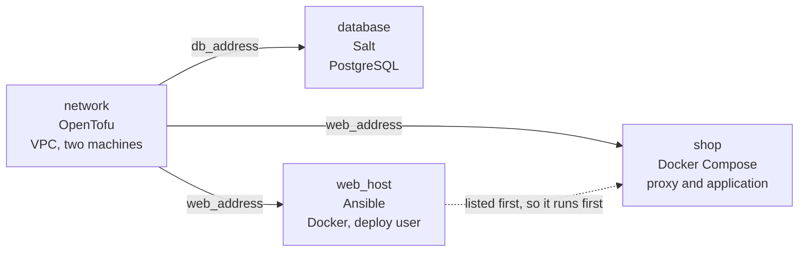
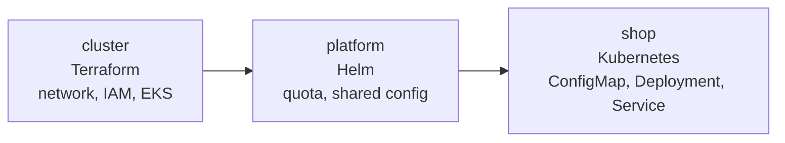
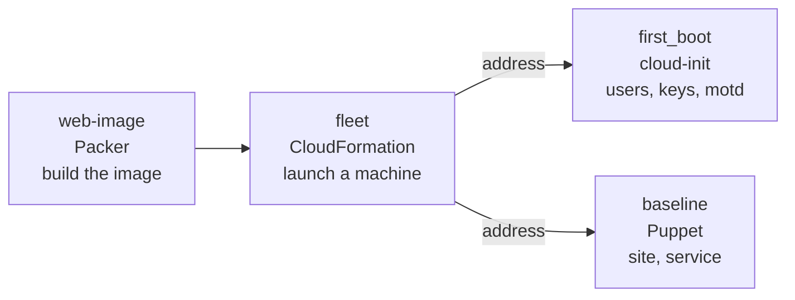
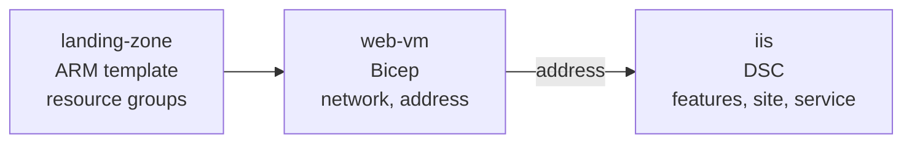
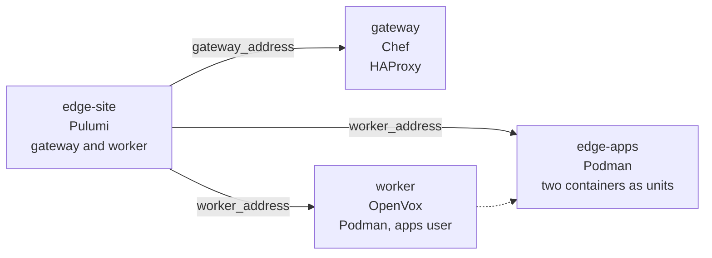
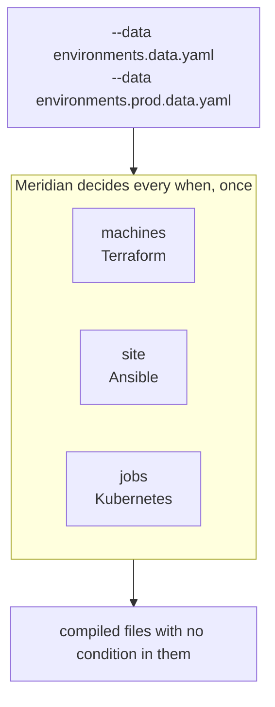
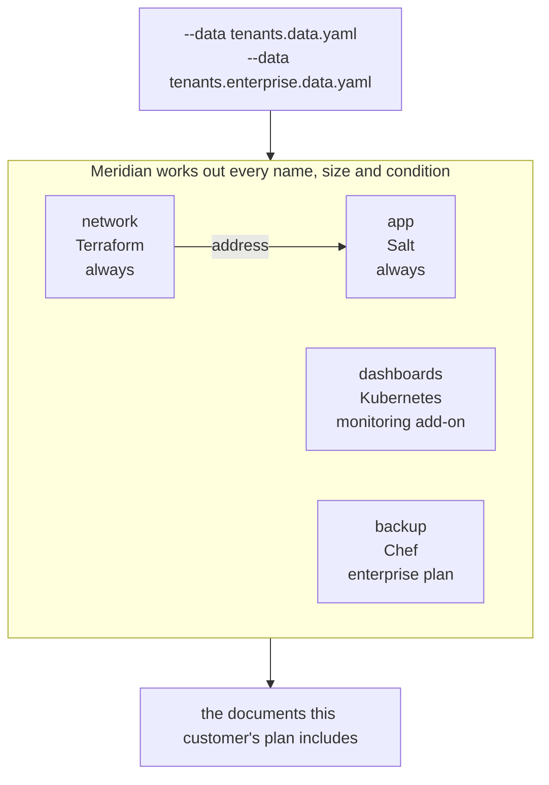
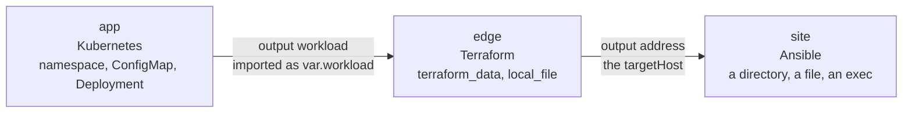

# Worked workflows

A workflow is several documents given to one `meridian` command. This page walks
through eight of them, each a file under
[`examples/workflow/`](../../examples/workflow). Between them they use every
target Meridian ships, and each shows a different way of fitting tools together.

Every file on this page is compiled by a test with the real plugins, in each of
the ways the page describes, so what you read here is what the command does.
The last one, the vertical slice, is also applied for real on every push: a
cluster, Terraform and Ansible, with nothing standing in for a tool.

| Workflow | Tools, in the order they run | Shows |
|---|---|---|
| [Three-tier application](#three-tier-application) | OpenTofu, Salt, Ansible, Docker | several machines from one provisioning stage; labels to run part of a workflow |
| [Cluster platform](#cluster-platform) | Terraform, Helm, Kubernetes | three Infrastructure documents in a fixed order |
| [Golden image](#golden-image) | Packer, CloudFormation, cloud-init, Puppet | build once, launch, bootstrap, then keep converged |
| [Windows web server](#windows-web-server) | ARM, Bicep, DSC | two deployment scopes, then configuration over WinRM |
| [Edge site](#edge-site) | Pulumi, Chef, OpenVox, Podman | two machines with different roles; containers under systemd |
| [Environments](#environments) | Terraform, Ansible, Kubernetes | one workflow for every environment, decided by `--data` |
| [Tenants](#tenants) | Terraform, Salt, Kubernetes, Chef | one workflow for every customer: the plan decides which documents run, which resources they hold and what size they are |
| [Vertical slice](#vertical-slice) | Kubernetes, Terraform, Ansible | the one that runs for real in CI: an output imported by Terraform, a host read by Ansible, and a second plan that changes nothing |

If you have not yet run a workflow of two documents, start with
[a two-stage workflow](first-two-stage.md). The rules every workflow follows are
in [the language reference](../reference/dsl/index.md#workflows-several-documents);
the three that matter most here:

- Every Infrastructure document runs before any ResourceSet. Within a kind,
  documents run in the order they are given.
- A ResourceSet names its machine with `targetHost`. When that is an output of an
  Infrastructure document, the ResourceSet is **deferred** until the output
  exists: `compile` and `plan` say so, and compile nothing for it against a guess.
- When a stage fails, the stages after it do not run. Nothing is rolled back.

## Three-tier application

[`examples/workflow/three-tier.yaml`](../../examples/workflow/three-tier.yaml)



One Infrastructure document creates two machines and promises three outputs.
Three ResourceSets each take a host from one of them. No address is written
anywhere in the file.

```
$ meridian compile examples/workflow/three-tier.yaml --out out
network (Infrastructure, target opentofu)
  compiled 1 file into out/network
database (ResourceSet, target salt)
  deferred: needs the output "db_address" of Infrastructure "network", which has not been applied yet
web_host (ResourceSet, target ansible)
  deferred: needs the output "web_address" of Infrastructure "network", which has not been applied yet
shop (ResourceSet, target docker)
  deferred: needs the output "web_address" of Infrastructure "network", which has not been applied yet
```

`meridian apply` runs OpenTofu, reads the outputs, and then compiles and runs
each ResourceSet against the address it was waiting for.

Things to notice in the file:

- **Two ResourceSets, one machine.** `web_host` (Ansible) and `shop` (Docker)
  both read `web_address`. Ansible installs Docker and Compose then runs the
  containers. `shop` is listed after `web_host`, which is the whole of what
  orders them: ResourceSets run in the order given.
- **The same six types on two tools.** `database` compiles for Salt and
  `web_host` for Ansible. Both use `package`, `file`, `service`, `user`,
  `group` and `exec`, and either could be pointed at the other tool by changing
  `target`.
- **A reference inside a file's content.** `data_directory = '${data_dir.path}'`
  is settled when the document is compiled: the path is written once.
- **Labels.** Every document carries `stage` and, where it applies, `tier`:

  ```
  meridian apply examples/workflow/three-tier.yaml -l tier=db
  meridian apply examples/workflow/three-tier.yaml -l 'stage!=provision'
  ```

  The first runs only the database. The second leaves OpenTofu alone and
  configures the machines it created the last time it was applied; a selected
  ResourceSet finds its host from that document's last apply.

## Cluster platform

[`examples/workflow/cluster-platform.yaml`](../../examples/workflow/cluster-platform.yaml)



All three documents are `kind: Infrastructure`, so they run in the order the
file gives them: the cluster, then what every team's workloads share, then one
application. Nothing here is deferred, and `meridian compile` writes all three.

- **`dependsOn` where the tool cannot see the order.** The cluster's IAM role
  must be allowed to manage a cluster before the cluster is created. No param
  of the cluster mentions the policy attachment, so the document says it.
- **A chart built from the document.** In `platform`, `values`, `chart` and
  `release` are settings, and `${values.cpuLimit}` becomes a read of
  `.Values.cpuLimit` in the chart's templates, so the value can still be
  overridden when the chart is installed.
- **A notify the tool does not have.** Kubernetes does not roll a Deployment
  when a ConfigMap it mounts changes. `notifies` on `shop_config` makes it, and
  the compile says how:

  ```
  warning: kubernetes: shop_app: restarts by rolling its pods whenever the content of "shop_config" changes; ...
  ```

The second and third documents reach the cluster through a kubeconfig context.
An output of one Infrastructure document is not handed to another: outputs go
from an Infrastructure document to a ResourceSet's `targetHost`.

## Golden image

[`examples/workflow/golden-image.yaml`](../../examples/workflow/golden-image.yaml)



Four tools, each doing the part it is best at. Packer bakes what is slow to
install into an image. CloudFormation launches from it. cloud-init does what
must happen once, on the first boot. Puppet keeps the configuration converged
on every run after that.

- **Two configuration tools, two jobs.** `first_boot` and `baseline` are both
  ResourceSets on the same machine, and both use the shared types. cloud-init
  takes params the others do not (`ssh_authorized_keys` on a `user`), and
  refuses what a first boot cannot do, such as removing a package. The
  [conformance matrix](../reference/conformance-matrix.md) has every difference.
- **An exec that runs once.** `creates:` makes `ssh-keygen -A` a no-op once the
  host key exists, so a plan does not show it as a change every time.
- **What is not connected.** The image id Packer reports is an output, and the
  CloudFormation document's `ImageId` is written by hand. An output cannot yet
  fill a param of another Infrastructure document; the example says so where
  the id is written.

## Windows web server

[`examples/workflow/windows-web.yaml`](../../examples/workflow/windows-web.yaml)



- **Two documents for two scopes.** A template is deployed to one scope. The
  resource groups are created at subscription scope by the ARM document; the
  network inside one of them is a separate deployment, written in Bicep. Both
  compile to what Azure Resource Manager deploys.
- **The tool's own expressions pass through.** `${resourceGroup().location}` and
  `${uniqueString(resourceGroup().id)}` are Bicep's functions, not Meridian's.
  A `${...}` that is not a reference to a resource of the document is handed to
  the tool as written.
- **DSC resources are DSC's own.** `PSDscResources/WindowsFeature` is the
  module and the resource, and `Ensure: Present` is the resource's own
  property. `spec.settings` says how the configuration is run: which engine,
  how the host is reached, and the name of a credential the runner resolves
  itself. No secret is in the file.

## Edge site

[`examples/workflow/edge-fleet.yaml`](../../examples/workflow/edge-fleet.yaml)



- **Roles as labels.** `role=gateway` and `role=worker` select the documents
  for one machine: `meridian apply examples/workflow/edge-fleet.yaml -l role=worker`
  runs OpenVox and then Podman, and leaves the gateway alone.
- **A reload, not a restart.** The HAProxy configuration notifies its service
  with `action: reload`. Chef can do that. Had this document targeted Puppet it
  would have been refused, because Puppet refreshes a service by restarting it.
- **Containers as systemd units.** The Podman document compiles to Quadlet
  files (`api.container`, `edge-net.network`, ...). `dependsOn` becomes the
  unit's own ordering, and `${collector.name}` is the name the container is
  reachable by.

## Environments

[`examples/workflow/environments.yaml`](../../examples/workflow/environments.yaml),
with [`environments.data.yaml`](../../examples/workflow/environments.data.yaml) and
[`environments.prod.data.yaml`](../../examples/workflow/environments.prod.data.yaml)



One file describes development and production. What differs between them is
decided by [`when`](../reference/dsl/conditions.md#when), from data given on the
command line:

```
meridian compile examples/workflow/environments.yaml \
    --data examples/workflow/environments.data.yaml

meridian compile examples/workflow/environments.yaml \
    --data examples/workflow/environments.data.yaml \
    --data examples/workflow/environments.prod.data.yaml
```

The first is development. The second layers production over it: a key in the
later file replaces the same key in the earlier one, whole.

| Resource | Document | Condition | Development | Production |
|---|---|---|---|---|
| `bastion` | `machines` (Terraform) | `data.env != 'prod'` | kept | removed |
| `web_ip` | `machines` (Terraform) | `data.env == 'prod'` | removed | kept |
| `audit_bucket` | `machines` (Terraform) | `defined(data.audit) && data.audit.enabled` | removed | kept |
| `debug_log` | `site` (Ansible) | `data.env != 'prod'` | kept | removed |
| `tls_conf` | `site` (Ansible) | `data.features.tls && defined(data.certificate)` | removed | kept |
| `budget` | `jobs` (Kubernetes) | `data.replicas == 3 \|\| data.high_availability` | removed | kept |
| `load_test` | `jobs` (Kubernetes) | `data.env != 'prod' && (data.load_test == true)` | kept | removed |

What the example is there to show:

- **A condition means the same on every target.** `data.env != 'prod'` is
  written in a Terraform document, an Ansible one and a Kubernetes one. Meridian
  decides it itself, before compiling, so no tool sees it and no tool can read it
  differently. A removed resource is not in the compiled files at all.
- **`ifMissing: skip`.** `ready` depends on `bastion`, which production removes.
  Without `ifMissing: skip` on that entry the production compile is refused,
  because a resource depending on something that is not there is far more often
  a mistake than an intention.
- **Guarding an optional key.** `defined(data.audit) && data.audit.enabled`
  reads `audit.enabled` only when `audit` is set. Development's data has no
  `audit` key and still compiles.
- **No data, no answer.** With no `--data`, the compile is refused:
  `data.env is not set (give it with --data, or test for it with defined(data.env))`.
  A condition is never taken as false because its key is missing.
- **`runtimeWhen` is the other kind.** `apt_cache` in the Ansible document
  carries `runtimeWhen`, which Meridian does not decide: it is copied into the
  task's `when:` and Ansible checks it on the machine.

## Tenants

[`examples/workflow/tenants.yaml`](../../examples/workflow/tenants.yaml),
with [`tenants.data.yaml`](../../examples/workflow/tenants.data.yaml) and
[`tenants.enterprise.data.yaml`](../../examples/workflow/tenants.enterprise.data.yaml)



Nothing in the file names a customer. The tenant, the plan and the add-ons come
from data, and the plan decides three things at once: which documents are part
of the run, which resources each holds, and what the values in them are.

```
meridian compile examples/workflow/tenants.yaml \
    --data examples/workflow/tenants.data.yaml

meridian compile examples/workflow/tenants.yaml \
    --data examples/workflow/tenants.data.yaml \
    --data examples/workflow/tenants.enterprise.data.yaml
```

The first is a customer on the starter plan, and the command says what the plan
left out:

```
network (Infrastructure, target terraform)
  when: 2 removed
    resource "db": cond.own_database is false
    output "database": cond.own_database is false
  compiled 1 file into out/network
dashboards (Infrastructure, target kubernetes)
  skipped: its when (data.addons.monitoring ?? false) is false
app (ResourceSet, target salt)
  when: 2 removed
    resource "site_cert": cond.tls is false
    "site_conf" depends on "site_cert": cond.tls is false
  deferred: needs the output "address" of Infrastructure "network", which has not been applied yet
backup (ResourceSet, target chef)
  skipped: its when (data.plan == 'enterprise') is false
```

| What | Where | Starter | Enterprise |
|---|---|---|---|
| `dashboards` document | `spec.when: data.addons.monitoring ?? false` | skipped | compiled |
| `backup` document | `spec.when: data.plan == 'enterprise'` | skipped | compiled |
| `db` and the `database` output | `when: cond.own_database` | removed | kept |
| `site_cert`, and the order `site_conf` waits in | `when: cond.tls` | removed | kept |
| `instance_type` | `cond.enterprise ? 'm6i.large' : 't3.small'` | `t3.small` | `m6i.large` |
| `listen` in the site configuration | `join(var.ports, ' ')` | `8080` | `80 443` |
| `RETAIN_DAYS` | `data.backup.retain_days ?? 30` | not compiled | `90` |

What the example is there to show:

- **A condition on a whole document.** `spec.when` takes the document out of
  the run. Nothing is compiled for it, no plugin is started for it, and the
  command says which condition decided it. A customer without the monitoring
  add-on has no `dashboards` directory at all.
- **Named conditions, decided once.** `conditions:` gives a condition a name,
  read as `cond.<name>`. `own_database` reads `enterprise`, so the rule "an
  enterprise tenant, or anyone who bought the add-on" is written in one place
  and used by a resource and an output.
- **Variables and functions.** `variables:` are worked out once per document
  and read as `var.<name>`. `cidrSubnet(data.cidr, 8, 1)` turns the tenant's
  `10.20.0.0/16` into `10.20.1.0/24`; `upper`, `title`, `join`, `merge` and
  `toString` shape the rest. Every one is in
  [the function reference](../reference/dsl/expressions.md#functions).
- **Values keep their type.** A value that is one interpolation and nothing
  else is placed as what it is: `multi_az` is a boolean, `allocated_storage` a
  number, `tags` a whole mapping. Interpolated into longer text it is text.
- **Interpolations beside references.** `vpc_id: ${main.id}` is a reference,
  left for Terraform to resolve. `cidr_block: ${{ var.app_cidr }}` is an
  interpolation, decided by Meridian. Both sit in the same resource.
- **Text from data is never a reference.** The customer's message of the day
  holds `${EDITOR}`. It is written to `/etc/motd` exactly as typed, on every
  target, and is never mistaken for a reference to a resource called `EDITOR`.
  [Interpolation](../reference/dsl/interpolation.md) has the rule.
- **Optional data.** `data.addons.database ?? false` and
  `data.backup.retain_days ?? 30` give a key that may be missing a value to
  fall back on, so the starter data file does not have to mention either.
- **One thing changed by hand.** `--set tenant=globex` compiles the same
  workflow for another customer without a file of their own.

## Vertical slice

[`examples/workflow/vertical-slice.yaml`](../../examples/workflow/vertical-slice.yaml),
with [`vertical-slice.data.yaml`](../../examples/workflow/vertical-slice.data.yaml)



The smallest workflow that goes through three tools and hands something real
between each pair. It is the one workflow CI applies with the tools themselves,
on every push: the `vertical slice` job starts a [kind](https://kind.sigs.k8s.io/)
cluster, installs Terraform and `ansible-core`, and runs
[`crates/meridian-cli/tests/vertical_slice.rs`](../../crates/meridian-cli/tests/vertical_slice.rs),
which drives the real `meridian` binary through `validate`, `compile`, `plan`,
`apply`, `status`, `report`, `plan` again and `drift`, and checks what each
tool left behind. Nothing in it needs an account: the cluster runs inside
Docker, Terraform creates a local value and a file, and Ansible configures the
machine it runs on.

1. **`app`** (Kubernetes) applies a namespace, a ConfigMap and a Deployment
   that mounts it. Its outputs are read from the cluster after the apply:
   `workload` is `meridian-slice/web`.
2. **`edge`** (Terraform) [imports](../reference/dsl/outputs-and-hand-offs.md#imports)
   that output, so until `app` has been applied the stage is deferred. The
   value arrives as the variable `workload`, which the `local` provider writes
   into `upstream.conf`. A `terraform_data` value stands for the machine, and
   the output `address` is its name: `localhost`.
3. **`site`** (Ansible) names its machine with `targetHost` from that output,
   so it too waits. It creates a directory and a file under `data.root`, and an
   `exec` that runs once, when the file was written, because the file
   [notifies](../reference/dsl/notifies.md) it.

What the example is there to show:

- **Two ways to hand a value on.** `edge` asks for a value with `imports` and
  gets it as its tool's own variable, never spliced into the compiled file;
  `site` asks for its machine with `targetHost`. Both are deferred by `plan`
  until the stage they wait on has been applied, and `compile` compiles `edge`
  all the same, because the value is not part of the artifact.
- **The second plan is the proof.** After the apply, `meridian plan` reports
  every stage in sync and `meridian drift` agrees: `kubectl diff`, `terraform
  plan` and Ansible's check mode each see the world as the documents say.
- **Data decides where.** `data.root` is where the second and third stages
  write; the test gives a scratch directory with `--set root=...`, and the
  data file beside the example gives a path for running it by hand.

To run it yourself, with a cluster in your current kubeconfig context,
`terraform` and `ansible-playbook` on your path:

```
MERIDIAN_ANSIBLE_ARGS='--connection local' \
meridian apply examples/workflow/vertical-slice.yaml \
    --data examples/workflow/vertical-slice.data.yaml
```

The namespace `meridian-slice` is what it leaves on the cluster; `kubectl
delete namespace meridian-slice` removes it.

## Using these as a starting point

Copy a file, change the names, and check it as you go:

```
meridian validate my-workflow.yaml          # the shape of the language, no plugins
meridian compile  my-workflow.yaml --out out # what each tool will be given
meridian plan     my-workflow.yaml          # what each tool would change
```

`validate` needs no plugin and no tool. `compile` needs the plugins. `plan` and
`apply` need the tools themselves; [install](install.md) lists what each target
uses.

A workflow that takes data keeps it beside it: `site.yaml` with
`site.data.yaml`, and one `site.<name>.data.yaml` for each variant. That is the
convention the examples test follows, compiling the workflow once with the first
file and once more for each variant layered over it.
