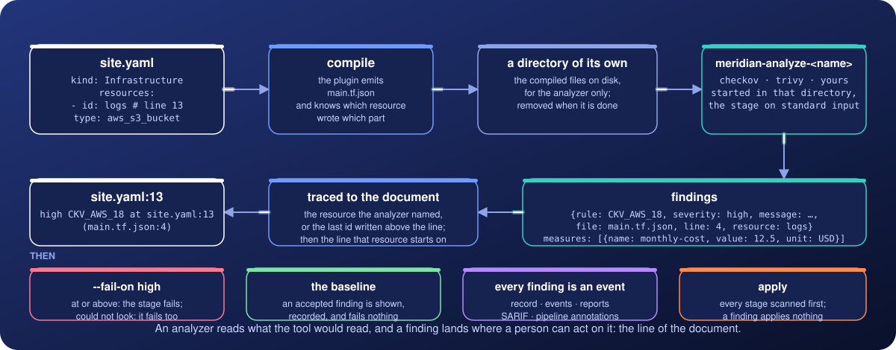

# Analyzers

An analyzer scans a stage's compiled files before any tool sees them: a security scanner, a
cost estimate, a lint of the native format. A finding at or above `--fail-on` fails the stage.

```sh
meridian plan  site.yaml --analyze checkov,trivy
meridian apply site.yaml --analyze checkov --fail-on critical
```

<p align="center"></p>

Two analyzers ship: [Checkov](#checkov) and [Trivy](#trivy). Any other scanner needs only
[a small program](#writing-an-analyzer). A [policy](policy.md) judges the change; an analyzer
judges the files.

**Not supported yet:** analyzers named in a document, analyzers that read a tool's plan, and a
built-in cost analyzer.

## Options

| Option | Environment | Default | Meaning |
|---|---|---|---|
| `--analyze NAME` | `MERIDIAN_ANALYZERS` | none | `compile`, `plan`, `apply`: run the program `meridian-analyze-<NAME>` from a [plugin directory](cli.md#options). Repeat it, or write `checkov,trivy` |
| `--analyze-config NAME.KEY=VALUE` | | | a setting for one analyzer, passed in the input and as `MERIDIAN_ANALYZE_<KEY>` |
| `--fail-on SEVERITY` | `MERIDIAN_FAIL_ON` | `high` | `critical`, `high`, `medium`, `low`, `info`, or `none` to fail on nothing |
| `--analyze-baseline FILE` | | none | a YAML or JSON file of [accepted findings](#the-baseline) |

`--analyze` on `drift` or `rollback` is an error; a rollback is never analyzed. A missing
analyzer, a setting for an analyzer not named, or an unreadable baseline is refused before
the run.

## When an analyzer runs

Each analyzer runs once per stage, right after the stage compiles.

- **`compile`** and **`plan`** keep going after a stage fails, so one run shows every
  finding. The command still exits `1`.
- **`apply`** analyzes every stage it can compile before applying any; one failure and
  nothing is applied. A stage that waits on an earlier output is analyzed at its turn.
- Stages left out by `spec.when`, or skipped by a resumed run, are not analyzed.

## Findings

```
network (Infrastructure, target terraform)
  analysis (checkov): 1 high, 1 low
    high CKV_AWS_18 at site.yaml:13 (main.tf.json:4): Ensure the S3 bucket has access logging enabled
    low CKV_AWS_21 at site.yaml:13 (main.tf.json:4): Ensure all data stored in the S3 bucket have versioning enabled
  FAILED: an analyzer found something at severity high or above, which this run fails on (--fail-on high):
      - high CKV_AWS_18 (checkov) at site.yaml:13 (main.tf.json:4): Ensure the S3 bucket has access logging enabled
```

A finding points at **the document line where its resource starts**, with the compiled place
in brackets. Meridian finds the resource from the name the analyzer gives. Failing that, it
uses the last resource id written on or above the compiled line. A finding it cannot trace
shows the compiled place alone.

Severities, lowest to highest: `info`, `low`, `medium`, `high`, `critical`. A scanner's
`note`, `warning` and `error` read as `info`, `medium` and `high`; `unknown` reads as `info`.

**Failing closed.** If an analyzer cannot start, exits non-zero, or answers with anything
but the [expected JSON](#the-answer), the stage fails with `analyzer-failed`, whatever
`--fail-on` says. A finding at the threshold fails it with `analysis-failed`.

## The baseline

A baseline lists findings you have reviewed and accept. Accepted findings are still shown
and recorded, but fail nothing.

```yaml
accepted:
  - rule: CKV_AWS_18
    resource: logs
    reason: the logs bucket cannot log to itself
  - rule: AVD-AWS-0089
    analyzer: trivy
    stage: network
```

`rule` is required. `analyzer`, `resource` (the document's id), `stage` (`metadata.name`)
and `target` narrow the match; each matches anything when left out. `reason` is for readers.
An entry with only a `rule` accepts that rule everywhere, so review the file like code.

## Events and reports

| Event | When | `detail` |
|---|---|---|
| `finding.reported` | one per finding | `analyzer`, `rule`, `severity`, `message`, `file`, `line`, `resource`, `document`, `documentLine`, `url`, `accepted` |
| `analysis.passed` | nothing reached `--fail-on` | `analyzer`, `asked`, counts per severity, `accepted`, `failing`, `measures` |
| `analysis.failed` | a finding reached `--fail-on`, or the analyzer could not look | the same; `asked` is `false` when it could not look |

The message is the analyzer's rule description, masked like every value. It is the only tool
text a run's record keeps, so an analyzer must name its rule and never quote the file.

Findings appear in every [report](reporting.md): a table in Markdown and HTML, `system-out`
in JUnit, `findings[]` in JSON, and results at the document line in
[SARIF](reporting.md#sarif). In a [pipeline](../operations/running-in-a-pipeline.md), each
finding not in the baseline is an annotation: an error at `high` and above, else a warning.

## Checkov

`meridian-analyze-checkov` runs `checkov -d . -o json --soft-fail` with the frameworks for
the target. It needs `checkov` on the `PATH`, or the program named in `MERIDIAN_CHECKOV`.

| Target | Frameworks |
|---|---|
| `terraform`, `opentofu` | `terraform_json` |
| `cloudformation`, `kubernetes`, `bicep`, `arm`, `ansible` | the same name |
| `helm` | `helm`, `kubernetes` |
| `docker`, `podman` | `dockerfile` |
| any other | all |

Checkov gives no severity without a Prisma Cloud key, so a failed check is `high` unless
`default-severity` says otherwise.

| Setting | Meaning |
|---|---|
| `framework` | frameworks to run instead, comma-separated |
| `check`, `skip-check` | checks to run or skip, comma-separated |
| `default-severity` | severity for a check with none; `high` by default |
| `args` | extra `checkov` arguments |

## Trivy

`meridian-analyze-trivy` runs `trivy config --format json .` and reports each `FAIL` with
Trivy's own severity. It needs `trivy` on the `PATH`, or the program named in `MERIDIAN_TRIVY`.
Cache `~/.cache/trivy` in a pipeline; the first run downloads the checks.

| Setting | Meaning |
|---|---|
| `severity` | severities to report, as Trivy spells them: `HIGH,CRITICAL` |
| `skip-check` | check ids to ignore, comma-separated |
| `args` | extra `trivy config` arguments |

## The analyzer protocol

An analyzer is a program named `meridian-analyze-<name>`. For each stage, Meridian:

1. writes the compiled files to a fresh directory and starts the program there;
2. sets `MERIDIAN_ANALYZE_<KEY>` for each setting, with the key upper-cased and `-` as `_`;
3. writes [the input](#the-input) to standard input as one JSON document;
4. reads [the answer](#the-answer) from standard output, and needs exit status `0`;
5. removes the directory.

Any other exit status or output fails the stage. On failure, Meridian shows the last line of
standard error.

### The input

```json
{
  "run":   {"id": "2026-11-18T12-04-03Z-0cc7", "mode": "plan"},
  "stage": {"name": "network", "kind": "Infrastructure", "target": "terraform",
            "category": "infrastructure-as-code", "host": "", "labels": {"env": "prod"}},
  "artifact": {"dir": "/tmp/meridian-analyze-4812-1-network-checkov", "files": ["main.tf.json"]},
  "settings": {"skip-check": "CKV_AWS_18"}
}
```

The `stage` fields match a [policy's input](policy.md#the-input). The input holds no file
content: the files are on disk. Fields may be added, never renamed or removed.

### The answer

```json
{
  "findings": [{"rule": "CKV_AWS_18", "severity": "high",
                "message": "Ensure the S3 bucket has access logging enabled",
                "file": "main.tf.json", "line": 4, "resource": "logs",
                "url": "https://docs.prismacloud.io/..."}],
  "measures": [{"name": "monthly-cost", "value": 12.5, "unit": "USD"}]
}
```

Only `findings` and `measures` are allowed, and either may be left out. Each finding needs a
`rule`. `severity` defaults to `medium`. `file`, `line` (from 1), `resource` and `url` are
optional; Meridian traces the line when `resource` is missing.

### Writing an analyzer

This shell script reports every compiled file over a size limit:

```sh
#!/bin/sh
# meridian-analyze-size
cat > /dev/null
limit=${MERIDIAN_ANALYZE_LIMIT:-100000}
findings=""
for file in $(find . -type f ! -name .meridian-files | sort); do
  if [ "$(wc -c < "$file")" -gt "$limit" ]; then
    f="{\"rule\":\"large-file\",\"severity\":\"low\",\"message\":\"Larger than $limit bytes\",\"file\":\"${file#./}\"}"
    findings="$findings${findings:+,}$f"
  fi
done
printf '{"findings":[%s]}\n' "$findings"
```

```sh
meridian plan site.yaml --analyze size --analyze-config size.limit=50000
```

In Rust, the `meridian-analyze` crate reads the input and writes the answer, so a new
analyzer only translates its scanner's output. Exit non-zero on anything unexpected, and
never keep the files: they can hold what the document holds.

## Limits

- Analyzers see files, not the tool's plan. Use a [policy](policy.md) for rules about changes.
- Findings are not compared between runs; use the baseline for known findings.
- Each analyzer starts once per stage.
