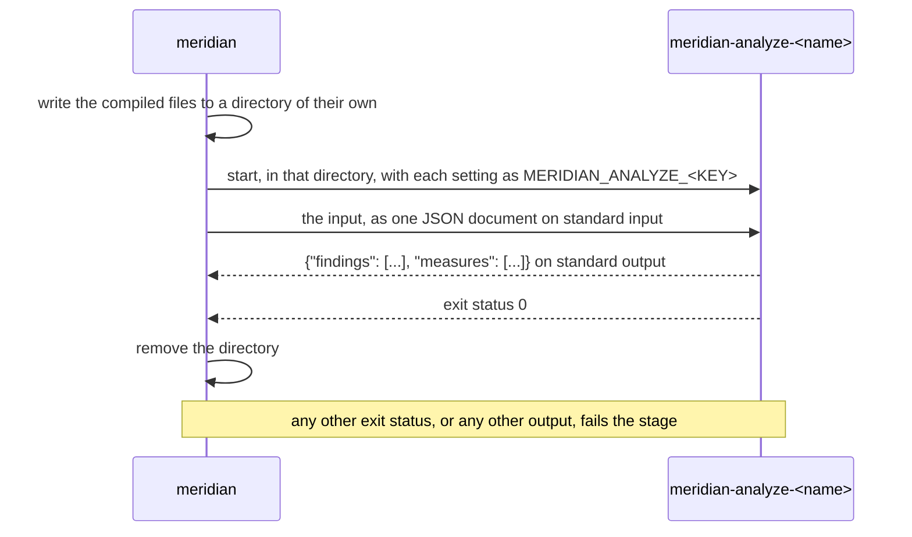

# Analyzers

An analyzer looks at what a stage compiled to, before any tool sees it, and
says what it found: a security scanner's failed checks, a cost estimate, a
lint of the native format. `meridian compile`, `meridian plan` and `meridian
apply` can put every stage through one or more analyzers, and a finding at
or above a severity you choose fails the stage.

```sh
meridian plan  site.yaml --analyze checkov,trivy
meridian apply site.yaml --analyze checkov --fail-on critical
```

<p align="center"></p>

Meridian's output *is* the tools' own formats, so the large libraries of
rules written against Terraform, CloudFormation, Kubernetes and the rest
apply to it unchanged. Two analyzers ship with Meridian, for
[Checkov](#the-checkov-analyzer) and [Trivy](#the-trivy-analyzer); any other
scanner needs only [an analyzer program](#writing-an-analyzer). Where a
[policy](policy.md) asks whether a change may be made, from Meridian's own
view of the stage, an analyzer asks what the compiled files look like to a
tool that knows the format.

**Supported:** any number of analyzers per run; settings per analyzer; a
severity threshold; a baseline of accepted findings; every finding traced to
the document and reported as an event, in every report format, as a pipeline
annotation, and in SARIF; measures such as a monthly cost.
**Not supported yet:** analyzers configured in a document (they are named on
the command line); an analyzer that reads a tool's plan rather than its
files; a built-in cost analyzer (Infracost reads Terraform files, so the
[analyzer protocol](#the-analyzer-protocol) fits it).

## Options

| Option | Environment | Default | Meaning |
|---|---|---|---|
| `--analyze NAME` | `MERIDIAN_ANALYZERS` | none | `compile`, `plan` and `apply`: an analyzer to put every stage through: the program `meridian-analyze-<NAME>` in a [plugin directory](cli.md#options). May be repeated, or given as `checkov,trivy` |
| `--analyze-config NAME.KEY=VALUE` | | | a setting for one analyzer; may be repeated. The program reads it from the input and as `MERIDIAN_ANALYZE_<KEY>` |
| `--fail-on SEVERITY` | `MERIDIAN_FAIL_ON` | `high` | the severity at which a finding fails its stage: `critical`, `high`, `medium`, `low`, `info`, or `none` to report findings and fail on nothing |
| `--analyze-baseline FILE` | | none | a YAML or JSON file of [accepted findings](#the-baseline) |

With no `--analyze`, nothing here applies. `--analyze` on `drift` or
`rollback` is an error, so that a command that analyzes nothing cannot be
mistaken for one that did. A rollback is deliberately not analyzed: it puts
back what was applied before, and a scanner's rule written since must not be
able to hold a failed change in place.

An analyzer that is not installed, a setting for an analyzer that was not
named, and a baseline that cannot be read are refused before the run starts.

## When an analyzer runs

An analyzer runs once per stage, as soon as the stage has compiled and before
its tool is asked anything.

- **`compile`** puts every stage through the analyzers and shows every
  finding. A stage that fails is reported as failed and the command exits
  `1`, but the compile goes on to the next stage, so that one compile shows
  everything there is to find. This is the cheapest check to run on a pull
  request: nothing is contacted.
- **`plan`** does the same: a failed stage does not stop the plan.
- **`apply`** makes a first pass over every stage before it applies any of
  them, as it does with a [policy](policy.md#when-a-policy-is-asked). Each
  stage that can be compiled is analyzed there; if any fails, the run fails
  with nothing applied. A stage that cannot be compiled in the first pass,
  because it waits on an output of a stage that has not been applied yet or
  reads a secret, is analyzed at its turn, just before its own apply, and a
  failure then stops the run as any failed stage does. A stage analyzed in
  the first pass is not analyzed again at its turn when it compiles to the
  same files.
- A document its own `spec.when` leaves out, and a stage a resumed run leaves
  alone, are not analyzed: nothing is compiled.

Each stage is analyzed separately, and each analyzer is started once per
stage. An analyzer never sees two stages at a time.

## What an analyzer says

An analyzer answers with findings and, optionally, measures.

| | |
|---|---|
| a finding | a rule, a severity, a message, and where: a compiled file and line, and the resource the finding is about |
| a measure | a number with a name and a unit, such as `monthly-cost` `12.5` `USD` |

```
network (Infrastructure, target terraform)
  analysis (checkov): 1 high, 1 low
    high CKV_AWS_18 at site.yaml:13 (main.tf.json:4): Ensure the S3 bucket has access logging enabled
    low CKV_AWS_21 at site.yaml:13 (main.tf.json:4): Ensure all data stored in the S3 bucket have versioning enabled
  analysis (trivy): none
  FAILED: an analyzer found something at severity high or above, which this run fails on (--fail-on high):
      - high CKV_AWS_18 (checkov) at site.yaml:13 (main.tf.json:4): Ensure the S3 bucket has access logging enabled
```

### Where a finding points

A scanner reports a line of `main.tf.json`, which is not a file anyone wrote.
Meridian knows which resource produced it, so a finding is shown against the
**line of the Meridian document that resource starts on**, with the compiled
place in brackets. Two things make that possible:

- An analyzer may name the resource. The reference analyzers take the last
  part of the scanner's resource name (`aws_s3_bucket.logs`,
  `Deployment.default.web`), which is the document's id wherever the
  emitter could keep it.
- When it does not, or names something the document does not have, Meridian
  reads the compiled file: the finding belongs to the last resource whose id
  is written as a whole word on or above the finding's line. Emitters write a
  resource's id into what they emit wherever the tool allows it, so this is
  right far more often than not, and a wrong guess only changes which
  document line a finding points at.

A finding that could not be traced is shown at its compiled place alone.

### Severities

| Severity | Meaning |
|---|---|
| `critical` | act before anything else |
| `high` | the scanner's failed check, or its high |
| `medium` | the scanner's medium, or a check with no severity of its own on Trivy |
| `low` | the scanner's low |
| `info` | worth knowing; also a scanner's `unknown` |

`--fail-on` names the lowest severity that fails a stage; the default `high`
fails on high and critical. Severities come from the analyzer; the words a
scanner uses for the same levels (`error`, `warning`, `note`, `unknown`) are
read too.

### Failing closed

An analyzer that could not look has not passed anything. Each of these fails
the stage with the reason `analyzer-failed`, whatever `--fail-on` says, and
the stage's line says what went wrong:

- the program cannot be started, or exits with anything but `0`;
- its answer is not the JSON object described [below](#the-analyzer-protocol);
- with the reference analyzers: `checkov` or `trivy` is not installed, or
  fails.

A finding at or above `--fail-on` fails the stage with the reason
`analysis-failed`. Both words appear in the run's record and in `meridian
status`, as `failed (analysis-failed)`.

## The baseline

Findings a project has looked at and accepts go in a baseline file, so that
a scanner's noise on generated boilerplate, or a public bucket that is public
on purpose, does not fail every run. An accepted finding is still shown and
still recorded, marked `accepted`, and does not count towards `--fail-on`.

```yaml
# accepted.yaml
accepted:
  - rule: CKV_AWS_18
    resource: logs
    reason: the logs bucket is where access logs go; it cannot log to itself
  - rule: AVD-AWS-0089
    analyzer: trivy
    stage: network
    target: terraform
```

| Field | Matches |
|---|---|
| `rule` | the rule's id, exactly; required |
| `analyzer` | the analyzer that reported it; any when left out |
| `resource` | the document's resource id the finding was traced to; any when left out |
| `stage` | the document's `metadata.name`; any when left out |
| `target` | the stage's target; any when left out |
| `reason` | why it is accepted; for the reader |

The file is given with `--analyze-baseline`. Keep it beside the documents
and review it as you would a rule: an entry with only a `rule` accepts that
rule everywhere.

A reference analyzer can also be told to skip a rule for every stage
(`--analyze-config checkov.skip-check=CKV_AWS_18`); the scanner then never
reports it, and nothing records that it was accepted. The baseline is the
better record.

## Events and reports

Every finding is an event, so it reaches the record, `meridian events`, every
report format, every sink and the pipeline engine's annotations with no
further configuration.

| Type | When | `detail` |
|---|---|---|
| `finding.reported` | an analyzer reported one finding | `kind`, `analyzer`, `rule`, `severity`, `message`, `file`, `line`, `resource`, `document`, `documentLine`, `url`, `accepted` |
| `analysis.passed` | an analyzer looked, and nothing it found reaches `--fail-on` | `kind`, `analyzer`, `asked` (`true`), `findings` (not accepted), `critical`, `high`, `medium`, `low`, `info`, `accepted`, `failing` (0), and `measures` when there are any |
| `analysis.failed` | a finding reaches `--fail-on`, or the analyzer could not look | the same; `asked` is `false` when it could not look, and `failing` counts the findings that reached the threshold |

A failed stage then has a `step.failed` event with the reason
`analysis-failed` or `analyzer-failed`.

```sh
meridian events --type 'finding.reported'
meridian events --type 'analysis.*'
```

The message in a `finding.reported` event is the analyzer's description of
its rule, passed through the run's masking of every value it knows to be
sensitive. It is the one place a run's record holds text a tool wrote,
because a report that cannot say what a rule found is of little use; an
analyzer must therefore name the rule and must not quote the file it was
looking at. The reference analyzers report the scanner's rule title, never a
line of the file.

In the reports:

- **Markdown** and **HTML** have a findings table under the steps, with each
  rule linked to its page where the analyzer gave one.
- **JUnit** lists the findings in the step's `system-out`, and a stage that
  failed on one has a `failure` of type `analysis-failed`.
- **JSON** has each step's `analysis` (`passed` or `failed`), the counts and
  the findings.
- **SARIF** (`--report sarif=findings.sarif`) is the format GitHub code
  scanning, Azure DevOps and most security dashboards read: one run per
  analyzer, every finding a result at the document's line, an accepted
  finding carrying a suppression. Upload it with `github/codeql-action/
  upload-sarif` and each finding appears on the pull request, on the line of
  the document.
- In a [pipeline](../operations/running-in-a-pipeline.md), each finding the
  baseline does not accept is an annotation on the document's line: an
  error at `critical` and `high`, a warning below.

[Reports and sinks](reporting.md) has every format.

## The Checkov analyzer

`meridian-analyze-checkov` ships with Meridian. It needs
[Checkov](https://www.checkov.io/2.Basics/Installing%20Checkov.html) as
`checkov` on the `PATH`, or the program named in `MERIDIAN_CHECKOV`.

It runs `checkov -d . -o json --soft-fail` in the stage's directory with the
frameworks that fit the target, and reports each failed check: the check id
(`CKV_AWS_18`) as the rule, the check's name as the message, the file and
line range it points at, the Prisma Cloud guideline as the URL, and the
resource.

| Target | Checkov frameworks |
|---|---|
| `terraform`, `opentofu` | `terraform_json` |
| `cloudformation` | `cloudformation` |
| `kubernetes` | `kubernetes` |
| `helm` | `helm`, `kubernetes` |
| `bicep` | `bicep` |
| `arm` | `arm` |
| `ansible` | `ansible` |
| `docker`, `podman` | `dockerfile` |
| any other | every framework Checkov has; a format Checkov does not read yields no finding |

Checkov gives a check a severity only with a Prisma Cloud key, so a failed
check with none is reported at `high`, which keeps Checkov's own meaning (it
fails a run on any failed check) under the default `--fail-on high`. The
setting `default-severity` changes that.

| Setting (`--analyze-config checkov.KEY=VALUE`) | Meaning |
|---|---|
| `framework` | the frameworks to run, comma-separated, in place of the table above |
| `check` | run only these checks (`--check`), comma-separated |
| `skip-check` | skip these checks (`--skip-check`), comma-separated |
| `default-severity` | the severity of a failed check Checkov gives none: `high` unless set |
| `args` | more arguments for `checkov`, split on whitespace |

## The Trivy analyzer

`meridian-analyze-trivy` ships with Meridian. It needs
[Trivy](https://trivy.dev/latest/getting-started/installation/) as `trivy`
on the `PATH`, or the program named in `MERIDIAN_TRIVY`.

It runs `trivy config --format json .` in the stage's directory, which scans
Terraform, CloudFormation, Kubernetes, Helm, Dockerfile and ARM files by their
content, and reports each misconfiguration whose status is `FAIL`: the check
id (`AVD-AWS-0088`) as the rule, Trivy's title and message as the message,
the file and start line, Trivy's own severity, its page as the URL, and the
resource.

| Setting (`--analyze-config trivy.KEY=VALUE`) | Meaning |
|---|---|
| `severity` | report only these severities (`--severity`), comma-separated, as Trivy spells them: `HIGH,CRITICAL` |
| `skip-check` | ignore these check ids, comma-separated |
| `args` | more arguments for `trivy config`, split on whitespace |

Trivy's first run downloads its checks bundle; in a pipeline, cache
`~/.cache/trivy` or set `TRIVY_CACHE_DIR`.

## The analyzer protocol

An analyzer is a program named `meridian-analyze-<name>`, found where plugins
are found. For each stage Meridian starts it once, in a directory holding
the stage's compiled files and nothing else.



| | |
|---|---|
| Working directory | the compiled files, as the artifact names them: `main.tf.json`, `manifests.yaml`, a `templates/` directory. It exists for the time of the analysis and is removed after, whatever happens |
| Arguments | none |
| Standard input | [the input](#the-input), as one JSON document, then end of file |
| Standard output | one JSON object with `findings` and `measures`, each a list. Either may be left out. No other key is allowed |
| Standard error | on failure, why. Meridian shows the last line |
| Exit status | `0` when the analyzer looked, whether or not it found anything. Anything else means it could not, which fails the stage |
| Environment | Meridian's own, plus `MERIDIAN_ANALYZE_<KEY>` for each `--analyze-config` setting, the key upper-cased with `-` as `_` |

### The input

```json
{
  "run":   {"id": "2026-11-18T12-04-03Z-0cc7", "mode": "plan"},
  "stage": {
    "name": "network",
    "kind": "Infrastructure",
    "target": "terraform",
    "category": "infrastructure-as-code",
    "host": "",
    "labels": {"env": "prod"}
  },
  "artifact": {
    "dir": "/tmp/meridian-analyze-4812-1-network-checkov",
    "files": ["main.tf.json"]
  },
  "settings": {"skip-check": "CKV_AWS_18"}
}
```

| Field | Holds |
|---|---|
| `run.id`, `run.mode` | the run, and `compile`, `plan` or `apply` |
| `stage.name`, `.kind`, `.target`, `.category`, `.host`, `.labels` | as a [policy](policy.md#the-input) is told them |
| `artifact.dir` | the directory the program was started in, as an absolute path |
| `artifact.files` | the compiled files, as paths inside it, in order |
| `settings` | the `--analyze-config` settings for this analyzer, by key |

The input holds no file content: the files are on disk. The shape is part of
Meridian's interface; fields are added, none is renamed or removed.

### The answer

```json
{
  "findings": [
    {"rule": "CKV_AWS_18", "severity": "high",
     "message": "Ensure the S3 bucket has access logging enabled",
     "file": "main.tf.json", "line": 4, "resource": "logs",
     "url": "https://docs.prismacloud.io/..."}
  ],
  "measures": [
    {"name": "monthly-cost", "value": 12.5, "unit": "USD"}
  ]
}
```

| Field | Holds |
|---|---|
| `findings[].rule` | the rule's id, as the scanner names it; required |
| `findings[].severity` | `critical`, `high`, `medium`, `low` or `info`; `error`, `warning`, `note` and `unknown` are read as `high`, `medium`, `info` and `info`; `medium` when left out |
| `findings[].message` | what the rule says. Name the rule; do not quote the file |
| `findings[].file` | the compiled file, as a path inside the directory; may be left out for a finding about the stage as a whole |
| `findings[].line` | the line in that file, from 1; may be left out |
| `findings[].resource` | the document's resource id, when the scanner's resource name gives it; Meridian traces the line when it is left out or unknown |
| `findings[].url` | where the rule is explained; may be left out |
| `measures[].name`, `.value`, `.unit` | a number the analyzer measured; `unit` may be left out |

### Writing an analyzer

An analyzer needs no library. This one, a shell script, reports every
compiled file over a size as a low finding:

```sh
#!/bin/sh
# meridian-analyze-size
cat > /dev/null                      # the input; this analyzer reads the files
limit=${MERIDIAN_ANALYZE_LIMIT:-100000}
findings=""
for file in $(find . -type f ! -name .meridian-files | sort); do
  size=$(wc -c < "$file")
  if [ "$size" -gt "$limit" ]; then
    f="{\"rule\":\"large-file\",\"severity\":\"low\",\"message\":\"The compiled file is larger than $limit bytes\",\"file\":\"${file#./}\"}"
    findings="$findings${findings:+,}$f"
  fi
done
printf '{"findings":[%s]}\n' "$findings"
```

```sh
meridian plan site.yaml --analyze size --analyze-config size.limit=50000
```

In Rust, the crate `meridian-analyze` reads the input and writes the answer,
so an analyzer for a new scanner is the translation of that scanner's output
and nothing else; `meridian-analyze-checkov` and `meridian-analyze-trivy`
are each one file.

An analyzer should fail (exit non-zero) on anything it does not understand,
and must not keep the files it was shown: they can hold what the document
holds.

## What this does not do yet

- An analyzer sees the compiled files, not the tool's plan. A rule over what
  an apply would change is a [policy](policy.md).
- Findings are not compared between runs, so there is no "new since last
  run". The baseline is the way to accept what is known.
- The analyzer is started once per stage. For a workflow with very many
  stages, that is `checkov` started once per stage.
