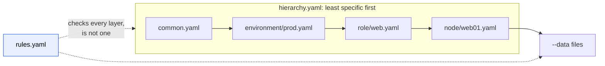
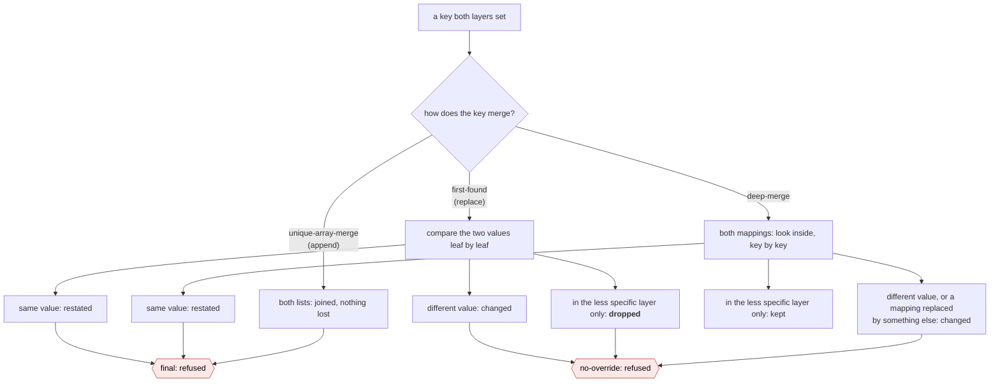

# Compile rules reference

Compile rules are policies over the layers of a hierarchy, checked before
anything is compiled. This page is the reference: the files, every rule, every
field and every message. For what the rules are for and how they were
designed, read [the concept page](../concepts/compile-rules.md).

Every example on this page is in
[`examples/compile-rules/`](../../examples/compile-rules/README.md), and a
test runs it through the real command.

## Contents

- [The files](#the-files)
- [The hierarchy file](#the-hierarchy-file)
- [The rules file](#the-rules-file)
- [Groups](#groups) and their [capabilities](#capabilities)
- [Key patterns](#key-patterns)
- [Shipped rule sets](#shipped-rule-sets)
- [Rules](#rules): [`no-override`](#no-override), [`final`](#final),
  [`restrict`](#restrict), [`required`](#required),
  [`forbidden-value`](#forbidden-value), [`merge-strategy`](#merge-strategy)
- [How a rule reads a merge](#how-a-rule-reads-a-merge)
- [The command line as a layer](#the-command-line-as-a-layer)
- [Running the check](#running-the-check)
- [Refusals](#refusals)
- [Mistakes in the rules file](#mistakes-in-the-rules-file)
- [Protecting the rules file](#protecting-the-rules-file)
- [From DscPipelineRunner](#from-dscpipelinerunner)
- [Using the rules from Rust](#using-the-rules-from-rust)

## The files

```
config/
├── hierarchy.yaml        the layers, and how each key merges
├── rules.yaml            the compile rules: its own file, never a layer
├── common.yaml           organization
├── environment/
│   └── prod.yaml         environment
├── role/
│   └── web.yaml          team
└── node/
    └── web01.yaml        team
```

`rules.yaml` is found because it is beside `hierarchy.yaml`. It is not listed
in the hierarchy and must not be: a hierarchy with a layer path that resolves
to the rules file is refused.



## The hierarchy file

The hierarchy file is what the rules are checked against, so its fields are
listed here.

```yaml
hierarchy:
  - common.yaml
  - environment/%{env}.yaml
  - role/%{role}.yaml
  - node/%{node}.yaml

default:
  strategy: deep-merge

keys:
  packages:
    strategy: unique-array-merge

strictness: lenient
```

| Field | Value |
|---|---|
| `hierarchy` | the layer files, **least specific first**, relative to the hierarchy file. A later layer is more specific and wins a merge. `%{name}` is replaced by the variable `name`, given with `--set name=value` on `meridian rules check` |
| `default.strategy` | how a top-level key merges when `keys` does not say: `first-found` (the default), `deep-merge` or `unique-array-merge` |
| `keys.<key>.strategy` | the strategy for one top-level key |
| `keys.<key>.dedupKey` | for `unique-array-merge`: the field that identifies an item that is a mapping |
| `strictness` | `lenient` (the default): a layer file that does not exist is skipped. `strict`: it is an error |

| Strategy | What the more specific layer's value does |
|---|---|
| `first-found` | replaces the less specific layer's value for that top-level key, whole |
| `deep-merge` | mappings merge key by key at every depth; anything else is replaced |
| `unique-array-merge` | lists are joined and repeated items removed |

## The rules file

```yaml
rulesVersion: 1
default: deny

layers:
  - name: organization
    paths: [common.yaml]
    capabilities:
      keys: ["**"]
  - name: environment
    paths: ["environment/*"]
    capabilities:
      keys: [variables, registry]
  - name: team
    paths: ["role/**", "node/**"]
    capabilities:
      keys: [variables, packages, web]

use:
  - protect-variables
  - protect-secrets
  - no-placeholder-secrets

rules:
  - id: region-is-final
    rule: final
    keys: [variables.Region]
```

| Field | Required | Value |
|---|---|---|
| `rulesVersion` | yes | `1` |
| `default` | no | `allow` or `deny`: what a group may do with a [capability](#capabilities) it does not list. Left out: `allow`. Use `deny` |
| `layers` | no | the [groups](#groups): who owns which layer, and what each may set |
| `use` | no | the [shipped rule sets](#shipped-rule-sets) in force. Left out: the three default ones. `use: []`: none |
| `rules` | no | your own [rules](#rules) |

**A rules file is a deny list by default.** Everything is allowed except what it
forbids, and even an otherwise empty file forbids three things through the
[default rule sets](#shipped-rule-sets):

- changing a variable a less specific layer set;
- changing a secret or a credential a less specific layer set;
- a secret or a credential that is empty or a placeholder.

So `rulesVersion: 1` alone is a working policy. The file then has two parts:
**groups with capabilities** say what each layer may set at all (with
`default: deny`, an allow list), and **rules** say what a layer may do to a
value another layer set.

| You want | Write |
|---|---|
| the default deny list | nothing: leave `use` out |
| the default deny list and rules of your own | `rules:`, and leave `use` out |
| to choose the shipped sets yourself | `use: [protect-secrets]`: exactly the sets listed are in force |
| no shipped set at all | `use: []` |
| an allow list: a layer may set only what its group lists | `default: deny`, and `capabilities` on each group |

With no rules file at all, nothing is checked; `--require-rules` makes that
an error.

Every rule has these fields, and then its own:

| Field | Required | Value |
|---|---|---|
| `id` | yes | a name for the rule, unique in the file. It opens every refusal the rule produces. Ids that start `meridian/` belong to the shipped rules |
| `rule` | yes | the kind of rule: `no-override`, `final`, `restrict`, `required`, `forbidden-value` or `merge-strategy` |
| `keys` | yes | the [key patterns](#key-patterns) the rule is about |
| `message` | no | your own words, added to every refusal the rule produces: who to ask, where the policy is written down |

The file is read strictly. An unknown field, a field the rule kind does not
take, or an undeclared group is an error, because a rule that silently does
nothing is worse than none. See
[mistakes in the rules file](#mistakes-in-the-rules-file).

## Groups

```yaml
default: deny
layers:
  - name: organization
    paths: [common.yaml]
    capabilities:
      keys: ["**"]
  - name: team
    paths: ["role/**", "node/**"]
    capabilities:
      keys: [variables, packages, web]
```

A group is a named set of layers. It says what those layers may set, and
rules use group names to say whose values are protected and who is
constrained.

| Field | Value |
|---|---|
| `name` | the group's name, unique. Names in brackets are Meridian's own |
| `paths` | patterns matched against a layer's path as the hierarchy expands it, such as `node/web01.yaml` |
| `capabilities` | what the group's layers may use; see [capabilities](#capabilities) |

In a path pattern, `*` and `?` match within one path element, and `**` as a
whole element matches any number of elements, including none. Matching is
exact about case.

| Pattern | Matches | Does not match |
|---|---|---|
| `common.yaml` | `common.yaml` | `x/common.yaml` |
| `node/*` | `node/web01.yaml` | `node/eu/web01.yaml` |
| `node/**` | `node/web01.yaml`, `node/eu/web01.yaml` | `role/web.yaml` |
| `**/*.yaml` | every `.yaml` layer at any depth | `common.json` |

**The first group whose pattern matches owns the layer.** Put a narrower group
before a broader one.

**A layer no group claims may set nothing.** When the file declares groups,
every layer the hierarchy loads must belong to one. Otherwise a new path added
to the hierarchy would be a layer no rule that names a group applies to:

```
[meridian/unclaimed-layer] layer "extra.yaml" is not claimed by any group under `layers`; a layer nobody owns may set nothing
```

Two group names are Meridian's own and can be used in a rule without being
declared: `(command line)`, for [values given on the command
line](#the-command-line-as-a-layer), and `(unclaimed)`.

Groups are optional. A rules file without `layers` can still use every rule
that does not name a group, and its refusals name layers by path alone.

### Capabilities

A group's capabilities are what its layers are allowed to use. This is
DscPipelineRunner's `Policy.yml` in Meridian: each layer lists what it may do,
and `default` decides everything it does not list.

| Capability | Value | Governs |
|---|---|---|
| `keys` | a list of [key patterns](#key-patterns) | the keys a layer of the group may set. An empty list allows none |

| `default` | A group that lists `capabilities.keys` | A group that does not |
|---|---|---|
| `deny` | may set only those keys | may set nothing |
| `allow` (or left out) | may set only those keys | may set anything |

```
[meridian/capabilities] layer "node/rogue.yaml" (team) sets "secrets.database.path", which team is not allowed to set: it may set only variables, packages, web
[meridian/capabilities] layer "Projects/x.yaml" (teams) sets "b", which teams is not allowed to set: it lists no `capabilities.keys`, and the default is deny
```

- **Each layer is held to its own group.** A value several layers contribute
  to must be allowed for each, so a team setting a key under an
  organization-owned mapping is judged as the team.
- **Writing above an allowed key is not writing the allowed key.** A group
  that may set `variables.Owner` may not write `variables: null`.
- **A layer no group claims may set nothing, whatever `default` says.**
- **`default: deny` needs groups.** With none, no layer could set anything,
  so the file is refused.
- Capabilities are checked and reported before rules. Permission to set a key
  does not excuse breaking a rule: a team that may set `variables` still may
  not change the organization's under `protect-variables`.
- Command-line values belong to whoever runs the command, not a group, so
  capabilities do not apply. Every rule still does; see [the command line as a layer](#the-command-line-as-a-layer).

`keys` is the capability there is today, because data is what is layered
today. Which targets a layer's documents may compile for is the same idea,
and belongs here once documents can be layered.

## Key patterns

A key pattern selects values inside a layer by their path, written with dots.

| Pattern | Selects |
|---|---|
| `variables` | the key `variables` **and everything beneath it** |
| `variables.**` | the same |
| `variables.Region` | that one key, and everything beneath it if it is a mapping |
| `*.password` | `password` directly beneath any top-level key |
| `**.password` | `password` at any depth, including the top |
| `secrets.*.path` | `path` of every entry under `secrets` |
| `**` | everything |

- `*` is any one key. `**` is any run of keys, including none.
- A pattern selects the key it names and everything beneath it. A rule that
  protects a mapping protects what is in it.
- Keys are compared exactly, including case: `variables.Region` does not
  select `variables.region`. They are two different keys in the data too.
- A key that contains a dot, a star or a quote is written in double quotes:
  `variables."app.kubernetes.io/name"`. In YAML that means quoting the whole
  pattern with single quotes: `'variables."a.b"'`.
- A list is one value. A pattern selects the list by its key, and a rule that
  looks at values ([`forbidden-value`](#forbidden-value)) looks at each item.

Refusals write keys the same way, so a key from a refusal can be pasted into
a rule.

## Shipped rule sets

| Name | On by default | Rule id in a refusal | Says |
|---|---|---|---|
| `protect-variables` | yes | `meridian/protect-variables` | a more specific layer may not change anything under `variables` that a less specific layer set |
| `protect-secrets` | yes | `meridian/protect-secrets` | the same for everything under `secrets` and under `credentials` |
| `no-placeholder-secrets` | yes | `meridian/no-placeholder-secrets` | nothing under `secrets` or `credentials` may be empty or a placeholder |
| `protect-all` | no | `meridian/protect-all` | a more specific layer may not change any key a less specific layer set |

**The three default sets are in force in every rules file that leaves `use`
out.** Writing `use` replaces them: exactly the sets it lists are in force,
and `use: []` switches all of them off. A file's own `rules` and its
`capabilities` do not affect which sets are on.

```yaml
use: [protect-variables, protect-secrets, no-placeholder-secrets]   # the same as leaving `use` out
```

`protect-variables`, `protect-secrets` and `protect-all` are
[`no-override`](#no-override) rules over every layer. A layer may add a
variable or a secret nobody has set, and may repeat one unchanged, and may
not change or remove one a less specific layer set. To protect only what one
group set, or to constrain only some groups, switch the set off and write the
rule yourself with [`setBy` and `appliesTo`](#no-override).

`no-placeholder-secrets` is a [`forbidden-value`](#forbidden-value) rule over
every layer. It refuses, anywhere under `secrets` or `credentials`:

| Value | Examples |
|---|---|
| nothing | `null`, `~`, `""` |
| a placeholder, in any case | `changeme`, `change-me`, `change_me`, `replaceme`, `replace-me`, `replace_me`, `placeholder`, `todo`, `tbd`, `fixme` |
| a run of x | `xxx`, `XXXXXXXX` |
| anything in angle brackets | `<your token here>` |

```
[meridian/no-placeholder-secrets] layer "node/web01.yaml" (team) sets "secrets.api.token" to a value the rule forbids (matches[0])
```

The whole value has to be the placeholder: `todo-list-service` is fine. To
forbid other values, add a `forbidden-value` rule of your own beside it.

## Rules

### `no-override`

A more specific layer may not change a value a less specific layer set.

```yaml
- id: org-values-hold
  rule: no-override
  keys: [variables, secrets]
  setBy: [organization]
  appliesTo: [team]
```

| Field | Value |
|---|---|
| `setBy` | the groups whose values are protected. Left out: every layer's |
| `appliesTo` | the groups that are constrained. Left out: every layer |

What counts, for a selected value a less specific layer set:

| The more specific layer | Result |
|---|---|
| sets a different value | refused |
| sets a value of another type (`5432` and `"5432"`) | refused |
| replaces a mapping above it with a scalar, `null` or a list | refused, once for each value beneath |
| sets a sibling under a key that merges by replacing it whole, leaving the value out | refused: the value is dropped |
| replaces a list with another list, under `deep-merge` or `first-found` | refused |
| sets the same value again | allowed |
| adds a key nobody set | allowed |
| adds items to a list that merges with `unique-array-merge` | allowed: nothing is lost |

```
[org-values-hold] layer "node/web01.yaml" (team) changes "variables.Region", which layer "common.yaml" (organization) set
[org-values-hold] layer "node/web01.yaml" (team) sets "variables", replacing "variables.Region", which layer "common.yaml" (organization) set
[org-values-hold] layer "node/web01.yaml" (team) sets "variables", which is merged by replacing it whole (first-found), and so drops "variables.Region", which layer "common.yaml" (organization) set
```

When several less specific layers set the value, the refusal names the least
specific one: that is whose value the rule protects.

### `final`

Once a layer sets the key, no more specific layer may set it at all, not even
to the same value. Takes `setBy` and `appliesTo` as `no-override` does.

```yaml
- id: region-is-final
  rule: final
  keys: [variables.Region]
```

```
[region-is-final] layer "node/web01.yaml" (team) sets "variables.Region", which is final once set, and layer "common.yaml" (organization) set it
```

`final` does not say which layer sets the key first. Whichever does, that is
the last word. Use it where a second copy would be a copy that can go stale,
and use `no-override` where repeating a value is harmless. A final list cannot
be added to either, whatever its merge strategy.

### `restrict`

Only the named groups may set the key.

```yaml
- id: secrets-belong-to-the-organization
  rule: restrict
  keys: [secrets, credentials]
  allow: [organization]
```

| Field | Value |
|---|---|
| `allow` | required: the groups that may set the keys. An empty list means no layer may |

```
[secrets-belong-to-the-organization] layer "node/web01.yaml" (team) sets "secrets.mine.from", which only organization may set
[no-debug] layer "common.yaml" (organization) sets "debug", which no layer may set
```

A layer that may not set a restricted key also may not replace it from above.
With `keys: [secrets.db.password]`, a team layer that writes `secrets: null`
never names the key, and is refused all the same when an allowed layer set
it:

```
[s] layer "node/x.yaml" (team) sets "secrets", replacing "secrets.db.password.from", which layer "common.yaml" (organization) set and only organization may set
```

`restrict` is about who may write a key. It does not stop an allowed group's
more specific layer from changing an allowed group's less specific value; that
is [`no-override`](#no-override).

### `required`

The key must be set. `keys` are exact here: no wildcards.

```yaml
# In the merged result: from whichever layer.
- id: cost-centre-is-set
  rule: required
  keys: [variables.CostCentre]

# In every layer of a group.
- id: team-layers-name-an-owner
  rule: required
  keys: [variables.Owner]
  appliesTo: [team]
```

| Field | Value |
|---|---|
| `appliesTo` | left out: the key must be set in the merged result. Given: every layer of these groups must set it itself |

A key that is `null` is not set.

```
[cost-centre-is-set] no layer sets "variables.CostCentre", which must be set
[team-layers-name-an-owner] layer "node/web01.yaml" (team) does not set "variables.Owner", which every layer of team must set
```

The first form checks the merged result, so a value the merge discards does
not count. A missing layer file is not a layer, so the second form ignores it;
use both when the value must exist regardless.

### `forbidden-value`

The key may not hold one of these values.

```yaml
- id: no-floating-tags
  rule: forbidden-value
  keys: ["**.image"]
  values: [latest]
  matches: ["*:latest"]
  ignoreCase: true
```

| Field | Value |
|---|---|
| `values` | scalars compared exactly, type included: `"0"` does not forbid `0` |
| `matches` | patterns over the value as text, where `*` is any run of characters and `?` any one. A number or a boolean is matched as it is written; `null` matches nothing |
| `ignoreCase` | `true`: compare text without regard to case. Default `false` |
| `appliesTo` | the groups that are checked. Left out: every layer |

At least one of `values` and `matches` is needed. Items of a list are checked
one by one, and the refusal says which:

```
[no-floating-tags] layer "node/web01.yaml" (team) sets "app.sidecars[0].image" to a value the rule forbids (matches[0])
```

The refusal names the entry of the rule that matched, by its position, and
not the value that was found.

### `merge-strategy`

The key may only be merged with one of these strategies. `keys` are exact
top-level keys, because that is what a strategy belongs to.

```yaml
- id: variables-merge-deep
  rule: merge-strategy
  keys: [variables]
  allow: [deep-merge]
```

```
[variables-merge-deep] "variables" is merged with first-found, and may only be merged with deep-merge
```

This is a rule about the hierarchy file and not about a layer, so it names no
layer. It is how a policy can insist on the merge direction it was written
for: under `first-found`, a layer that sets one variable replaces all of
them.

## How a rule reads a merge

`no-override` and `final` ask what a more specific layer's value does to a
less specific layer's, and the answer depends on the key's strategy.



`final` refuses everything `no-override` refuses as well.

## The command line as a layer

A `--data` file is merged over the hierarchy and wins, so it is checked as
the most specific layer. Each file is a layer of its own, named
`--data <file>`, in the group `(command line)`, whatever the file is called.
A command-line value replaces the top-level key it names whole, so it is
judged the way `first-found` is.

```
[meridian/protect-variables] layer "--data override.yaml" ((command line)) changes "variables.OrganizationName", which layer "common.yaml" (organization) set
```

To let the command line set a restricted key, name the group:
`allow: [organization, "(command line)"]`.

## Running the check

```
meridian rules check --hierarchy FILE [--rules FILE] [--require-rules]
                     [--data FILE]... [--set KEY=VALUE]...
```

| Option | Meaning |
|---|---|
| `--hierarchy FILE` | the hierarchy file. Layers are found relative to it |
| `--rules FILE` | the rules file. Default: `rules.yaml` beside the hierarchy file, when there is one |
| `--require-rules` | fail when there is no rules file |
| `--data FILE` | a YAML or JSON file of values, as on `compile`: merged over the hierarchy, each key it names replacing that key whole, and checked as a layer named `--data FILE` in the group `(command line)`; may be repeated |
| `--set KEY=VALUE` | one value, as on `compile`: applied after every `--data` file, `KEY` may be dotted to set one key inside a mapping and keep the keys beside it, and the value is typed as YAML types it. All of them are checked together as one last layer named `--set`, in the group `(command line)`. A layer path's `%{KEY}` reads the same value; may be repeated |

It loads the layers one node would get, checks every rule, and compiles
nothing. Run it once for each node, or each combination of variables, that
your pipeline compiles:

```
$ meridian rules check --hierarchy config/hierarchy.yaml --set env=prod --set role=web --set node=web01
rules: config/rules.yaml (9 rules)
layers, least specific first:
  common.yaml            organization
  environment/prod.yaml  environment
  role/web.yaml          team
  node/web01.yaml        team
  --set                  (command line)
no violations
```

The list shows which group owns each layer, which is the first thing to look
at when a rule does not apply where you expected. The `--set` row is there
because `--set` means here what it means on `compile`: `env`, `role` and
`node` pick the layer files and are also values in the merged data, set last.
A rule holds them like any other layer, so a `--set` that changes a protected
value is refused:

```
$ meridian rules check --hierarchy config/hierarchy.yaml --set env=prod --set role=web --set node=web01 --set variables.Region=us
error: compile rules: 2 violations; nothing was compiled
  - [meridian/protect-variables] layer "--set" ((command line)) changes "variables.Region", which layer "common.yaml" (organization) set
  - [region-is-final] layer "--set" ((command line)) sets "variables.Region", which is final once set, and layer "common.yaml" (organization) set it
```

`--set` names one key and keeps the keys beside it, so it drops nothing; a
`--data` file replaces each key it names whole, so one that sets `variables`
also drops every variable it leaves out.
[`capabilities`](#capabilities) do not apply to either.

| Exit status | Meaning |
|---|---|
| `0` | every rule holds, or there is no rules file and none was required |
| `1` | a rule is broken, or the hierarchy, a layer or the rules file is wrong |
| `2` | a mistake in the command line (a `--set` without `=` is reported with status `1`, as on `compile`) |

`compile`, `plan` and `apply` do not read a hierarchy yet, so they do not run
the rules by themselves; run `rules check` before them in a pipeline. See
[how this fits the rest of the language](../concepts/compile-rules.md#how-this-fits-the-rest-of-the-language).

## Refusals

```
$ meridian rules check --hierarchy config/hierarchy.yaml --set env=prod --set role=web --set node=rogue
error: compile rules: 10 violations; nothing was compiled
  - [meridian/capabilities] layer "node/rogue.yaml" (team) sets "credentials", which team is not allowed to set: it may set only variables, packages, web
  - [meridian/capabilities] layer "node/rogue.yaml" (team) sets "secrets.database.path", which team is not allowed to set: it may set only variables, packages, web
  - [meridian/protect-variables] layer "node/rogue.yaml" (team) changes "variables.OrganizationName", which layer "common.yaml" (organization) set
  - [meridian/protect-secrets] layer "node/rogue.yaml" (team) sets "credentials", replacing "credentials.deploy.type", which layer "common.yaml" (organization) set
  - [meridian/protect-secrets] layer "node/rogue.yaml" (team) sets "credentials", replacing "credentials.deploy.user", which layer "common.yaml" (organization) set
  - [meridian/protect-secrets] layer "node/rogue.yaml" (team) changes "secrets.database.path", which layer "common.yaml" (organization) set
  - [meridian/no-placeholder-secrets] layer "node/rogue.yaml" (team) sets "credentials" to a value the rule forbids (values[0])
  - [region-is-final] layer "node/rogue.yaml" (team) sets "variables.Region", which is final once set, and layer "common.yaml" (organization) set it
  - [team-layers-name-an-owner] layer "node/rogue.yaml" (team) does not set "variables.Owner", which every layer of team must set
  - [no-floating-tags] layer "node/rogue.yaml" (team) sets "web.image" to a value the rule forbids (matches[0])
```

Each line gives `[rule id]`, the layer and its group, the key, and the
violation, then the rule's own `message` if it has one.

- **Every violation is listed**, not only the first.
- **The order is fixed**: rules in file order (shipped sets first), then
  layers least to most specific, then keys. The same files always print the
  same text.
- **No value is ever printed**, neither the new one nor the one it replaced.
- **Nothing is handed over.** A hierarchy that breaks a rule produces no
  merged data.

## Mistakes in the rules file

These are errors in the file itself, reported before any layer is looked at.

| Message | Cause |
|---|---|
| `rulesVersion: required (write `rulesVersion: 1`)` | the file has no version |
| `rulesVersion: this Meridian reads version 1, found 2` | a file for a newer Meridian |
| `rules file: unknown field "ruls"` | a misspelt top-level field |
| `use[0]: there is no shipped rule set "..."` | a misspelt name under `use` |
| `layers[1].name: the group "a" is declared twice` | two groups with one name |
| `layers[0].paths: the group "a" claims no layers` | a group without `paths` |
| `layers[0].capabilities: unknown field "targets"` | a capability that does not exist |
| `default: expected "allow" or "deny", found "Deny"` | the value is lower case |
| `default: deny needs groups under `layers`: ...` | `default: deny` in a file that declares no groups |
| `rules[0].id: required`, `rules[1].id: the id "a" is used twice` | every rule needs its own id |
| `rules[0].rule: unknown rule "locked"` | not one of the six kinds |
| `rules[0]: a final rule does not take the field "allow"` | a field that belongs to another kind of rule |
| `rules[0].appliesTo: there is no group "team" under `layers`` | a rule names a group the file does not declare |
| `rules[0].keys: the key pattern "a..b" has an empty segment` | a malformed [key pattern](#key-patterns) |
| `rules[0].keys: a required rule names exact keys, and a.* has a wildcard` | `required` and `merge-strategy` take exact keys |
| `rule "m": allow: unknown merge strategy "deep"` | a `merge-strategy` rule names a strategy the hierarchy does not have |
| `the rules file ... is also the hierarchy layer "rules.yaml"` | the hierarchy lists the rules file as a layer |
| `compile rules are required for this run, and there is no rules.yaml ...` | `--require-rules` was given and there is no rules file |

## Protecting the rules file

`rules.yaml` is in the configuration repository, so whoever can change it
decides what every layer may do.

- Give `rules.yaml` and `hierarchy.yaml` to your most trusted owners, with
  CODEOWNERS and branch protection.
- Pass `--require-rules` in the pipeline, so deleting the file is an error,
  not a way to switch the rules off.
- For more, keep the rules where contributors cannot write and pass
  `--rules FILE`, which replaces the repository's file.
- Give every folder of layers to a group. A layer outside every group is
  refused, so a new folder cannot appear outside the policy.

## From DscPipelineRunner

DscPipelineRunner's
[`Policy.yml`](https://github.com/ZanattaMichael/Dsc.PipelineRunner/blob/main/Example%20Policy%20Configuration/Policy.yml)
says what each layer of a configuration may use. It sits beside `Datum.yml`,
outside the hierarchy, so no layer can add to it or override it. `rules.yaml`
is the same file for Meridian, and reads the same way:

<table>
<tr><th>DscPipelineRunner <code>Policy.yml</code></th><th>Meridian <code>rules.yaml</code></th></tr>
<tr><td>

```yaml
PolicyVersion: 1
Default: Deny
Layers:
  - Name: Platform
    Paths:
      - Datum.yml
      - Platform/**
      - Composites/**
    Capabilities:
      Targets: [ '*' ]
      Engines: [ '*' ]
      ExecutionScripts: true
      DatumScriptBlocks: true
  - Name: Teams
    Paths:
      - Projects/**
    Capabilities:
      Targets: [ Local, WinRM ]
      Engines: [ DscV2, DscV3 ]
```

</td><td>

```yaml
rulesVersion: 1
default: deny
layers:
  - name: platform
    paths:
      - "Platform/**"
    capabilities:
      keys: ["**"]


  - name: teams
    paths:
      - "Projects/**"
    capabilities:
      keys: [variables, packages]


```

</td></tr>
</table>

| `Policy.yml` | `rules.yaml` | Same? |
|---|---|---|
| A file of its own beside `Datum.yml`, never merged | a file of its own beside `hierarchy.yaml`, never merged; a hierarchy that lists it as a layer is refused | yes |
| `PolicyVersion: 1` | `rulesVersion: 1` | yes |
| `Default: Deny` or `Allow`, for a capability a layer does not list | `default: deny` or `allow` | yes, written in lower case. Left out, it is `allow`: a rules file is a deny list unless it says `default: deny` |
| `Layers`, ordered; the first whose `Paths` match a file owns it | `layers`, ordered; the first whose `paths` match owns the layer | yes |
| `Paths` have no file extension, are not case-sensitive, and `*` crosses folders | `paths` include the extension, are case-sensitive, and only `**` crosses folders | no: write `Projects/**`, or `Projects/*.yaml` |
| A file no layer claims may do nothing, whatever `Default` says | the same | yes |
| A layer is decided by where a file is, never by what it says | the same | yes |
| Something several layers contributed to is allowed only what every one of them is allowed | each layer is held to its own group for every key it sets | yes |
| `Capabilities`: `Targets`, `Engines`, `ExecutionScripts`, `DatumScriptBlocks` | `capabilities`: `keys` | the capabilities differ; see below |
| Read strictly: an unknown key is an error | the same | yes |
| Every violation is listed and nothing runs | every violation is listed and nothing is compiled | yes |
| `-PolicyPath`, `-RequirePolicy` | `--rules`, `--require-rules` | yes |
| `<node>.provenance.json` lists each layer and its owner | `meridian rules check` prints each layer and its group | printed, not written to a file |

**What differs, and why.** `Policy.yml` governs what a layer's *resources* may
use (Target, engine, scripts), because a DscPipelineRunner layer holds
resources. A Meridian hierarchy layer holds *data*; documents (with the target
and resources) are not layered, so the capability to govern is which keys a
layer may set. Per-layer targets and engines will join `keys` under
`capabilities` once documents can be layered.

`Policy.yml` does not stop a team's file from changing a variable the
platform set: DscPipelineRunner merges `variables` deeply and the most
specific file wins. In Meridian that is a rule, `protect-variables`, and it
is in force in the file above because it is one of the
[default sets](#shipped-rule-sets).

The hierarchy file for the same configuration:

| DscPipelineRunner `Datum.yml` | Meridian `hierarchy.yaml` |
|---|---|
| `ResolutionPrecedence`, most specific first | `hierarchy`, **least** specific first: reverse the list |
| `Projects\$($Node.Project)` | `Projects/%{Project}.yaml`, with `--set Project=...` |
| `lookup_options: variables: merge_hash_array: deep` | `keys: variables: strategy: deep-merge` |
| `lookup_options: resources: merge_hash_array: UniqueKeyValTuples`, `tuple_keys: [name]` | `keys: resources: strategy: unique-array-merge`, `dedupKey: name`. The first layer to declare a name keeps its entry; entries are not merged |

## Using the rules from Rust

The crate is `meridian-rules`. A compiler makes one call:

```rust
let loaded = meridian_rules::enforce(&rules, &hierarchy, &scope, &loader, &command_line)?;
// loaded.resolved.data is the merged data. It exists only if every rule held.
```

| Item | Use |
|---|---|
| `Rules::parse(name, bytes)` | read a rules file |
| `enforce(rules, hierarchy, scope, loader, command_line)` | load, merge, check; `Ok(Loaded)` or `Err(Refusal)` |
| `check_files(files, scope, command_line)` | the same from paths on disk, finding `rules.yaml` and refusing a rules file that is a layer |
| `evaluate(rules, stack)` | check rules over any `Stack`: layers, a `MergePlan` and the merged result |
| `MergePlan` | how a stack merges: `kind(path)` gives `Replace`, `Deep` or `Append`. Implemented for `meridian_resolve::Hierarchy`; implement it to check another way of layering with the same rules |
| `Violation` | `rule`, `check`, `layer`, `group`, `key` and `text`, for a caller that reports in its own format |

`evaluate` is not tied to data files. Anything that can be presented as an
ordered stack of layers of keyed values can be checked by the same rules.
