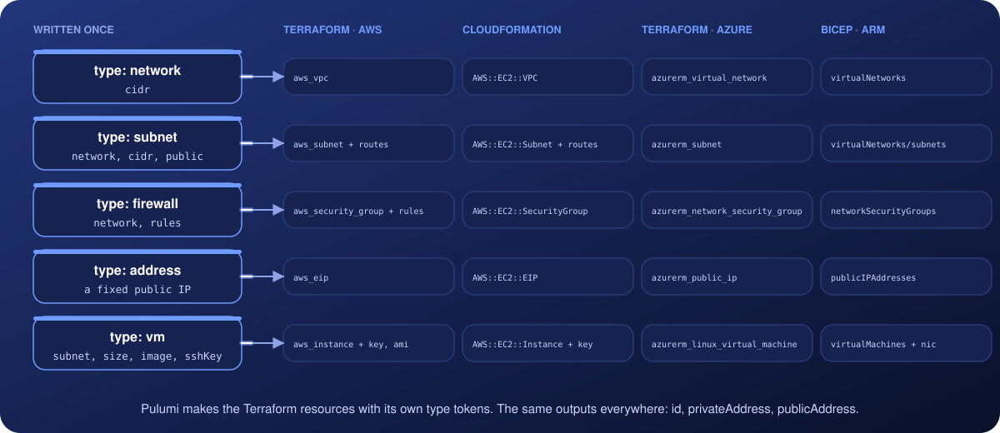

# The common infrastructure types

Five resource types, `network`, `subnet`, `firewall`, `address` and `vm`, compile to each
cloud's own resources on the targets below.

| Type | What it is |
|---|---|
| [`network`](#network) | a private network with its own address range |
| [`subnet`](#subnet) | a range of addresses inside a network, where machines are placed |
| [`firewall`](#firewall) | which traffic may reach, or leave, the machines it is attached to |
| [`address`](#address) | a fixed public IP address |
| [`vm`](#vm) | a virtual machine in a subnet, from an image, of a size, reachable with a key |

The vocabulary is defined once, in the SDK. A param outside it is refused. What a cloud
cannot express is refused at compile time with what to write instead. The
[infra conformance matrix](../infra-conformance-matrix.md) is generated from what the
targets do.

<p align="center"></p>

## Where they compile

| Target | Clouds | How the cloud is chosen |
|---|---|---|
| `terraform` | AWS (`aws` provider), Azure (`azurerm` provider) | `spec.settings.cloud`, or the one cloud whose provider the document configures |
| `opentofu` | AWS, Azure | the same as `terraform`: the two read the same providers, and compile a common resource to the same blocks |
| `cloudformation` | AWS | always AWS, in the stack's region |
| `bicep` | Azure | always Azure |
| `arm` | Azure | always Azure: the same resources as Bicep, written as an ARM template |

Other targets refuse them as `unsupported-resource-type`. Pulumi and GCP are next
(issue 151).

ARM writes the same resources as the Bicep column below, except the API version is
`apiVersion` and a subnet is named `<network>/<subnet>` instead of taking a `parent`.

## Beside the tool's own types

A document can mix them with the tool's own types (a `vm` next to an `aws_s3_bucket`).
It then compiles for that one tool.

`${net}` and `dependsOn: [{resource: net}]` work on every target. A read of an attribute
not listed under [outputs](#outputs-every-target-promises), such as `${vm.arn}`, is passed
to the tool as written and works only on the cloud that has it.

## A first document

```yaml
apiVersion: meridian/v1
kind: Infrastructure
metadata:
  name: web-aws
spec:
  target: terraform
  settings:
    cloud: aws
  resources:
    - id: aws
      type: provider
      params: {source: hashicorp/aws, version: "~> 5.0", region: eu-west-1}
    - id: net
      type: network
      params: {cidr: 10.0.0.0/16}
    - id: web
      type: subnet
      params: {network: "${net}", cidr: 10.0.1.0/24, public: true}
    - id: web_fw
      type: firewall
      params:
        network: ${net}
        rules:
          - {port: "22", cidr: 203.0.113.0/24}
          - {port: "80", cidr: 0.0.0.0/0}
    - id: web_ip
      type: address
    - id: vm
      type: vm
      params:
        subnet: ${web}
        firewalls: ["${web_fw}"]
        address: ${web_ip}
        size: {cpus: 2, memoryGb: 4}
        image: {family: ubuntu, version: "24.04"}
        sshKey: ssh-rsa AAAA... admin@example.com
  outputs:
    - name: address
      value: ${vm.publicAddress}
```

Full documents:
[`web-aws.yaml`](../../../examples/common/web-aws.yaml),
[`web-azure.yaml`](../../../examples/common/web-azure.yaml),
[`web-bicep.yaml`](../../../examples/common/web-bicep.yaml),
[`web-arm.yaml`](../../../examples/common/web-arm.yaml) and
[`web-cloudformation.yaml`](../../../examples/common/web-cloudformation.yaml). They differ
in settings, provider, stack and deployment, and AWS's public subnet
(see [`subnet`](#subnet)).

## State

Left out, or `present`. `state: absent` is refused: the tools remove what the document
no longer declares.

## Outputs every target promises

Read as `${id.output}`; each target rewrites it to the tool's expression. A
`ResourceSet` can take its `targetHost` from a `vm` on any cloud.

| Type | Reads |
|---|---|
| `network`, `subnet`, `firewall` | `id`: the cloud's own id |
| `address` | `id`; `address`: the IP address |
| `vm` | `id`; `privateAddress`: the address inside the network; `publicAddress`: the machine's address from the internet |

`publicAddress` is the attached `address`. On AWS a vm in a public subnet has one
without it. On Azure, reading `publicAddress` of a vm with no `address` is refused as
`invalid-reference`.

## `network`

| Param | Kind | |
|---|---|---|
| `cidr` | text, required | the address range, such as `10.0.0.0/16` |
| `name` | text | the name in the cloud; the id unless given |
| `location` | text | an Azure location. Refused on AWS, where the provider's or the stack's region decides |
| `tags` | mapping of text | labels on the resource |

| Terraform, AWS | CloudFormation | Terraform, Azure | Bicep |
|---|---|---|---|
| `aws_vpc` with DNS host names on | `AWS::EC2::VPC` with DNS host names on | `azurerm_virtual_network` | `Microsoft.Network/virtualNetworks` |

## `subnet`

| Param | Kind | |
|---|---|---|
| `network` | reference, required | the network it is in: `${net}` |
| `cidr` | text, required | its range, inside the network's |
| `public` | true or false | whether machines in it get a public address and a route to the internet; off unless given |
| `location` | text | on AWS, the availability zone |
| `name`, `tags` | | as on `network` |

| Terraform, AWS | CloudFormation | Terraform, Azure | Bicep |
|---|---|---|---|
| `aws_subnet`. With `public: true`, also one `aws_internet_gateway` per network, and a route table with a route to it | `AWS::EC2::Subnet`. With `public: true`, also one `AWS::EC2::InternetGateway` per network and its attachment, and a route table with a route to it, ordered after the attachment | `azurerm_subnet` | `Microsoft.Network/virtualNetworks/subnets`, with the network as its `parent` |

On Azure `public: true`, `location` and `tags` are refused as `unsupported-param`;
attach an `address` to the vm instead of `public`.

## `firewall`

| Param | Kind | |
|---|---|---|
| `network` | reference, required | the network the firewall belongs to |
| `rules` | list | the traffic allowed, one mapping per rule (below) |
| `name`, `location`, `tags` | | as on `network` |

Each rule:

| Key | |
|---|---|
| `cidr` | required: where the traffic comes from (`in`) or goes to (`out`); `0.0.0.0/0` for anywhere |
| `direction` | `in` (the default) or `out` |
| `protocol` | `tcp` (the default), `udp`, `icmp` or `any` |
| `port` | one port (`"80"`) or a range (`"8000-9000"`); every port when left out. An `icmp` rule takes none |

Other rule fields are refused. With no `out` rule, everything may go out.

| Terraform, AWS | CloudFormation | Terraform, Azure | Bicep |
|---|---|---|---|
| `aws_security_group`, with one `aws_vpc_security_group_ingress_rule` or `..._egress_rule` per rule. With no `out` rule, an egress rule that allows everything is added, because Terraform removes the one AWS gives a new group | `AWS::EC2::SecurityGroup`, with the rules inside it. With no `out` rule AWS keeps its allow-all rule; an `out` rule replaces it | `azurerm_network_security_group`, with one `azurerm_network_security_rule` per rule | `Microsoft.Network/networkSecurityGroups`, with the rules inside it |

On Azure, rules get priorities in document order from 100. Terraform places the
security group at the network's location, Bicep at the resource group's, unless the
firewall gives one.

## `address`

| Param | Kind | |
|---|---|---|
| `name`, `location`, `tags` | | as on `network` |

| Terraform, AWS | CloudFormation | Terraform, Azure | Bicep |
|---|---|---|---|
| `aws_eip` in the VPC domain | `AWS::EC2::EIP` in the VPC domain | `azurerm_public_ip`, Standard, static | `Microsoft.Network/publicIPAddresses`, Standard, static |

On AWS `name` is refused; the `Name` tag is the id unless `tags.Name` is given.

## `vm`

| Param | Kind | |
|---|---|---|
| `subnet` | reference, required | the subnet it is in |
| `size` | required | `{cpus, memoryGb}`, or the cloud's own size as text |
| `image` | required | `{family, version}`, or the cloud's own image as text |
| `sshKey` | text or secret | the public key that may log in. Required on Azure, where it must be an RSA (`ssh-rsa`) key, because Azure Linux VMs accept no other kind |
| `user` | text | the login the key is for. Azure only; `azureuser` unless given |
| `address` | reference | an `address` to attach |
| `firewalls` | list of references | the firewalls that apply. Azure takes one |
| `name`, `location`, `tags` | | as on `network` |

| Terraform, AWS | CloudFormation | Terraform, Azure | Bicep |
|---|---|---|---|
| `aws_instance`; an `aws_key_pair` for the key, a `data.aws_ami` lookup for an image by name, an `aws_eip_association` for an address | `AWS::EC2::Instance`; an `AWS::EC2::KeyPair` for the key, an `AWS::EC2::EIPAssociation` for an address | `azurerm_linux_virtual_machine`, an `azurerm_network_interface` (`<id>_nic`), and an association with the firewall | `Microsoft.Compute/virtualMachines` and a `Microsoft.Network/networkInterfaces` (`<id>_nic`) |

On AWS `user` is refused: the image decides it (`ubuntu`, `admin` on Debian). On Azure
`sshKey` is required (`missing-param`).

### Sizes

`{cpus, memoryGb}` becomes the smallest size below with at least that much; larger is
refused. Text, such as `t3.small`, is passed through.

| Processors | Memory (GB) | AWS | Azure |
|---|---|---|---|
| 2 | 0.5 | `t3.nano` | |
| 1 | 1 | | `Standard_B1s` |
| 2 | 1 | `t3.micro` | |
| 1 | 2 | | `Standard_B1ms` |
| 2 | 2 | `t3.small` | |
| 2 | 4 | `t3.medium` | `Standard_B2s` |
| 2 | 8 | `t3.large` | `Standard_B2ms` |
| 4 | 16 | `t3.xlarge` | `Standard_B4ms` |
| 8 | 32 | `t3.2xlarge` | `Standard_B8ms` |
| 16 | 64 | `m6i.4xlarge` | `Standard_D16s_v5` |
| 32 | 128 | `m6i.8xlarge` | `Standard_D32s_v5` |

### Images

`{family, version}` must be one of these. Quote the version (`"24.04"`).

| Family | Version | AWS | Azure |
|---|---|---|---|
| `ubuntu` | `"24.04"` | newest AMI owned by Canonical (`099720109477`) named `ubuntu/images/hvm-ssd-gp3/ubuntu-noble-24.04-amd64-server-*` | `Canonical` / `ubuntu-24_04-lts` / `server` |
| `ubuntu` | `"22.04"` | the same owner, `ubuntu/images/hvm-ssd/ubuntu-jammy-22.04-amd64-server-*` | `Canonical` / `0001-com-ubuntu-server-jammy` / `22_04-lts-gen2` |
| `debian` | `"12"` | newest AMI owned by Debian (`136693071363`) named `debian-12-amd64-*` | `Debian` / `debian-12` / `12-gen2` |
| `debian` | `"11"` | the same owner, `debian-11-amd64-*` | `Debian` / `debian-11` / `11-gen2` |

Terraform and OpenTofu look up the AMI in the publisher's own account. CloudFormation reads the
vendor's public SSM parameter as `{{resolve:ssm:...}}`:
`/aws/service/debian/release/<version>/latest/amd64` or
`/aws/service/canonical/ubuntu/server/<version>/stable/current/amd64/hvm/ebs-gp3/ami-id`
(`ebs-gp2` for 22.04). Other images are text: an AMI id or an Azure image id.

## What a common type adds

Some common resources become several tool resources. The main one keeps the id; the
others are named from it:

| Added | For |
|---|---|
| `<vm>_image`, `<vm>_key`, `<vm>_address` | AWS: the AMI lookup, the key pair, the address association |
| `<vm>_nic`, `<vm>_nic_firewall` | Azure: the network interface, and its firewall |
| `<net>_gateway`, `<net>_gateway_link` (CloudFormation), `<subnet>_routes`, `<subnet>_routes_internet`, `<subnet>_routes_link` | AWS: a public subnet's way out |
| `<fw>_in_<n>`, `<fw>_out_<n>`, `<fw>_out_all`, `<fw>_rule_<n>` | a firewall's rules |

A document that already uses one of these ids is refused as `duplicate-resource`.

## Settings

Terraform and OpenTofu read these [`spec.settings`](index.md#settings) keys:

| Key | |
|---|---|
| `cloud` | `aws` or `azure`. Needed only when the document configures both providers or neither |
| `location` | Azure: the location of every common resource that gives none |
| `resourceGroup` | Azure: the resource group every common resource is created in. Required on Azure |

`location` and `resourceGroup` are refused on a document with no common resources.
Bicep and ARM need no settings (the deployment's resource group and its location).
CloudFormation needs none (the stack's region; a subnet's `location` is its zone).

## Refusals

| Rule | When |
|---|---|
| `unsupported-param` | a param outside the vocabulary; or one this cloud cannot express (the message says why and what to write) |
| `missing-param` | a required param is not given; on Azure, a vm with no `sshKey`, or a resource with no location on Terraform |
| `invalid-param` | a param of the wrong kind, a reference param that is not one `${id}`, a size or image of the wrong shape, a firewall rule that breaks the rules above, a size bigger than the table |
| `invalid-reference` | a read of a promised output that this cloud cannot give, such as `publicAddress` of an Azure vm with no address |
| `unsupported-state` | any state but `present` |
| `missing-resource` | Terraform: the cloud cannot be told from the document; or Azure with no `resourceGroup` |
| `invalid-setting` | a setting with a value that is not one it takes |
| `duplicate-resource` | an id the document uses is one a common type adds |

## Why so few

Each of the five maps one-to-one on every target. Disks, object stores and DNS records
are next. See [decision 0040](../../decisions/0040-common-infrastructure-types-are-a-small-core-mapped-per-cloud.md).
