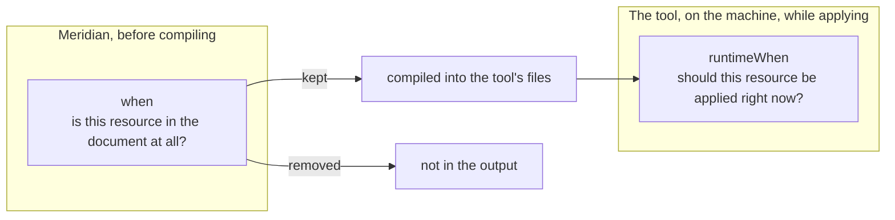
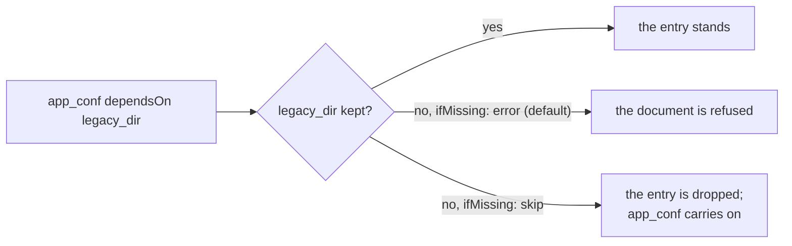

# Conditions: `when` and `runtimeWhen`

`when` is decided by Meridian before compiling. `runtimeWhen` is checked by the tool at
apply time.



| | `when` | `runtimeWhen` |
|---|---|---|
| Decided by | Meridian | the tool |
| Decided when | before anything is compiled | on the machine, at the moment the resource is applied |
| Written in | Meridian's [expression language](expressions.md) | the tool's own language |
| Effect when false | the resource is not in the compiled output | the resource is in the output; the tool skips it |
| Can read | the values given with `--data` and `--set`, and the document's [variables and named conditions](interpolation.md#variables) | whatever the tool can see on the machine |
| Can be written on | a resource, a document, an output, a `dependsOn` or `notifies` entry: [where a `when` can be written](#where-a-when-can-be-written) | a resource |
| Available | on every target | on the targets that can |

## `runtimeWhen`

```yaml
- id: apt_cache
  type: exec
  params:
    command: apt-get update
  runtimeWhen: "ansible_facts['os_family'] == 'Debian'"
```

Text in the tool's own language. Meridian copies it, unchecked, into the
tool's apply-time check. It is the one part of a shared-dialect document that
does not move between tools.

| Target | It becomes | Written in | Example |
|---|---|---|---|
| `ansible` | the task's `when:` | a Jinja2 expression over Ansible facts and variables | `"ansible_facts['os_family'] == 'Debian'"` |
| `salt` | a Jinja `if` around the state, evaluated when the minion renders the file | a Jinja expression over grains and pillar, written without `{{ }}` | `"grains['os_family'] == 'RedHat'"` |
| `chef` | an `only_if` guard | Ruby, with node attributes | `"node['platform_family'] == 'debian'"` |
| `dsc` | a `preCondition` | the DSC runner's function language | `"equals (nodeName) 'web'"` |

Every other target refuses it:

```
rw.yaml:8:7: puppet: resource "a" [unsupported-runtime-condition]: resource carries runtimeWhen "x", which this target cannot express: a Puppet catalog is compiled before it reaches the node, so there is no apply-time conditional to compile it into
```

| Target | Why not |
|---|---|
| `puppet`, `openvox` | a catalog is compiled before it reaches the node |
| `cloud-init` | it evaluates nothing per resource; the machine applies its user-data once |
| `terraform`, `opentofu`, `pulumi`, `cloudformation`, `bicep`, `arm` | there is no node; the tool talks to an API |
| `packer` | refused; a step's own `only` or `except` param does this job |
| `docker`, `kubernetes`, `helm` | nothing to check a condition against while a project or a set of objects is submitted |
| `podman` | refused; systemd's own `Condition*=` settings under `unit` do this job |

The [capability matrix](../capability-matrix.md) has the `runtimeWhen` column.

A plan shows the resource as the tool's dry run does. A notified resource's
`runtimeWhen` is not copied onto the reaction (an Ansible handler has no `when:`).

## `when`

```yaml
- id: debug_log
  type: file
  params: {path: /var/log/app/debug.log}
  when: "data.env != 'prod'"
```

Meridian decides `when` before compiling. A resource is either in the output
or not, so what you review is what runs. No target sees the condition, so it
works on every target.

### The condition language

An [expression](expressions.md) that gives `true` or `false`, reading `--data` and
`--set` values as `data.<key>`. Quote it in YAML.

| You write | Meaning |
|---|---|
| `data.env`, `data.region.name`, `data.ports[0]` | a value from the data: a key, keys inside mappings, an item of a list |
| `true`, `false`, `null`, `3`, `1.5`, `'prod'`, `[1, 2]`, `{a: 1}` | themselves |
| `a == b`, `a != b` | whether two values are the same. `3` and `3.0` are; `'3'` and `3` are not |
| `a < b`, `a <= b`, `a > b`, `a >= b` | order, between two numbers or two texts |
| `a in b`, `a not in b` | an item of a list, a key of a mapping, or text inside text |
| `a =~ 'pattern'`, `a !~ 'pattern'` | text matches a regular expression |
| `a + b`, `a - b`, `a * b`, `a / b`, `a % b` | arithmetic; `+` also joins two texts or two lists |
| `!a`, `a && b`, `a \|\| b` | not, and, or. `&&` binds tighter than `\|\|`; the right side is only read when the left leaves the answer open |
| `c ? a : b` | `a` when `c` is true, otherwise `b` |
| `a ?? b` | `a`, or `b` when `a` is not set or null |
| `( ... )` | grouping |
| `defined(data.key)` | whether the data sets that key |
| `length(x)`, `upper(x)`, `contains(x, y)`, ... | [functions](expressions.md#functions): about eighty, the same wherever an expression is written |

```yaml
- id: tls_dir
  type: file
  state: directory
  params: {path: /etc/app/tls}
  when: "data.env in ['staging', 'prod'] && (data.tls.enabled ?? false)"

- id: swap_file
  type: exec
  params: {command: fallocate -l 2G /swapfile}
  when: "data.memory_mb < 4 * 1024"

- id: nat_address
  type: aws_eip
  params: {domain: vpc}
  when: "length(filter(data.subnets, 's', !s.public)) > 1 && data.account != 'sandbox'"
```

Full language: [expressions and functions](expressions.md).

| Rule | Checked by | Message |
|---|---|---|
| The condition must be written in the language | `validate` | `spec.resources[0].when: unexpected "=" (to compare two values in a condition, write ==)` |
| Every name must be one a condition can read | `validate` | `unknown name "env" (an expression reads data.<key>, var.<name>, cond.<name>, secret.<name> or meridian.run.id; text is quoted)` |
| Every function must exist and be given a number of arguments it takes | `validate` | `unknown function "Length" (did you mean length?)` |
| `facts.*` is not available: nothing gathers facts from a node yet | `validate` | `facts are not available: ... a condition can only read data.<key>` |
| A key the condition reads must be set | `compile` | `data.env is not set (give it with --data or --set, or test for it with defined(data.env))` |
| Types must go together; nothing is converted silently | `compile` | `cannot compare a string and a number with >; convert one first, with toString or toNumber` |
| The condition must come out `true` or `false` | `compile` | `data.env is a string, not true or false; compare it with == or !=` |

Guard an optional key with `data.x ?? false`, or with
`defined(data.x) && data.x == 'y'`.

The resources kept are the same on every target; a test asserts it.

`when: ${{ data.env == 'prod' }}` is the same as `when: data.env == 'prod'`. An
interpolation mixed with other text is refused. `'${{'` inside quotes is text.

### Giving the data

```
meridian apply site.yaml --data common.yaml --data prod.yaml --set replicas=5
```

A data file is one YAML or JSON mapping. A later `--data` key replaces an earlier one
whole. `--set KEY=VALUE` applies after every file:

| You write | Sets |
|---|---|
| `--set env=prod` | `data.env` to the text `prod` |
| `--set replicas=5`, `--set tls=true` | a number, a boolean: the value is typed as YAML types it |
| `--set 'version="1.10"'` | text that would otherwise be read as a number |
| `--set region.name=eu-west-1` | one key inside the mapping `data.region`, keeping its other keys |
| `--set 'ports=[80, 443]'` | a list |
| `--set note=` | null |

A later `--set` wins. A dotted key into a non-mapping is refused: `--set env.name=x: env is
already set to a string, so it cannot hold the key "name"`.

With no data, a condition that reads a key is refused.

### `ifMissing`

A resource whose `when` is false is left out with its own `dependsOn` and `notifies`.
`ifMissing` decides what happens to *another* resource's entry that names it:

```yaml
- id: legacy_dir
  type: file
  state: directory
  params: {path: /opt/legacy}
  when: data.legacy

- id: app_conf
  type: file
  params: {path: /etc/app.conf, content: "x"}
  dependsOn:
    - resource: legacy_dir
      ifMissing: skip
```



| Value | When the named resource was removed |
|---|---|
| `error` (the default) | refused: `resource "app_conf" depends on "legacy_dir", which its when removed from this run; set ifMissing: skip on this entry if the resource should carry on without it` |
| `skip` | the entry is dropped and the resource carries on without it |

The same on `dependsOn` and `notifies`. The default is `error`. It never excuses a
resource the document does not declare.

Also:

- An output or a `${...}` reference that reads a removed resource is refused by
  the target, as a reference to a resource that is not there.
- A dependency cycle is refused whatever the conditions say.
- If every resource is removed the document compiles to nothing, and applying
  it tells the tool that nothing should exist.

| Command | A document that uses `when` |
|---|---|
| `validate` | the condition's syntax is checked, and that every `var.<name>` and `cond.<name>` it reads is declared |
| `compile`, `plan`, `apply` | the condition is decided from `--data` and `--set`, and the resource is kept or removed |

## Where a `when` can be written

The same language, decided at the same moment, in each of these places:

| Place | When false |
|---|---|
| a resource: `when` | the resource is not in the compiled output |
| a document: `spec.when` | the document is not part of this run. It is reported as `skipped`, and the run still succeeds |
| an output: `when` | the output is not declared |
| a `dependsOn` or `notifies` entry: `when` | the entry is dropped. Both resources stay |

```yaml
apiVersion: meridian/v1
kind: Infrastructure
metadata:
  name: network
spec:
  target: terraform
  when: data.regions.eu ?? false          # the whole document
  conditions:
    public: length(data.public_ports ?? []) > 0
  resources:
    - id: main
      type: aws_vpc
      params: {cidr_block: 10.20.0.0/16}
    - id: public
      type: aws_subnet
      when: cond.public                    # a resource
      params: {vpc_id: "${main.id}", cidr_block: 10.20.0.0/24}
    - id: gateway
      type: aws_internet_gateway
      params: {vpc_id: "${main.id}"}
      dependsOn:
        - resource: public
          when: cond.public                # an edge
  outputs:
    - name: public_subnet_id
      value: ${public.id}
      when: cond.public                    # an output
```

**A document.** `spec.when` is decided after variables and named conditions. A skipped
document is not read further, so its data need not be given. A document taking its host
from it uses that document's last apply.

**An edge.** Decided before `ifMissing`. A dropped entry needs no `ifMissing`:

```yaml
dependsOn:
  - resource: site_cert
    when: cond.needs_tls
notifies:
  - resource: web_svc
    action: reload
    when: "data.env != 'dev'"
```

**An output.** A false `when` means the output is not declared. Give an output the same
`when` as the resource it reads.

### What is reported

Every decision is printed with the stage:

```
site (ResourceSet, target ansible on shop-dev.example.com)
  when: 2 removed
    resource "site_cert": cond.needs_tls is false
    "site_conf" depends on "site_cert": cond.needs_tls is false
  compiled 2 files into build/site
monitoring (Infrastructure, target kubernetes)
  skipped: its when (data.monitoring.enabled ?? false) is false
```

### Named conditions

`spec.conditions` names a condition, read as `cond.<name>`. See
[interpolation](interpolation.md#named-conditions).

```yaml
spec:
  conditions:
    is_prod: data.env == 'prod'
    needs_tls: cond.is_prod || (data.force_tls ?? false)
```

## Choosing

| The condition depends on | Use |
|---|---|
| something only known on the machine at that moment (a file exists, a fact, a node attribute) | `runtimeWhen`, on `ansible`, `chef`, `salt` or `dsc` |
| which environment or kind of machine the document is for, as far as you can say it in a data file | `when`, on any target |
| which documents of a workflow to run at all | not a condition: [labels and a selector](index.md#labels-and-selectors) |
| whether another resource changed | not a condition: [`notifies`](notifies.md) |

## A worked example

[`examples/workflow/environments.yaml`](../../../examples/workflow/environments.yaml)
covers development and production across Terraform, Ansible and Kubernetes, with two data
files, `ifMissing: skip`, a guarded optional key and one `runtimeWhen`
([walk-through](../../quickstart/workflows.md#environments)).
