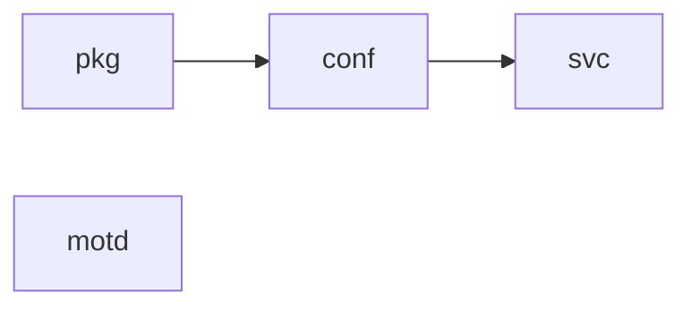
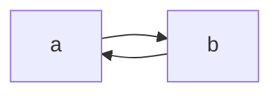
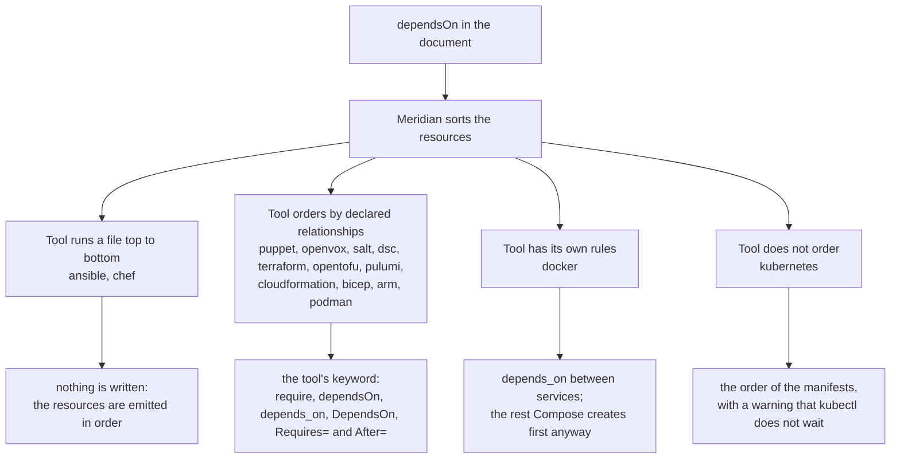

# `dependsOn`

```yaml
- id: nginx_conf
  type: file
  params: {path: /etc/nginx/nginx.conf, content: "..."}
  dependsOn:
    - resource: nginx_pkg
```

Order only. Data is a [reference](references.md); reacting to change is
[`notifies`](notifies.md).

## Fields

`dependsOn` is a list. Each entry is a mapping:

| Field | Required | Value |
|---|---|---|
| `resource` | yes | the `id` of another resource in the same document |
| `when` | no | a [condition](conditions.md#where-a-when-can-be-written) on the entry itself. False, and the entry is dropped; both resources stay |
| `ifMissing` | no | `error` (the default) or `skip`: what happens when a [`when`](conditions.md#when) removed the resource this entry names. See [`ifMissing`](conditions.md#ifmissing) |

## Rules

| Rule | Checked by | Message |
|---|---|---|
| The resource named must be in the document | `validate` | `resource "a" depends on unknown resource "s2"` |
| A resource cannot depend on itself | `validate` | `resource "a" cannot depend on itself` |
| The dependencies must not form a cycle | `validate` | `dependency cycle among 2 resources: a -> b -> a` |
| An entry naming a resource its `when` removed must say `ifMissing: skip` | `compile` | `resource "conf" depends on "pkg", which its when removed from this run; ...` |
| A dependency cannot point into another document | by construction | ids are local to a document |

## How the order is worked out

Meridian sorts before any plugin sees the document:

1. Each resource as early as its dependencies allow.
2. Ties in written order.

### A worked example

Four resources, written out of order:

```yaml
resources:
  - id: svc
    type: service
    params: {name: nginx}
    dependsOn: [{resource: conf}]
  - id: conf
    type: file
    params: {path: /etc/nginx/nginx.conf, content: "x"}
    dependsOn: [{resource: pkg}]
  - id: motd
    type: file
    params: {path: /etc/motd, content: "hi"}
  - id: pkg
    type: package
    params: {name: nginx}
```

The graph (an arrow reads "must come before"):



The sort, step by step:

| Step | Ready (dependencies all placed) | Placed | Why |
|---|---|---|---|
| 1 | `motd`, `pkg` | `motd` | both are ready; `motd` is written first |
| 2 | `pkg` | `pkg` | |
| 3 | `conf` | `conf` | `pkg` is placed, so `conf` is ready |
| 4 | `svc` | `svc` | |

Result: `motd`, `pkg`, `conf`, `svc`, which is the task order on Ansible.

### A cycle



Refused, naming the resources on the cycle:

```
cycle.yaml:8:7: spec.resources[0].dependsOn: dependency cycle among 2 resources: a -> b -> a
```

Every command finds it, before loading a plugin. Every resource counts, whatever its
`when`. Notifies do not form cycles.

## What a dependency becomes

What the plugin writes:



| Tool orders by | Targets | What `dependsOn` becomes |
|---|---|---|
| position in the file | `ansible`, `chef` | nothing written; the resources are emitted in order |
| declared relationships | `puppet`, `openvox`, `salt`, `dsc`, `terraform`, `opentofu`, `pulumi`, `cloudformation`, `bicep`, `arm`, `podman` | the tool's own keyword |
| its own rules | `docker` | `depends_on` between services |
| the fixed shape of a build | `packer` | the order of the provisioners and the chain of post-processors; a dependency that contradicts the shape is refused |
| the stages of a first boot | `cloud-init` | nothing written; a dependency that points backwards through the stages is refused |
| nothing | `kubernetes` | the order of the manifests, with a warning |
| the kind of each object | `helm` | nothing written where Helm's own install order already agrees; refused where it does not |

- **File-ordered tools run independent resources in sequence**, with a warning:

  ```
  warning: ansible: resources "motd", "pkg" are independent but will run in sequence; this target flattens the dependency graph and cannot express parallelism
  ```

- **A reference that implies order is not repeated.** On Terraform, OpenTofu, Pulumi,
  CloudFormation and Bicep, `${web_sg.id}` in `web` already orders them. Use `dependsOn`
  for order the tool cannot see, such as an IAM role an instance needs.

## When to use it, and when not

| You want | Use |
|---|---|
| B must not start until A is finished | `dependsOn` |
| B needs a value A produces | a [reference](references.md); the order follows |
| B should be restarted when A changes | [`notifies`](notifies.md) |
| document 2 must run after document 1 | nothing to write: [Infrastructure runs before ResourceSet](how-it-fits-together.md#step-4-documents-become-stages), and a `targetHost` taken from an output makes the wait explicit |

See [dependencies and notifications](../../concepts/dependencies.md).
