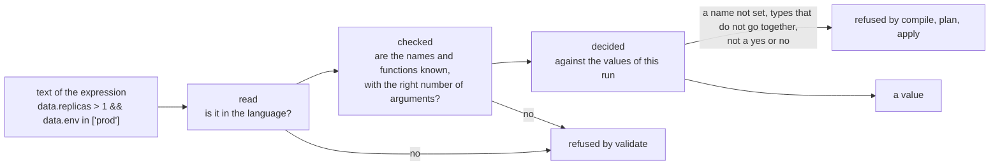

# Expressions and functions

The language of [`when`](conditions.md), interpolations and variables. Meridian decides
it before the plugin sees anything, so it means the same on every target.



- **It always ends.** No loops or recursion; `map` and `filter` run once per item.
  Nesting is limited to 64 levels and 1,000 operators, field reads and indexes.
- **It is pure.** Only `env` reads outside.
- **It never guesses.** Unset names, mismatched types and non-boolean conditions are
  errors. Nothing is converted silently.

## Contents

- [Values](#values)
- [Names](#names)
- [Operators](#operators)
- [Paths, indexes and missing values](#paths-indexes-and-missing-values)
- [Functions](#functions)
- [Errors](#errors)
- [Writing an expression in YAML](#writing-an-expression-in-yaml)

## Values

| Type | Written | Notes |
|---|---|---|
| null | `null` | |
| boolean | `true`, `false` | |
| number | `3`, `-1`, `1.5` | whole numbers and decimals. `3 == 3.0` |
| text | `'prod'`, `"prod"` | `\'`, `\"`, `\\`, `\n`, `\t`, `\r` inside |
| list | `[1, 'a', true]` | a comma may follow the last item |
| mapping | `{name: 'web', port: 80}` | a key is a name or quoted text: `{'my-key': 1}`. A key cannot be set twice |

## Names

What an expression can read depends on where it is written:

| Name | Holds | Available in |
|---|---|---|
| `data.<key>` | the values given with [`--data` and `--set`](conditions.md#giving-the-data) | every `when` and every [interpolation](interpolation.md) |
| `var.<name>` | a [variable](interpolation.md#variables) the document declares | every `when` and every interpolation |
| `cond.<name>` | a [named condition](interpolation.md#named-conditions) the document declares: `true` or `false` | every `when` and every interpolation |
| `secret.<name>` | a [secret](secrets.md) the document declares. The expression holds a reference to it, never the value | a `when`, a named condition, a variable, and an interpolation in `params`; [refused](secrets.md#where-a-secret-cannot-be-used) where a value is shown or stored |
| `meridian.run.id` | the run id given with `--run-id` or `MERIDIAN_RUN_ID`, or by [`meridian test`](../testing.md#the-run-id); unset otherwise. For names and tags of what one environment makes | every `when` and every interpolation |
| `facts.<path>` | facts about the machine | nowhere yet: refused, with a reason |

More names (`param`, `endpoint`, `outputs`) arrive with
the [language expansion](../../plans/language-expansion.md#22-names-an-expression-can-read).
A name the place does not offer is refused when the document is validated:

```
site.yaml:9:7: spec.resources[1].when: unknown name "env" (an expression reads data.<key>, var.<name>, cond.<name>, secret.<name> or meridian.run.id; text is quoted)
```

## Operators

From loosest to tightest. Operators on the same line bind equally.

| Operators | Meaning | Takes |
|---|---|---|
| `c ? a : b` | `a` when `c` is true, otherwise `b`. Only the side taken is evaluated | `c` must be a boolean |
| `a ?? b` | `a`, or `b` when `a` is null or not set | anything |
| `a \|\| b` | or. `b` is read only when `a` is false | booleans |
| `a && b` | and. `b` is read only when `a` is true | booleans |
| `a == b`, `a != b` | the same value, or not | anything. Different types are never equal, except that numbers compare by value |
| `a < b`, `a <= b`, `a > b`, `a >= b` | ordered | two numbers, or two texts |
| `a in b`, `a not in b` | `a` is an item of the list `b`, a key of the mapping `b`, or text inside the text `b` | |
| `a =~ b`, `a !~ b` | the text `a` matches the pattern `b`, or does not | text and a [pattern](#patterns) |
| `a + b`, `a - b` | add, subtract. `+` also joins text to text and a list to a list | numbers; for `+`, also two texts or two lists |
| `a * b`, `a / b`, `a % b` | multiply, divide, remainder | numbers |
| `!a`, `-a` | not, negative | a boolean; a number |
| `a.key`, `a[index]`, `f(x)` | a key, an item, a call | |
| `( ... )` | grouping | |

- **No silent conversion.** `'3' == 3` is false. `'3' + 3` is an error naming
  both types: `cannot add a string and a number with +; convert one first, with
  toString or toNumber`.
- **Logic takes booleans only.** `data.env && true` is an error when `data.env`
  is text: `data.env is a string, not true or false; compare it with == or !=`.
- **Comparisons do not chain.** `1 < 2 < 3` and `a == b == c` are refused. Write
  `1 < 2 && 2 < 3`.
- **Whole numbers stay whole.** `6 / 3` is `2`; `7 / 2` is `3.5`. A result too
  large for a whole number is an error, not a wrapped value.
- **Division by zero is an error.**
- **Text orders by its characters**, so `'Z' < 'a'` and `'10' < '9'`. Compare
  versions with [`semverCompare`](#versions).

Examples:

| Expression | Value |
|---|---|
| `data.replicas > 1 && data.env in ['staging', 'prod']` | `true` in production with 3 replicas |
| `data.env == 'prod' ? 'm5.large' : 't3.micro'` | `'m5.large'` |
| `data.tls.enabled ?? false` | `false` when nothing sets it |
| `data.region =~ '^eu-'` | `true` for `eu-west-1` |
| `data.memory_mb < 4 * 1024` | `true` for 2048 |
| `'metrics' in data.features` | whether the mapping has that key |
| `data.ports + [22]` | the list with one more item |

### Patterns

`=~`, `!~` and the `regex` functions match anywhere; anchor with `^` and `$`. `(?i)`
ignores case. No backreferences or lookaround; matching is linear time.

## Paths, indexes and missing values

| You write | Meaning |
|---|---|
| `data.region.name` | a key inside a mapping, inside a mapping |
| `data.my-key` | a key may hold a hyphen after a `.` |
| `data['my key']` | any key, as quoted text |
| `data[data.which]` | a key worked out by an expression |
| `data.ports[0]`, `data.ports.0` | the first item of a list |
| `data.ports[-1]` | the last item |

A hyphen directly after a key is part of it: write `data.count - 1` with spaces.

Reading something that is not there is an error:

```
data.env is not set (give it with --data or --set, or test for it with defined(data.env))
```

That includes a missing key and an index past the end. Three things handle it:

| You write | Gives |
|---|---|
| `defined(data.x)` | `true` or `false`: whether it is set. A key set to `null` is set |
| `data.x ?? 'fallback'` | the fallback when `data.x` is not set **or** is null |
| `default(data.x, 'fallback')` | the same, as a function |

They handle "not set" only: `data.env.name ?? 'x'`, where `data.env` is text, is still the
error `data.env is a string, so it has no key "name"`.

## Functions

Names are case sensitive: `unknown function "Upper" (did you mean upper?)`. `validate`
checks argument counts; types are checked when decided: `argument 1 of upper(...) must be
text, and is a number`.

### Presence

| Function | Gives |
|---|---|
| `defined(path)` | whether the path is set. Takes a path, not a value |
| `coalesce(a, b, ...)` | the first argument that is set and not null; `null` if none |
| `default(value, fallback)` | `value`, or `fallback` when it is not set or null |
| `required(value, 'message')` | `value`, or an error with your message when it is null |

### Text

| Function | Gives | Example |
|---|---|---|
| `lower(text)`, `upper(text)` | the text in one case | `upper('web')` is `'WEB'` |
| `title(text)` | each word capitalised | `title('hello world')` is `'Hello World'` |
| `trim(text)` | without spaces and line breaks at the ends | |
| `trimPrefix(text, prefix)`, `trimSuffix(text, suffix)` | without that start or end, if it has it | `trimSuffix('a.conf', '.conf')` is `'a'` |
| `replace(text, from, to)` | every `from` replaced | `replace('a-b', '-', '_')` is `'a_b'` |
| `split(text, separator)` | a list of the parts. Empty text gives an empty list | `split('a,b', ',')` is `['a', 'b']` |
| `join(list, separator)` | the items as one text. Items are text, numbers or booleans | `join(['a', 'b'], '-')` is `'a-b'` |
| `format(template, values...)` | the template with `%s` (any single value) and `%d` (a whole number) filled in order; `%%` is a percent sign | `format('%s-%d', 'web', 3)` is `'web-3'` |
| `startsWith(text, prefix)`, `endsWith(text, suffix)` | true or false | |
| `contains(holder, item)` | whether text holds text, a list holds an item, or a mapping has a key | `contains([80, 443], 443)` is `true` |
| `substr(text, start)`, `substr(text, start, length)` | part of the text, counted in characters from 0 | `substr('abcdef', 1, 3)` is `'bcd'` |
| `indent(text, spaces)` | every line that is not empty moved right | |
| `quote(text)` | the text in double quotes, with `"` and `\` escaped | |
| `regexMatch(text, pattern)` | whether the [pattern](#patterns) matches | |
| `regexReplace(text, pattern, to)` | every match replaced; `$1` is the first group | `regexReplace('web01', '[0-9]+', 'N')` is `'webN'` |
| `regexFind(text, pattern)` | the first match, or `null` | |

### Numbers

| Function | Gives |
|---|---|
| `min(a, b, ...)`, `max(a, b, ...)` | the smallest or largest. Also takes one list: `max(data.ports)` |
| `abs(n)` | without its sign |
| `floor(n)`, `ceil(n)` | the whole number below or above |
| `round(n)`, `round(n, places)` | the nearest whole number, or to 0 to 15 decimal places. A half rounds away from zero |
| `sum(list)` | the total of a list of numbers; `0` for an empty list |

### Lists and mappings

| Function | Gives | Example |
|---|---|---|
| `length(x)` | the characters of text, the items of a list, the keys of a mapping | |
| `keys(map)`, `values(map)` | the keys, or the values, in key order | |
| `entries(map)` | a list of `{key, value}` | |
| `merge(a, b, ...)` | one mapping; a later argument's key replaces an earlier one's, whole | `merge({a: {x: 1}}, {a: {y: 2}})` is `{a: {y: 2}}` |
| `deepMerge(a, b, ...)` | the same, but mappings inside mappings are merged key by key. Lists are replaced | `deepMerge({a: {x: 1}}, {a: {y: 2}})` is `{a: {x: 1, y: 2}}` |
| `concat(a, b, ...)` | the lists one after another | |
| `flatten(list)` | lists inside the list opened up, one level | `flatten([[1, 2], 3])` is `[1, 2, 3]` |
| `unique(list)` | without repeats; the first of each is kept | |
| `sort(list)` | in order. All numbers, or all text | |
| `reverse(x)` | a list or text, backwards | |
| `first(list)`, `last(list)` | one item. An empty list is an error | |
| `slice(list, start)`, `slice(list, start, end)` | the items from `start` up to but not including `end`. Negative counts from the end | `slice([1, 2, 3, 4], 1, 3)` is `[2, 3]` |
| `range(n)`, `range(start, end)`, `range(start, end, step)` | whole numbers from `start` up to but not including `end`. At most 10000 | `range(3)` is `[0, 1, 2]` |
| `zip(a, b)` | pairs, as long as the shorter list | `zip([1, 2], ['a', 'b'])` is `[[1, 'a'], [2, 'b']]` |
| `lookup(map, key)`, `lookup(map, key, fallback)` | the value of the key; without a fallback a missing key is an error | |
| `pick(map, keys)`, `omit(map, keys)` | the mapping with only, or without, those keys | |
| `any(list)`, `all(list)` | whether any, or every, item is true. `any([])` is false and `all([])` is true | |
| `map(list, 'name', expression)` | a list of the expression's value for each item, which the expression reads by the name given | `map([1, 2], 'n', n * 2)` is `[2, 4]` |
| `filter(list, 'name', condition)` | the items the condition is true for | `filter(data.ports, 'p', p > 1000)` |

In `map` and `filter` the quoted name exists only in the third argument. They nest:
`map(data.rows, 'row', map(row, 'n', n * length(row)))`.

### Selection

For a list of mappings, such as `data.sites` holding `{name, port, tls}`:

| Function | Gives |
|---|---|
| `where(list, 'field', value)` | the items whose field equals the value |
| `pluck(list, 'field')` | that field of every item that has it |
| `groupBy(list, 'field')` | a mapping from each value of the field, as text, to the items that have it |

`pluck(where(data.sites, 'tls', true), 'name')` is the names of the sites with
TLS.

### Types

| Function | Gives |
|---|---|
| `type(x)` | `'null'`, `'bool'`, `'number'`, `'string'`, `'list'` or `'map'` |
| `toString(x)` | text, a number or a boolean as text. A list or mapping has no single text form: use `join` or `toJson` |
| `toNumber(x)` | a number, from a number or from text holding one. Anything else is an error |
| `toBool(x)` | from `true`, `false`, `'true'` or `'false'`. Nothing else: `'yes'` is refused |
| `toJson(x)` | the value as compact JSON text, keys in order |
| `fromJson(text)` | the value the JSON text holds |

### Encoding

| Function | Gives |
|---|---|
| `base64Encode(text)`, `base64Decode(text)` | standard base64. Decoding something that is not base64, or not text once decoded, is an error |
| `urlEncode(text)` | the text safe for a URL: everything but letters, digits and `-_.~` percent-encoded |
| `sha256(text)` | the SHA-256 of the text, as 64 hexadecimal characters |

### Networks

IPv4 and IPv6. A network is written in CIDR form, `10.0.0.0/16`.

| Function | Gives | Example |
|---|---|---|
| `cidrHost(network, n)` | the nth address of the network; negative counts from the end | `cidrHost('10.0.0.0/24', 5)` is `'10.0.0.5'` |
| `cidrSubnet(network, bits, n)` | the nth subnet made by adding `bits` to the prefix | `cidrSubnet('10.0.0.0/16', 8, 3)` is `'10.0.3.0/24'` |
| `cidrNetmask(network)` | the netmask of an IPv4 network | `cidrNetmask('10.0.0.0/20')` is `'255.255.240.0'` |
| `cidrContains(network, address)` | whether the address is inside the network | |

### Versions

A version is one to three numbers, `1`, `1.6` or `1.6.2`, with an optional
leading `v`. A pre-release (`1.0.0-rc1`) orders before its release; build
metadata (`+build5`) is ignored.

| Function | Gives |
|---|---|
| `semverCompare(a, b)` | `-1`, `0` or `1` |
| `semverSatisfies(version, range)` | whether the version meets every requirement of the range. Requirements are separated by spaces and start with `>=`, `<=`, `>`, `<`, `=` or `!=`: `'>=1.6 <2'` |

A version must be text; quote it in data (`os_version: "24.04"`).

### Paths

Text only, `/` separators; nothing is read from disk.

| Function | Gives |
|---|---|
| `basename(path)` | the last part: `'nginx.conf'` |
| `dirname(path)` | everything before it: `'/etc/nginx'`; `'.'` when there is nothing before it, and `'/'` for the root itself |
| `joinPath(a, b, ...)` | the parts joined with one `/` between each |

### Environment

| Function | Gives |
|---|---|
| `env('NAME')` | the environment variable of the `meridian` process. Not set is an error |
| `env('NAME', fallback)` | the same, or the fallback when it is not set |

`env` depends on where Meridian runs. Prefer `--set` or a data file for reviewable
values.

### Selectors

| Function | Gives |
|---|---|
| `matchesSelector(labels, 'tier=web,env!=dev')` | whether a mapping of labels meets a selector, in the language of [`-l`](index.md#labels-and-selectors): `key=value`, `key!=value`, `key`, `!key`, separated by commas |

## Errors

Errors give the file, line and field, and what to write instead where possible.

| When | Example |
|---|---|
| Not in the language | `unexpected "=" (to compare two values in a condition, write ==)` |
| Unfinished | `expected ")", but the condition ends` |
| An unknown name | `unknown name "env" (an expression reads data.<key>, var.<name>, cond.<name>, secret.<name> or meridian.run.id; text is quoted)` |
| An unknown function | `unknown function "Length" (did you mean length?)` |
| The wrong number of arguments | `replace(...) takes 3 arguments, and was given 2` |
| A name that is not set | `data.env is not set (give it with --data or --set, or test for it with defined(data.env))` |
| A key on something that has none | `data.env is a string, so it has no key "name"` |
| Types that do not go together | `cannot compare a string and a number with >; convert one first, with toString or toNumber` |
| The wrong type of argument | `argument 1 of upper(...) must be text, and is a number` |
| Not a yes or a no | `data.count is a number, not true or false; compare it with == or !=` |
| Division by zero | `data.count is divided by zero` |
| Too deep | `the condition is nested more than 64 levels deep` |
| Too long | `the condition has more than 1000 operators` |

`validate` finds the first five; `compile`, `plan` and `apply` the rest. Codes such as
`expr-unknown-name` are in [error kinds and codes](../errors.md#expressions-meridian-expr).

## Writing an expression in YAML

Quote the whole expression.

```yaml
when: "data.env != 'prod'"
when: "data.replicas > 1 && data.env in ['staging', 'prod']"
when: "(data.env == 'prod' ? 3 : 1) <= data.replicas"
```

Use double quotes outside and single quotes inside. For a pattern with a backslash, use
single quotes outside: `when: 'data.host =~ "^web\d+$"'`.

Examples for Ansible, Terraform and Kubernetes: [`examples/conditions/`](../../../examples/conditions).
