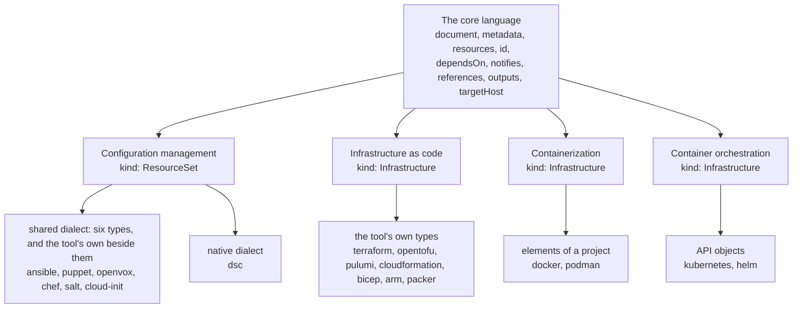

# The Meridian language


This is the reference for everything a Meridian document can say: every field,
what it must hold, and what happens when it does not. It describes what the
`meridian` command accepts today. Every field on this page does something: a
field Meridian cannot honour for a document is refused, not ignored.

The language has one core and four **flavours**. The core is the same for every
tool: the document, its resources, how they are ordered, how they refer to each
other. The flavour is what a resource's `type`, `state` and `params` mean, and
that depends on which segment the target belongs to:

| Segment | Flavour in one line | Reference |
|---|---|---|
| Configuration management | a small shared vocabulary (`package`, `file`, `service`, ...) that compiles for several tools | [configuration management](configuration-management.md) |
| Infrastructure as code | the tool's own resource types, wired with references, producing outputs | [infrastructure as code](infrastructure-as-code.md) |
| Containerization | the elements of a container project on one host | [containerization](containerization.md) |
| Container orchestration | the cluster's own API objects | [container orchestration](container-orchestration.md) |

A target's page under [`targets/`](../../targets/ansible.md) then says what that
one tool makes of the flavour.



## The pages of this reference

| Page | Covers |
|---|---|
| This page | every field in one place, with its rules |
| [How it fits together](how-it-fits-together.md) | a document's path from file to running tool, step by step, with a worked example |
| [Resources](resources.md) | `id`, `type`, `state`, `params` in depth |
| [Common infrastructure types](common-infrastructure-types.md) | `network`, `subnet`, `firewall`, `address`, `vm`: written once, compiled to each cloud's own resources by Terraform and Bicep |
| [`dependsOn`](dependson.md) | order: how the sort works, cycles, what each tool makes of it |
| [`notifies`](notifies.md) | reactions: native, synthetic, refused; the actions each target takes |
| [Conditions](conditions.md) | `runtimeWhen` and `when` |
| [Expressions and functions](expressions.md) | the language a `when` and an interpolation are written in: values, operators, every function, every error |
| [Interpolation, variables and named conditions](interpolation.md) | an expression inside a value, `spec.variables`, `spec.conditions`, and what is decided in which order |
| [Secrets](secrets.md) | `spec.secrets`: declaring a secret by where it comes from, reading it as `secret.<name>`, what an expression may do with one, and when it is fetched |
| [Credentials](credentials.md) | `spec.credentials`: an identity declared by name and type, its secret fields, and reaching a host as one with `targetHost.credential` |
| [References](references.md) | `${...}`: syntax, how each target rewrites it, what can be read where |
| [Outputs and hand-offs](outputs-and-hand-offs.md) | `outputs`, `targetHost` and `imports`: the ties between documents |
| [YAML pitfalls](yaml-pitfalls.md) | what Meridian does about each YAML trap: booleans, octal, version numbers, dates, tags, tabs, flow style, KYAML and JSON |
| The four flavour pages above | how all of it is written for each segment |

## Contents

- [Files](#files)
- [The document](#the-document)
- [`metadata`](#metadata)
- [`spec` of an Infrastructure document](#spec-of-an-infrastructure-document)
- [`spec` of a ResourceSet](#spec-of-a-resourceset)
- [`targetHost`](#targethost)
- [`endpoint`](#endpoint)
- [Resources](#resources)
- [`dependsOn`](#dependson)
- [`notifies`](#notifies)
- [`when` and `runtimeWhen`](#when-and-runtimewhen)
- [References](#references)
- [`outputs`](#outputs)
- [`imports`](#imports)
- [Workflows: several documents](#workflows-several-documents)
- [Which check happens when](#which-check-happens-when)

## Files

A file is YAML or JSON. Meridian decides which from the content, not from the
file's extension. YAML in flow style, including
[KYAML](https://kubernetes.io/docs/reference/encodings/kyaml/) as `kubectl`
prints it, is YAML and reads the same as the block form.

| | YAML | JSON |
|---|---|---|
| Several documents in one file | separated by `---` | a top-level array of objects |
| A number where text belongs (`name: 123`) | read as the text `"123"` | an error: JSON is typed |
| Anchors, aliases and `<<` merge keys | supported | not applicable |

Rules that hold for both:

- The file must be UTF-8. A byte order mark at the start is ignored.
- An **unknown field is an error**, at every level except inside `params` and
  `metadata.labels`. A misspelt `dependsOn` is reported with its line; it is
  never silently ignored.
- A field set twice in the same mapping is an error.
- An empty file is an error (`no documents found`).

How a plain YAML value is typed matters inside `params`, because the value is
handed to the tool with its type:

| You write | It is |
|---|---|
| `true`, `false` (also `True`, `TRUE`, ...) | a boolean |
| `yes`, `no`, `on`, `off` | text. Only `true` and `false` are booleans |
| `42`, `-7`, `1_000`, `0x1F`, `0o17`, `0b101` | an integer |
| `0644` | the integer 420: a leading zero means octal. Quote a file mode: `"0644"` |
| `08`, `09` | text: not octal, and no number was meant |
| `1.5`, `1e3`, `.inf`, `.nan` | a floating point number. `1.10` is 1.1 and `3.0` is 3: quote a version number. The [`lossy-number`](../lint.md#lossy-number) lint points these out |
| `~`, `null`, or nothing | null |
| `2026-11-17` | text. A date is not converted |
| anything quoted, or tagged `!!str` | text |
| any other tag (`!!int`, `!!binary`, `!custom`) | an error: write the value plainly, or quote it |

Every one of these traps, and what to do about it, is on
[YAML pitfalls](yaml-pitfalls.md).

## The document

```yaml
apiVersion: meridian/v1
kind: Infrastructure        # or ResourceSet
metadata:
  name: web
spec:
  ...
```

| Field | Required | Value |
|---|---|---|
| `apiVersion` | yes | The version of the language the document is written in: `meridian/v1`. Anything else is refused before the rest of the document is read. See [`apiVersion`](#apiversion) |
| `kind` | yes | `Infrastructure` or `ResourceSet` |
| `metadata` | yes | see [`metadata`](#metadata) |
| `spec` | yes | depends on the kind |

### `apiVersion`

`apiVersion` says which version of the Meridian language a document is written
in. It is `meridian/v` and a whole number, and `meridian/v1` is the only
version so far.

The number changes only when a document that compiles today would stop
compiling or would mean something else. New fields, new kinds of document and
new resource types are added inside the current version, so a document never
needs its `apiVersion` touched to keep working, and you never need to raise it
to use something new.

A build reads each version it knows in one of three ways:

| State | What happens |
|---|---|
| supported | the document compiles |
| deprecated | the document compiles, and the run prints one warning naming the version to move to |
| removed | the document is refused, and the message names the release that removed the version |

A value the build does not know is refused, and the message says why:

```
site.yaml:1:1: apiVersion: unsupported apiVersion "meridian/v2": it is newer than this build, which understands meridian/v1; upgrade meridian
site.yaml:1:1: apiVersion: unsupported apiVersion "meridian/v1.0": versions are whole numbers, as in "meridian/v1"
site.yaml:1:1: apiVersion: unsupported apiVersion "apps/v1": expected "meridian/v1"
```

[`meridian migrate`](../cli.md#migrate) moves documents to a newer version,
[`meridian version`](../cli.md#version) lists the versions a build reads, and
[compatibility](../compatibility.md) has the full rules.

The two kinds answer different questions. An **Infrastructure** document says
what should exist, and can promise [outputs](#outputs). A **ResourceSet** says
how a machine that exists is configured, and names that machine with
[`targetHost`](#targethost). Why they are separate is in
[the two-stage architecture](../../concepts/two-stage-architecture.md).

Which kind goes with which segment:

| Segment | `Infrastructure` | `ResourceSet` |
|---|---|---|
| Infrastructure as code | yes | refused |
| Container orchestration | yes | refused |
| Containerization | yes | yes: the project runs on the daemon of the host the document names |
| Configuration management | refused | yes |

Meridian enforces this pairing. Every plugin declares the segment it belongs to
(`meridian plugins` shows it as the plugin's category), and a document of a kind
that segment does not take is refused when it is compiled, before the plugin
sees it:

```
this is a ResourceSet document, and its target is an infrastructure-as-code
tool: it creates what should exist and is not pointed at one machine, so it
takes kind: Infrastructure, without a targetHost
```

A tool that provisions has no machine to be pointed at, and a tool that
configures one machine has nothing to provision. Before this check, the wrong
pairing compiled into something that meant less than the document said. A
plugin built before categories existed declares none, and takes either kind.

The check needs the plugin, so `compile`, `plan` and `apply` make it and
`validate` does not.

## `metadata`

| Field | Required | Value |
|---|---|---|
| `name` | yes | the document's name. It must be unique among the documents of the same kind given to one command. Other documents refer to it (`targetHost.ref`), compiled files are written under it, and state is kept under it. It must start with a letter or a digit, hold only letters, digits, `.`, `_` and `-`, and be at most 128 characters; `validate` refuses any other name, because the name becomes one directory name under `--out` and under the state directory |
| `labels` | no | a mapping of text to text, for choosing which documents a command runs. See [labels and selectors](#labels-and-selectors) |

Some targets build a name in their own files from `metadata.name`, and are
stricter about it than Meridian is. Puppet and Chef, for example, need
lower-case letters, digits and underscores, because the name becomes a class or
cookbook name. A name a target cannot use is refused when the document is
compiled, not rewritten.

### Labels and selectors

```yaml
metadata:
  name: web
  labels:
    tier: web
    env: prod
```

Labels mean nothing to Meridian on their own, and they are not passed to the
tool. They exist so that one command can run part of a workflow. A label's
value may hold an [interpolation](interpolation.md), such as
`env: ${{ data.env }}`, and a selector matches the value it comes to.
`compile`, `plan` and `apply` take `-l` (or `--selector`):

```
meridian apply site.yaml -l tier=web
meridian plan  site.yaml -l env=prod,tier!=db
```

| Requirement | Selects a document whose labels |
|---|---|
| `key=value` (also `key==value`) | set `key` to exactly `value` |
| `key!=value` | do not set `key` to `value`. A document without the label is selected |
| `key` | set `key`, to anything |
| `!key` | do not set `key` |

Requirements separated by commas must all hold, and so must the requirements of
every `-l` given. Rules:

- A document that is not selected does not run, and is not reported.
- It is still loaded and checked, and it can still be referred to. A selected
  ResourceSet whose `targetHost` names an unselected Infrastructure document
  finds its host from that document's last apply, and is deferred if there has
  not been one.
- A selector that selects nothing is an error, `no document's labels match the
  selector tier=cache`, not a run that did nothing and reported success.
- A malformed selector (`=web`, an empty requirement) is an error.
- `validate` takes no selector: it always checks every document.

## `spec` of an Infrastructure document

| Field | Required | Value |
|---|---|---|
| `target` | yes | the name of the plugin that compiles and runs the document, such as `terraform`. `meridian plugins` lists what is installed |
| `targetVersion` | no | text: the version of the tool to compile for. See [`targetVersion`](#targetversion) |
| `when` | no | a [condition](conditions.md#where-a-when-can-be-written) on the whole document. False, and the document is skipped |
| `variables` | no | a mapping of named values, read as `var.<name>`. See [variables](interpolation.md#variables) |
| `conditions` | no | a mapping of named conditions, read as `cond.<name>`. See [named conditions](interpolation.md#named-conditions) |
| `secrets` | no | a list of secrets, each a name and where it comes from, read as `secret.<name>`. See [secrets](secrets.md) |
| `credentials` | no | a list of credentials, each a name, a type and the type's fields, used by name. See [credentials](credentials.md) |
| `endpoint` | no | the cloud the document is applied to and the credential it is reached as. See [`endpoint`](#endpoint) |
| `settings` | no | a mapping of the tool's own settings for the whole document. See [`settings`](#settings) |
| `imports` | no | a list of [imports](#imports): values handed to this document from others |
| `resources` | yes | a list of at least one [resource](#resources) |
| `outputs` | no | a list of [outputs](#outputs) |

`targetHost` is not a field of an Infrastructure document.

## `spec` of a ResourceSet

| Field | Required | Value |
|---|---|---|
| `target` | yes | the plugin, such as `ansible` |
| `targetVersion` | no | text: the version of the tool to compile for. See [`targetVersion`](#targetversion) |
| `when` | no | a [condition](conditions.md#where-a-when-can-be-written) on the whole document. False, and the document is skipped |
| `variables` | no | a mapping of named values, read as `var.<name>`. See [variables](interpolation.md#variables) |
| `conditions` | no | a mapping of named conditions, read as `cond.<name>`. See [named conditions](interpolation.md#named-conditions) |
| `secrets` | no | a list of secrets, each a name and where it comes from, read as `secret.<name>`. See [secrets](secrets.md) |
| `credentials` | no | a list of credentials, each a name, a type and the type's fields, used by name. See [credentials](credentials.md) |
| `targetHost` | yes, to compile | the machine, and the credential it is reached as. See [`targetHost`](#targethost) |
| `endpoint` | no | the cloud the document is applied to and the credential it is reached as, for a target that reaches no host. See [`endpoint`](#endpoint) |
| `settings` | no | a mapping of the tool's own settings for the whole document. See [`settings`](#settings) |
| `imports` | no | a list of [imports](#imports): values handed to this document from others |
| `resources` | yes | a list of at least one [resource](#resources) |

`outputs` is not a field of a ResourceSet.

## `targetVersion`

```yaml
spec:
  target: dsc
  targetVersion: "3"
```

Some tools changed so much between versions that the same document has to be
compiled differently. `targetVersion` says which version the document is written
for. Quote it: an unquoted `3.0` is still read as the text `3.0`, but quoting
keeps `1.10` from ever being taken for `1.1`.

A plugin declares the versions it compiles for, and `meridian plugins` lists
them on its `versions:` line. The rules:

- The version must be one the plugin declares, or a more specific version under
  one of them. A plugin that declares `3` takes `3`, `3.0` and `3.1.4`. Versions
  are compared part by part: `30` is not under `3`, and `1.10` is not under
  `1.1`.
- The document may be more specific than the plugin, not less: a plugin that
  declares `3.1` does not take `3`.
- A version the plugin does not compile for is refused:
  `the document asks for targetVersion "4", and target "dsc" compiles for: 2, 3`.
- A plugin that declares no versions cannot honour the field, so a document
  that sets it is refused: `target "terraform" does not say which versions of
  its tool it compiles for, so the request cannot be honoured; remove
  targetVersion`. Accepting a version nothing checks would be a silent loss.
- The version is handed to the plugin, which may compile differently for it.
  What it changes is on the target's page.
- A document with no `targetVersion` is compiled the plugin's default way.

Which targets declare versions today:

| Target | Versions | What the version changes |
|---|---|---|
| `dsc` | `2`, `3` | the engine that evaluates the resources: [DSC](../../targets/dsc.md#the-version-of-dsc) |
| every other target | none | `targetVersion` is refused |

The check needs the plugin, so `compile`, `plan` and `apply` make it and
`validate` does not.

## `settings`

```yaml
spec:
  target: dsc
  settings:
    engine: DscV2
    target: WinRM
```

A tool has settings that belong to the whole document and to no resource of
it: which engine runs it, how its host is reached. `settings` is one mapping
for them. The target checks it exactly as it checks a resource's `params`: each
target's page lists the keys it takes and what each accepts, and a value may
hold interpolation.

The rules:

- A plugin declares the keys it reads, and `meridian plugins` lists them on
  its `settings:` line. A document that sets any other key is refused before
  the plugin is asked: `the document sets spec.settings.transport, and target
  "dsc" takes only: credential, engine, target`. A plugin that declares no keys
  takes no settings, so a document that sets any is refused the same way,
  which is also what happens with a plugin built before `settings` existed.
  Dropping a setting nothing reads would be a silent loss.
- The values are the plugin's to check. What each accepts is on the target's
  page, with the rule it refuses under.
- A setting is not a resource: it has no `id`, no `when` of its own, and takes
  no `dependsOn` or `notifies`. `spec.when` skips the whole document, settings
  included.

Which targets take settings today:

| Target | Keys | What they say |
|---|---|---|
| `dsc` | `engine`, `target`, `credential` | [how the configuration is run](../../targets/dsc.md#how-the-configuration-is-run) |
| every other target | none | the tool's own settings are a [settings resource](resources.md#type) for now, such as `stack` or `cluster` |

The settings resources will move under `settings`, one target at a time, and
each keeps compiling with a warning until the next `apiVersion` removes it. The
`dsc` target's `runner` resource is the first to have moved.

## `targetHost`

Two forms. A machine that is already there:

```yaml
targetHost:
  from: inline
  host: web01.example.com
```

A machine an Infrastructure document creates:

```yaml
targetHost:
  from: infrastructure
  ref: machine          # that document's metadata.name
  output: address       # one of its outputs
```

| Field | Value |
|---|---|
| `from` | `inline` or `infrastructure`. Required |
| `host` | required with `from: inline`: a host name or address, as the tool would be given it |
| `ref` | required with `from: infrastructure`: the name of an Infrastructure document given to the same command |
| `output` | required with `from: infrastructure`: the name of an output that document declares |
| `credential` | optional, with either form: the name of a credential in `spec.credentials` the host is reached as, of type `ssh` or `usernamePassword`, for a target that takes one. Left out, the tool reaches the host as its own identity. See [Credentials](credentials.md#reaching-a-host-as-a-credential) |

With `from: infrastructure`, the document and the output must exist, and
`meridian validate` checks that. The value is only known once the Infrastructure
document has been applied; until then the ResourceSet is reported as
**deferred** and is not compiled against a guess.

`meridian validate` accepts a ResourceSet with no `targetHost`, but it cannot be
compiled: `document "web" declares no targetHost`.

## `endpoint`

Where a document is applied when that is not a host: an account, a
subscription or a project of a cloud, and the credential it is reached as.

```yaml
endpoint:
  type: cloud
  credential: prod     # one of spec.credentials, of type aws, azure or gcp
```

| Field | Value |
|---|---|
| `type` | `cloud` for an infrastructure target; `cluster`, a Kubernetes API, is declared but no target takes one yet. Required |
| `credential` | the name of a credential in `spec.credentials` of a type the kind takes: `aws`, `azure` or `gcp` for a cloud, `kubeconfig` for a cluster. Required |

A field of both kinds of document. Left out, the tool reaches its cloud as
whatever login it finds on the machine. A ResourceSet names one identity,
in `targetHost.credential` or here. See
[Reaching a cloud as a credential](credentials.md#reaching-a-cloud-as-a-credential).

## Resources

```yaml
- id: nginx_conf
  type: file
  state: present
  params:
    path: /etc/nginx/nginx.conf
    content: "worker_processes 4;\n"
  dependsOn:
    - resource: nginx_pkg
  notifies:
    - resource: nginx_svc
      action: restart
  runtimeWhen: "ansible_facts['os_family'] == 'Debian'"
```

| Field | Required | Value |
|---|---|---|
| `id` | yes | the resource's name inside the document. Unique in the document. `dependsOn`, `notifies` and `${...}` use it, and plans and errors report it |
| `type` | yes | what kind of thing. Its meaning belongs to the [flavour](#the-meridian-language) |
| `state` | no | what "as it should be" means for this type, such as `present` or `absent`. The values, and whether there are any, belong to the flavour |
| `params` | no | a mapping: the type's settings. Free-form as far as the core is concerned; the target checks it |
| `dependsOn` | no | a list. See [`dependsOn`](#dependson) |
| `notifies` | no | a list. See [`notifies`](#notifies) |
| `when` | no | text: a condition Meridian decides before compiling. A resource whose condition is false is left out. See [`when` and `runtimeWhen`](#when-and-runtimewhen) |
| `runtimeWhen` | no | text, in the tool's own language. Only on targets that can check a condition while applying |
| `adopt` | no | text: the tool's own identifier of a thing that already exists, for the tool to take under management instead of creating. See [adopting what exists](resources.md#adopting-what-exists) |

In depth: [resources](resources.md).

Many tools use the `id` as a name in their own files, so they limit what it may
hold. Letters, digits and underscores, starting with a letter, work on every
target. A target that needs a different spelling in its own file (a
CloudFormation logical id, a Kubernetes object name) derives it, and still
reports the id you wrote.

The order resources are written in matters only as a tiebreak: resources with no
dependency between them keep the order of the document.

## `dependsOn`

```yaml
dependsOn:
  - resource: nginx_pkg
```

"Do not touch this resource until that one is done." It is about order and
nothing else. In depth, with the sort worked through: [`dependsOn`](dependson.md).

| Field | Required | Value |
|---|---|---|
| `resource` | yes | the `id` of another resource in the same document |
| `ifMissing` | no | `error` (the default) or `skip`: what happens when a [`when`](#when-and-runtimewhen) removed the resource this entry names. See [`ifMissing`](#ifmissing) |

Rules:

- The resource must exist in the document. `resource "a" depends on unknown
  resource "b"`.
- A resource cannot depend on itself.
- The dependencies of a document must not form a cycle. A cycle is reported with
  the resources in it, in the order they would have to be applied:
  `dependency cycle among 2 resources: a -> b -> a`. `meridian validate` finds
  it, and so does every other command. Every resource counts, whatever its
  `when` says: an order that only works while one condition happens to be false
  is still a mistake. Only `dependsOn` can form a cycle; two resources that
  notify each other are fine.
- A dependency cannot point into another document. Documents are ordered by
  [kind](#workflows-several-documents), and connected only by outputs.

What a dependency becomes in the tool's file differs by tool (a keyword, or
simply the order of the file) and is described in
[dependencies and notifications](../../concepts/dependencies.md).

## `notifies`

```yaml
notifies:
  - resource: nginx_svc
    action: restart
```

"When this resource really changes, do that to the other one." On a run where
nothing changed, nothing happens. A notify is a reaction and not an order: it takes no part in
the sort that `dependsOn` drives. In depth: [`notifies`](notifies.md).

| Field | Required | Value |
|---|---|---|
| `resource` | yes | the `id` of another resource in the same document |
| `action` | yes | what to do to it. The words a target accepts depend on the tool and on the type of the notified resource |
| `on` | no | `changed`, which is also what leaving it out means |
| `ifMissing` | no | `error` (the default) or `skip`: what happens when a [`when`](#when-and-runtimewhen) removed the notified resource. See [`ifMissing`](#ifmissing) |

Rules:

- The resource must exist in the document, and cannot be the notifier itself.
- `on` names the event that fires the notify. There is one: `changed`, the
  notifier really changed. Every tool's mechanism (an Ansible handler, a Puppet
  refresh, a Chef notification) fires on a change and on nothing else, so any
  other value is refused when the document is validated: `unknown event
  "always" (expected "changed", ...)`. Write `on: changed` to say it out loud,
  or leave it out.
- A target accepts only the actions its tool can really perform. `reload` aimed
  at a service is refused on Puppet, which can only restart on refresh; it is
  not turned into a restart.
- A target with no way to react to a change refuses every notify.

The actions by segment are on each flavour's page, and the
[capability matrix](../capability-matrix.md) says which targets take a notify at
all.

## `when` and `runtimeWhen`

They are two different times. In depth: [conditions](conditions.md).

A `when` can also be written on a whole document (`spec.when`), on an output
and on a `dependsOn` or `notifies` entry:
[where a `when` can be written](conditions.md#where-a-when-can-be-written).
Values anywhere in a document can hold an expression between `${{` and `}}`:
[interpolation](interpolation.md).

**`runtimeWhen`** is a condition the tool checks on the machine while it
applies, so it is written in the tool's own language and Meridian passes it
through as written. Only some configuration management targets have such a
moment; every other target refuses a resource that carries one. See
[configuration management](configuration-management.md#runtimewhen).

**`when`** is decided by Meridian before anything is compiled, so a resource is
either in the compiled output or it is not, and no target ever sees a
condition. It works on every target.

```yaml
- id: debug_log
  type: file
  when: "data.env != 'prod'"
  params:
    path: /var/log/app/debug.log
```

### What a `when` can say

A condition is an [expression](expressions.md) over the values given to the
command with `--data` and `--set`. Quote the whole condition in YAML, because
`!`, `'`, `[` and `>` mean something to YAML.

| You write | Meaning |
|---|---|
| `data.env`, `data.region.name`, `data.ports[0]` | a value from the data |
| `true`, `false`, `null`, `3`, `1.5`, `'prod'`, `[1, 2]`, `{a: 1}` | themselves. `3` and `3.0` are equal; `'3'` and `3` are not |
| `==`, `!=`, `<`, `<=`, `>`, `>=` | comparison. Order is for two numbers or two texts |
| `a in b`, `a not in b` | an item of a list, a key of a mapping, or text inside text |
| `a =~ 'pattern'`, `a !~ 'pattern'` | text matches a regular expression |
| `+`, `-`, `*`, `/`, `%` | arithmetic; `+` also joins two texts or two lists |
| `!a`, `a && b`, `a \|\| b` | not, and, or. `&&` binds tighter than `\|\|`; the right side is only read when the left leaves the answer open |
| `c ? a : b`, `a ?? b` | a choice; a fallback for a value that is not set or null |
| `( ... )` | grouping |
| `defined(data.key)` and about eighty other [functions](expressions.md#functions) | whether the data sets that key; text, numbers, lists, networks, versions |

Rules:

- A condition must come out as `true` or `false`. Text, a number or `null` is
  not a yes or a no: `data.env is a string, not true or false; compare it with
  == or !=`.
- A key the data does not set is an error, not a "no": `data.env is not set
  (give it with --data or --set, or test for it with defined(data.env))`. Guard
  an optional key with `data.x ?? false`.
- Nothing is converted silently. Comparing or adding text and a number is an
  error that names both types.
- `facts.*` is refused: Meridian does not gather facts from a node yet, so a
  condition cannot depend on the node. To decide on the node while applying,
  use `runtimeWhen` on a target that supports it.
- The condition's syntax, its names and its functions are checked by
  `meridian validate`. Its answer needs the data, so it is decided by
  `compile`, `plan` and `apply`.
- A condition is decided before the target's plugin is involved, so it means
  the same on every target.

### Giving the data

```
meridian apply site.yaml --data common.yaml --data prod.yaml --set replicas=5
```

A data file is YAML or JSON holding one mapping of names to values. `--data` may
be given more than once; a key in a later file replaces the same key from an
earlier file, whole (mappings are not merged). `--set KEY=VALUE` gives one
value after every file, typed as YAML types it, and a dotted key sets one key
inside a mapping. The same data is also handed to every plugin when it
compiles. In depth: [giving the data](conditions.md#giving-the-data).

### What removing a resource does

A resource whose `when` is false is not in the compiled output, and neither are
its own `dependsOn` and `notifies`. What matters is the entries of *other*
resources that name it.

### `ifMissing`

```yaml
- id: app_conf
  type: file
  dependsOn:
    - resource: legacy_dir
      ifMissing: skip
```

| Value | When the named resource was removed by its `when` |
|---|---|
| `error` (the default) | the document is refused: `resource "app_conf" depends on "legacy_dir", which its when removed from this run; set ifMissing: skip on this entry if the resource should carry on without it` |
| `skip` | the entry is dropped and the resource carries on without it |

It is the same on `dependsOn` and on `notifies`. The default is `error` because
a resource depending on something that is not there is far more often a mistake
than an intention. Any other value is refused when the document is validated.
`ifMissing` has no effect on an entry whose resource is present, and it never
excuses an entry that names a resource the document does not declare at all.

Two more consequences of removing a resource:

- An output, or a `${...}` reference, that reads a removed resource is refused
  by the target as a reference to a resource that is not there.
- If every resource is removed, the document compiles to nothing, and applying
  it tells the tool that nothing should exist. On a tool that deletes what is no
  longer declared, that is a deletion.

## References

Inside a text value in `params`, and in an output's `value`, `${...}` refers to
something only the tool can know.

```yaml
params:
  vpc_security_group_ids: ["${web_sg.id}"]
```

| You write | Meaning |
|---|---|
| `${id}` | the resource with that id, in the tool's own way of naming it |
| `${id.field}`, `${id.list[0].field}` | a value read from it: a path of `.field` and `[index]` steps |
| text around it, `http://${web.ip}:8080` | the value placed inside the text |
| `$${` | a literal `${` |
| anything that is not a path, such as `${upper(x.name)}` | the tool's own expression language, on the targets that have one |

Rules:

- The first name of a path must be the `id` of a resource in the same document.
  A reference to a resource that is not there is a compile error with the line.
- A `${` that is never closed is an error. Braces inside an expression balance,
  so `${merge({a = 1}, x)}` is one expression.
- What can be read from a resource is the tool's decision: a Terraform
  attribute, a CloudFormation `GetAtt` attribute, the name of a Kubernetes
  object. Some targets allow less inside `params` than in an output, because a
  param is fixed when the document is compiled and an output is read after the
  apply.
- A reference usually implies an order. Where the tool derives the order from
  the reference itself, the target does not write the dependency a second time.
- A reference never crosses documents. To carry a value from one document to
  the next, declare an [output](#outputs).

The configuration management targets that use the shared resource types
(`ansible`, `puppet`, `chef`, `salt`, `cloud-init`) have nothing to read at
apply time,
so there a reference is settled when the document is compiled: `${id.param}`
becomes the value the document gives that param on the resource `id`. A bare
`${id}`, a deeper path, a param the resource does not set, or anything that is
not a path is refused.

In depth, with what each target rewrites a reference into:
[references](references.md).

## `outputs`

Only in an Infrastructure document.

```yaml
outputs:
  - name: address
    value: ${web.public_ip}
```

| Field | Required | Value |
|---|---|---|
| `name` | yes | unique among the document's outputs |
| `value` | no, but give one | text holding one or more references. The core does not check that it is there; an output without a value has nothing to report |

In depth, with the life of a hand-off: [outputs and hand-offs](outputs-and-hand-offs.md).

An output is a value the tool reports after the document is applied. It is
shown, kept in the state directory, and handed to the stage that asked for it. A
value the tool marks as sensitive is shown as `(sensitive)`. On an apply, an
output the tool has no value for is an error, not an empty value.

An output can be consumed in two places: as the `targetHost` of a
ResourceSet, and as an [import](#imports) of any document.

Configuration management documents are ResourceSets, which have no `outputs`
field, so those targets produce none. The
[capability matrix](../capability-matrix.md) has the column for every target.

## `imports`

In either kind of document: `spec.imports`, values the document is handed from
other documents of the workflow.

```yaml
imports:
  - name: user_data          # the tool's variable of this name
    from: artifact           # a file another document compiles to
    ref: bootstrap
    file: user-data
    sensitive: true
  - name: vpc_id
    from: output             # a value another document's apply produced
    ref: network
    output: vpc_id
```

| Field | Required | Value |
|---|---|---|
| `name` | yes | the name the value arrives under: a letter or underscore, then letters, digits and underscores. Unique among the document's imports |
| `from` | yes | `artifact`, a file another document compiles to, or `output`, a value an Infrastructure document's apply produced |
| `ref` | yes | the `metadata.name` of the other document, given to the same command |
| `file` | with `artifact` | the path of a file that document compiles to, as `meridian compile` lists it |
| `output` | with `output` | the `name` of an output that document declares |
| `sensitive` | no | `true` masks the value wherever Meridian prints. An output its tool marks sensitive stays sensitive without it |

An import reaches the document's **tool**, as the tool's own variable or
parameter of that name. It is never spliced into the document's text, so the
document declares the variable and reads it the way its tool does:

```yaml
resources:
  - id: user_data
    type: variable
    params: {type: string, sensitive: true}
  - id: web
    type: aws_instance
    params:
      user_data: ${user_data}
```

A document that imports runs after every document it imports from. Only a
target that takes inputs can import; the
[capability matrix](../capability-matrix.md) has the column. In depth, with
diagrams and every rule: [outputs and hand-offs](outputs-and-hand-offs.md#imports).

## Workflows: several documents

The documents given to one `meridian` command are one workflow, whether they are
in one file or in several.

```
meridian apply machine.yaml web.yaml
```

- Every Infrastructure document runs before any ResourceSet, whatever order the
  files are given in. Within a kind, documents run in the order given.
- A document runs after every document it needs: the one its `targetHost` comes
  from, and every one it [imports](#imports) from. That is the only thing that
  moves a document from the order above, and it can put a ResourceSet before an
  Infrastructure document.
- Documents that wait on each other cannot be ordered, and are refused by
  `validate`.
- Two documents of the same kind cannot share a name. An Infrastructure document
  and a ResourceSet can.
- A document waiting for an output, as its host or as an import, is deferred
  until that output exists.
- When a stage fails, the stages after it do not run. Nothing is rolled back.

Every step from file to running tool is in
[how it fits together](how-it-fits-together.md). A worked example is
[a two-stage workflow](../../quickstart/first-two-stage.md),
and [`examples/workflow/`](../../../examples/workflow) holds its files.
[Worked workflows](../../quickstart/workflows.md) walks through six larger ones
that between them use every target.

## Which check happens when

| Check | `validate` | `compile`, `plan`, `apply` |
|---|---|---|
| The file is well formed; no unknown or repeated field | yes | yes |
| `apiVersion`, `kind`, `metadata.name`, `spec.target` are there | yes | yes |
| At least one resource; every resource has an `id` and a `type`; ids are unique | yes | yes |
| `dependsOn` and `notifies` name a resource of the document, and not their own | yes | yes |
| Document names are unique within a kind; output names are unique | yes | yes |
| The dependencies form no cycle | yes | yes |
| A notify's `on` is `changed`; an `ifMissing` is `error` or `skip` | yes | yes |
| A `when` is written in the expression language, with names it can read and functions that exist | yes | yes |
| `targetHost` is complete, and names a real document and output | yes | yes |
| Every import is complete, has a usable and unique name, and names a real document and output | yes | yes |
| No documents wait on each other, through `targetHost` and `imports` | yes | yes |
| The target takes imports, when the document has any | no | yes |
| The file an import names is one the other document compiles to | no | `plan`, `apply` |
| A plugin for `target` is installed | no | yes |
| A ResourceSet has a `targetHost` | no | yes |
| The document's kind is one the target's segment takes | no | yes |
| The target compiles for the `targetVersion` | no | yes |
| Every `when` has an answer, from the `--data` files and `--set` | no | yes |
| An entry naming a resource its `when` removed says `ifMissing: skip` | no | yes |
| The selector, if one is given, selects at least one document | no | yes |
| The target takes the `type`, the `state`, every param, the notify's action, `runtimeWhen` | no | yes |
| Every `${...}` points at something | no | yes |

`validate` loads no plugin, so it knows the shape of the language and nothing
about what a tool can express. A document that validates can still be refused by
its target. That refusal is the point of the
[capability model](../../concepts/capability-model.md): a document either does
what it says or does not compile.

Every error names the file, the line and column, and the field:

```
web.yaml:12:19: spec.resources[0].dependsOn[0].resource: resource "a" depends on unknown resource "s2"
```
