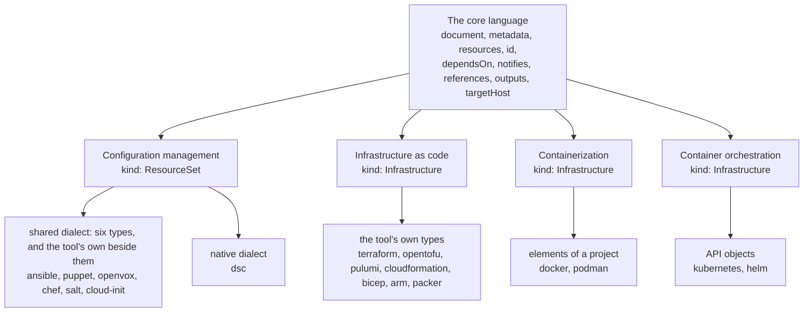

# The Meridian language


Every field a document can hold, what it must contain, and how it is checked. A field
Meridian cannot honour is refused, not ignored.

The core (documents, resources, order, references) is the same for every tool. The
**flavour**, what `type`, `state` and `params` mean, depends on the target's segment:

| Segment | Flavour in one line | Reference |
|---|---|---|
| Configuration management | a small shared vocabulary (`package`, `file`, `service`, ...) that compiles for several tools | [configuration management](configuration-management.md) |
| Infrastructure as code | the tool's own resource types, wired with references, producing outputs | [infrastructure as code](infrastructure-as-code.md) |
| Containerization | the elements of a container project on one host | [containerization](containerization.md) |
| Container orchestration | the cluster's own API objects | [container orchestration](container-orchestration.md) |

Each [target page](../../targets/ansible.md) covers one tool.



## The pages of this reference

| Page | Covers |
|---|---|
| This page | every field in one place, with its rules |
| [How it fits together](how-it-fits-together.md) | a document's path from file to running tool, step by step, with a worked example |
| [Resources](resources.md) | `id`, `type`, `state`, `params` in depth |
| [Common infrastructure types](common-infrastructure-types.md) | `network`, `subnet`, `firewall`, `address`, `vm`: written once, compiled to each cloud's own resources by Terraform, OpenTofu, Pulumi, CloudFormation, Bicep and ARM |
| [`dependsOn`](dependson.md) | order: how the sort works, cycles, what each tool makes of it |
| [`notifies`](notifies.md) | reactions: native, synthetic, refused; the actions each target takes |
| [Conditions](conditions.md) | `runtimeWhen` and `when` |
| [Expressions and functions](expressions.md) | the language a `when` and an interpolation are written in: values, operators, every function, every error |
| [Interpolation, variables and named conditions](interpolation.md) | an expression inside a value, `spec.variables`, `spec.conditions`, and what is decided in which order |
| [Secrets](secrets.md) | `spec.secrets`: declaring a secret by where it comes from, reading it as `secret.<name>`, what an expression may do with one, and when it is fetched |
| [Credentials](credentials.md) | `spec.credentials`: an identity declared by name and type, its secret fields, and reaching a host as one with `targetHost.credential` |
| [References](references.md) | `${...}`: syntax, how each target rewrites it, what can be read where |
| [Outputs and hand-offs](outputs-and-hand-offs.md) | `outputs`, `targetHost` and `imports`: the ties between documents |
| [YAML pitfalls](yaml-pitfalls.md) | what Meridian does about each YAML trap: booleans, octal, version numbers, dates, tags, tabs, flow style, KYAML and JSON |
| The four flavour pages above | how all of it is written for each segment |

## Contents

- [Files](#files)
- [The document](#the-document)
- [`metadata`](#metadata)
- [`spec` of an Infrastructure document](#spec-of-an-infrastructure-document)
- [`spec` of a ResourceSet](#spec-of-a-resourceset)
- [`targetHost`](#targethost)
- [Resources](#resources)
- [`dependsOn`](#dependson)
- [`notifies`](#notifies)
- [`when` and `runtimeWhen`](#when-and-runtimewhen)
- [References](#references)
- [`outputs`](#outputs)
- [`imports`](#imports)
- [Workflows: several documents](#workflows-several-documents)
- [Which check happens when](#which-check-happens-when)

## Files

A file is YAML or JSON, decided by content, not extension. Flow-style YAML, including
[KYAML](https://kubernetes.io/docs/reference/encodings/kyaml/), reads the same as block
form.

| | YAML | JSON |
|---|---|---|
| Several documents in one file | separated by `---` | a top-level array of objects |
| A number where text belongs (`name: 123`) | read as the text `"123"` | an error: JSON is typed |
| Anchors, aliases and `<<` merge keys | supported | not applicable |

- The file must be UTF-8. A byte order mark at the start is ignored.
- An **unknown field is an error**, except inside `params` and `metadata.labels`.
- A field set twice in the same mapping is an error.
- An empty file is an error (`no documents found`).

A plain YAML value reaches the tool with its YAML type:

| You write | It is |
|---|---|
| `true`, `false` (also `True`, `TRUE`, ...) | a boolean |
| `yes`, `no`, `on`, `off` | text. Only `true` and `false` are booleans |
| `42`, `-7`, `1_000`, `0x1F`, `0o17`, `0b101` | an integer |
| `0644` | the integer 420: a leading zero means octal. Quote a file mode: `"0644"` |
| `08`, `09` | text: not octal, and no number was meant |
| `1.5`, `1e3`, `.inf`, `.nan` | a floating point number. `1.10` is 1.1 and `3.0` is 3: quote a version number. The [`lossy-number`](../lint.md#lossy-number) lint points these out |
| `~`, `null`, or nothing | null |
| `2026-11-17` | text. A date is not converted |
| anything quoted, or tagged `!!str` | text |
| any other tag (`!!int`, `!!binary`, `!custom`) | an error: write the value plainly, or quote it |

See [YAML pitfalls](yaml-pitfalls.md).

## The document

```yaml
apiVersion: meridian/v1
kind: Infrastructure        # or ResourceSet
metadata:
  name: web
spec:
  ...
```

| Field | Required | Value |
|---|---|---|
| `apiVersion` | yes | The version of the language the document is written in: `meridian/v1`. Anything else is refused before the rest of the document is read. See [`apiVersion`](#apiversion) |
| `kind` | yes | `Infrastructure` or `ResourceSet` |
| `metadata` | yes | see [`metadata`](#metadata) |
| `spec` | yes | depends on the kind |

### `apiVersion`

`meridian/v` and a whole number. `meridian/v1` is the only version. It changes only when a
document that compiles today would stop compiling or change meaning; additions stay within
the version.

A build reads each version it knows in one of three ways:

| State | What happens |
|---|---|
| supported | the document compiles |
| deprecated | the document compiles, and the run prints one warning naming the version to move to |
| removed | the document is refused, and the message names the release that removed the version |

An unknown value is refused:

```
site.yaml:1:1: apiVersion: unsupported apiVersion "meridian/v2": it is newer than this build, which understands meridian/v1; upgrade meridian
site.yaml:1:1: apiVersion: unsupported apiVersion "meridian/v1.0": versions are whole numbers, as in "meridian/v1"
site.yaml:1:1: apiVersion: unsupported apiVersion "apps/v1": expected "meridian/v1"
```

[`meridian migrate`](../cli.md#migrate) moves documents to a newer version,
[`meridian version`](../cli.md#version) lists the versions a build reads, and
[compatibility](../compatibility.md) has the full rules.

An **Infrastructure** document declares what should exist and can have
[outputs](#outputs). A **ResourceSet** configures an existing machine named by
[`targetHost`](#targethost). See
[the two-stage architecture](../../concepts/two-stage-architecture.md).

Kind by segment:

| Segment | `Infrastructure` | `ResourceSet` |
|---|---|---|
| Infrastructure as code | yes | refused |
| Container orchestration | yes | refused |
| Containerization | yes | yes: the project runs on the daemon of the host the document names |
| Configuration management | refused | yes |

A document of the wrong kind for its plugin's category is refused at compile time:

```
this is a ResourceSet document, and its target is an infrastructure-as-code
tool: it creates what should exist and is not pointed at one machine, so it
takes kind: Infrastructure, without a targetHost
```

A plugin that declares no category takes either kind. `validate` does not make this
check.

## `metadata`

| Field | Required | Value |
|---|---|---|
| `name` | yes | the document's name. It must be unique among the documents of the same kind given to one command. Other documents refer to it (`targetHost.ref`), compiled files are written under it, and state is kept under it. It must start with a letter or a digit, hold only letters, digits, `.`, `_` and `-`, and be at most 128 characters; `validate` refuses any other name, because the name becomes one directory name under `--out` and under the state directory |
| `labels` | no | a mapping of text to text, for choosing which documents a command runs. See [labels and selectors](#labels-and-selectors) |

Some targets are stricter. Puppet and Chef need lower-case letters, digits and
underscores. A name a target cannot use is refused at compile, not rewritten.

### Labels and selectors

```yaml
metadata:
  name: web
  labels:
    tier: web
    env: prod
```

Labels select documents and are not passed to the tool. A value may hold an
[interpolation](interpolation.md) (`env: ${{ data.env }}`). `compile`, `plan` and `apply`
take `-l` (or `--selector`):

```
meridian apply site.yaml -l tier=web
meridian plan  site.yaml -l env=prod,tier!=db
```

| Requirement | Selects a document whose labels |
|---|---|
| `key=value` (also `key==value`) | set `key` to exactly `value` |
| `key!=value` | do not set `key` to `value`. A document without the label is selected |
| `key` | set `key`, to anything |
| `!key` | do not set `key` |

All comma-separated requirements, and every `-l`, must hold.

- A document that is not selected does not run, and is not reported.
- It is still loaded, checked and referable. A selected ResourceSet whose
  `targetHost` names an unselected Infrastructure document takes its host from
  that document's last apply, or is deferred if there was none.
- A selector matching nothing is an error (`no document's labels match the
  selector tier=cache`).
- A malformed selector (`=web`, an empty requirement) is an error.
- `validate` takes no selector.

## `spec` of an Infrastructure document

| Field | Required | Value |
|---|---|---|
| `target` | yes | the name of the plugin that compiles and runs the document, such as `terraform`. `meridian plugins` lists what is installed |
| `targetVersion` | no | text: the version of the tool to compile for. See [`targetVersion`](#targetversion) |
| `when` | no | a [condition](conditions.md#where-a-when-can-be-written) on the whole document. False, and the document is skipped |
| `variables` | no | a mapping of named values, read as `var.<name>`. See [variables](interpolation.md#variables) |
| `conditions` | no | a mapping of named conditions, read as `cond.<name>`. See [named conditions](interpolation.md#named-conditions) |
| `secrets` | no | a list of secrets, each a name and where it comes from, read as `secret.<name>`. See [secrets](secrets.md) |
| `credentials` | no | a list of credentials, each a name, a type and the type's fields, used by name. See [credentials](credentials.md) |
| `settings` | no | a mapping of the tool's own settings for the whole document. See [`settings`](#settings) |
| `imports` | no | a list of [imports](#imports): values handed to this document from others |
| `resources` | yes | a list of at least one [resource](#resources) |
| `outputs` | no | a list of [outputs](#outputs) |

`targetHost` is not a field of an Infrastructure document.

## `spec` of a ResourceSet

| Field | Required | Value |
|---|---|---|
| `target` | yes | the plugin, such as `ansible` |
| `targetVersion` | no | text: the version of the tool to compile for. See [`targetVersion`](#targetversion) |
| `when` | no | a [condition](conditions.md#where-a-when-can-be-written) on the whole document. False, and the document is skipped |
| `variables` | no | a mapping of named values, read as `var.<name>`. See [variables](interpolation.md#variables) |
| `conditions` | no | a mapping of named conditions, read as `cond.<name>`. See [named conditions](interpolation.md#named-conditions) |
| `secrets` | no | a list of secrets, each a name and where it comes from, read as `secret.<name>`. See [secrets](secrets.md) |
| `credentials` | no | a list of credentials, each a name, a type and the type's fields, used by name. See [credentials](credentials.md) |
| `targetHost` | yes, to compile | the machine, and the credential it is reached as. See [`targetHost`](#targethost) |
| `settings` | no | a mapping of the tool's own settings for the whole document. See [`settings`](#settings) |
| `imports` | no | a list of [imports](#imports): values handed to this document from others |
| `resources` | yes | a list of at least one [resource](#resources) |

`outputs` is not a field of a ResourceSet.

## `targetVersion`

```yaml
spec:
  target: dsc
  targetVersion: "3"
```

The tool version the document is written for. Quote it (`"1.10"`). A plugin lists its
versions on the `versions:` line of `meridian plugins`.

- The version must be one the plugin declares, or a more specific version under
  one of them. A plugin that declares `3` takes `3`, `3.0` and `3.1.4`. Versions
  are compared part by part: `30` is not under `3`, and `1.10` is not under
  `1.1`.
- The document may be more specific than the plugin, not less: a plugin that
  declares `3.1` does not take `3`.
- A version the plugin does not compile for is refused:
  `the document asks for targetVersion "4", and target "dsc" compiles for: 2, 3`.
- A plugin that declares no versions refuses the field: `target "terraform" does not
  say which versions of its tool it compiles for, so the request cannot be honoured;
  remove targetVersion`.
- The version is passed to the plugin, which may compile differently for it;
  the target's page says how.
- With no `targetVersion` the plugin's default applies.

Targets that declare versions:

| Target | Versions | What the version changes |
|---|---|---|
| `dsc` | `2`, `3` | the engine that evaluates the resources: [DSC](../../targets/dsc.md#the-version-of-dsc) |
| every other target | none | `targetVersion` is refused |

`validate` does not make this check.

## `settings`

```yaml
spec:
  target: dsc
  settings:
    engine: DscV2
    target: WinRM
```

Tool settings for the whole document, such as the engine or how the host is reached.
Checked like `params`; values may hold interpolation. Each target page lists its keys.

- A plugin lists its keys on the `settings:` line of `meridian plugins`. Any other key is
  refused: `the document sets spec.settings.transport, and target "dsc" takes only:
  credential, engine, target`. A plugin that declares none refuses any setting.
- The plugin checks the values; the target's page lists what each accepts and
  the rule it refuses under.
- A setting is not a resource: no `id`, no `when`, no `dependsOn` or
  `notifies`. `spec.when` skips the whole document, settings included.

Targets that take settings:

| Target | Keys | What they say |
|---|---|---|
| `dsc` | `engine`, `target`, `credential` | [how the configuration is run](../../targets/dsc.md#how-the-configuration-is-run) |
| every other target | none | the tool's own settings are a [settings resource](resources.md#type) for now, such as `stack` or `cluster` |

Settings resources will move under `settings` one target at a time, compiling with a
warning until the next `apiVersion`. `dsc`'s `runner` has moved.

## `targetHost`

Two forms. A machine that is already there:

```yaml
targetHost:
  from: inline
  host: web01.example.com
```

A machine an Infrastructure document creates:

```yaml
targetHost:
  from: infrastructure
  ref: machine          # that document's metadata.name
  output: address       # one of its outputs
```

| Field | Value |
|---|---|
| `from` | `inline` or `infrastructure`. Required |
| `host` | required with `from: inline`: a host name or address, as the tool would be given it |
| `ref` | required with `from: infrastructure`: the name of an Infrastructure document given to the same command |
| `output` | required with `from: infrastructure`: the name of an output that document declares |
| `credential` | optional, with either form: the name of a credential in `spec.credentials` the host is reached as, of type `ssh` or `usernamePassword`, for a target that takes one. Left out, the tool reaches the host as its own identity. See [Credentials](credentials.md#reaching-a-host-as-a-credential) |

With `from: infrastructure`, `validate` checks the document and output exist. Until that
document is applied, the ResourceSet is **deferred**.

`meridian validate` accepts a ResourceSet with no `targetHost`, but it cannot be
compiled: `document "web" declares no targetHost`.

## Resources

```yaml
- id: nginx_conf
  type: file
  state: present
  params:
    path: /etc/nginx/nginx.conf
    content: "worker_processes 4;\n"
  dependsOn:
    - resource: nginx_pkg
  notifies:
    - resource: nginx_svc
      action: restart
  runtimeWhen: "ansible_facts['os_family'] == 'Debian'"
```

| Field | Required | Value |
|---|---|---|
| `id` | yes | the resource's name inside the document. Unique in the document. `dependsOn`, `notifies` and `${...}` use it, and plans and errors report it |
| `type` | yes | what kind of thing. Its meaning belongs to the [flavour](#the-meridian-language) |
| `state` | no | what "as it should be" means for this type, such as `present` or `absent`. The values, and whether there are any, belong to the flavour |
| `params` | no | a mapping: the type's settings. Free-form as far as the core is concerned; the target checks it |
| `dependsOn` | no | a list. See [`dependsOn`](#dependson) |
| `notifies` | no | a list. See [`notifies`](#notifies) |
| `when` | no | text: a condition Meridian decides before compiling. A resource whose condition is false is left out. See [`when` and `runtimeWhen`](#when-and-runtimewhen) |
| `runtimeWhen` | no | text, in the tool's own language. Only on targets that can check a condition while applying |
| `adopt` | no | text: the tool's own identifier of a thing that already exists, for the tool to take under management instead of creating. See [adopting what exists](resources.md#adopting-what-exists) |

In depth: [resources](resources.md).

An `id` of letters, digits and underscores, starting with a letter, works on every
target. A target that needs another spelling derives it and still reports your id.

Independent resources keep document order.

## `dependsOn`

```yaml
dependsOn:
  - resource: nginx_pkg
```

Order only. In depth: [`dependsOn`](dependson.md).

| Field | Required | Value |
|---|---|---|
| `resource` | yes | the `id` of another resource in the same document |
| `ifMissing` | no | `error` (the default) or `skip`: what happens when a [`when`](#when-and-runtimewhen) removed the resource this entry names. See [`ifMissing`](#ifmissing) |

Rules:

- The resource must exist in the document. `resource "a" depends on unknown
  resource "b"`.
- A resource cannot depend on itself.
- The dependencies of a document must not form a cycle. A cycle is reported with
  the resources in it, in the order they would have to be applied:
  `dependency cycle among 2 resources: a -> b -> a`. Every resource counts, whatever
  its `when`. Notifies do not form cycles.
- A dependency cannot point into another document.

What each tool writes: [dependencies and notifications](../../concepts/dependencies.md).

## `notifies`

```yaml
notifies:
  - resource: nginx_svc
    action: restart
```

Runs an action on another resource when this one changes. It does not affect order. In
depth: [`notifies`](notifies.md).

| Field | Required | Value |
|---|---|---|
| `resource` | yes | the `id` of another resource in the same document |
| `action` | yes | what to do to it. The words a target accepts depend on the tool and on the type of the notified resource |
| `on` | no | `changed`, which is also what leaving it out means |
| `ifMissing` | no | `error` (the default) or `skip`: what happens when a [`when`](#when-and-runtimewhen) removed the notified resource. See [`ifMissing`](#ifmissing) |

Rules:

- The resource must exist in the document, and cannot be the notifier itself.
- `on` takes one value, `changed` (the default). Any other is refused:
  `unknown event "always" (expected "changed", ...)`.
- A target accepts only actions its tool can perform. `reload` is refused on Puppet.
- A target that cannot react to change refuses every notify.

See each flavour's page and the [capability matrix](../capability-matrix.md).

## `when` and `runtimeWhen`

In depth: [conditions](conditions.md).

A `when` can also be written on a whole document (`spec.when`), on an output
and on a `dependsOn` or `notifies` entry:
[where a `when` can be written](conditions.md#where-a-when-can-be-written).
Values anywhere in a document can hold an expression between `${{` and `}}`:
[interpolation](interpolation.md).

**`runtimeWhen`**: checked by the tool on the machine at apply time, in the tool's own
language, passed through as written. Only some configuration management targets take it
([configuration management](configuration-management.md#runtimewhen)).

**`when`**: decided by Meridian before compiling. The resource is in the output or not.
Works on every target.

```yaml
- id: debug_log
  type: file
  when: "data.env != 'prod'"
  params:
    path: /var/log/app/debug.log
```

### What a `when` can say

An [expression](expressions.md) over `--data` and `--set` values. Quote it in YAML.

| You write | Meaning |
|---|---|
| `data.env`, `data.region.name`, `data.ports[0]` | a value from the data |
| `true`, `false`, `null`, `3`, `1.5`, `'prod'`, `[1, 2]`, `{a: 1}` | themselves. `3` and `3.0` are equal; `'3'` and `3` are not |
| `==`, `!=`, `<`, `<=`, `>`, `>=` | comparison. Order is for two numbers or two texts |
| `a in b`, `a not in b` | an item of a list, a key of a mapping, or text inside text |
| `a =~ 'pattern'`, `a !~ 'pattern'` | text matches a regular expression |
| `+`, `-`, `*`, `/`, `%` | arithmetic; `+` also joins two texts or two lists |
| `!a`, `a && b`, `a \|\| b` | not, and, or. `&&` binds tighter than `\|\|`; the right side is only read when the left leaves the answer open |
| `c ? a : b`, `a ?? b` | a choice; a fallback for a value that is not set or null |
| `( ... )` | grouping |
| `defined(data.key)` and about eighty other [functions](expressions.md#functions) | whether the data sets that key; text, numbers, lists, networks, versions |

Rules:

- A condition must come out as `true` or `false`. Text, a number or `null` is
  not a yes or a no: `data.env is a string, not true or false; compare it with
  == or !=`.
- A key the data does not set is an error, not a "no": `data.env is not set
  (give it with --data or --set, or test for it with defined(data.env))`. Guard
  an optional key with `data.x ?? false`.
- Nothing is converted silently. Comparing or adding text and a number is an
  error that names both types.
- `facts.*` is refused; use `runtimeWhen` to decide on the node.
- `validate` checks syntax, names and functions. `compile`, `plan` and `apply` decide the
  value.

### Giving the data

```
meridian apply site.yaml --data common.yaml --data prod.yaml --set replicas=5
```

A data file is one YAML or JSON mapping. With several `--data` files, a later key
replaces an earlier one whole. `--set KEY=VALUE` applies after every file, YAML-typed; a
dotted key sets a key inside a mapping. Plugins get the same data. In depth:
[giving the data](conditions.md#giving-the-data).

### What removing a resource does

A resource whose `when` is false is left out, with its own `dependsOn` and `notifies`.
Entries in *other* resources that name it are handled by `ifMissing`.

### `ifMissing`

```yaml
- id: app_conf
  type: file
  dependsOn:
    - resource: legacy_dir
      ifMissing: skip
```

| Value | When the named resource was removed by its `when` |
|---|---|
| `error` (the default) | the document is refused: `resource "app_conf" depends on "legacy_dir", which its when removed from this run; set ifMissing: skip on this entry if the resource should carry on without it` |
| `skip` | the entry is dropped and the resource carries on without it |

The same on `dependsOn` and `notifies`. The default is `error`. It never excuses a
resource the document does not declare.

Also:

- An output, or a `${...}` reference, that reads a removed resource is refused
  by the target as a reference to a resource that is not there.
- If every resource is removed, the document compiles to nothing. On a tool that deletes
  undeclared resources, applying it deletes them.

## References

Inside a text value in `params`, and in an output's `value`, `${...}` refers to
something only the tool can know.

```yaml
params:
  vpc_security_group_ids: ["${web_sg.id}"]
```

| You write | Meaning |
|---|---|
| `${id}` | the resource with that id, in the tool's own way of naming it |
| `${id.field}`, `${id.list[0].field}` | a value read from it: a path of `.field` and `[index]` steps |
| text around it, `http://${web.ip}:8080` | the value placed inside the text |
| `$${` | a literal `${` |
| anything that is not a path, such as `${upper(x.name)}` | the tool's own expression language, on the targets that have one |

Rules:

- The first name must be the `id` of a resource in the same document.
- A `${` that is never closed is an error. Braces inside an expression balance,
  so `${merge({a = 1}, x)}` is one expression.
- The tool decides what can be read: a Terraform attribute, a CloudFormation `GetAtt`
  attribute, a Kubernetes object name. Some targets allow less in `params` than in an
  output.
- Where the tool derives order from a reference, the target does not repeat it.
- A reference never crosses documents; use an [output](#outputs).

On configuration management targets using the shared types, `${id.param}` becomes that
param's value at compile time. A bare `${id}`, a deeper path or an unset param is refused.

In depth: [references](references.md).

## `outputs`

Only in an Infrastructure document.

```yaml
outputs:
  - name: address
    value: ${web.public_ip}
```

| Field | Required | Value |
|---|---|---|
| `name` | yes | unique among the document's outputs |
| `value` | no, but give one | text holding one or more references. The core does not check that it is there; an output without a value has nothing to report |

In depth: [outputs and hand-offs](outputs-and-hand-offs.md).

A value the tool reports after apply. It is shown, kept in the state directory, and
handed to the stage that uses it, as a ResourceSet's `targetHost` or an
[import](#imports). Sensitive values show as `(sensitive)`. An output with no value is an
error. See the [capability matrix](../capability-matrix.md).

## `imports`

`spec.imports`, in either kind: values from other documents of the workflow.

```yaml
imports:
  - name: user_data          # the tool's variable of this name
    from: artifact           # a file another document compiles to
    ref: bootstrap
    file: user-data
    sensitive: true
  - name: vpc_id
    from: output             # a value another document's apply produced
    ref: network
    output: vpc_id
```

| Field | Required | Value |
|---|---|---|
| `name` | yes | the name the value arrives under: a letter or underscore, then letters, digits and underscores. Unique among the document's imports |
| `from` | yes | `artifact`, a file another document compiles to, or `output`, a value an Infrastructure document's apply produced |
| `ref` | yes | the `metadata.name` of the other document, given to the same command |
| `file` | with `artifact` | the path of a file that document compiles to, as `meridian compile` lists it |
| `output` | with `output` | the `name` of an output that document declares |
| `sensitive` | no | `true` masks the value wherever Meridian prints. An output its tool marks sensitive stays sensitive without it |

An import reaches the **tool** as its own variable or parameter of that name, never
spliced into the text. The document declares and reads it as the tool does:

```yaml
resources:
  - id: user_data
    type: variable
    params: {type: string, sensitive: true}
  - id: web
    type: aws_instance
    params:
      user_data: ${user_data}
```

A document runs after every document it imports from. Only targets that take inputs can
import ([capability matrix](../capability-matrix.md)). In depth:
[outputs and hand-offs](outputs-and-hand-offs.md#imports).

## Workflows: several documents

The documents given to one command, in one file or several.

```
meridian apply machine.yaml web.yaml
```

- Infrastructure documents run before ResourceSets; within a kind, in the order given.
- A document runs after its `targetHost` source and every document it
  [imports](#imports) from. This can put a ResourceSet first.
- Documents that wait on each other cannot be ordered, and are refused by
  `validate`.
- Two documents of the same kind cannot share a name. An Infrastructure document
  and a ResourceSet can.
- A document waiting for an output, as its host or as an import, is deferred
  until that output exists.
- When a stage fails, the stages after it do not run. Nothing is rolled back.

See [how it fits together](how-it-fits-together.md),
[a two-stage workflow](../../quickstart/first-two-stage.md),
[worked workflows](../../quickstart/workflows.md) and
[`examples/workflow/`](../../../examples/workflow).

## Which check happens when

| Check | `validate` | `compile`, `plan`, `apply` |
|---|---|---|
| The file is well formed; no unknown or repeated field | yes | yes |
| `apiVersion`, `kind`, `metadata.name`, `spec.target` are there | yes | yes |
| At least one resource; every resource has an `id` and a `type`; ids are unique | yes | yes |
| `dependsOn` and `notifies` name a resource of the document, and not their own | yes | yes |
| Document names are unique within a kind; output names are unique | yes | yes |
| The dependencies form no cycle | yes | yes |
| A notify's `on` is `changed`; an `ifMissing` is `error` or `skip` | yes | yes |
| A `when` is written in the expression language, with names it can read and functions that exist | yes | yes |
| `targetHost` is complete, and names a real document and output | yes | yes |
| Every import is complete, has a usable and unique name, and names a real document and output | yes | yes |
| No documents wait on each other, through `targetHost` and `imports` | yes | yes |
| The target takes imports, when the document has any | no | yes |
| The file an import names is one the other document compiles to | no | `plan`, `apply` |
| A plugin for `target` is installed | no | yes |
| A ResourceSet has a `targetHost` | no | yes |
| The document's kind is one the target's segment takes | no | yes |
| The target compiles for the `targetVersion` | no | yes |
| Every `when` has an answer, from the `--data` files and `--set` | no | yes |
| An entry naming a resource its `when` removed says `ifMissing: skip` | no | yes |
| The selector, if one is given, selects at least one document | no | yes |
| The target takes the `type`, the `state`, every param, the notify's action, `runtimeWhen` | no | yes |
| Every `${...}` points at something | no | yes |

`validate` loads no plugin, so a valid document can still be refused by its target
([capability model](../../concepts/capability-model.md)).

Every error names the file, line, column and field:

```
web.yaml:12:19: spec.resources[0].dependsOn[0].resource: resource "a" depends on unknown resource "s2"
```
