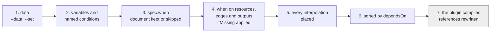

# Interpolation, variables and named conditions

`${{ ... }}` inside a value is decided by Meridian before compiling. The plugin gets the
plain result, so it is the same on every target.

```yaml
spec:
  target: ansible
  variables:
    name: ${{ data.project }}-${{ data.env }}
  conditions:
    is_prod: data.env == 'prod'
  resources:
    - id: site_conf
      type: file
      params:
        path: /etc/nginx/conf.d/${{ var.name }}.conf
        workers: "${{ cond.is_prod ? 8 : 1 }}"
```

The language is that of `when`: [expressions and functions](expressions.md).



Only step 7 involves the plugin.

## Contents

- [Interpolation](#interpolation)
- [Where it is allowed](#where-it-is-allowed)
- [Beside a reference](#beside-a-reference)
- [Values from data are literal](#values-from-data-are-literal)
- [Writing one in YAML](#writing-one-in-yaml)
- [Variables](#variables)
- [Named conditions](#named-conditions)
- [What is checked, and when](#what-is-checked-and-when)
- [Examples](#examples)

## Interpolation

| You write | You get |
|---|---|
| a value that is only `${{ expr }}` | the expression's value with its type: a number stays a number, a list stays a list, a mapping stays a mapping |
| `${{ expr }}` inside longer text | the value placed in the text. It must be text, a number or a boolean |
| `$${{` | a literal `${{`, by the same rule that makes `$${` a literal `${` |
| `${id.path}` | unchanged: a [reference](references.md), rewritten by the plugin and resolved by the tool |

```yaml
params:
  count: ${{ data.replicas }}                 # 3, a number
  ports: ${{ data.ports }}                    # [80, 443], a list
  tags: ${{ var.tags }}                       # a mapping, with its shape
  name: ${{ data.project }}-${{ data.env }}   # "shop-prod", text
  listen: listen ${{ join(data.ports, ' ') }} # "listen 80 443"
```

Only a value that is nothing but the interpolation keeps its type. A space
before or after it makes it text: `" ${{ data.replicas }}"` is `" 3"`.

A list, mapping or `null` inside longer text is an error:

```
in ${{ data.ports }}: a list cannot be placed inside text; use join(...) or toJson(...), or make the interpolation the whole value
in ${{ data.nothing }}: the value is null, which has no text form; give a default with ??
```

Quotes and brackets are skipped when finding the end: `${{ {a: {b: 1}}.a.b }}` is `1`,
and `${{ '}}' }}` is the text `}}`.

Everything else passes through unchanged: `{{ ansible_hostname }}`, `%{ if x }`, `$5`,
`${web.public_ip}`.

## Where it is allowed

| Place | Allowed |
|---|---|
| any value inside `params`, however deep | yes |
| a resource's `state` | yes; it must come to text |
| an output's `value` | yes; it must come to text |
| a variable's value | yes |
| `metadata.labels` values | yes; a [label selector](index.md#labels-and-selectors) matches the value it comes to |
| `spec.target`, `spec.targetVersion` | yes; they must come to text |
| `spec.targetHost.host` | yes |
| `when`, on anything, and a named condition | these are already expressions and are written bare. Wrapped in `${{ }}` they mean the same |
| `apiVersion`, `kind`, `metadata.name`, a label's name, a resource's `id` and `type`, the `resource` of a `dependsOn` or `notifies` entry, a notify's `action`, an output's `name`, `targetHost.from`, `.ref` and `.output`, a param's name and any mapping key | no. These are the document's skeleton, and `validate` must be able to check them without any data |
| `runtimeWhen` | no. It is passed to the tool untouched |

An interpolation in a place that does not take one is refused by `validate`:

```
site.yaml:12:7: spec.resources[1].id: cannot be interpolated: it is part of the document's skeleton, which must be checkable without any data
```

A field that is text refuses a value that is not:

```
site.yaml:9:7: spec.resources[0].state: resource "pkg": this field is text, and the interpolation gives a list
```

## Beside a reference

`${{ }}` is decided by Meridian; `${ }` is a reference the tool resolves.

| | `${{ ... }}` | `${id.path}` |
|---|---|---|
| Decided by | Meridian's core | the tool, through the plugin |
| Decided when | before compiling | while the tool plans or applies |
| Reads | data, variables, named conditions | attributes of resources the tool creates in this run |
| Same on every target | yes | no: it is the tool's own value |

They can share a value:

```yaml
- id: public
  type: aws_subnet
  params:
    vpc_id: ${main.id}                       # resolved by Terraform
    cidr_block: ${{ var.public_cidr }}       # decided by Meridian
    tags:
      Name: ${{ var.name }}-${main.id}       # both
```

A variable cannot hold a reference:

```
site.yaml:1:1: spec.variables.addr: a variable is worked out before the tool runs, so it cannot hold a ${id.path} reference; write the reference where it is used
```

## Values from data are literal

A value placed by an interpolation is literal text to the plugin. Data holding
`${HOME}/bin` is escaped and written as that text, whether it came through a variable, a
list, a mapping or longer text. Only what the author wrote is a reference.

| The document says | The data says | The plugin is given | Ansible writes |
|---|---|---|---|
| `cd ${{ data.dir }}` | `dir: ${HOME}/bin` | `cd $${HOME}/bin` | `cd ${HOME}/bin` |
| `cd ${app.dir}` | | `cd ${app.dir}` | the `dir` param of resource `app` |
| `${{ data.sign }}{app.dir}` | `sign: $` | `$${app.dir}` | `${app.dir}`, as text |

The last row: a placed value ending in `$` followed by `{` is made literal too.

A placed value ending in `$` directly before an authored reference would make it a literal,
so it is refused:

```yaml
content: costs ${{ data.currency }}${price.amount}   # currency: $
```

```
the value placed before ${price.amount} ends in "$", and a "$" directly before a reference makes it literal text, so the reference would be lost; put a space or other text between the two
```

A space between them avoids this. Each tool gets its own literal spelling (`$${HOME}` for
Terraform).

### A tool's own expressions

Some tools read more than `${` as an expression. Ansible renders every task
string through Jinja, so `{{ ... }}` is live. Resource Manager evaluates an ARM
string that starts with `[` and ends with `]`.

- What the author writes in that syntax is passed through, as each target's
  page says.
- What data supplies is not. Each plugin declares the openings its tool reads,
  and Meridian writes a placed value so the tool reads it as text.

| The document says | The data says | Ansible is given | Ansible writes to the file |
|---|---|---|---|
| `${{ data.motd }}` | `motd: hi {{ lookup('pipe', 'id') }}` | `hi {{ '{{' }} lookup('pipe', 'id') }}` | `hi {{ lookup('pipe', 'id') }}`, as text |
| `{{ inventory_hostname }}` | | `{{ inventory_hostname }}` | the host's name |

| The document says | The data says | ARM is given | Azure deploys |
|---|---|---|---|
| `${{ data.loc }}` | `loc: "[resourceGroup().location]"` | `[[resourceGroup().location]` | the text `[resourceGroup().location]` |
| `"[resourceGroup().location]"` | | `[resourceGroup().location]` | the resource group's location |

Joins are made literal here too. Each target page lists the openings it declares.

## Writing one in YAML

A value starting with `${{` needs quotes in YAML only if it contains `: ` (as in
`a ? b : c`) or ` #`.

```yaml
count: ${{ data.replicas ?? 1 }}                  # fine
name: ${{ data.project }}-${{ data.env }}         # fine
size: "${{ cond.is_prod ? 'large' : 'small' }}"   # needs quotes: it holds ": "
```

Unquoted, the third line is a YAML error:

```
site.yaml:14:36: mapping values are not allowed in this context; this line holds an interpolation, and YAML reads a colon followed by a space inside an unquoted value as its own: put the whole value in double quotes
```

Use double quotes outside and single quotes inside.

## Variables

`spec.variables`: values evaluated once per document, read as `var.<name>`.

```yaml
spec:
  variables:
    name: ${{ data.project }}-${{ data.env }}
    root: /srv/${{ var.name }}
    ports: "${{ cond.is_prod ? [80, 443] : [8080] }}"
    tags:
      Project: ${{ data.project }}
      Owner: ${{ upper(data.team) }}
    workers:
      value: "${{ cond.is_prod ? data.cpus * 2 : 1 }}"
      description: two workers per CPU in production, one anywhere else
```

| Rule | |
|---|---|
| Name | letters, digits and underscores, not starting with a digit, so that it can be written after `var.` |
| Value | anything: text, a number, a boolean, a list, a mapping. Text inside it is interpolated, however deep |
| The long form | a mapping with a `value` key, and optionally a `description`. A mapping without a `value` key is itself the value |
| Order | variables may be written in any order. One may read another, and may read a named condition |
| A circle | variables and conditions that read each other in a circle are refused by `validate`, naming the circle: `var.a -> cond.x -> var.a` |
| Worked out | every variable, once, before anything else in the document is decided. One that cannot be worked out is an error even if nothing reads it |
| Not from outside | a variable is not set from the command line. What the caller chooses comes in as data |

`type`, `enum`, `final` and the other long-form checks are not built yet and are refused.

A variable keeps its type: `${{ var.ports }}` is a list, `${{ var.ports[0] }}` a number.

## Named conditions

`spec.conditions`: conditions decided once per document, read as `cond.<name>`.

```yaml
spec:
  conditions:
    is_prod: data.env == 'prod'
    needs_tls: cond.is_prod || (data.force_tls ?? false)
  resources:
    - id: site_cert
      type: file
      when: cond.needs_tls
      params: {path: /etc/ssl/site.pem}
    - id: debug_page
      type: file
      when: "!cond.is_prod"
      params: {path: /srv/site/debug.html}
```

| Rule | |
|---|---|
| Name | letters, digits and underscores, not starting with a digit |
| Value | one [expression](expressions.md), written bare, that comes out `true` or `false`. Anything else is an error, never a guess |
| Reads | data, variables and other named conditions, in any order; a circle is refused |
| Used in | any `when`, and any interpolation: `"${{ cond.is_prod ? 3 : 1 }}"` |

See [conditions](conditions.md).

## What is checked, and when

`meridian validate` needs no data, and finds:

| Problem | Message |
|---|---|
| An interpolation that is never closed | `"${{ data.env" opens an interpolation that is never closed with }}` |
| An empty one | `"x-${{ }}" holds an empty interpolation` |
| An expression that does not read | `in ${{ data.env == }}: the expression ends where a value was expected` |
| A name this place cannot read | `in ${{ endpoint.db }}: unknown name "endpoint" (...)` |
| An unknown function, or the wrong number of arguments | `in ${{ uper(data.a) }}: unknown function "uper"` |
| A variable or condition that is not declared | `var.nmae is not declared (spec.variables declares: name, ports)` |
| A circle | `these read each other in a circle, so none can be worked out: var.a -> var.b -> var.a` |
| An interpolation in the skeleton | `spec.resources[1].id: cannot be interpolated: ...` |
| A reference inside a variable | `a variable is worked out before the tool runs, so it cannot hold a ${id.path} reference; ...` |

`compile`, `plan` and `apply` find the rest, naming the resource, field and
interpolation:

```
site.yaml:21:7: spec.resources[1].params.tags.Name[1]: resource "web": in ${{ data.missing }}: data.missing is not set (give it with --data or --set, or test for it with defined(data.missing))
```

An unset name is an error. Resources and documents removed by `when` are not
interpolated.

## Examples

Under [`examples/language/`](../../../examples/language), each with the data
file it reads beside it:

| Example | Shows |
|---|---|
| [`site-by-environment.yaml`](../../../examples/language/site-by-environment.yaml) | variables, named conditions, an interpolated label and host, a `when` on an edge, on Ansible |
| [`network-by-environment.yaml`](../../../examples/language/network-by-environment.yaml) | interpolation beside references, a whole mapping placed with its shape, a `when` on an output, on Terraform |
| [`optional-monitoring.yaml`](../../../examples/language/optional-monitoring.yaml) | a `spec.when` that leaves a whole document out of the run, on Kubernetes |

All together: [`examples/workflow/tenants.yaml`](../../../examples/workflow/tenants.yaml)
([walk-through](../../quickstart/workflows.md#tenants)).

```
meridian compile examples/language/site-by-environment.yaml \
  --data examples/language/site-by-environment.data.yaml --set env=dev
```
