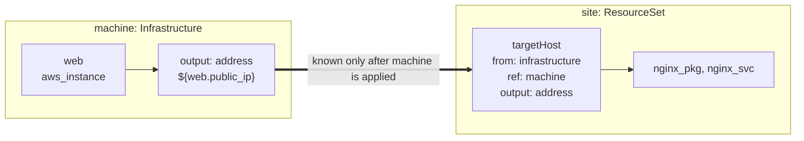
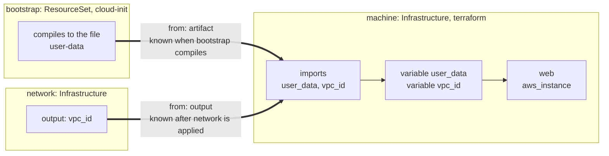
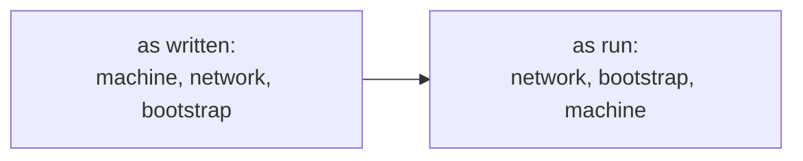
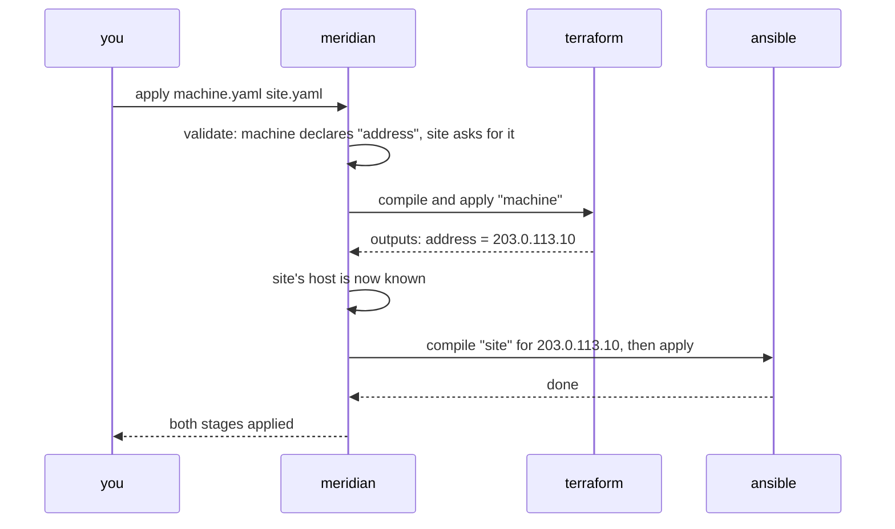

# Outputs and hand-offs: `outputs`, `targetHost` and `imports`

Documents connect only through values. [`targetHost`](#targethost) takes the machine a
ResourceSet configures. [`imports`](#imports) takes any value for the document's tool.



## `outputs`

Only in an Infrastructure document: `spec.outputs`, a list.

```yaml
outputs:
  - name: address
    value: ${web.public_ip}
  - name: url
    value: http://${web.public_ip}:8080
```

| Field | Required | Value |
|---|---|---|
| `name` | yes | the output's name, unique among the document's outputs. This is what another document asks for |
| `value` | give one | text holding one or more [references](references.md). The core does not insist on it, but an output without a value has nothing to report. It may also hold an [interpolation](interpolation.md), which Meridian places before compiling: `https://${web.public_dns}/${{ data.project }}` |
| `when` | no | a [condition](conditions.md#where-a-when-can-be-written) on the output. False, and the output is not declared. Give it the same condition as the resource the output reads |

```
out.yaml:13:7: spec.outputs[1].name: duplicate output name "o" (first declared at out.yaml:12:7)
```

An output is a value the tool reports after apply. It compiles to the tool's own output
(a Terraform `output`, a CloudFormation `Outputs` entry, a Bicep `output`), or the plugin
reads it back (`docker inspect`, `kubectl get`). It can read more than a param can:

| Target | An output can read |
|---|---|
| `terraform`, `opentofu` | any attribute of a resource or data source |
| `cloudformation` | `Ref` and `GetAtt` attributes |
| `bicep` | any property; always reported as text |
| `arm` | a resource's id, name and properties; always reported as text |
| `pulumi` | any property of a resource, with its type kept; a secret is reported as sensitive |
| `packer` | what the build's manifest records for a source: `id`, `artifact_id`, `builder_type`, `build_time`, `files` |
| `docker` | a published port (`${app.port.8080}`), or a path into the container's inspection |
| `kubernetes`, `helm` | any path into the live object, such as `${svc.status.loadBalancer.ingress[0].ip}`; `helm` also anything a template can read |

- An output with no value after apply is an error.
- The Kubernetes target waits, for a limited time, for values that take time to exist.
- Sensitive values show as `(sensitive)`; anything from a Kubernetes Secret is sensitive.
- Outputs stay with the tool. A later run asks the tool again.
- Every infrastructure as code, containerization and container orchestration target has
  outputs ([capability matrix](../capability-matrix.md)); configuration management targets
  do not.

## `targetHost`

Only in a ResourceSet, and required to compile.

### A machine that already exists

```yaml
targetHost:
  from: inline
  host: web01.example.com
```

| Field | Required | Value |
|---|---|---|
| `from` | yes | `inline` |
| `host` | yes | a host name, an address, or `user@host`, as you would give it to the tool: letters, digits and `. - _ : @ [ ] %`, not starting with `-` |

### A machine another document creates

```yaml
targetHost:
  from: infrastructure
  ref: machine
  output: address
```

| Field | Required | Value |
|---|---|---|
| `from` | yes | `infrastructure` |
| `ref` | yes | the `metadata.name` of an Infrastructure document given to the same command |
| `output` | yes | the `name` of an output that document declares |

### Rules

| Rule | Checked by | Message |
|---|---|---|
| `from` is `inline` or `infrastructure` | `validate` | `unknown source "x" (expected "infrastructure" or "inline")` |
| `host` is given with `inline` | `validate` | `missing required field for from: inline` |
| `ref` and `output` are given with `infrastructure` | `validate` | `missing required field for from: infrastructure` |
| the document named exists | `validate` | `no Infrastructure document named "machine" is loaded` |
| it declares that output | `validate` | `Infrastructure "machine" declares no output "address"` |
| a ResourceSet has a `targetHost` at all | `compile` | `document "web" declares no targetHost` |
| the host is a name and nothing a tool reads as more | `validate` for a host written inline; `compile` for one an interpolation places; `apply` for one read from an output | `"-oProxyCommand=..." starts with "-", which a tool would read as an option and not as a host` |

Whitespace, control characters, quotes and other punctuation in a host are refused
wherever it came from; an output that is not a name fails the stage. Plugins check again
(rule `invalid-host`).

Both documents must be given to the same command.

### What the host is used for

The tool reaches the host with its own credentials:

| Target | The host becomes |
|---|---|
| `ansible` | the play's `hosts`, and the entry in `inventory.ini` |
| `puppet`, `openvox` | the node statement in `site.pp`; another machine is reached with Bolt |
| `salt` | the entry in the top file; another machine is reached with `salt-ssh` |
| `chef` | the machine `chef-run` is pointed at |
| `cloud-init` | the machine's name in `meta-data`, and where an apply can wait for the first boot |
| `dsc` | the machine the runner reaches over WinRM or SSH, as `spec.settings.target` says |

## `imports`

`spec.imports`, in either kind: values from other documents, handed to this document's
tool. For example, user-data for a machine, or an id another document created.



```yaml
kind: Infrastructure
metadata: {name: machine}
spec:
  target: terraform
  imports:
    - name: user_data
      from: artifact
      ref: bootstrap
      file: user-data
      sensitive: true
    - name: vpc_id
      from: output
      ref: network
      output: vpc_id
  resources:
    - id: user_data
      type: variable
      params: {type: string, sensitive: true}
    - id: vpc_id
      type: variable
      params: {type: string}
    - id: web
      type: aws_instance
      params:
        ami: ami-0abcdef1234567890
        instance_type: t3.micro
        user_data: ${user_data}
```

| Field | Required | Value |
|---|---|---|
| `name` | yes | the name the value arrives under. It becomes the name of the tool's variable, so it starts with a letter or an underscore and holds only letters, digits and underscores. Unique among the document's imports |
| `from` | yes | `artifact` or `output` |
| `ref` | yes | the `metadata.name` of the other document |
| `file` | with `artifact` | the path of a file the other document compiles to, exactly as `meridian compile` lists it |
| `output` | with `output` | the `name` of an output the other document declares |
| `sensitive` | no | `true` or `false`. `true` masks the value wherever Meridian prints |

### The two sources

| | `from: artifact` | `from: output` |
|---|---|---|
| The value | the whole text of one file the other document compiles to | the value the other document's tool reported for one output |
| The other document | either kind | an Infrastructure document, because only they declare outputs |
| Known | as soon as the other document compiles. No tool has to run | once the other document has been applied, in this run or an earlier one |
| Before it is known | the importing document waits only if the other document itself cannot compile yet | the importing document is **deferred**, as a ResourceSet waiting on a host is |
| `plan` before anything is applied | planned, with the value | deferred |

A file is imported as it compiles now; the run applies its document first.

### How the value arrives

The value reaches the tool under the import's name, as a tool variable. It is never
written into the compiled files.

| Target | The import `user_data` arrives as | The document declares |
|---|---|---|
| `terraform` | the environment variable `TF_VAR_user_data` | a resource of type `variable` with the id `user_data`, read as `${user_data}` |
| `opentofu` | `TF_VAR_user_data` | a `variable`, read as `${user_data}` |
| `packer` | `PKR_VAR_user_data` | a `variable` |
| `pulumi` | the stack configuration value `user_data` (`--config`), always passed as a secret argument | a `config` value |
| `arm` | the template parameter `user_data` (`--parameters`) | a `parameter`; one Meridian is given no value for is left to `az` |
| every other target | refused | |

Strings pass as they are; other values as JSON.

A target without inputs refuses an import at compile:

```
the document imports "user_data", and target "ansible" has no way to hand a value from another document to its tool; remove spec.imports, or use a target that takes inputs
```

See the `inputs` column of the [capability matrix](../capability-matrix.md).

A ResourceSet whose host comes from an Infrastructure document also gets every output of
that document by name, unless an import has the same name.

### Order

A document runs after every document it imports from and its `targetHost` source.



- Nothing waits on a document excluded by a
  [selector](index.md#labels-and-selectors). A file imported from it is compiled
  for the purpose but nothing is applied; an output imported from it is read
  from its last apply.
- A cycle is refused. Common case: a bootstrap document whose `targetHost` is the machine
  its user-data creates. Give it an `inline` host.

### Secrets

- `sensitive: true` masks the value in everything Meridian prints, tool output included.
- A sensitive output stays sensitive when imported.
- Values are never [recorded](../state.md).
- Mark the tool's variable sensitive too (`sensitive: true` on a Terraform `variable`).

### Rules

| Rule | Checked by | Message |
|---|---|---|
| `name` is given | `validate` | `missing required field` |
| `name` can be a variable's name | `validate` | `"user-data" cannot name an import: it becomes the name of the tool's variable, ...` |
| names are unique in the document | `validate` | `duplicate import name "a" (first declared at ...)` |
| `from` is `artifact` or `output` | `validate` | `unknown source "x" (expected "artifact" or "output")` |
| `file` is given with `artifact`, `output` with `output` | `validate` | `missing required field for from: artifact` |
| the other one is not | `validate` | `does not apply to from: artifact, which takes \`file\`` |
| the document named exists | `validate` | `no document named "bootstrap" is loaded` |
| for an output, it is an Infrastructure document | `validate` | `"bootstrap" is a ResourceSet, and only an Infrastructure document declares outputs` |
| it declares that output | `validate` | `Infrastructure "network" declares no output "vpc_id"` |
| for an artifact, the name means one document | `validate` | `both an Infrastructure and a ResourceSet document are named "network", ...; rename one of them` |
| a document does not import from itself | `validate` | `a document cannot import from itself` |
| no documents wait on each other | `validate` | `these documents wait on each other, so none of them can be applied first: ResourceSet "bootstrap" needs Infrastructure "machine" needs ResourceSet "bootstrap"` |
| the target takes imports | `compile` | `the document imports "user_data", and target "ansible" has no way ...` |
| the file is one the other document compiles to | `plan`, `apply` | `import "user_data" is the file "userdata" of ResourceSet "bootstrap", which compiles to no file of that name (it compiles to: meta-data, user-data)` |
| the output was produced | `apply` | `Infrastructure "network" did not produce the output "vpc_id" that import "vpc_id" needs (it produced: ...)` |

Example: [`examples/workflow/bootstrap-then-machine.yaml`](../../../examples/workflow/bootstrap-then-machine.yaml).

## The life of a hand-off



| Moment | State of the ResourceSet |
|---|---|
| `validate` | checked: the document and output it names exist |
| `compile`, or `plan` before the first apply | **deferred**. Reported, not failed, and not compiled against a guess |
| `apply` | compiled for the real value once the Infrastructure stage has succeeded, then applied |
| `plan` on a later run | planned like any other stage, because the tool can report the output |
| the Infrastructure stage fails | **not run** |

```
$ meridian compile examples/workflow/vm-then-web.yaml --out build
machine (Infrastructure, target terraform)
  compiled 1 file into build/machine
site (ResourceSet, target ansible)
  deferred: needs the output "address" of Infrastructure "machine", which has not been applied yet
```

## What cannot be expressed yet

- An import reaches only a tool variable, not a param through `${...}`. Configuration
  management targets cannot import. See the
  [language expansion](../../plans/language-expansion.md).
- A ResourceSet has no outputs; its compiled files can be imported.
- A ResourceSet configures one host.

See [the two-stage architecture](../../concepts/two-stage-architecture.md) and
[a two-stage workflow](../../quickstart/first-two-stage.md).
