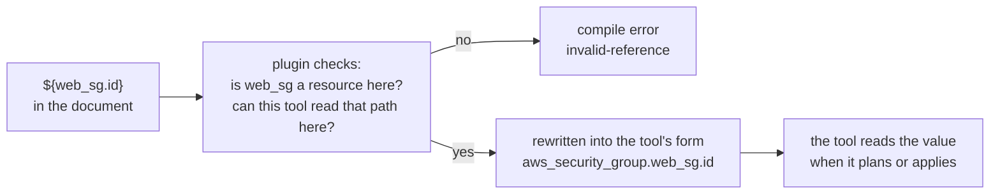
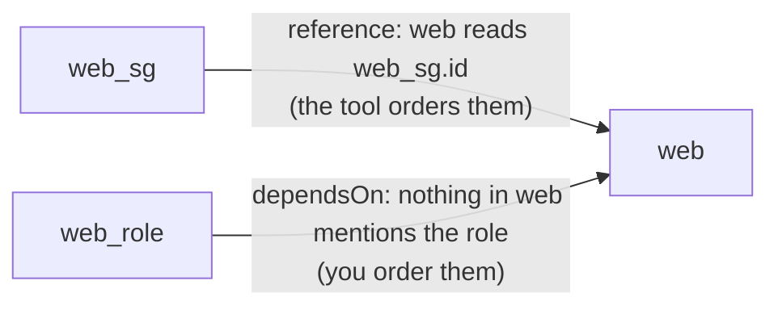

# References

A reference puts a value from one resource into another, or into an output. It carries
data; [`dependsOn`](dependson.md) carries order and [`notifies`](notifies.md) a reaction.

```yaml
params:
  vpc_security_group_ids: ["${web_sg.id}"]
```

## Where a reference can appear

| Place | Read |
|---|---|
| a text value anywhere inside `params`, however deeply nested | yes |
| an output's `value` | yes |
| `runtimeWhen` | no. It is the tool's own language, passed through untouched |
| `id`, `type`, `state`, `metadata`, a key of a mapping | no |

## Syntax

| You write | Meaning |
|---|---|
| `${id}` | the resource with that id, in the tool's own way of naming it |
| `${id.field}` | a value read from it |
| `${id.list[0].field}` | a path: any number of `.field` and `[index]` steps |
| `http://${web.ip}:8080` | a reference inside longer text; the value is placed in the text |
| `$${` | a literal `${`. Use it for text the tool should see as written, such as a shell variable in a script |
| `${upper(x.name)}`, `${a ? b : c}` | not a path: the tool's own expression language, on the targets that have one |

- Spaces just inside the braces are ignored: `${ web.ip }` is `${web.ip}`.
- Braces inside an expression balance, so `${merge({a = 1}, x)}` is one
  expression.
- A `${` that is never closed is an error.
- The first name is the `id` of a resource in the **same document**. Use an
  [output](outputs-and-hand-offs.md) to cross documents.
- A value that is only a reference keeps the type of what it reads, where the
  tool has types. Inside longer text it becomes text.

## How a reference is resolved

Meridian's core only *finds* references. The plugin *rewrites* each one into its
tool's own form, and the tool produces the value when it runs.



So two things are checked when the document is compiled, before anything runs:

1. **The resource exists.**

   ```
   ref.yaml:7:7: terraform: resource "a" [invalid-reference]: param "ami": ${img.id} refers to "img", which is not a resource in this document
   ```

2. **The tool can know the value there.** Some tools read less in a param than in an
   output:

   ```
   kubernetes: resource "a" [invalid-reference]: param "data": ${nosuch.x} refers to "nosuch", which is not an object in this document
   ```

The attribute after the first name is checked by the tool when it plans.

## What a reference becomes, by target

| Target | `${id}` | `${id.path}` | Inside longer text | Not a path |
|---|---|---|---|---|
| `terraform`, `opentofu` | the resource's address | an attribute: `aws_instance.web.public_ip`, or `data.aws_ami.ubuntu.id` for a data source | Terraform interpolation | Terraform's expression language |
| `cloudformation` | `Ref` | `Fn::GetAtt` | `Fn::Sub` | pseudo parameters: `${AWS::Region}` |
| `bicep` | the symbolic name | a property read | Bicep interpolation | Bicep's expression language: `${resourceGroup().location}` |
| `arm` | `resourceId(...)` | the resource's `id`, `name`, `type`, `apiVersion`, or a path into its state, read with `reference(...)` | `format(...)` | ARM's own expressions are written in square brackets, not in `${}` |
| `pulumi` | the resource | a property of the resource | Pulumi YAML interpolation, unchanged | refused: use Pulumi's `fn::` functions |
| `packer` | | a `variable`, a `local` or a `data.<type>`; in an output, what the manifest records for a source | Packer's template syntax | refused |
| `docker` | the element's name | in an output only: a published port, or a path into the container's inspection | the name placed in the text | refused |
| `kubernetes` | the object's name | in a param, only `metadata.name` and `metadata.namespace`; in an output, any path into the live object | the value placed in the text | refused |
| `helm` | another object's name | `metadata.name` and `metadata.namespace` of an object; `${values.path}`, `${release.name}`, `${chart.version}` from its settings resources; in an output, any path into the live object | a Helm template action placed in the text | refused |
| `dsc` | | `${id.Property}`: a property the other resource reported | | |
| `podman` | the unit's name | in an output: a path into `podman inspect` | the name placed in the text | |
| `ansible`, `puppet`, `openvox`, `chef`, `salt`, `cloud-init` | refused | `${id.param}` only: the value the document gives that param, placed at compile time. See [below](#configuration-management-the-shared-types) | the value placed in the text | refused |

Each target's page has its own table under "References".

## References and order

- On tools that derive order from data (Terraform, CloudFormation, Bicep), the
  tool sees the reference and orders the two itself. The plugin does not also
  write a dependency.
- On DSC, the resource that reads is ordered after the one it reads.
- A reference adds no edge to Meridian's sort. Use [`dependsOn`](dependson.md) for order the
  tool cannot see.



## Configuration management: the shared types

On `ansible`, `puppet`, `openvox`, `chef`, `salt` and `cloud-init`, the plugin settles a
reference at compile: `${id.param}` becomes that param's value on resource `id`:

```yaml
- id: site_root
  type: file
  state: directory
  params:
    path: /srv/app

- id: index
  type: file
  params:
    path: ${site_root.path}/index.html   # /srv/app/index.html
    content: hello
```

| You write | You get |
|---|---|
| `${id.param}` as a whole value | that param's value, with its type: a list stays a list |
| `${id.param}` inside longer text | the value placed in the text; it must be a single value |
| a reference to a param that itself holds a reference | followed until it is settled; a chain that comes back to itself is refused |
| `$${` | a literal `${`, as a shell variable in a file's `content` needs |
| `${id}`, `${id.param.deeper}`, `${id.list[0]}` | refused: a reference here is `${id.param}` and nothing else |
| a resource the document does not declare, or a param it does not set | refused |
| `${upper(x.name)}` | refused: these targets have no expression language |

Every refusal is the rule `invalid-reference`, with the line:

```
site.yaml:11:7: puppet: resource "index" [invalid-reference]: param "path": ${nowhere.path} refers to a resource "nowhere", which this document does not declare; for a literal ${ write $${
```

It does not order the two resources; use [`dependsOn`](dependson.md).

## A worked example

Three resources on Terraform, two references and one output:

```yaml
resources:
  - id: ubuntu
    type: data.aws_ami
    params:
      most_recent: true
      owners: ["099720109477"]

  - id: web_sg
    type: aws_security_group
    params:
      name: web

  - id: web
    type: aws_instance
    params:
      ami: ${ubuntu.id}
      instance_type: t3.small
      vpc_security_group_ids: ["${web_sg.id}"]

outputs:
  - name: url
    value: http://${web.public_ip}:8080
```

What the plugin writes:

| In the document | In `main.tf.json` |
|---|---|
| `${ubuntu.id}` | `${data.aws_ami.ubuntu.id}` |
| `${web_sg.id}` | `${aws_security_group.web_sg.id}` |
| `http://${web.public_ip}:8080` | `http://${aws_instance.web.public_ip}:8080` |

Terraform orders `ubuntu` and `web_sg` before `web` and reports `url` after apply. Full
document: [`examples/terraform/web-vm.yaml`](../../../examples/terraform/web-vm.yaml).
