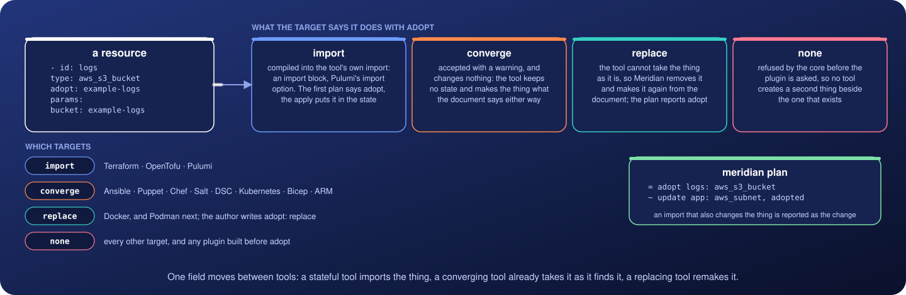

# Resources: `id`, `type`, `state`, `params`, `adopt`

`spec.resources` is a list of at least one resource.

```yaml
- id: nginx_conf
  type: file
  state: present
  params:
    path: /etc/nginx/nginx.conf
    content: "worker_processes 4;\n"
```

Covers the four fields that say what a resource is, and [`adopt`](#adopting-what-exists).
Related fields: [`dependsOn`](dependson.md), [`notifies`](notifies.md),
[`when` and `runtimeWhen`](conditions.md).

## `id`

Required, unique in the document. Used by:

- `dependsOn` and `notifies` name a resource by its id
- `${id}` and `${id.path}` refer to it
- plans, warnings and errors report it
- most targets use it as a name in the tool's own file: the Terraform block
  name, the Bicep symbolic name, the Compose service name, the title of a
  Puppet resource, the name of an Ansible task

```
dup.yaml:11:7: spec.resources[1].id: duplicate resource id "a" (first declared at dup.yaml:8:7)
```

Letters, digits and underscores, starting with a letter, work on every target. Where a
tool needs another spelling, the target derives it and reports your id:

| Target | What the id becomes |
|---|---|
| `cloudformation` | a logical id of letters and digits: `web_vm` is written `WebVm` |
| `kubernetes` | the object's name when `metadata.name` is not given, with underscores as hyphens: `web_config` is `web-config` |
| `terraform`, `opentofu`, `pulumi`, `bicep`, `arm`, `docker` | used as written |

An id is local to its document.

## `type`

Required. Its meaning depends on the target's segment:

| Segment | `type` is | Reference |
|---|---|---|
| Configuration management, shared dialect (`ansible`, `puppet`, `openvox`, `chef`, `salt`, `cloud-init`) | one of the shared types: `package`, `packageRepository`, `file`, `service`, `user`, `group`, `cron`, `exec`; or the tool's own type beside them, such as `ansible.builtin.lineinfile` | [flavour](configuration-management.md), [types](../resource-types.md), [native types](configuration-management.md#native-types-beside-the-six) |
| Configuration management, DSC | `Module/Resource` | [flavour](configuration-management.md#the-native-dialect-dsc) |
| Infrastructure as code | the tool's own type: `aws_instance`, `AWS::EC2::Instance`, `Microsoft.Network/publicIPAddresses@2023-09-01` | [flavour](infrastructure-as-code.md) |
| Containerization | an element of the project: `service`, `network`, `volume`, `config`, `secret` | [flavour](containerization.md) |
| Container orchestration | API version and kind: `apps/v1/Deployment` | [flavour](container-orchestration.md) |

`service` is an OS service to Ansible and a container to Docker. An unknown type is
refused with the list of known ones:

```
type.yaml:8:7: ansible: resource "a" [unsupported-resource-type]: unsupported resource type "firewall" on this target (supported: cron, exec, file, group, package, packageRepository, service, user)
```

Most targets pass the tool's own types through. They check a type's *shape*
and leave its existence to the tool. A Bicep type without its API version is
refused at compile. A Terraform type that no provider has is refused by
Terraform when it plans.

**Settings resources** say where and how the rest is deployed: `provider` and `backend` (Terraform), `stack` (CloudFormation), `provider`, `backend` and `encryption` (OpenTofu),
`stack` and `config` (Pulumi), `deployment` and `parameter` (ARM), `variable`,
`local` and `plugin` (Packer),
`deployment` (Bicep), `project` (Docker), `cluster` (Kubernetes), `values`,
`chart`, `release` and `kustomization` (Helm). Each target page gives their params. `dsc`
uses [`spec.settings`](index.md#settings); its old `runner` resource compiles with a
warning. Other targets will move the same way.

## `state`

Optional. Only the shared configuration management types use it:

| Type | States |
|---|---|
| `package` | `present` (default), `absent`, `latest` |
| `service` | `running` (default), `started`, `stopped` |
| `file` | `present` (default) or `file`, `directory`, `absent` |
| `user`, `group` | `present` (default), `absent` |
| `exec` | none |

Left out, the type's default applies. An unsupported state is refused:

```
st.yaml:8:7: ansible: resource "a" [unsupported-state]: resource type "package" does not accept state "purged" on this target (accepted: absent, latest, present)
```

Every other flavour refuses `state`:

| Target | Why there is no `state` |
|---|---|
| `dsc` | a DSC resource carries its desired state in its own properties (`Ensure`, `_exist`); set it in `params` |
| `terraform`, `opentofu`, `pulumi`, `cloudformation`, `docker`, `podman`, `helm` | the tool removes what the document no longer declares; remove the resource |
| `bicep`, `arm`, `kubernetes` | the tool never deletes; remove the resource from the document and delete it with the tool |
| `packer` | a build only creates images; remove the resource |

## `params`

Optional mapping. The core does not check its field names; the target does.

Values keep their type ([YAML typing](index.md#files)):

```yaml
params:
  mode: "0644"       # text. Unquoted, 0644 would be the number 420
  enabled: true      # a boolean
  enabled: yes       # text, not a boolean
  replicas: 2        # a number
```

**Who checks what.**

| Flavour | How strictly params are checked at compile |
|---|---|
| The six shared types | completely. Every param is known; one the type does not take on that target is refused, never dropped |
| A tool's own type on a shared-dialect target | lightly, as on a passthrough target: the params are the tool's, and the tool is the judge |
| Passthrough targets | lightly. The names and values are the tool's own, so the tool is the judge. The target checks what it must understand to write the file: references, the settings resource, and the few params it treats specially |

```
param.yaml:8:7: ansible: resource "a" [unsupported-param]: resource type "package" does not accept param "version" on this target (accepted: name)
```

On passthrough targets, names are the tool's: `instance_type` for Terraform,
`InstanceType` for CloudFormation. Text may hold [references](references.md).

## Adopting what exists

<p align="center"></p>

`adopt` gives the tool's identifier of something that already exists, so the tool
manages it instead of creating another:

```yaml
- id: logs
  type: aws_s3_bucket
  adopt: example-logs        # the identifier `terraform import` takes
  params:
    bucket: example-logs
```

By target (the `adopt` column of the [capability matrix](../capability-matrix.md)):

| Target says | What happens | Targets |
|---|---|---|
| `import` | Compiled into the tool's import; the first plan reports `adopt` and the apply records it in state | Terraform, OpenTofu, Pulumi |
| `converge` | Accepted with a warning and changes nothing: the tool converges either way | Ansible, Puppet, OpenVox, Chef, Salt, DSC, Kubernetes, Bicep, ARM |
| `replace` | Removed and made again from the document; the plan reports `adopt`. The author writes `adopt: replace` | Docker (Podman next) |
| no | Refused before the plugin is asked | the rest |

- `adopt` is text, and may be placed from data: `adopt: "${{ data.vpc_id }}"`.
  It cannot hold a secret.
- `adopt` with `state: absent` is refused.
- `adopt` on something the tool cannot import, such as a Terraform data source, is
  refused as `invalid-adopt`.
- On a target that says `replace`, the value must be the word `replace`; any
  other value, or `adopt: replace` on something that is not a container, is
  refused as `invalid-adopt`.
- `adopt` can stay after the import; it then does nothing.
- [`meridian retarget`](../../operations/retargeting.md) writes `adopt` lines when a
  document moves to another tool.

## A resource in each flavour


```yaml
# configuration management: an abstract type, a state, a few known params
- id: nginx_svc
  type: service
  state: running
  params:
    name: nginx
    enabled: true

# infrastructure as code: the tool's type and arguments, no state
- id: web
  type: aws_instance
  params:
    ami: ami-0abcdef1234567890
    instance_type: t3.micro

# containerization: an element of the project, its fields as the format has them
- id: app
  type: service
  params:
    image: ghcr.io/example/app:1.4
    ports: ["8080:8080"]

# container orchestration: an API object, its whole body
- id: web_svc
  type: v1/Service
  params:
    spec:
      selector: {app: web}
      ports: [{port: 80}]
```

Complete documents:
[`examples/flavours/`](../../../examples/flavours).
