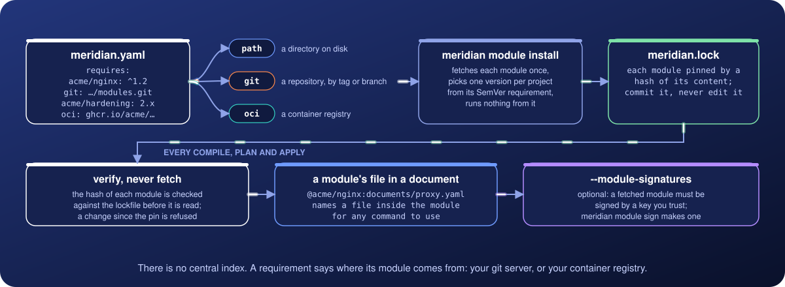

# Modules

A module packages documents and data with a versioned manifest. A project lists the modules
it needs; Meridian fetches them, pins them in a lockfile and verifies them on every run.

<p align="center"></p>

- Sources: a directory, git, or an OCI registry. No central index.
- [SemVer](https://semver.org) requirements, one version per module per project.
- Content hashes in `meridian.lock`, checked on every use.
- Files addressed as `@acme/nginx:documents/proxy.yaml`.
- Published versions cannot be replaced.
- Optional [signatures](#signatures) (`--module-signatures`, off by default).
- Only `module install`, `update` and `push` use the network. Installing runs nothing.

Example project: [`examples/modules`](../../examples/modules/README.md).

## A first module

A module is a directory with a `meridian.yaml`:

```
hardening/
  meridian.yaml
  documents/ssh.yaml
  data/defaults.yaml
```

```yaml
# hardening/meridian.yaml
apiVersion: meridian/v1
kind: Module
metadata:
  name: acme/hardening
  version: 1.2.0
  description: A baseline SSH configuration
```

The project's own `meridian.yaml` requires it:

```yaml
# site/meridian.yaml
apiVersion: meridian/v1
kind: Module
metadata:
  name: example-site
spec:
  modules:
    - name: acme/hardening
      version: "^1.2"
      git: https://git.example.com/acme/meridian-hardening.git
```

```
$ meridian module install
+ acme/hardening 1.2.0 (git+https://git.example.com/acme/meridian-hardening.git)
wrote meridian.lock

$ meridian plan web.yaml @acme/hardening:documents/ssh.yaml \
    --data @acme/hardening:data/defaults.yaml
```

Commit `meridian.yaml` and `meridian.lock`, not `.meridian/`.

## The manifest

The same file serves a module and a project.

```yaml
apiVersion: meridian/v1
kind: Module
metadata:
  name: acme/nginx
  version: 1.4.2
  description: An nginx reverse proxy
spec:
  meridian: ">=0.1.0"
  modules:
    - name: acme/base
      version: "^2.1"
      git: https://git.example.com/acme/meridian-base.git
```

| Field | Required | Value |
|---|---|---|
| `apiVersion` | yes | The [language version](dsl/index.md#apiversion): `meridian/v1` |
| `kind` | yes | `Module` |
| `metadata.name` | yes | One to three parts of lower-case letters, digits and `-`, joined by `/`: `nginx`, `acme/nginx`, `acme/web/nginx`. This is the name others require it by |
| `metadata.version` | to be shared | The module's version, as `MAJOR.MINOR.PATCH`. A project that only uses modules can leave it out. Required for a module fetched by version, and by `meridian module pack` |
| `metadata.description` | no | One line saying what the module is for |
| `spec.meridian` | no | The releases of `meridian` the module works with, as a [version requirement](#version-requirements). A release outside it refuses the module by name |
| `spec.modules` | no | The modules this one needs. See [requiring a module](#requiring-a-module) |
| `spec.credentials` | no | Logins for registries, each naming where its password comes from. See [registry logins](#registry-logins) |
| `spec.settings` | no | How each target's runner is configured for this project, by target and then by setting name. See [plugin settings](#plugin-settings) |

Unknown fields are errors. Quote versions: `version: "1.4"`.

### What goes in a module

Content is found by directory:

| Directory | Holds |
|---|---|
| `documents/` | `Infrastructure` and `ResourceSet` documents |
| `data/` | Data files, as given to `--data` |
| `tests/` | `Test` documents for `meridian test`, naming the module's own files relative to themselves. See [testing a module](#testing-a-module) |
| `composites/`, `functions/` | Reserved for the language's composites and functions |
| `README.md` | What the module is for and how to use it |

`@<module>:<path>` reaches any file. Symlinks and control characters in names are refused;
top-level `.git` and `.meridian` are excluded.

## Requiring a module

Each entry of `spec.modules` has a `name` and exactly one source: `path`, `git`
or `oci`.

| Field | Goes with | Meaning |
|---|---|---|
| `name` | every entry | The module's `metadata.name`. What is found at the source must say the same name |
| `version` | `git`, `oci`; optional with `path` | The versions that will do, as a [requirement](#version-requirements) |
| `path` | | A directory, relative to the manifest that names it |
| `git` | | A repository address: anything `git clone` takes |
| `ref` | `git` | A branch, tag or commit to pin to, instead of `version` |
| `subdir` | `git` | The directory of the repository that holds the module, when it is not the top |
| `oci` | | A registry repository: `registry.example.com/team/module`, with no scheme and no tag |
| `insecure` | `oci` | `true` to use plain HTTP. For a registry on a trusted network only |

### From a directory: `path`

```yaml
- name: acme/base
  path: ../modules/base
```

Read in place, not copied or hashed. An optional `version` must match `metadata.version`.
Fetched modules cannot require by `path`.

### From git: `git`

```yaml
- name: acme/nginx
  version: "^1.4"
  git: https://git.example.com/acme/meridian-nginx.git

- name: acme/tls
  version: "~2.0"
  git: git@git.example.com:acme/platform.git
  subdir: modules/tls

- name: acme/experimental
  git: https://git.example.com/acme/experimental.git
  ref: main
```

- `version` picks from tags `v1.4.2` or `1.4.2`; the tagged `meridian.yaml` must agree.
- `ref` pins the commit a branch, tag or commit points at, until `module update`.
- Not both.

Uses your `git` (`MERIDIAN_GIT` to override) and its logins; never prompts.

### From a registry: `oci`

```yaml
- name: acme/postgres
  version: "~3.2"
  oci: registry.example.com/acme/meridian-postgres
```

Any OCI registry. Versions are tags `3.2.1` or `v3.2.1`. Logins come from the `auths` of
`~/.docker/config.json` (or `$DOCKER_CONFIG`); credential helpers are not run. Or name a
[credential](#registry-logins).

## Registry logins

A project can declare a credential in `meridian.yaml` and name it on a module:

```yaml
apiVersion: meridian/v1
kind: Module
metadata:
  name: site
spec:
  modules:
    - name: acme/postgres
      version: "~3.2"
      oci: registry.example.com/acme/meridian-postgres
      credential: internal-registry
  credentials:
    - name: internal-registry
      type: registry
      server: registry.example.com
      user: ci-reader
      password:
        from: env
        key: REGISTRY_PASSWORD
```

```
$ REGISTRY_PASSWORD=… meridian module install
+ acme/postgres 3.2.4 (oci:registry.example.com/acme/meridian-postgres)
```

Same as [the language's credentials](../concepts/secrets-in-memory.md#a-credential-outside-a-run).
Registries take two types:

| `type` | Fields | Use it when |
|---|---|---|
| `registry` | `server`, `user`, `password` | The login is for one registry. `server` is the registry's host as it is written in `oci` (`registry.example.com`, `localhost:5000`), and the login is only ever sent to that host |
| `usernamePassword` | `user`, `password` (`domain` is not used) | One login serves several registries. It is sent to the registry of every requirement that names it |

`token` is refused; for GitHub or GitLab tokens use `registry` with the token as `password`.
`password` says where the secret is:

| `from` | Also | The secret is |
|---|---|---|
| `env` | `key: NAME` | The value of the environment variable `NAME` |
| `file` | `path: FILE`, and optionally `allowWideMode: true`, `keepTrailingNewline: true` | The contents of `FILE`, without its final newline. The file must be readable by its owner only (mode `0600`) unless `allowWideMode` is set |
| `exec` | `command: [PROGRAM, ARG, …]` | What the program prints, without its final newline. This is how a password manager or a cloud's token command is used: `command: [pass, show, registry/ci]` |

- A literal password is refused.
- `credential` must be declared in the same file, and only on `oci`.
- Only the project's own manifest counts; to log in for a transitive dependency, require it
  yourself.
- A named credential replaces the Docker configuration.
- Fetched only by `module install`, `update` and `push --credential`, once per command.
- Never written down; held in [locked memory](../concepts/secrets-in-memory.md).

To push with one:

```
$ meridian module push registry.example.com/acme/meridian-nginx --credential internal-registry
```

## Plugin settings

Plugins read operator settings (tool path, profile, extra args) from environment variables
([reference](plugin-settings.md), `meridian plugins --settings`). `spec.settings` stores them
with the project:

```yaml
spec:
  settings:
    ansible:
      args: --user deploy --private-key "/home/deploy/.ssh/my key"
    kubernetes:
      args: --context prod
      output-wait: 300
    terraform:
      program: tofu
```

Keys are target, then the setting's short name (`args`, `program`). Values are read as the
environment variable would be.

- **The environment wins** when non-blank.
- **Undeclared names are refused.**
- **No secrets**; use [`spec.secrets`](dsl/secrets.md#handing-a-secret-to-a-tool).

Only the current directory's manifest is read; an unreadable one stops the command.

## Version requirements

Cargo-style requirements:

| Requirement | Means |
|---|---|
| `1.4` or `^1.4` | `>=1.4.0, <2.0.0` |
| `^0.3` | `>=0.3.0, <0.4.0`: before `1.0`, the middle number is the breaking one |
| `~1.4` | `>=1.4.0, <1.5.0` |
| `=1.4.2` | exactly `1.4.2` |
| `>=1.2, <1.8` | both |
| `*` | any version |

Pre-releases are chosen only if the requirement names one.

### How a version is chosen

- One version per module per project.
- The newest that satisfies every requirement.
- Locked versions are kept while they still fit.
- Conflicts are errors:

```
error: no version of acme/base satisfies every requirement on it
    ^2   required by the project
    ^1   required by acme/app 1.0.0
    available: 1.0.0, 1.3.0, 2.1.0
```

So is one name from two sources.

## The lockfile

`meridian module install` writes `meridian.lock` beside the manifest:

```yaml
# Written by `meridian module`. Commit it; do not edit it.
lockVersion: 1
modules:
  - name: acme/base
    version: "2.2.1"
    source: git+https://git.example.com/acme/meridian-base.git
    resolved: "9c1d7be0a4f2a9c1e5b3d8f6a7c2e4b1d0f9a8c7"
    integrity: h1:6b1f0a8f3e0c4c7b9a55d3f7c1e2a4b6d8f0a1c3e5b7d9f1a3c5e7b9d1f3a5c7
  - name: acme/nginx
    version: "1.4.2"
    source: git+https://git.example.com/acme/meridian-nginx.git
    resolved: "4f2a9c1e5b3d8f6a7c2e4b1d0f9a8c79c1d7be0a"
    integrity: h1:91c4d7a2b5e8f1a4c7d0b3e6f9a2c5d8e1b4a7c0d3f6a9b2c5e8d1f4a7b0c3e6
    requires: [acme/base]
```

| Field | Meaning |
|---|---|
| `lockVersion` | The format of the file. A newer `meridian` reads an older lockfile; an older one refuses a newer lockfile |
| `name`, `version` | The module and the version chosen. A module pinned by `ref`, or a `path` module, may have no version |
| `source` | Where it comes from: `git+<address>`, with `//<subdir>` and `#<ref>` when given; `oci+<repository>`; `path+<directory>` |
| `resolved` | Exactly what was fetched: the git commit, or the digest of the registry manifest. This, not the tag, is what a later fetch asks for |
| `integrity` | The [content hash](#integrity) the module must have |
| `requires` | The modules this one requires |

`path` modules have no `resolved` or `integrity`. Every field is validated before use. The
file is sorted with no timestamps. Commit it.

## Integrity

`integrity` is `h1:` plus the SHA-256 of a sorted listing of `<file sha256>  <path>` lines,
excluding `meridian.sig`. It is the same from git or a registry. Checked on fetch, on every
use, and by `module verify`.

| What happened | What you see |
|---|---|
| A file in `.meridian/modules` was edited | `acme/nginx 1.4.2 in .meridian/modules/acme/nginx/1.4.2 does not match meridian.lock`, with both hashes. Delete that directory and install again |
| A git tag was moved to another commit after you pinned it | Nothing changes: the pinned commit is what is fetched, not the tag |
| A registry serves different bytes for a digest | `the registry … answered a request for sha256:… with different content` |
| The source now serves content that does not match the pin | `what git+… now serves does not match meridian.lock`. If the change is expected, run `meridian module update <name>` |
| The module is pinned but not fetched | `acme/nginx 1.4.2 is not installed; run meridian module install` |

Archives with non-plain entries, escaping or duplicate paths, or over 256 MiB unpacked are
refused.

## Signatures

A signed module has `meridian.sig`, made by [`module sign`](#sign). Same keys,
`--trusted-key` and policies as [plugin signatures](plugin-signatures.md).

| Option | Environment | Default | Meaning |
|---|---|---|---|
| `--module-signatures POLICY` | `MERIDIAN_MODULE_SIGNATURES` | `off` | `off` does not look. `warn` uses a module that is unsigned or whose signature does not pass, and says so on standard error. `require` uses only modules signed by a trusted key |
| `--trusted-key FILE` | `MERIDIAN_TRUSTED_KEYS` (separated by `:`, or `;` on Windows) | the key a released `meridian` was built with | a public key to trust, or a directory of `*.pub` files; may be repeated |

Set them in the environment:

```
export MERIDIAN_MODULE_SIGNATURES=require
export MERIDIAN_TRUSTED_KEYS=/etc/meridian/trusted-keys
```

Checked for every fetched module (not `path`) by `install` and `update` before locking, on
every use after the hash, and by `module verify`.

The signature covers name, version and [content hash](#integrity), so it cannot be reused
for another module or version, or as a plugin signature.

| What you see | What it means |
|---|---|
| `acme/nginx 1.4.2 is not signed: it holds no meridian.sig` | The publisher did not sign this version. Under `require` it is refused |
| `its signature does not pass: it was signed by key 3fa9…, which is not a trusted key` | It is signed, by a key you have not named. If you trust that publisher, get their public key from them and add it with `--trusted-key` |
| `its signature does not pass: the module is not the module that was signed: its contents have changed` | The signature belongs to other content, another version or another module |
| `warning: acme/nginx 1.4.2 is not signed` | The same findings under `warn`: the module was used anyway |

There is no revocation list; remove a `.pub` file to retire a key.

## Using a module's files

A file in a module is written `@<module>:<path>`:

```
meridian validate @acme/nginx:documents/proxy.yaml
meridian plan site.yaml @acme/nginx:documents/proxy.yaml
meridian apply site.yaml @acme/nginx:documents/proxy.yaml \
    --data @acme/nginx:data/defaults.yaml --data prod.yaml
```

Anywhere a document or `--data` file is given. The module must be pinned, the path cannot
leave it, and the command runs from the project directory. Later `--data` files override
earlier ones.

## Commands

Run from the project directory.

```
meridian module install [--locked]
meridian module update [NAME]...
meridian module verify
meridian module list
meridian module sign --key FILE
meridian module pack [--out FILE]
meridian module push REPOSITORY [--insecure]
```

| Option | Environment | Default | Meaning |
|---|---|---|---|
| `--state-dir DIR` | `MERIDIAN_STATE_DIR` | `.meridian` | Fetched modules are kept in `DIR/modules` |
| `--module-signatures POLICY` | `MERIDIAN_MODULE_SIGNATURES` | `off` | Whether fetched modules must be [signed](#signatures): `off`, `warn` or `require` |
| `--trusted-key FILE` | `MERIDIAN_TRUSTED_KEYS` | | A public key whose signatures are trusted; may be repeated |

### `install`

Resolves, fetches what is missing, and updates `meridian.lock`.

```
$ meridian module install
+ acme/nginx 1.4.2 (git+https://git.example.com/acme/meridian-nginx.git)
+ acme/base 2.2.1 (git+https://git.example.com/acme/meridian-base.git)
wrote meridian.lock
```

| Line | Meaning |
|---|---|
| `+ name version (source)` | newly pinned |
| `~ name old -> new` | the pin moved |
| `- name version` | no longer required, and removed from the lockfile |
| `N modules unchanged` | pins that stayed where they were |

With a lockfile it fetches exactly what is pinned. `--locked` fails if the lock would
change (use in CI):

```
meridian module install --locked
meridian plan site.yaml @acme/nginx:documents/proxy.yaml
```

### `update`

Moves pins (all, or the named ones) to the newest allowed version, or a `ref`'s current
commit.

```
$ meridian module update acme/nginx
~ acme/nginx 1.4.2 -> 1.5.0
1 module unchanged
wrote meridian.lock
```

To go further, change the requirement and run `install`.

### `verify`

Checks every pin (exit `1` on failure), and with `--module-signatures` each
[signature](#signatures):

```
$ meridian module verify --module-signatures require --trusted-key keys/acme.pub
ok      acme/base 2.2.1  signed by key 3fa91c0e5d7b2a48
ok      local
```

Unsigned is `ok … not signed` under `warn`, `FAILED` under `require`.

```
$ meridian module verify
ok      acme/base 2.2.1
FAILED  acme/nginx 1.4.2
    acme/nginx 1.4.2 in .meridian/modules/acme/nginx/1.4.2 does not match meridian.lock
    ...
error: 1 module failed verification
```

### `list`

Pinned modules from `meridian.lock`.

```
$ meridian module list
acme/base   2.2.1  git+https://git.example.com/acme/meridian-base.git
acme/nginx  1.4.2  git+https://git.example.com/acme/meridian-nginx.git
local       -      path+../local
```

### `sign`

Writes `meridian.sig` for the current directory's module.

```
$ meridian module sign --key ~/keys/acme.key
signed acme/nginx 1.4.2 with key 3fa91c0e5d7b2a48
  integrity: h1:9b1f…
  wrote:     meridian.sig
```

Keys come from [`meridian signing keygen`](cli.md#signing). Sign last; any later change makes
it stale.

### `pack`

Writes the registry archive. Needs `metadata.version`.

```
$ meridian module pack
packed acme/nginx 1.4.2 into .meridian/packages/acme-nginx-1.4.2.tar.gz
  size:       1843 bytes
  integrity:  h1:91c4d7a2…
  media type: application/vnd.meridian.module.layer.v1.tar+gzip
```

`--out FILE` to choose the path. Output is deterministic; `integrity` is what consumers
pin.

### `push`

Publishes to an OCI registry as `metadata.version`.

```
$ meridian module push registry.example.com/acme/meridian-nginx
published acme/nginx 1.4.2 to registry.example.com/acme/meridian-nginx:1.4.2
  digest:     sha256:3f1c…
  integrity:  h1:91c4d7a2…
```

`REPOSITORY` has no scheme or tag. `--insecure` uses HTTP. `--credential NAME` uses a
[declared credential](#registry-logins). Re-pushing the same content is a no-op; different
content under an existing version is refused. `digest` becomes consumers' `resolved`.

## Testing a module

Tests live under `tests/`:

```yaml
# tests/proxy.test.yaml
apiVersion: meridian/v1
kind: Test
metadata:
  name: proxy
spec:
  documents: [../documents/proxy.yaml]
  data: [../data/defaults.yaml]
  cases:
    - name: the defaults compile
      expect:
        proxy: {outcome: compiled}
```

Run `meridian test` in the module directory. `module install` runs no tests. See
[testing](testing.md).

## Publishing

### To git

Tag the commit with the version:

```
git tag v1.4.2
git push origin v1.4.2
```

Signed:

```
meridian module sign --key ~/keys/acme.key
git add meridian.sig && git commit -m "Release 1.4.2"
git tag v1.4.2
```

Tag and `metadata.version` must agree. Never move a pushed tag.

### To a registry

An OCI artifact with one layer:

| | |
|---|---|
| Artifact type | `application/vnd.meridian.module.v1` |
| Layer media type | `application/vnd.meridian.module.layer.v1.tar+gzip` |
| Tag | the version: `1.4.2` or `v1.4.2` |

```
meridian module push registry.example.com/acme/meridian-nginx
```

Run `module sign` before pushing; a published version cannot be signed later. Any OCI tool
using these media types works, such as [`oras`](https://oras.land):

```
meridian module pack --out module.tar.gz
oras push registry.example.com/acme/meridian-nginx:1.4.2 \
  --artifact-type application/vnd.meridian.module.v1 \
  module.tar.gz:application/vnd.meridian.module.layer.v1.tar+gzip
```

Tags use `_` for `+`: `1.4.2_build.5` is `1.4.2+build.5`.

## Where modules are kept

Under the state directory:

```
.meridian/modules/<name>/<version>/
.meridian/modules/<name>/ref-<commit>/      for a module pinned by ref
```

A cache; safe to delete, not to edit.

## When something goes wrong

| Message | Cause | Fix |
|---|---|---|
| `the project requires modules and has no meridian.lock` | The modules were never installed here | `meridian module install` |
| `meridian.lock is out of date with meridian.yaml: …` | The manifest changed since the lockfile was written | `meridian module install`, and commit the lockfile |
| `… is not installed` | The lockfile is there but the module has not been fetched on this machine | `meridian module install` |
| `no version of … satisfies every requirement on it` | Two requirements cannot both hold, or the source has no such version | Loosen a requirement; the message lists who requires what, and what exists |
| `… is required from two different sources` | Two manifests name different sources for one module | Make them agree |
| `… holds the module X, and it was required as Y` | The `name` in the requirement is not the module's `metadata.name` | Use the module's own name |
| `the version X of … holds a manifest that says Y` | A tag and the module's `metadata.version` disagree | Fix it in the module and release a new version |
| `… needs meridian >=X, and this is meridian Y` | The module's `spec.meridian` excludes this release | Upgrade `meridian`, or use an older version of the module |
| `… requires … by path, which only works between modules on disk` | A fetched module names a `path` source | The module must name a `git` or `oci` source |
| `the registry … did not allow reading …` or `writing to …` | No login, or a refused one | `docker login` for that registry, or [name a credential](#registry-logins) for it. `the credential X was refused` means the registry did not accept that user and password |
| `the credential X is for the registry A, and … is on B; it was not sent` | A `registry` credential's `server` is not the host in `oci` | Fix `server`, or declare a credential for that registry |
| `the credential X is a token credential; …` | A registry is logged in to with a user and a password | Declare it as `registry`, with the token as `password` |
| `spec.modules[N].credential: no credential named X is declared in spec.credentials` | The requirement names a credential the file does not declare | Declare it under `spec.credentials`, or fix the name |
| `spec.credentials[N].password: a password is written in the file; …` | The secret itself is in `meridian.yaml` | Replace it with where it comes from, such as `{from: env, key: NAME}`, and change the password that was written down |
| `the credential X: …` | The secret could not be fetched: a variable that is not set, a file that is missing or readable by others, a command that failed | The rest of the message names the provider and what went wrong |
| `… is already published in … with different content` | A push of a version that exists, with other files | Raise `metadata.version` and push again |
| `… is not a Meridian module: it has no layer of type …` | The registry tag holds something else, such as a container image | Check the repository; see [publishing to a registry](#to-a-registry) |
| `… is not signed: it holds no meridian.sig` | Signatures are required and this version was published without one | Ask the publisher to sign a release, pin a signed version, or use `--module-signatures warn` |
| `… its signature does not pass: it was signed by key …, which is not a trusted key` | It is signed by a key you have not named | Add the publisher's public key with `--trusted-key` |
| `… is not a module of this project` | `@name:path` names a module that is not pinned | Add it to `spec.modules` and install |
| `the git program was not found` | A git module needs `git` | Install git, or set `MERIDIAN_GIT` |

## For plugin and tool authors

Crate `meridian-module`: `Modules::load` (verifies), `meridian_module::sign`,
`Modules::resolve` (`@<module>:<path>`), `Modules::roots`. Design:
[modules and versioning](../plans/modules-and-versioning.md).
