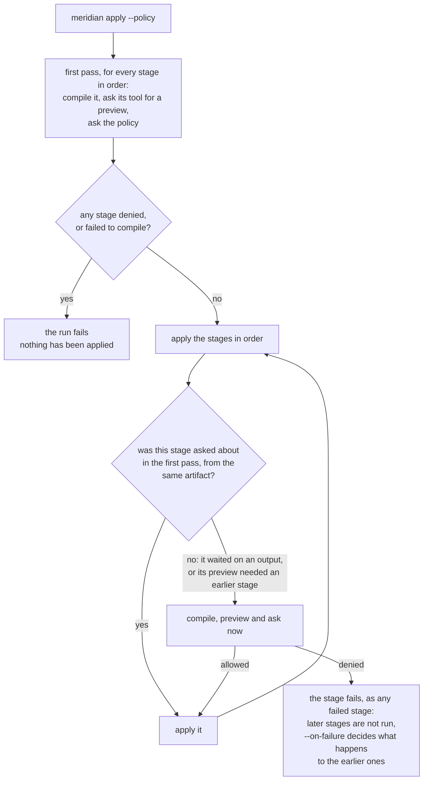
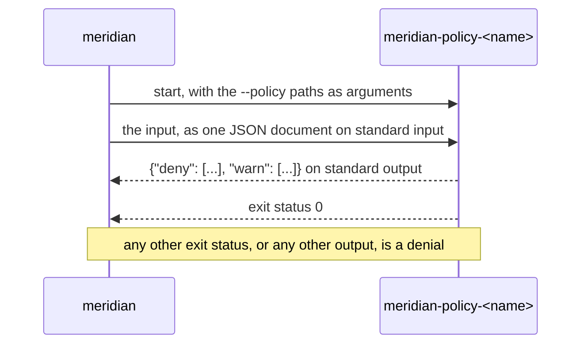

# Policy checks

`meridian plan` and `meridian apply` can ask a policy whether each stage may change.

```sh
meridian plan  site.yaml --policy policies/
meridian apply site.yaml --policy policies/
```

Policies are [Rego](https://www.openpolicyagent.org/docs/latest/policy-language/) via Open
Policy Agent, or any language with [an engine](#writing-an-engine). See also
[running safely](../concepts/run-safety.md#asking-a-policy-first).

## Options

| Option | Environment | Default | Meaning |
|---|---|---|---|
| `--policy PATH` | | no policy | `plan` and `apply`: a policy file or directory. May be repeated; every one is handed to the engine |
| `--policy-engine NAME` | `MERIDIAN_POLICY_ENGINE` | `opa` | the engine: the program `meridian-policy-<NAME>` in a [plugin directory](cli.md#options) |

`--policy` on `compile`, `drift` or `rollback` is an error; rollbacks are never checked. A
missing policy path or engine is refused before the run.

## When a policy is asked



- **`apply`** checks every stage (compiled and previewed) before applying any. Any denial
  fails the run with nothing applied.
- Stages waiting on an unapplied output, whose tool cannot preview, or that read
  [secrets](dsl/secrets.md) are checked just before their own apply. A denial then stops
  the run as a failed stage would.
- Stages excluded by `spec.when` or skipped by a
  [resume](../concepts/run-safety.md#picking-up-where-a-run-stopped) are not checked.
- **`plan`** checks every stage, reports denials as failed, keeps going, and exits `1`.

Each stage is asked once, on its own.

## What a policy says

An answer is two lists of messages.

| | Effect |
|---|---|
| `deny` | each message is a reason the change may not be made. Any message fails the stage |
| `warn` | each message is shown beside the stage, and stops nothing |

```
network (Infrastructure, target terraform)
  policy warning: network has no env label, so no environment's rules apply to it
  policy: allowed
  + create aws_vpc.main
```

```
network (Infrastructure, target terraform)
  FAILED: the policy does not allow this change:
      - network: aws_db_instance.main would be a replace in prod
web (ResourceSet, target ansible)
  not run, because Infrastructure "network" failed
run 2026-11-17T09-14-03Z-0cc7 was stopped by its policy before anything was applied
```

### Failing closed

These are denials:

- the engine cannot start or exits non-zero;
- its answer is not the [expected JSON](#the-engine-protocol);
- with OPA: `opa` is missing, a policy does not parse, or package `meridian` defines
  nothing.

## The input

For each stage the policy is given one JSON document. In Rego it is `input`.

```json
{
  "run":   {"id": "2026-11-17T09-14-03Z-0cc7", "mode": "apply"},
  "stage": {
    "name": "web",
    "kind": "ResourceSet",
    "target": "ansible",
    "category": "configuration-management",
    "host": "203.0.113.10",
    "labels": {"env": "prod", "tier": "web"}
  },
  "resources": [
    {"id": "nginx_conf", "type": "file", "state": "present",
     "params": {"path": "/etc/nginx/nginx.conf", "mode": "0644"}}
  ],
  "artifact": {"files": {"site.yml": "- hosts: all\n  tasks: ..."}},
  "plan": {
    "changes": [
      {"resource": "nginx_conf", "action": "update", "summary": "content differs"}
    ],
    "unknown": false
  }
}
```

| Field | Holds |
|---|---|
| `run.id` | the run's id |
| `run.mode` | `plan` or `apply` |
| `stage.name` | the document's `metadata.name` |
| `stage.kind` | `Infrastructure` or `ResourceSet` |
| `stage.target` | the document's `spec.target` |
| `stage.category` | what the target's plugin says it is: `infrastructure-as-code`, `configuration-management`, `containerization`, `container-orchestration` or `unspecified` |
| `stage.host` | the machine a ResourceSet configures; empty for an Infrastructure document |
| `stage.labels` | the document's `metadata.labels`; an empty object when it has none |
| `resources` | the resources as they were handed to the target, in order, after every [`when`](dsl/conditions.md) was decided: a resource a condition left out is not here |
| `resources[].id`, `.type`, `.state`, `.params` | as the document wrote them |
| `artifact.files` | what the document compiled to: each file's path and its whole text |
| `plan` | what the tool says an apply would change, or `null` when the target cannot preview |
| `plan.changes[].resource` | the id the tool reports, which is the document's resource id wherever the tool allows it |
| `plan.changes[].action` | `create`, `update`, `delete` or `replace`. A replace destroys and creates again |
| `plan.changes[].summary` | the tool's own one-line description; may be empty |
| `plan.unknown` | `true` when the tool could not say everything it would change |

Fields are added, never renamed or removed.

- `plan` is `null` when the target cannot preview; test `input.plan == null` or
  `input.plan.unknown` to refuse those.
- In an apply's first pass, the plan predates every stage of the run.

## Secrets

The input can hold secrets.

- It goes to the engine on stdin only, never to disk.
- Neither it nor the messages are recorded; the [record](state.md#events) keeps the decision
  and counts.
- Messages show on the terminal with sensitive values masked. Name resources rather than
  quoting params.

## Events

| Type | When | `detail` |
|---|---|---|
| `policy.passed` | the policy allowed the stage | `kind`, `denials` (0), `warnings`, `asked` (`true`) |
| `policy.denied` | the policy denied the stage, or could not be asked | `kind`, `denials`, `warnings`, `asked`: `false` when the engine could not be asked |

A denied stage then has a `step.failed` event with the reason
`policy-denied`, and `meridian status` shows it as `failed (policy-denied)`.

```sh
meridian events --type 'policy.*'
```

## The OPA engine

`meridian-policy-opa` needs [OPA](https://www.openpolicyagent.org/docs/latest/#running-opa)
1.0+ as `opa` on `PATH` or in `MERIDIAN_OPA`. It reads `deny` and `warn` (strings or
`{msg}` objects) from package `meridian`, as [Conftest](https://www.conftest.dev/) does.

```rego
package meridian

import rego.v1

# Nothing in production is deleted, or destroyed and created again, by a run.
deny contains msg if {
	input.stage.labels.env == "prod"
	some change in input.plan.changes
	change.action in {"delete", "replace"}
	msg := sprintf("%s: %s would be a %s in prod", [input.stage.name, change.resource, change.action])
}

# Every stage says which environment it belongs to.
warn contains msg if {
	not input.stage.labels.env
	msg := sprintf("%s has no env label, so no environment's rules apply to it", [input.stage.name])
}
```

Full example: [`examples/policy`](https://github.com/ZanattaMichael/meridian-core/tree/main/examples/policy).
Each `--policy` path is passed as `--data` (JSON and YAML become `data`). The engine runs:

```sh
opa eval --format json --stdin-input --data <path>... data.meridian
```

To test without Meridian, use `--input input.json` instead of `--stdin-input`.

## The engine protocol

An engine is a program `meridian-policy-<name>` on the plugin path, run once per stage.



| | |
|---|---|
| Arguments | the `--policy` paths, in the order given, exactly as typed |
| Standard input | [the input](#the-input), as one JSON document, then end of file |
| Standard output | one JSON object with `deny` and `warn`, each a list of strings, or of objects with a string under `msg`. Either may be left out. No other key is allowed |
| Standard error | on failure, why. Meridian shows the last line |
| Exit status | `0` when the engine answered, whether or not it denied anything. Anything else means it could not answer, which Meridian reads as a denial |
| Environment | Meridian's own; an engine reads its settings from there, as the OPA engine reads `MERIDIAN_OPA` |

### Writing an engine

This shell engine denies every stage on a Friday:

```sh
#!/bin/sh
# meridian-policy-friday
cat > /dev/null                      # the input; this policy does not need it
if [ "$(date +%u)" = 5 ]; then
  echo '{"deny": ["no changes on a Friday"]}'
else
  echo '{}'
fi
```

```sh
meridian apply site.yaml --policy . --policy-engine friday
```

Never write the input anywhere; exit non-zero on anything unexpected.

## What this does not do yet

- One stage at a time; no cross-stage rules.
- No per-run override of a denial.
- One engine process per stage.
