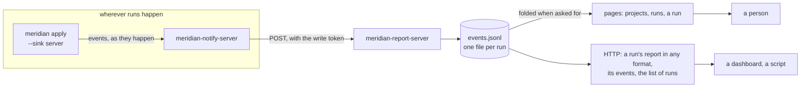

# The report server

`meridian-report-server` is optional. It receives events from the `server`
[sink](reporting.md#sinks), keeps them, lists runs per project, and serves every
[report format](reporting.md#the-formats) over HTTP.

It does not run or approve anything, hold infrastructure state or values, speak TLS (put it
behind a proxy), or manage users (one write token, one read token).

## How it fits



It stores only events, laid out like a run's [record](state.md), and builds pages with the
same code as `meridian report`.

## Running it

```
MERIDIAN_SERVER_TOKEN="$(openssl rand -hex 32)" \
    meridian-report-server --listen 127.0.0.1:8717 --data /var/lib/meridian-reports
```

| Option | Environment | Default | Meaning |
|---|---|---|---|
| `--listen ADDR` | `MERIDIAN_SERVER_LISTEN` | `127.0.0.1:8717` | the address to listen on. Port `0` picks a free one; the first line printed says which |
| `--data DIR` | `MERIDIAN_SERVER_DATA` | `meridian-reports` | where the events are kept |
| `--token-file FILE` | `MERIDIAN_SERVER_TOKEN` holds the token itself | | the write token: what a sender must present to add events. **Required**, and at least 16 characters |
| `--read-token-file FILE` | `MERIDIAN_SERVER_READ_TOKEN` holds the token itself | reading is open | the read token: what a reader must present |
| `--keep-runs N` | | `1000` | how many runs each project keeps; the oldest are removed |

Tokens come from a file or the environment, never an argument.

### Before you expose it

| | |
|---|---|
| TLS | the server speaks plain HTTP. Keep it on the loopback address behind a reverse proxy that terminates TLS, or on a private network. A token sent over plain HTTP across a network is a token given away |
| Reading | with no read token, anyone who can reach the server can read every run. Reports hold names, never values, but names of hosts, steps and resources are still worth protecting: set a read token unless the network already limits who can reach it |
| Writing | the write token lets its holder add events to any project. It cannot read a secret, change a run that is stored, or start anything. Give CI the write token only |
| Disk | a request may carry 4 MiB and a run 200,000 events; `--keep-runs` bounds each project. Projects are created by whoever holds the write token |

Browsers give the read token as the password. Programs send
`Authorization: Bearer <token>`. The write token also reads.

## Sending runs to it

The sink is [`examples/sinks/meridian-notify-server`](../../examples/sinks/meridian-notify-server),
a `curl` script, placed in a plugin directory.

```
export MERIDIAN_NOTIFY_TOKEN=...            # the server's write token
meridian apply site.yaml --sink server \
    --sink-config server.url=https://reports.example.com \
    --sink-config server.project=shop
```

| Setting | Meaning |
|---|---|
| `url` | the server's address. Required |
| `project` | the project the run is filed under: letters, digits, `-` and `_`. `default` when not set |
| `token` | the write token. Required. Set it as `MERIDIAN_NOTIFY_TOKEN` in the environment, not with `--sink-config`, which would leave it in your shell history |
| `timeout` | seconds to allow each request; `10` by default |

`server.on` filters events. A down server is a warning unless `server.required=true`. To
send an old run:

```
meridian events RUN | curl --fail --data-binary @- \
    -H "Authorization: Bearer $MERIDIAN_NOTIFY_TOKEN" \
    https://reports.example.com/v1/projects/shop/runs/RUN/events
```

## What it shows

| Page | Shows |
|---|---|
| `/` | every project, how many runs it has, and how its latest run went |
| `/projects/{project}` | the project's newest 200 runs, newest first, with counts by kind of run |
| `/projects/{project}/runs/{run}` | the run's [HTML report](reporting.md#html), with links to the other formats. While the run is going the page reloads itself every 3 seconds; it uses no script |

## HTTP interface

| Request | Answers |
|---|---|
| `POST /v1/projects/{project}/runs/{run}/events` | adds events, one JSON object per line. `200` with `{"accepted":N,"ignored":M}`. Needs the write token |
| `GET /v1/projects/{project}/runs` | the newest 200 runs as JSON: `run`, `mode`, `status`, `started`, `finished`, `steps`, `failed`, `changed`, `drifted` |
| `GET /v1/projects/{project}/runs/{run}/events` | the run's events, one per line, in order |
| `GET /v1/projects/{project}/runs/{run}/report/{format}` | the run's report: `json`, `junit`, `markdown`, `html` or `sarif` |
| `GET /healthz` | `ok`. Needs no token |

Sending is idempotent by sequence number. Events may arrive in any order.

| Status | Means |
|---|---|
| `400` | a line is not an event, an event belongs to a different run, or the project or run is not a plain name. Nothing from the request was stored |
| `401` | the token is missing or wrong |
| `404` | no such project, run or format |
| `413` | the request is over 4 MiB, or the run is full |

Events are re-serialised, so unknown fields are dropped.

## What is on disk

```
<data>/projects/<project>/runs/<run>/events.jsonl
```

One file per run, one event per line, no database. Read one with
`meridian report --from <data>/projects/shop/runs/<run>/events.jsonl`; delete a directory
to delete a run. Nothing outside the data directory is read, links included.
