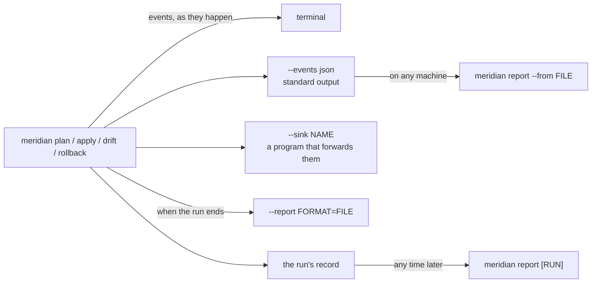
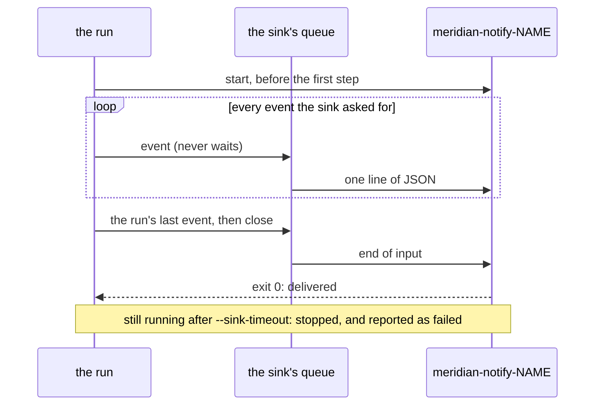

# Reports and sinks

What a run tells people and other systems, and how to get it where you need
it. This page covers what works today. What is planned, an OpenTelemetry
sink among it, is in [the reporting plan](../plans/reporting.md). The
optional server that collects runs has [its own page](report-server.md).

**Supported:** a live stream of events; report files in JSON, JUnit XML,
Markdown and HTML, written by the run or afterwards; sinks that are sent the
events as they happen; a [report server](report-server.md) fed by a sink.
**Not supported yet:** SARIF (a policy result is reported as counts); sinks configured in a document (they are named
on the command line); `notification.*` events; a built-in HTTP client, so the
webhook and server sinks shipped as examples need `curl`.

## How it fits together

A run says everything it does as [events](state.md#events). Reporting is
three ways of reading that one stream, and nothing else is ever read: not
your documents, not the compiled files, not what a tool printed.



| You want | Use |
|---|---|
| to watch a run | nothing: the terminal shows it |
| a program to follow a run | [`--events json`](cli.md#options) |
| test results in CI | `--report junit=meridian.xml` |
| a summary on a pull request or a job page | `--report markdown=FILE` |
| a page to keep with the build | `--report html=meridian.html` |
| numbers for a script | `--report json=meridian.json` |
| a report of a run that already happened | [`meridian report`](#meridian-report) |
| runs in a chat channel, a pager, a dashboard | a [sink](#sinks) |
| every run of every project in one place | the [report server](report-server.md) |

### No value is ever in a report

An event names things: a step, a resource id, an output. It never holds a
value from a document or a tool, sensitive or not, and a failure is a fixed
word such as `tool-failed`, never the tool's own message, because a tool can
quote a secret in one. Reports and sinks are made from events and nothing
else, so there is nothing to mask and nothing to leak. The tool's own
output is on the terminal of the run, masked, and nowhere else.

## `--report`

```
meridian apply site.yaml \
    --report junit=out/meridian.xml \
    --report markdown=out/summary.md \
    --report html=out/meridian.html
```

`--report FORMAT=FILE` may be given more than once, on `compile`, `plan`,
`apply`, `drift` and `rollback`. The files are written when the run ends,
whether it succeeded or failed; the directory is made if it is not there. A
format that does not exist is refused before anything runs. A report that
cannot be written is a warning, not a failed run: the tools did their work.

A run that was refused before it started, because the state is locked for
example, has no events and writes no report.

## `meridian report`

```
meridian report [RUN] [--format FORMAT] [--out FILE]
meridian report --from FILE [--format FORMAT] [--out FILE]
```

Writes a report of a recorded run, the last one when no run is named, to
standard output or to `--out`. The format is `markdown` unless `--format`
says otherwise. It reads the same [state](state.md) the run wrote, so
`--state-dir`, `--backend` and `--backend-config` apply.

`--from` reads events from a file instead, one JSON object per line as
`--events json` and `meridian events` write them; `-` reads standard input.
The machine that reports need not be the machine that ran:

```
meridian apply site.yaml --events json > events.jsonl
meridian report --from events.jsonl --format html --out meridian.html
```

A report made from the record also says who ran it and where, which the
events alone do not.

## The formats

`md` is accepted for `markdown` and `xml` for `junit`.

### `markdown`

```markdown
## ✗ Meridian apply failed: 2 steps, 1 failed, 4 resources changed

- **Run:** 2026-11-17T09-53-36Z-1110
- **Command:** apply site.yaml
- **Started:** 2026-11-17T09:53:36.312Z
- **Duration:** 26 ms

| Step | Target | Endpoint | Status | Changes | Duration |
|---|---|---|---|---|---|
| Infrastructure network | terraform |  | ✓ succeeded | 4 changed | 12 ms |
| ResourceSet web | ansible | 10.0.0.5 | ✗ failed | none | 8 ms |

### What needs attention

- **ResourceSet web** failed: the tool reported a failure
```

Each step's resources and output names follow in a collapsed section. In
GitHub Actions, `--report markdown="$GITHUB_STEP_SUMMARY"` puts it on the
job's page.

### `junit`

A run is a test suite and a step is a test case, named by its kind and name,
with its target as the class: `meridian.ansible`, `ResourceSet web`.

| The step | Is reported as |
|---|---|
| succeeded, or was put back | a passed test case |
| failed | `<failure type="REASON">`, the reason being the fixed word, such as `tool-failed` or `policy-denied` |
| drifted, in a `drift` run | `<failure type="drift">` |
| could not be put back | `<failure type="rollback-failed">` |
| skipped, deferred, or not run because an earlier step failed | `<skipped>` |
| never finished, because the run died | `<error type="unfinished">` |

The resources a step changed, and the names of its outputs, are its
`<system-out>`. The run's id, mode, status and command are `<properties>`.

### `html`

One page with no scripts and nothing fetched from anywhere, so it opens from
a build's artifacts or an email. It follows the reader's light or dark
setting.

### `json`

One document. Its shape is named in `schema`; fields are added without
changing the name, and the name changes if one is removed or changes
meaning.

| Field | Holds |
|---|---|
| `schema` | `meridian.report/v1` |
| `run`, `mode`, `command` | the run's id, `compile`/`plan`/`apply`/`drift`/`rollback`, and what was typed |
| `status` | `succeeded`, `failed`, or `running` when no event says how it ended |
| `started`, `finished`, `durationMs` | times in UTC; `durationMs` is `null` for a run that did not finish |
| `resumes`, `rollsBack` | the run this one continues, or puts back |
| `user`, `host`, `selector` | from the run's record; empty when the report was made with `--from` |
| `events` | how many events the report was folded from |
| `summary` | counts: `steps`, `succeeded`, `failed`, `skipped`, `notRun`, `deferred`, `rolledBack`, `running`, `planned`, `changed`, `drifted` |
| `steps[]` | `name`, `kind`, `target`, `endpoint`, `status`, `reason`, `artifact`, `started`, `finished`, `durationMs`, `waitingOn`, `waitingFor`, `drift`, `rollback`, `resources[]`, `outputs[]` |
| `steps[].status` | `running`, `succeeded`, `failed`, `skipped`, `deferred`, `not-run`, `rolled-back` |
| `steps[].drift` | `none`, `detected`, `unknown`; empty when the run was not a drift check |
| `steps[].policy`, `policyDenials`, `policyWarnings` | `passed` or `denied`, empty when no [policy](policy.md) was asked, and how many rules denied and warned. Counts only: a rule's message is not in an event |
| `steps[].rollback` | `succeeded`, `failed`, `unavailable`; empty when the step was not put back |
| `steps[].resources[]` | `id`, `action`, and `phase`: `planned` or `changed` |
| `steps[].outputs[]` | `name` and `sensitive`. Never a value |

## Sinks

A sink is a program that is sent the run's events as they happen and
forwards them somewhere else.

```
meridian apply site.yaml \
    --sink webhook \
    --sink-config webhook.url=https://example.com/meridian \
    --sink-config webhook.on='run.*,step.failed'
```

| Option | Environment | Meaning |
|---|---|---|
| `--sink NAME` | `MERIDIAN_SINKS` (separated by `,`) | send events to this sink; may be repeated. `command` is built in; any other is the program `meridian-notify-<NAME>` in a [plugin directory](cli.md#options) |
| `--sink-config SINK.KEY=VALUE` | | a setting for a sink; may be repeated |
| `--sink-timeout DURATION` | | how long a sink has to finish sending after the run's last event; `30s` by default |

Two settings are Meridian's own, for every sink:

| Setting | Meaning |
|---|---|
| `on` | the [event types](state.md#events) the sink is sent, separated by commas. `step.*` takes a family and `*` everything, which is the default |
| `required` | `true`: the run fails, with exit status 1, when the sink fails. By default a failed sink is a warning and the run's result stands, because a chat outage must not stop a deployment |

Every other setting is the sink's own and reaches its program as an
environment variable. A setting that is a credential is better set as that
variable directly than typed as an option: `MERIDIAN_NOTIFY_SECRET=...`
reaches every sink of the run, and stays out of your shell history. Settings
are never written to the run's record.

### The `command` sink

Runs the program its `program` setting names. It is the quickest way to try
something:

```
meridian apply site.yaml --sink command \
    --sink-config command.program=./notify.sh \
    --sink-config command.on=run.failed
```

### Sinks shipped as examples

[`examples/sinks`](../../examples/sinks) holds three, all short shell
scripts meant to be read and copied.

| Sink | Settings | Does |
|---|---|---|
| `file` | `path` | appends every event to a file |
| `server` | `url`, `project`, `token` | sends each event to a [Meridian report server](report-server.md) |
| `webhook` | `url`; optional `secret`, `timeout` | posts each event as JSON with `curl`. With a `secret`, each request carries `X-Meridian-Signature: sha256=<HMAC-SHA256 of the body, in hex>` |

### A sink never holds a run up



- Each sink has its own queue. A sink too slow to keep up misses events
  rather than slowing a step; how many is reported as a warning.
- A sink that cannot be started is an error before anything runs.
- What a sink printed on its standard error is shown, its last line, when it
  fails.

### Writing a sink

A sink is any executable named `meridian-notify-<name>` in a plugin
directory. Contract, version 1:

| | |
|---|---|
| Arguments | none |
| Standard input | one [event](state.md#events) per line, as JSON, in order, as each happens. It closes when the run is over |
| Environment | `MERIDIAN_NOTIFY_PROTOCOL=1`; `MERIDIAN_NOTIFY_NAME`, the name it was asked for by; each setting as `MERIDIAN_NOTIFY_<SETTING>`, upper-cased, anything but a letter or digit becoming `_` |
| Standard output | ignored |
| Standard error | for a person; the last line is shown if the sink fails |
| Exit status | `0` when everything it was sent was delivered; anything else is a failure |

A sink should refuse a protocol version it does not know, read to the end of
its input, and finish soon after. It is started once per run, so it can keep
a connection open, batch, or build one summary from the whole run. The
smallest complete one is
[`meridian-notify-file`](../../examples/sinks/meridian-notify-file).

## In CI

GitHub Actions, with test results, a job summary and the page kept:

```yaml
- name: Apply
  run: |
    meridian apply site.yaml \
      --report junit=out/meridian.xml \
      --report markdown="$GITHUB_STEP_SUMMARY" \
      --report html=out/meridian.html
- name: Keep the report
  if: always()
  uses: actions/upload-artifact@v4
  with:
    name: meridian-report
    path: out/
```

A scheduled drift check that fails the job, and says which steps drifted:

```
meridian drift site.yaml --report junit=drift.xml
```

`drift` exits `2` when something drifted, and each drifted step is a failed
test case.
