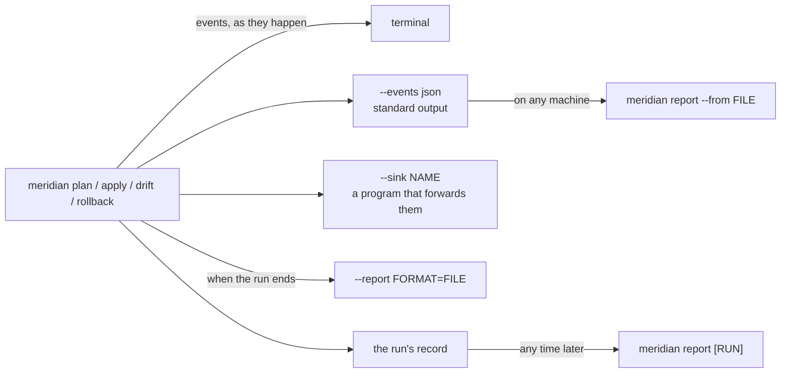
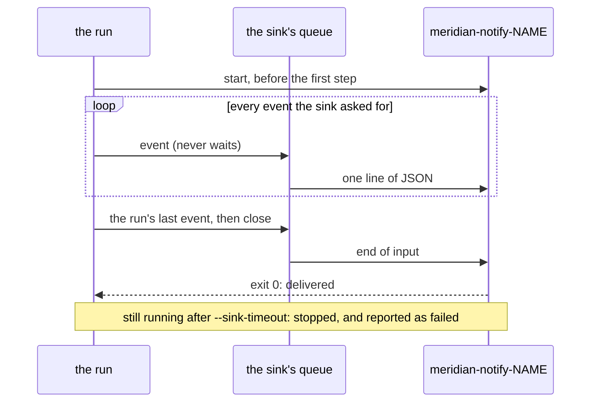

# Reports and sinks

Live events, report files (JSON, JUnit XML, Markdown, HTML), sinks, and a
[report server](report-server.md). Not yet: SARIF, sinks in documents, `notification.*`
events, a built-in HTTP client (the example sinks use `curl`). Plans:
[reporting plan](../plans/reporting.md).

## How it fits together

All reporting reads only the run's [events](state.md#events).



| You want | Use |
|---|---|
| to watch a run | nothing: the terminal shows it |
| a program to follow a run | [`--events json`](cli.md#options) |
| test results in CI | `--report junit=meridian.xml` |
| a summary on a pull request or a job page | `--report markdown=FILE` |
| a page to keep with the build | `--report html=meridian.html` |
| an [analyzer](analyzers.md)'s findings on the pull request, line by line | `--report sarif=findings.sarif`, uploaded to code scanning |
| numbers for a script | `--report json=meridian.json` |
| a report of a run that already happened | [`meridian report`](#meridian-report) |
| runs in a chat channel, a pager, a dashboard | a [sink](#sinks) |
| every run of every project in one place | the [report server](report-server.md) |

### No value is ever in a report

Events hold names and fixed failure words (`tool-failed`), never values or tool messages.
Tool output appears only on the terminal, masked.

## `--report`

```
meridian apply site.yaml \
    --report junit=out/meridian.xml \
    --report markdown=out/summary.md \
    --report html=out/meridian.html
```

`--report FORMAT=FILE` (repeatable) on `compile`, `plan`, `apply`, `drift` and `rollback`
writes when the run ends, pass or fail. Unknown formats are refused up front; a write
failure is a warning. A run refused before starting writes no report.

## `meridian report`

```
meridian report [RUN] [--format FORMAT] [--out FILE]
meridian report --from FILE [--format FORMAT] [--out FILE]
```

Reports a recorded run (default: the last) to stdout or `--out`, as `markdown` unless
`--format` is given. Reads the [state](state.md) (`--state-dir`, `--backend`). `--from FILE`
(or `-`) reads JSON-lines events instead, so it can run on another machine:

```
meridian apply site.yaml --events json > events.jsonl
meridian report --from events.jsonl --format html --out meridian.html
```

A report from the record also names who ran it and where.

## The formats

`md` is accepted for `markdown` and `xml` for `junit`.

### `markdown`

```markdown
## ✗ Meridian apply failed: 2 steps, 1 failed, 4 resources changed

- **Run:** 2026-11-17T09-53-36Z-1110
- **Command:** apply site.yaml
- **Started:** 2026-11-17T09:53:36.312Z
- **Duration:** 26 ms

| Step | Target | Endpoint | Status | Changes | Duration |
|---|---|---|---|---|---|
| Infrastructure network | terraform |  | ✓ succeeded | 4 changed | 12 ms |
| ResourceSet web | ansible | 10.0.0.5 | ✗ failed | none | 8 ms |

### What needs attention

- **ResourceSet web** failed: the tool reported a failure
```

Resources and output names are in collapsed sections. In GitHub Actions use
`--report markdown="$GITHUB_STEP_SUMMARY"`.

### `junit`

A run is a suite; a step is a case named by kind and name, class `meridian.<target>`.

| The step | Is reported as |
|---|---|
| succeeded, or was put back | a passed test case |
| failed | `<failure type="REASON">`, the reason being the fixed word, such as `tool-failed`, `policy-denied` or `analysis-failed` |
| drifted, in a `drift` run | `<failure type="drift">` |
| could not be put back | `<failure type="rollback-failed">` |
| skipped, deferred, or not run because an earlier step failed | `<skipped>` |
| never finished, because the run died | `<error type="unfinished">` |

Changed resources and output names are `<system-out>`; run id, mode, status and command
are `<properties>`.

### `html`

One self-contained page, no scripts, light or dark.

### `sarif`

[SARIF 2.1.0](https://docs.oasis-open.org/sarif/sarif/v2.1.0/sarif-v2.1.0.html),
the format code scanning reads, holding every [analyzer](analyzers.md)
finding of the run and nothing else: one `run` per analyzer, its rules under
the tool's `driver`, each finding a `result` whose location is the Meridian
document and the line the resource starts on (the compiled file's when the
finding could not be traced), with the severity, step, target, resource and
compiled place under `properties`. The level is `error` for `critical` and
`high`, `warning` for `medium` and `note` below. An accepted finding carries
a `suppression`, which code scanning shows as dismissed. A run with no
analyzer writes a log with no runs.

```yaml
- run: meridian plan site.yaml --analyze checkov --report sarif=findings.sarif
- uses: github/codeql-action/upload-sarif@v3
  if: always()
  with:
    sarif_file: findings.sarif
```

### `json`

One document, versioned by `schema`; the name changes only if a field is removed or
changes meaning.

| Field | Holds |
|---|---|
| `schema` | `meridian.report/v1` |
| `run`, `mode`, `command` | the run's id, `compile`/`plan`/`apply`/`drift`/`rollback`, and what was typed |
| `status` | `succeeded`, `failed`, or `running` when no event says how it ended |
| `started`, `finished`, `durationMs` | times in UTC; `durationMs` is `null` for a run that did not finish |
| `resumes`, `rollsBack` | the run this one continues, or puts back |
| `user`, `host`, `selector` | from the run's record; empty when the report was made with `--from` |
| `events` | how many events the report was folded from |
| `summary` | counts: `steps`, `succeeded`, `failed`, `skipped`, `notRun`, `deferred`, `rolledBack`, `running`, `planned`, `changed`, `drifted` |
| `steps[]` | `name`, `kind`, `target`, `endpoint`, `status`, `reason`, `artifact`, `started`, `finished`, `durationMs`, `waitingOn`, `waitingFor`, `drift`, `rollback`, `resources[]`, `outputs[]`, `findings[]` |
| `steps[].status` | `running`, `succeeded`, `failed`, `skipped`, `deferred`, `not-run`, `rolled-back` |
| `steps[].drift` | `none`, `detected`, `unknown`; empty when the run was not a drift check |
| `steps[].policy`, `policyDenials`, `policyWarnings` | `passed` or `denied`, empty when no [policy](policy.md) was asked, and how many rules denied and warned. Counts only: a rule's message is not in an event |
| `steps[].analysis`, `findingsReported`, `findingsAccepted`, `findingsFailing` | `passed` or `failed`, empty when no [analyzer](analyzers.md) looked; how many findings were not accepted, were accepted, and reached `--fail-on` |
| `steps[].findings[]` | `analyzer`, `rule`, `severity`, `message`, `file`, `line`, `resource`, `document`, `documentLine`, `url`, `accepted` |
| `steps[].rollback` | `succeeded`, `failed`, `unavailable`; empty when the step was not put back |
| `steps[].resources[]` | `id`, `action`, and `phase`: `planned` or `changed` |
| `steps[].outputs[]` | `name` and `sensitive`. Never a value |

## Sinks

A sink is a program sent the run's events as they happen.

```
meridian apply site.yaml \
    --sink webhook \
    --sink-config webhook.url=https://example.com/meridian \
    --sink-config webhook.on='run.*,step.failed'
```

| Option | Environment | Meaning |
|---|---|---|
| `--sink NAME` | `MERIDIAN_SINKS` (separated by `,`) | send events to this sink; may be repeated. `command` is built in; any other is the program `meridian-notify-<NAME>` in a [plugin directory](cli.md#options) |
| `--sink-config SINK.KEY=VALUE` | | a setting for a sink; may be repeated |
| `--sink-timeout DURATION` | | how long a sink has to finish sending after the run's last event; `30s` by default |

Two settings are Meridian's own, for every sink:

| Setting | Meaning |
|---|---|
| `on` | the [event types](state.md#events) the sink is sent, separated by commas. `step.*` takes a family and `*` everything, which is the default |
| `required` | `true`: the run fails, with exit status 1, when the sink fails. By default a failed sink is a warning and the run's result stands, because a chat outage must not stop a deployment |

Other settings reach the program as environment variables. Set credentials directly in
the environment (`MERIDIAN_NOTIFY_SECRET=...`). Settings are never recorded.

### The `command` sink

Runs the program in its `program` setting:

```
meridian apply site.yaml --sink command \
    --sink-config command.program=./notify.sh \
    --sink-config command.on=run.failed
```

### Sinks shipped as examples

[`examples/sinks`](../../examples/sinks) has three shell scripts:

| Sink | Settings | Does |
|---|---|---|
| `file` | `path` | appends every event to a file |
| `server` | `url`, `project`, `token` | sends each event to a [Meridian report server](report-server.md) |
| `webhook` | `url`; optional `secret`, `timeout` | posts each event as JSON with `curl`. With a `secret`, each request carries `X-Meridian-Signature: sha256=<HMAC-SHA256 of the body, in hex>` |

### A sink never holds a run up



- A sink that falls behind drops events, with a warning.
- A sink that cannot start is an error before the run.
- A failed sink shows its last stderr line.

### Writing a sink

An executable `meridian-notify-<name>` on the plugin path. Contract, version 1:

| | |
|---|---|
| Arguments | none |
| Standard input | one [event](state.md#events) per line, as JSON, in order, as each happens. It closes when the run is over |
| Environment | `MERIDIAN_NOTIFY_PROTOCOL=1`; `MERIDIAN_NOTIFY_NAME`, the name it was asked for by; each setting as `MERIDIAN_NOTIFY_<SETTING>`, upper-cased, anything but a letter or digit becoming `_` |
| Standard output | ignored |
| Standard error | for a person; the last line is shown if the sink fails |
| Exit status | `0` when everything it was sent was delivered; anything else is a failure |

Refuse unknown versions, read to end of input, then exit. One process per run. Smallest
example: [`meridian-notify-file`](../../examples/sinks/meridian-notify-file).

## In CI

GitHub Actions:

```yaml
- name: Apply
  run: |
    meridian apply site.yaml \
      --report junit=out/meridian.xml \
      --report markdown="$GITHUB_STEP_SUMMARY" \
      --report html=out/meridian.html
- name: Keep the report
  if: always()
  uses: actions/upload-artifact@v4
  with:
    name: meridian-report
    path: out/
```

Scheduled drift check:

```
meridian drift site.yaml --report junit=drift.xml
```

`drift` exits `2` on drift; each drifted step is a failed test case.
