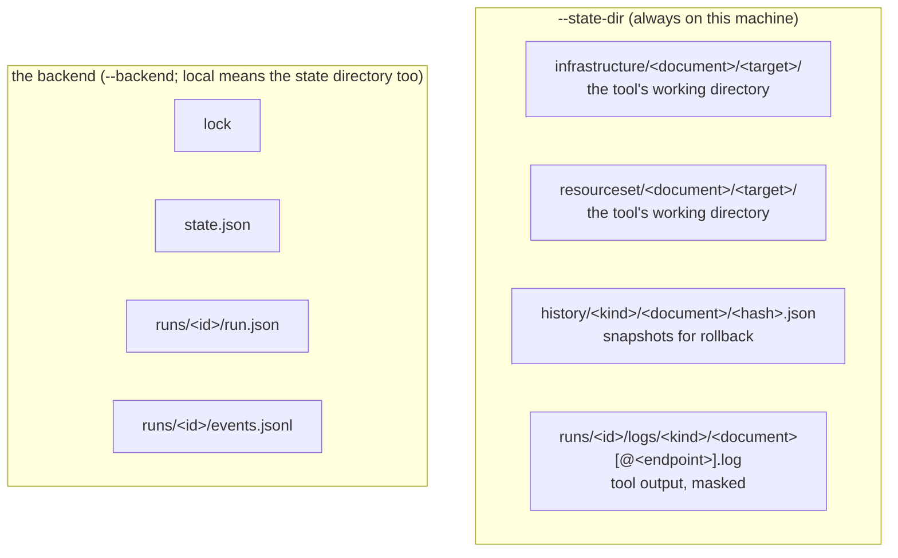
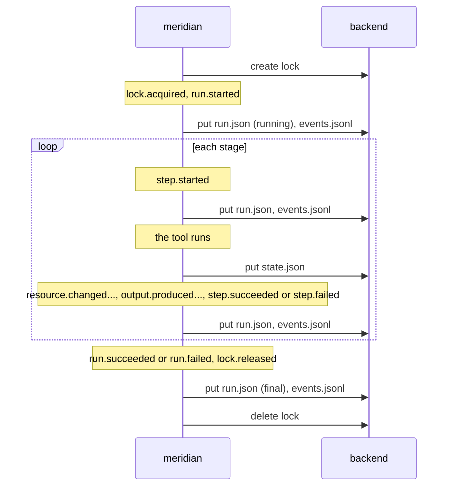

# State, runs and backends

What Meridian keeps about its runs. See also [running safely](../concepts/run-safety.md).

## What is kept, and where



| Key | Holds | Written |
|---|---|---|
| `lock` | who holds the state, and for what | when a `plan`, `apply`, `drift` or `rollback` starts; removed when it ends |
| `state.json` | the last apply of every stage | after every apply, successful or not |
| `runs/<id>/run.json` | one run's summary | when the run starts, and at every step boundary |
| `runs/<id>/events.jsonl` | one run's events, in order | with `run.json` |

A working directory belongs to the plugin; Meridian keeps it between runs and never reads it.

The local backend writes files atomically, mode `0600`.

**The record holds no secret value.** Only names, ids, hashes, counts and times; never a
param, output value, data file or tool output. Tool output is kept apart, masked, on this
machine only: [`runs/<id>/logs/`](#runsidlogs).

## `history/`

For [rollback](../concepts/run-safety.md#putting-a-run-back), each stage keeps two
artifacts at `history/<kind>/<document>/<hash>.json` (files by path): the one just applied
and the last good one.

Snapshots hold content, so they stay **only on the machine that applied**, mode `0600`,
never in a backend. Another machine cannot roll that stage back. A snapshot whose hash does
not match is refused.

## `runs/<id>/logs/`

Each step's tool output, written as the tool prints it, one file per step:
`runs/<id>/logs/<kind>/<document>[@<endpoint>].log` under the state
directory, as in `resourceset/web@203.0.113.10.log`. A character of the
endpoint other than a letter, a digit, `.`, `-` or `_` becomes `_`. Each line
is

```
2026-11-17T09:15:11.102Z stderr fatal: [203.0.113.10]: FAILED! => {"msg": "No package matching 'nginx'"}
```

the time in UTC, the stream, and the text. The stream is `stdout` or `stderr`
for the tool's own lines, and `meridian` for what Meridian adds: the failure
of a step (`step failed (<reason>): <message>`) or of its rollback, and where
lines were cut.

- **Masked.** Every secret the stage fetched and every sensitive output of an
  earlier stage is replaced by `(sensitive)` before the line is written, as on
  the terminal.
- **Local only.** Like `history/`, the logs stay in the state directory on
  the machine that ran and are never sent to a backend. With the local backend
  they sit beside `run.json`. Files are readable only by their owner (mode
  `0600`).
- **Capped.** `--log-limit` (default `10MiB`) bounds each step's file. Past
  the first half of it, only the last half is kept, held in memory until the
  step ends, and a `meridian cut N lines (M bytes) ...` line marks the gap.
  A run that is killed keeps the start of the step's output, not its end.
- **Kept with the run.** When old run records are removed (`--keep-runs`),
  their logs are removed too.
- `--no-logs` (or `MERIDIAN_NO_LOGS`) keeps none. `compile` keeps none.

The endpoint is known once a step ends. Until then, and in a run that was
killed, the file has no `@<endpoint>`. A rollback adds its lines to the end of
the step's file.

[`meridian logs`](cli.md#logs) reads these files, and
[`meridian bug-report`](cli.md#bug-report) packs them with the run's record.

## `lock`

```json
{"command":"apply site.yaml","host":"build-07","id":"2026-11-17T09-14-03Z-0cc7","pid":4242,"since":"2026-11-17T09:14:03.204Z","user":"mike"}
```

| Field | Value |
|---|---|
| `id` | the id of the run that took it; what `meridian unlock` is given |
| `user`, `host`, `pid` | best effort: the operating system user, the machine's name and the process. They identify nobody and authenticate nothing |
| `command` | what the run is doing: the subcommand, the files and the selector |
| `since` | when it was taken |

The lock uses the backend's atomic "create only if absent". An unreadable lock is still a
lock.

## `state.json`

One entry per stage, keyed by the document's kind and name:

```json
{
  "infrastructure/network": {
    "artifactHash": "sha256:9f2c...",
    "lastGood": "sha256:9f2c...",
    "run": "2026-11-17T09-14-03Z-0cc7",
    "status": "applied",
    "target": "terraform"
  },
  "resourceset/web": {
    "artifactHash": "sha256:41d0...",
    "lastGood": "sha256:77aa...",
    "run": "2026-11-17T09-14-03Z-0cc7",
    "status": "failed",
    "target": "ansible"
  }
}
```

| Field | Value |
|---|---|
| `target` | the target the document selected |
| `artifactHash` | the hash of the artifact that was applied, or that the apply was attempted with |
| `status` | `applied` or `failed` |
| `run` | the run that did it |
| `lastGood` | the artifact hash of the last apply that succeeded; equal to `artifactHash` after a success, unchanged by a failure, empty when no apply ever succeeded |

An artifact's hash covers every file's path and content, so it is reproducible.

## `runs/<id>/run.json`

```json
{
  "id": "2026-11-17T09-14-03Z-0cc7",
  "mode": "apply",
  "command": "apply site.yaml",
  "user": "mike",
  "host": "build-07",
  "selector": "",
  "started": "2026-11-17T09:14:03.204Z",
  "finished": "2026-11-17T09:15:11.910Z",
  "status": "failed",
  "resumes": "",
  "steps": [
    {"kind": "Infrastructure", "name": "network", "target": "terraform", "endpoint": "",
     "status": "succeeded", "artifact": "sha256:9f2c...", "changes": 4, "reason": "",
     "previous": "sha256:1b7e..."},
    {"kind": "ResourceSet", "name": "web", "target": "ansible", "endpoint": "203.0.113.10",
     "status": "failed", "artifact": "sha256:41d0...", "changes": 2, "reason": "tool-failed",
     "previous": "sha256:77aa..."}
  ]
}
```

| Field | Value |
|---|---|
| `id` | the run's id: the second it started, and four characters that order and separate runs within that second |
| `mode` | `plan`, `apply`, `drift` or `rollback` |
| `status` | `running`, `succeeded` or `failed`. A run that was stopped with Ctrl-C or by a time limit is `failed`, with a step whose `reason` says which; a run that was killed stays `running` |
| `resumes` | the run this one continued, when it was started with `--resume` |
| `selector` | the `-l` selection, when there was one |

A step's `previous` is the hash of its last successful apply before this run (empty if
none).

A step's `status`:

| Status | Meaning |
|---|---|
| `running` | the step had started when the record was last written |
| `succeeded` | it did what was asked: planned, applied, or checked for drift |
| `failed` | it failed; `reason` says what kind of failure |
| `skipped` | a resumed run found it already applied from the same artifact |
| `deferred` | it waits on an output that does not exist yet |
| `not-run` | an earlier step failed, so it was not attempted |
| `rolled-back` | it was applied again from the artifact of its last successful apply; `artifact` is that artifact's hash |

A step's `reason`, when it failed:

| Reason | Meaning |
|---|---|
| `no-plugin` | no plugin provides the document's target |
| `compile-refused` | the document was refused before or while it was compiled |
| `not-supported` | the target cannot do what was asked, such as apply |
| `plugin-failed` | the plugin itself failed: its process died, or the call did |
| `tool-failed` | the tool said no: it exited non-zero, or could not reach the machine |
| `state-failed` | the step's working directory could not be prepared |
| `policy-denied` | the run's [policy](policy.md) does not allow the change, or could not be asked |
| `interrupted` | the operator stopped the run with Ctrl-C (or a `SIGTERM`) while the step was going, or before its tool was started |
| `timed-out` | the step's tool ran past `--stage-timeout` and was stopped |
| `plan-differs` | an `apply --plan` compiled the stage to an artifact other than the one the saved plan recorded, or the plan previewed a stage the document now leaves out; the stages after it are not run |

These words are never reused. See also
[error kinds and codes](errors.md#stages-of-a-run-meridian-orchestrator).

## Events

`runs/<id>/events.jsonl` has one JSON object per line.

```json
{"attempt":1,"detail":{"artifact":"sha256:41d0...","changes":2,"kind":"ResourceSet","reason":"tool-failed"},"endpoint":"203.0.113.10","instance":"web","run":"2026-11-17T09-14-03Z-0cc7","seq":14,"step":"web","target":"ansible","time":"2026-11-17T09:15:11.204Z","type":"step.failed","workflow":""}
```

| Field | Value |
|---|---|
| `run` | the run |
| `seq` | the event's place in the run, from 1, strictly increasing |
| `time` | when, in UTC |
| `type` | what happened; the table below |
| `step` | the document's name; empty for an event about the run as a whole |
| `instance` | the same as `step` today |
| `endpoint` | the machine the step configures, when there is one |
| `target` | the step's target |
| `attempt` | `1` for a step's event, `0` for the run's |
| `workflow` | empty today |
| `detail` | what else there is to say; fixed per type |

| Type | When | `detail` |
|---|---|---|
| `lock.acquired` | the run holds the lock | `id` |
| `run.started` | the run begins | `mode`, `command`, `resumes`, `rollsBack` (the run a `rollback` puts back), `plan` (the run that took the saved plan an `apply --plan` carries out), `toolDebug` (the [`--tool-debug`](cli.md#asking-a-tool-for-more-output) level, 0 when off) |
| `step.started` | a step begins | `kind` |
| `resource.planned` | one line of a plan, or of a drift check | `kind`, `resource`, `action` |
| `resource.changed` | one thing an apply or a rollback changed, including what a failed apply had done before it failed | `kind`, `resource`, `action` |
| `output.produced` | an apply produced an output | `kind`, `name`, `sensitive`. Never the value |
| `policy.passed` | the run's [policy](policy.md) allowed the step | `kind`, `denials` (0), `warnings`, `asked`. Counts, never the messages |
| `policy.denied` | the policy denied the step, or could not be asked | `kind`, `denials`, `warnings`, `asked`: `false` when the engine could not be asked |
| `step.succeeded` | the step did what was asked | `kind`, `artifact`, `changes`; a plan also has `unknown` |
| `step.failed` | the step failed | `kind`, `reason`, `artifact`, `changes` |
| `step.skipped` | the step was not run | `kind`, `reason`: `already-applied` (with `artifact`, `appliedIn`) `earlier-step-failed` (with `becauseOf`), or `when-false`: the document's own `spec.when` left it out. The condition is not recorded |
| `step.deferred` | the step waits on an output | `kind`, `waitingOn`, `output` |
| `drift.none` | a drift check found the step in sync | `kind`, `artifact`, `changes` (0) |
| `drift.detected` | a drift check found the step drifted | `kind`, `artifact`, `changes` |
| `drift.unknown` | a drift check could not call it either way | `kind`, `artifact`, `changes`, `reason`: `never-applied`, `no-preview`, `document-changed` or `last-apply-failed` |
| `rollback.started` | a step is about to be put back | `kind`, `to` (the artifact hash) |
| `rollback.succeeded` | it was put back | `kind`, `to`, `changes` |
| `rollback.failed` | putting it back failed; the rollback stops | `kind`, `to`, `reason` |
| `rollback.unavailable` | it could not be put back, and was left | `kind`, `reason`: `first-apply`, `no-snapshot`, `applied-since`, `document-missing`, `host-unknown`, `imports-unknown`, `no-plugin`, `state-failed` or `earlier-rollback-failed` |
| `run.succeeded`, `run.failed` | the run ends | `steps`, `failed`, `rolledBack` |
| `lock.released` | the run is about to release the lock | `id` |

`action` is `create`, `update`, `delete` or `replace`. `resource` is the tool's id, mapped
to the document's id where possible.



Events are written whole at each step boundary; a run that dies keeps them up to the last
one.

## Choosing a backend

| Option | Environment | Default | Meaning |
|---|---|---|---|
| `--backend NAME` | `MERIDIAN_BACKEND` | `local` | `local`, or the name of a backend program |
| `--backend-config KEY=VALUE` | | | a setting for the backend; may be repeated |
| `--state-dir DIR` | `MERIDIAN_STATE_DIR` | `.meridian` | the working directories, and with `local` the record too |

Taken by `plan`, `apply`, `drift`, `rollback`, `status`, `runs`, `events` and `unlock`.

## Writing a backend

A backend is a program `meridian-backend-<name>` on the plugin path, run once per
operation.

| Arguments | Standard input | Standard output | Exit status |
|---|---|---|---|
| `get <key>` | | the blob | `0`, or `3` when there is none |
| `put <key>` | the blob | | `0` |
| `create <key>` | the blob | | `0`, or `4` when the key is already there |
| `delete <key>` | | | `0`, also when there was none |
| `list <prefix>` | | the keys that start with the prefix, one per line | `0` |

- Any other exit status fails; stderr is the reason.
- `--backend-config KEY=VALUE` arrives as `MERIDIAN_BACKEND_<KEY>` (upper case, non-alphanumerics
  as `_`).
- Keys are relative paths such as `runs/2026-11-17T09-14-03Z-0cc7/run.json`. Refuse any that
  climb out.
- `put` replaces the blob atomically.
- **`create` must be atomic**: exactly one of two callers gets `0` (`O_EXCL`,
  `If-None-Match: *`, a conditional put). Without that, a store cannot be a backend.

Reference implementation:
[`examples/backends/meridian-backend-dir`](../../examples/backends/meridian-backend-dir), tested
against the same contract as the built-in backend.

Backend settings may be credentials; they are passed in the environment and never recorded.
